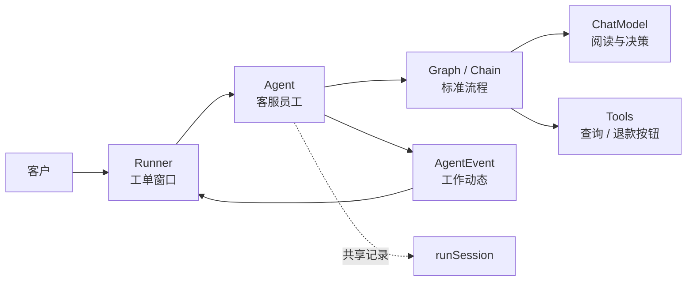

# 先理解这些概念

如果直接打开 `adk/chatmodel.go`，很容易把 Agent、模型、Runner、Graph、Tool 混为一谈。先用一个生活化例子建立概念，再看代码会容易很多。

## 一个客服系统的比喻

假设要做一个“能查询订单、申请退款”的客服助手：

- **ChatModel** 像负责阅读和写作的大脑。它能根据文字推断下一步，但自己不能访问订单数据库。
- **Tool** 像“查询订单”和“提交退款”两个业务按钮。它们真正执行外部操作。
- **Agent** 像一名客服员工。员工拥有名字、职责，收到用户请求后持续报告自己的工作过程。
- **ChatModelAgent** 是一种由大模型驱动的客服员工。它让模型决定何时按哪个业务按钮，并把结果再次交给模型判断。
- **Runner** 像客服系统的工单窗口。应用从这里发起一次服务、接收过程事件，并在需要人工审批时保存/恢复工单。
- **Graph / Chain** 像员工内部的标准操作流程。它描述先问模型、再执行工具、然后是否继续问模型。
- **AgentEvent** 像工作动态：正在回答、工具返回了结果、要转给退款专员、等待主管审批、或者发生错误。
- **runSession** 像这张工单的共享记录，保存原始问题、已发生事件和流程变量。

最重要的一点是：这些对象不是同一层的不同叫法，而是在不同层承担不同责任。



把代码名和生活化角色一一对应后，再读后面的接口：Runner 接收工单，Agent 持续工作，Graph 是内部步骤，ChatModel 负责判断，Tool 执行动作，AgentEvent 向外报告过程。

## ChatModel 只是一次模型调用

经典消息路径中的 `model.BaseChatModel` 职责可以简化理解为：

```text
一组 Message
   ↓
模型推理
   ↓
一个 Assistant Message（可能包含 ToolCall）
```

普通 ChatModel 不会自动执行 ToolCall。它返回的只是结构化意图，例如：

```json
{
  "name": "get_order",
  "arguments": "{\"order_id\":\"A100\"}"
}
```

如果应用只调用 `ChatModel.Generate`，还必须自己解析 ToolCall、调用工具、构造 ToolMessage、重新调用模型，并处理循环上限和流式输出。`AgenticModel` 是另一条协议：它使用 `AgenticMessage.ContentBlocks`，工具语义由模型侧处理，详见 [Typed Agent 与 AgenticMessage](./typed-agent-agentic.md)。

## Tool 只是一个可调用能力

Tool 知道怎样完成一项具体操作。它不决定自己何时被调用，也不了解完整对话。

```text
JSON arguments → InvokableRun → string result
JSON arguments → StreamableRun → StreamReader[string]
```

例如查询订单工具只关心 order_id，并返回订单数据。是否需要查询、查询结果够不够、下一步是否退款，由上层 Agent 决定。

## Agent 是一个事件生产者

Eino ADK 对 Agent 的最低要求不是“必须使用大模型”，而是：有名字、描述，并能根据输入持续产生事件。

```go
type TypedAgent[M MessageType] interface {
    Name(ctx context.Context) string
    Description(ctx context.Context) string
    Run(ctx context.Context, input *TypedAgentInput[M],
        options ...AgentRunOption) *AsyncIterator[*TypedAgentEvent[M]]
}

type Agent = TypedAgent[*schema.Message]
```

因此以下对象都可以是 Agent：

- 调用大模型和工具的 ChatModelAgent；
- 固定返回一段文本的规则 Agent；
- 调用内部 HTTP 服务的 Agent；
- 依次执行多个 Agent 的 SequentialAgent；
- 同时执行多个 Agent 的 ParallelAgent；
- 用户自己实现的业务 Agent。

“Agent”描述的是协议，不限定实现方式。

## ChatModelAgent 是 Agent 的一种实现

`ChatModelAgent` 是经典 Message 路径的便利别名，并实现 `Agent` 和 `ResumableAgent`。`TypedChatModelAgent[*schema.AgenticMessage]` 则走 AgenticModel 路径。它们额外知道：

- 怎样把 AgentInput 变成模型 messages；
- 怎样把 tool schema 绑定到模型；
- 怎样构建 Model ↔ Tools 的 ReAct Graph；
- 怎样由 event sender wrappers 生成 AgentEvent，并暴露 Agent callback；
- 怎样把 Exit / Transfer 变成控制动作；
- 怎样把 compose Graph 的中断桥接到 ADK。

所以关系是：

```text
Agent（接口）
  ├─ ChatModelAgent（大模型驱动实现）
  ├─ workflowAgent（组合实现）
  └─ 你的自定义 Agent（任意实现）
```

不能说“Agent 调用 ChatModelAgent”作为普遍规律；更准确的是“Runner 执行一个 Agent，而这个 Agent 可能恰好是 ChatModelAgent”。

## Runner 是执行入口，不是 Agent

Runner 不实现 `Agent` 接口，也没有 Name/Description。它持有一个根 Agent：

```go
type Runner = TypedRunner[*schema.Message]
```

Runner 做的是应用层生命周期管理：

- 把 query 包装成 AgentInput；
- 创建全新的 runSession；
- 给 Agent 加上 flowAgent 包装层；
- 把 session values 注入 context；
- 返回事件 iterator；
- 捕获根中断并保存 checkpoint；
- 从 checkpoint 恢复。

Runner 不决定调用哪个 Tool，也不会直接调用 ChatModel。

## flowAgent 是内部适配层

用户通常不会主动创建 `flowAgent`，但每次 Runner 执行时都会通过 `toFlowAgent` 包装根 Agent。它解决的是“一个普通 Agent 如何进入多 Agent 系统”：

- 添加 RunPath 和执行 Address；
- 从共享 session 重建当前 Agent 的输入；
- 复制并记录事件；
- 处理 TransferToAgent；
- 找到中断树中应该恢复的子 Agent。

可以把它理解为 Agent 的“运行时外壳”。ChatModelAgent 是业务实现，flowAgent 是框架适配器。

## Graph 是 Agent 内部实现工具

`compose.Graph` 和 `adk.Agent` 都能表达流程，但层级不同：

| 对比 | compose Graph | ADK Agent |
| --- | --- | --- |
| 基本单位 | Component / Lambda | AgentEvent |
| 典型输入输出 | 泛型 I → O | AgentInput → 事件序列 |
| 控制结构 | Edge / Branch / State | Action / Transfer / Workflow |
| 流式 | Runnable 四种范式 | MessageVariant 中的 stream |
| 恢复 | 节点/channel/task | Agent 树、session、子中断 |

ChatModelAgent 内部用 Graph 实现 ReAct，但自定义 Agent 完全可以不用 Graph。

## “流式”有两个层面

小白最容易混淆：Agent 本来就返回多个 AgentEvent，那 `EnableStreaming` 还有什么用？

- **事件级异步**：无论是否 streaming，一个 Agent 都通过 iterator 返回多条事件，例如模型事件、工具事件、最终事件。
- **消息内容流式**：`EnableStreaming=true` 时，一条 Assistant/Tool 事件内部可能携带 MessageStream，文本 chunk 逐步到达。

因此非流式 ChatModelAgent 仍可能产生多条事件，只是每条消息是完整 Message。

## “历史”也有三个层面

| 层面 | 保存什么 | 位置 |
| --- | --- | --- |
| ReAct State | 当前 ChatModelAgent 内模型/工具循环的 messages | `adk.State.Messages` |
| Run Session | 整个 Agent 树已发生的事件和 KV | `runSession` |
| 外部业务存储 | 跨请求的对话、用户资料、订单状态 | 应用数据库 |

Runner.Run 每次建立新 session，不会自动加载昨天的对话。跨请求记忆需要应用读取数据库，把历史 Message 传入 Run，或用自己的 session/persistence 层管理。

## 一张最终关系图

```text
你的应用
  │
  │ 创建 Runner(root Agent)
  ▼
Runner ──创建──> runContext / runSession
  │
  │ 包装
  ▼
flowAgent ──执行──> Agent 接口实现
                       │
                       ├─ 如果是 ChatModelAgent
                       │      └─ Chain → ReAct Graph
                       │                    ├─ ChatModel
                       │                    └─ ToolsNode → Tool
                       │
                       ├─ 如果是 workflowAgent
                       │      └─ 子 flowAgent...
                       │
                       └─ 如果是自定义 Agent
                              └─ 自己产生 AgentEvent
```

## 什么时候直接用哪一个

- 只想调用一次模型：直接使用 ChatModel 组件；
- 想让模型自主使用工具：创建 ChatModelAgent；
- 想组合多名 Agent：使用 SetSubAgents、Workflow 或 Prebuilt；
- 想从 Web/CLI 发起执行、消费事件：创建 Runner；
- 想完全掌控业务逻辑：实现 Agent 接口；
- 想表达类型化组件数据流：使用 compose Graph/Chain/Workflow。
