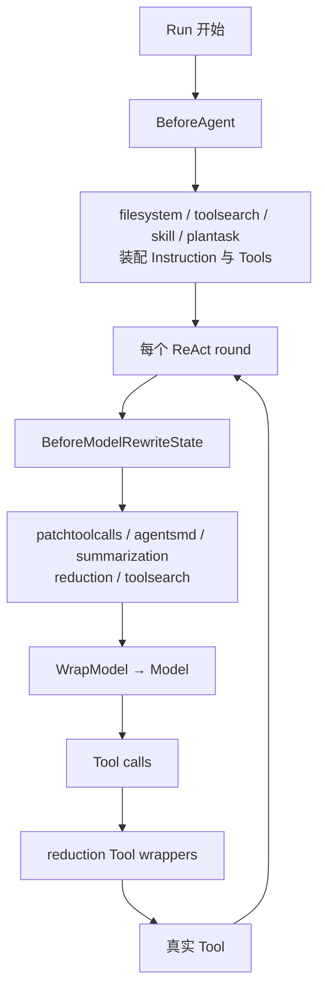
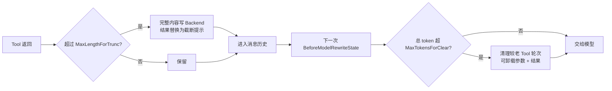
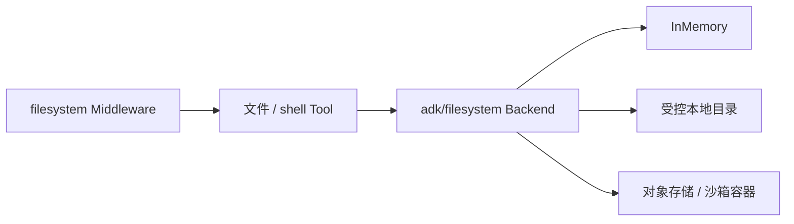

# 内置 Middleware：八类能力、执行阶段与选型

当前 `adk/middlewares` 不再只有旧版 reduction、filesystem、skill。最新源码包含八个能力族，而且绝大多数已经实现为 `ChatModelAgentMiddleware` / `TypedChatModelAgentMiddleware[M]`。

::: tip 先建立正确认识
“都是 Middleware”只说明它们接在同一扩展协议上，并不说明它们做同一种事。判断一个功能应放在哪里，必须同时看：它能拿到什么数据、在什么阶段执行、修改是否持久化、失败会中止哪一层。
:::

## 1. 全景表

| 包 | 主要目的 | 主要 Hook | 能看到/修改什么 | 推荐场景 |
| --- | --- | --- | --- | --- |
| `patchtoolcalls` | 补齐悬空 tool call | `BeforeModelRewriteState` | 模型调用前的消息历史 | 恢复、裁剪或 provider 历史导致 tool call/result 不配对 |
| `agentsmd` | 注入 Agents.md | `BeforeModelRewriteState` | 当前 Agent 的模型历史 | 项目规则、编码规范；注意当前实现会写入本次 Agent state |
| `summarization` | 超阈值生成语义摘要 | `BeforeModelRewriteState` | 全历史、ToolInfo、摘要模型 | 长对话压缩、保留语义 |
| `reduction` | 截断/卸载/清理 Tool 内容 | Tool wrappers + `BeforeModelRewriteState` | 即时 Tool 结果和历史 tool 轮次 | 大结果保护、确定性上下文缩减 |
| `filesystem` | 注入文件/可选 shell 工具 | `BeforeAgent` | Instruction、Tools | 让 Agent 获得工作区能力 |
| `dynamictool/toolsearch` | 动态暴露大型工具集 | `BeforeAgent` + `BeforeModelRewriteState` | Tools、ToolInfo、消息与 run-local | 数十/数百个工具按需发现 |
| `skill` | 渐进加载和执行 SKILL.md | `BeforeAgent` + `WrapModel` | Instruction、Tools、RunLocal、Model | 可复用能力包、fork 子 Agent、模型切换 |
| `plantask` | 注入结构化任务工具 | `BeforeAgent` | Tools、Backend | 编码/复杂任务的计划跟踪 |



<p class="diagram-caption">`BeforeAgent` 是一次 Run 的装配层；`BeforeModelRewriteState` 每个模型轮次都会执行；Tool wrapper 只包围工具端点。</p>

## 2. 推荐构造方式

经典 `*schema.Message` 路径：

```go
mw, err := summarization.New(ctx, &summarization.Config{ /* ... */ })

agent, err := adk.NewChatModelAgent(ctx, &adk.ChatModelAgentConfig{
    Name:     "assistant",
    Model:    chatModel,
    Handlers: []adk.ChatModelAgentMiddleware{mw},
})
```

AgenticMessage 路径使用泛型构造器：

```go
mw, err := summarization.NewTyped[*schema.AgenticMessage](ctx,
    &summarization.TypedConfig[*schema.AgenticMessage]{ /* ... */ },
)

agent, err := adk.NewTypedChatModelAgent(ctx,
    &adk.TypedChatModelAgentConfig[*schema.AgenticMessage]{
        Model:    agenticModel,
        Handlers: []adk.TypedChatModelAgentMiddleware[*schema.AgenticMessage]{mw},
    },
)
```

`ChatModelAgentConfig.Middlewares []AgentMiddleware` 仍存在，但已经 Deprecated；新代码应放进 `Handlers`。某些包仍保留旧构造器，只用于兼容。

## 3. patchtoolcalls：修复消息协议完整性

模型历史中常见这一种坏状态：assistant 产生了 tool call，但后面没有同 `call_id` 的 tool result。某些 provider 会拒绝整个请求。

```text
assistant: tool_call(id=42, name=search)
user:      继续
            ↑ 缺少 tool_result(id=42)
```

`patchtoolcalls` 在每次模型调用前扫描历史，并为悬空调用插入占位结果。它支持两种消息协议：

- `schema.Message`：匹配 `Assistant.ToolCalls` 与后续 `Tool` message；
- `schema.AgenticMessage`：匹配 function-tool-call/result ContentBlock。

默认生成普通文本结果，也可通过 `PatchedToolResultGenerator` 根据工具名、call ID 和原始参数生成 plain Content 或 EnhancedTool 的 `ToolResult`。

适合：历史恢复、人工编辑历史、异常中断后的协议修复。它不是业务重试，也不会重新执行缺失的工具。

## 4. agentsmd：注入项目规则，以及一个源码语义陷阱

`agentsmd` 每个模型轮次从 Backend 加载指定 Agents.md，并在第一条 User message 前插入带内部 Extra 标记的消息。

按当前可执行实现，关键语义是：

1. 注入发生在 `BeforeModelRewriteState`；
2. Middleware 返回带注入消息的新 state，`typedStateModelWrapper` 随后执行 `st.Messages = state.Messages`，所以消息会留在**当前 ChatModelAgent 的 ReAct state**，后续模型轮次和 checkpoint 都可能看到；
3. 同一 Run 通过 run-local cache 避免每轮重复读取；
4. Extra 标记保证幂等，不会一轮一轮累加；
5. 支持 `@import`，最大递归深度为 5；
6. 可设置单文件和总字节预算。

这里必须区分两种“持久”：注入消息不会自己变成一个对外 `AgentEvent`，因此不会仅凭该 Middleware 就成为应用层跨 Query 的长期 conversation memory；但它确实被写回当前 Agent 内部 state。测试中的二次调用直接复用第一次返回的 state，并依靠 Extra marker 避免重复；这也佐证它不是“仅给一次底层 Model 调用看的临时参数”。

源码包注释声称注入是 transient、不会持久化、会自然排除在 summarization 之外，并建议把它放在 summarization 之后；但这与当前 wrapper 的 state 写回路径并不完全一致。放在 summarization 后面只能保证**本轮新插入**发生在本轮摘要之后；若上一轮 marker 消息仍在 state，本轮 summarization 仍可能看到它。源码测试甚至显式模拟“被 summarization 删除 marker 后再插入”。

因此，在当前版本不要把“绝不会进入摘要”当成稳定保证：

- 若规则进入摘要也可接受，可按源码建议把 `summarization` 放前、`agentsmd` 放后；
- 若必须严格排除，应定制 summarization 的输入过滤，或增加一个明确区分“模型临时视图”和“持久 state”的 Middleware；
- 不要把 Agents.md 当成用户记忆。它仍是项目约束，只是当前实现的内部 state 生命周期比包注释描述得更长。

## 5. summarization：语义压缩而不是机械删除

### 5.1 它在什么时候触发

每次模型调用前，Middleware 用 `TokenCounter` 统计消息与工具，满足 `TriggerCondition` 后调用独立的 summary model。

默认 token counter 会参考最后一条 assistant usage，并对增量内容做约 4 chars/token 的估算；严格窗口控制应传入与 provider 一致的 tokenizer。

### 5.2 它能做什么

`TypedConfig[M]` 的关键职责包括：

| 配置 | 作用 |
| --- | --- |
| `Model` / `ModelOptions` | 真正执行摘要的模型 |
| `TokenCounter` / `Trigger` | 何时触发 |
| `GenModelInput` | 怎样构造摘要模型输入 |
| `GetFailoverModel` | 摘要模型失败时切换模型与输入 |
| `Finalize` | 把原历史与 summary 合成为新历史 |
| `TranscriptFilePath` | 告诉主模型完整记录的位置 |
| `EmitInternalEvents` | 发出 before/generate/after 内部事件 |
| `Callback` | 观察摘要前后 state |

它还提供 `TypedFinalizerBuilder`，用于更精确地选择保留哪些近期消息、怎样插入 summary。

### 5.3 为什么 Summary 适合 Middleware

Summary 需要：看到完整模型历史、在模型调用前替换本轮 state、可能调用另一个 Model、又不能伪装成普通业务 Tool。`BeforeModelRewriteState` 正好拥有这些信息与时机。

若摘要是用户明确请求的业务产物，例如“生成一份会议总结文件”，应使用 Tool 或独立 Agent；那不是上下文维护。

## 6. reduction：两阶段的确定性缩减

新版 reduction 已不只是旧 `ClearToolResult`。它把保护上下文拆成两个阶段：



### 6.1 Truncation：刚返回就保护

四类 Tool endpoint 都有 wrapper：普通/Enhanced × invoke/stream。它解决“单个结果立即撑爆上下文”。可为不同工具配置独立 `ToolReductionConfig` 和自定义 `TruncHandler`。

### 6.2 Clear：历史过长再清理

`BeforeModelRewriteState` 统计全历史，按完整 tool-call round 处理旧调用；可保留最近 N 轮、排除关键工具、要求一次至少清出若干 token，并通过 `ClearMessageRewriter` 改写被清理轮次。

重要字段：

- `Backend`：保存被卸载的原文；
- `ReadFileToolName`：提示模型怎样取回；
- `RootDir` / 两个 path generator：组织 trunc 与 clear 文件；
- `SkipTruncation` / `SkipClear`：只启用一个阶段；
- `ClearRetentionSuffixLimit`：保护近期 tool rounds；
- `ToolConfig`：按工具覆盖通用策略。

Reduction 不理解内容语义。它适合日志、搜索结果、代码输出等大块 Tool 数据；重要决策与用户偏好更适合 summary/memory。

## 7. filesystem：把文件能力装配进 Run

推荐的 `filesystem.New` / `NewTyped` 接收 `MiddlewareConfig`，在 `BeforeAgent` 中增加 instruction 和 tools：

- `ls`
- `read_file`
- `write_file`
- `edit_file`
- `glob`
- `grep`
- 可选 `execute`：配置 `Shell` 或 `StreamingShell` 时加入

`Shell` 与 `StreamingShell` 互斥。`UseMultiModalRead` 会把 read_file 变成 EnhancedInvokableTool，Backend 还必须实现相应多模态读取协议。

### Backend 的位置

真正的权限、路径隔离、存储和 shell sandbox 都属于 `adk/filesystem` Backend，而不是 Middleware。Middleware 只负责把这些能力暴露为工具。



旧 `filesystem.NewMiddleware(Config)` 返回 `AgentMiddleware` 并自带大结果卸载，属于兼容入口。新代码使用 Handler 版 filesystem，再用 reduction 统一处理大结果，职责更清晰。

## 8. dynamictool/toolsearch：大型工具集的渐进披露

把 200 个 ToolInfo 每轮都交给模型会浪费上下文，也降低选工具准确率。toolsearch 将工具分成“已可见”和“动态工具”：

1. `BeforeAgent` 加入 `tool_search` 元工具和动态工具实体；
2. 初始模型 ToolInfo 隐藏动态工具；
3. 模型调用 `tool_search`，匹配结果记录到 run-local；
4. 后续 `BeforeModelRewriteState` 只暴露匹配工具；
5. 同一 Run 内保持发现状态。

`UseModelToolSearch=true` 时交给支持原生 tool search 的模型；否则 Middleware 自己过滤 ToolInfo。后者会让每轮工具列表变化，可能破坏 provider KV cache。

适合大量“可能会用”但不是每轮都需要的工具。对于 5～10 个核心工具，直接装配通常更简单。

## 9. skill：渐进加载、fork 与模型覆盖

Skill Backend 分成：

```go
type Backend interface {
    List(context.Context) ([]FrontMatter, error)
    Get(context.Context, string) (Skill, error)
}
```

List 只提供 name/description 等 frontmatter，模型选择后才 Get 完整 SKILL.md，因此不会把所有说明永久塞进上下文。

### 三种执行方式

| frontmatter context | 行为 | 历史 |
| --- | --- | --- |
| 空 | inline：把 Skill 内容作为 Tool result 返回 | 主 Agent 继续 |
| `fork` | 用 `AgentHub` 创建子 Agent | 默认不带父历史 |
| `fork_with_context` | 创建子 Agent | 带父历史与当前 tool call |

frontmatter 还可指定 `agent` 和 `model`。`ModelHub` 解析模型名；inline 模式可通过 run-local active model + `WrapModel` 改变后续模型，fork 模式则把解析出的模型传给 `AgentHub.Get`。

`NewMiddleware` 是经典消息推荐入口；`NewTyped` 支持两类消息。`New` 返回旧 AgentMiddleware，已 Deprecated，而且无法支持需要历史的 fork 模式。

Skill 的文件 Backend 适配器现位于 `skill/filesystem_backend.go`，构造器是 `NewBackendFromFilesystem`；旧 `skill/local.go` 已不存在。

## 10. plantask：计划是结构化状态，不只是提示词

plantask 在 `BeforeAgent` 增加四个工具：TaskCreate、TaskGet、TaskUpdate、TaskList。状态写入用户提供的 Backend，并以 `BaseDir` 隔离工作目录。

它适合需要跨多个模型轮次维护任务树的编码 Agent。相比“请先列计划”的 system prompt，结构化 Tool 可以：

- 更新单个任务状态而不是重写整段文本；
- 由 UI 或外部程序读取；
- 在上下文缩减后重新查询；
- 把计划状态与对话文本分开存储。

它不是通用调度器，也不会自动决定下一任务；选择和执行仍由模型完成。

## 11. 组合顺序为什么有意义

Handler 按配置顺序进入 hook 链，因此多个 state rewriter 的先后会改变输入。一个常见组合是：

```go
Handlers: []adk.ChatModelAgentMiddleware{
    patchMW,       // 先修好消息协议
    summaryMW,     // 再对真实会话做语义压缩
    reductionMW,   // 再做确定性 Tool 历史保护
    agentsMDMW,    // 最后注入项目规则；只保证本轮新注入晚于本轮摘要
    filesystemMW,  // Run 级工具装配
    skillMW,
    planTaskMW,
}
```

这不是唯一合法顺序，但每次调整都应回答：后一个 Middleware 应该看到前一个改写前还是改写后的 State？需要被 summary 压缩吗？其内容是否只应对当次模型调用可见？

## 12. 按功能选组件，而不是“都能做就都一样”

| 需求 | 最合适组件 | 原因 |
| --- | --- | --- |
| 跨请求保存用户偏好 | Store/Memory + history loader | 生命周期跨 Run，Middleware run-local 不够 |
| 模型窗口快满时压缩语义 | summarization Middleware | 每个模型调用前能看完整 history |
| 单个 Tool 结果太大 | reduction Tool wrapper | 结果产生当下即可拦截 |
| 项目规则每轮都要看到 | agentsmd Middleware | 每轮模型前保证存在；当前实现会写回本次 Agent state，但不会自行产生长期记忆事件 |
| 用户明确要求生成摘要报告 | Tool 或专门 Agent | 这是业务产物，不是运行时维护 |
| 审计每次模型/Tool 调用 | Callback | 观察为主，不应改写业务语义 |
| 给 Agent 增加文件能力 | filesystem Middleware | Run 开始时统一装配 instruction + tools |
| 数百工具按需发现 | toolsearch Middleware | 需要跨 round 保存可见工具集合 |
| 可复用流程说明和子 Agent | skill Middleware | 有目录、按需加载和 fork 协议 |
| 结构化待办 | plantask Middleware | 独立 Backend 比聊天文本稳定 |

## 13. 源码阅读路线

1. `adk/handler.go`：先理解八个 Hook；
2. `patchtoolcalls` 和 `agentsmd`：最简单的 state rewrite；
3. `summarization`：会调用 Model 的复杂 rewrite；
4. `reduction`：同时跨 Tool endpoint 与 model state；
5. `filesystem`、`plantask`：Run 级能力装配；
6. `dynamictool/toolsearch`：run-local 跨 round 状态；
7. `skill`：Tool、子 Agent、Model 切换的综合案例。

配合 [Middleware 新旧 API](./middleware-current.md) 阅读，可以把“这个包实现了什么”对应到“它为什么选择这个执行阶段”。
