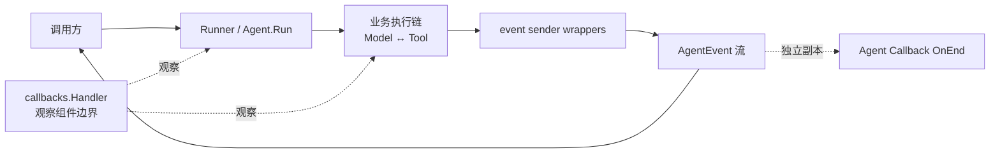
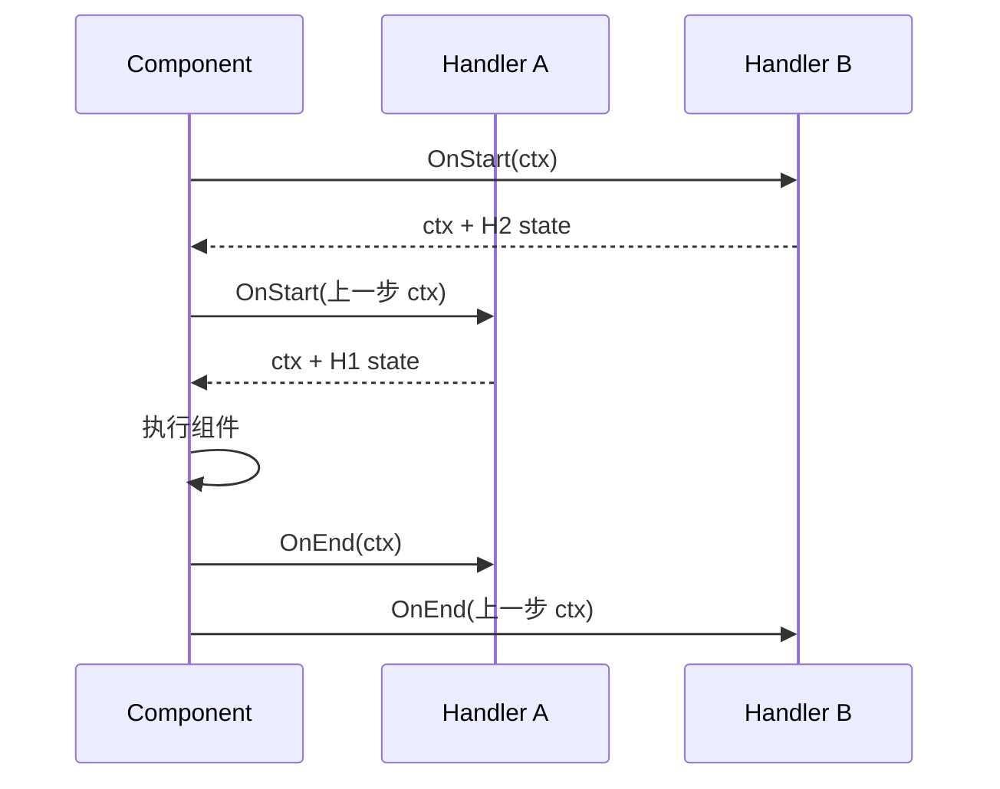
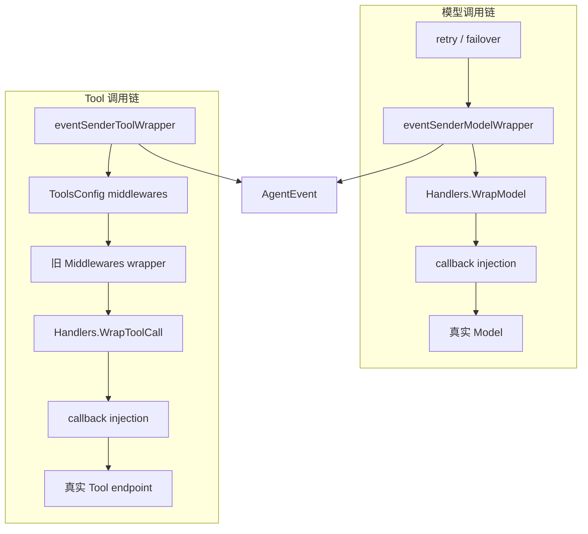
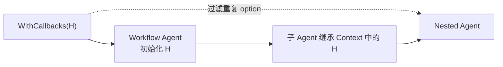

# Callback 与 AgentEvent：观察链和业务事件流不是一回事

很多人第一次读 ADK 时，会把 Callback 和 `AgentEvent` 理解成同一套机制：模型、Tool 执行后触发 Callback，再由 Callback 把结果转换成事件。**当前源码不是这样工作的。**

先记住最重要的结论：

- `callbacks.Handler` 是通用组件观察机制，适合 tracing、metrics、日志、审计；
- `AgentEvent` 是 Agent 对调用方输出的业务事件流，承载模型消息、Tool 结果、动作、错误、中断等；
- ChatModelAgent 使用独立的 event sender wrappers 产生模型和 Tool 的 `AgentEvent`；
- `adk.WithCallbacks` 提供的是 **Agent 级 Callback**：`OnStart` 看本次输入，`OnEnd` 得到一份独立的事件迭代器；它不是生成这些事件的那条链。

## 1. 先把三条链分开



<p class="diagram-caption">实线是业务数据流；虚线是观察关系。Callback 能看到执行，但默认不承担 Model/Tool 结果到 AgentEvent 的转换。</p>

### 1.1 业务执行链

它真正决定 Agent 做什么：准备消息、调用模型、执行 Tool、更新 ReAct state、继续下一轮或结束。

### 1.2 AgentEvent 输出链

它把执行过程暴露给 Runner、用户界面、上层 Agent 或 AgentTool。模型输出和 Tool 结果主要由 `eventSenderModelWrapper`、`eventSenderToolWrapper` 写入事件流。

### 1.3 Callback 观察链

它围绕组件调用触发，不改变组件的业务返回值。典型用途是耗时统计、Token 用量、链路追踪、错误计数和合规审计。

三条链会在 Context 中相遇，也可能观察相同的数据，但职责和所有权不同。

## 2. 通用 Callback 的五个执行时机

`callbacks.Handler` 有五个方法：

```go
type Handler interface {
    OnStart(ctx context.Context, info *RunInfo, input CallbackInput) context.Context
    OnEnd(ctx context.Context, info *RunInfo, output CallbackOutput) context.Context
    OnError(ctx context.Context, info *RunInfo, err error) context.Context
    OnStartWithStreamInput(
        ctx context.Context,
        info *RunInfo,
        input *schema.StreamReader[CallbackInput],
    ) context.Context
    OnEndWithStreamOutput(
        ctx context.Context,
        info *RunInfo,
        output *schema.StreamReader[CallbackOutput],
    ) context.Context
}
```

| 时机 | 什么时候执行 | 能拿到什么 | 典型用途 |
|---|---|---|---|
| `OnStart` | 非流式组件开始前 | `RunInfo`、组件定义的输入 | 开始 span、记录请求大小 |
| `OnEnd` | 非流式组件成功后 | `RunInfo`、组件定义的输出 | 结束 span、统计 Token/结果大小 |
| `OnError` | 组件直接返回非 nil error | `RunInfo`、error | 错误计数、告警 |
| `OnStartWithStreamInput` | 组件接收流式输入时 | 输入流的独立副本 | 统计输入 chunk |
| `OnEndWithStreamOutput` | 组件返回流式输出时 | 输出流的独立副本 | 首 Token 延迟、chunk/Token 统计 |

::: warning 流中的错误不等于 OnError
`OnError` 处理的是组件调用直接返回的 error。组件已经成功返回 `StreamReader` 后，消费流时出现的错误存在于流中，不会重新触发这次调用的 `OnError`。需要在读取流的地方处理。
:::

## 3. `RunInfo` 告诉 Callback “正在观察谁”

`RunInfo` 的核心字段是：

```go
type RunInfo struct {
    Name      string
    Type      string
    Component components.Component
}
```

- `Name`：业务名称；Graph 节点通常是 node name；
- `Type`：实现类型，例如模型实现的类型；
- `Component`：组件类别，例如 ChatModel、Tool、Agent、AgenticAgent、Graph；
- `RunInfo` 可能为 nil，Handler 不能无条件解引用。

Callback 不应该依赖“某个 Handler 一定先于另一个 Handler”。公开接口注释明确不承诺不同 Handler 之间的稳定顺序语义。需要筛选目标时，应根据 `RunInfo.Component`、`Name`、`Type` 判断。

## 4. Context 是怎样在 Callback 内传播的

Handler 可以用返回的 Context 在开始与结束阶段之间传状态。当前 `internal/callbacks/inject.go` 的实现会把同一 timing 中前一个 Handler 返回的 Context 传给下一个，并采用开始阶段逆序、结束/错误阶段正序，形成包围关系：



关键限制：

- 上图只展示当前内部顺序，不是可以依赖的跨 Handler 业务协议；
- 全局 Handler 与单次调用 Handler 还会组成外内层，开始/结束方向不同；
- 使用 Context 传递本 Handler 所需的轻量 tracing state 是合理的；
- 不要把 Handler A → Handler B 的偶然 Context 可见性当成稳定业务通信通道；
- 不要通过 Handler 顺序实现业务编排；
- 跨 Handler 共享数据时，应使用明确且并发安全的外部对象。

::: warning 源码注释与当前实现的边界
公开 `callbacks.Handler` 注释要求调用方不要假设不同 Handler 的顺序或 Context 链；当前内部实现确实有确定的逆序 start / 正序 end 循环。文档同时给出实现事实和使用契约：可用单个 Handler 的 Context 做 span 配对，但不要让业务正确性依赖多个 Handler 的注册顺序。
:::

一个耗时统计 Handler：

```go
type startedAtKey struct{}

handler := callbacks.NewHandlerBuilder().
    OnStartFn(func(
        ctx context.Context,
        info *callbacks.RunInfo,
        input callbacks.CallbackInput,
    ) context.Context {
        return context.WithValue(ctx, startedAtKey{}, time.Now())
    }).
    OnEndFn(func(
        ctx context.Context,
        info *callbacks.RunInfo,
        output callbacks.CallbackOutput,
    ) context.Context {
        startedAt, ok := ctx.Value(startedAtKey{}).(time.Time)
        if ok {
            log.Printf("component=%v cost=%s", info, time.Since(startedAt))
        }
        return ctx
    }).
    Build()
```

## 5. 不要直接断言 `CallbackInput` 的类型

`CallbackInput` / `CallbackOutput` 是 `any` 的别名。真正类型由组件定义：

- Model Callback 使用 model 包定义的输入输出；
- Tool Callback 使用 Tool 组件定义的输入输出；
- Agent Callback 使用 `adk.AgentCallbackInput/Output`；
- Agentic Agent 使用泛型 `TypedAgentCallbackInput/Output`。

应使用组件提供的转换函数：

```go
handler := callbacks.NewHandlerBuilder().
    OnStartFn(func(
        ctx context.Context,
        info *callbacks.RunInfo,
        input callbacks.CallbackInput,
    ) context.Context {
        modelInput := model.ConvCallbackInput(input)
        if modelInput == nil {
            return ctx // 不是 Model callback
        }
        log.Printf("model messages=%d", len(modelInput.Messages))
        return ctx
    }).
    Build()
```

不要写 `input.(*model.CallbackInput)`：一个全局 Handler 会遇到很多组件类型，直接断言很容易 panic。

## 6. Callback 怎样挂载

当前有三种常见挂载范围。

### 6.1 进程级全局 Callback

```go
callbacks.AppendGlobalHandlers(traceHandler, metricsHandler)
```

它适合全局 tracing/metrics。注意：

- 应在进程初始化阶段调用；
- `AppendGlobalHandlers` 本身不是并发安全的；
- 不要在请求处理中反复追加，否则会重复触发并产生数据竞争风险。

### 6.2 Compose 单次执行 Callback

```go
out, err := runnable.Invoke(
    ctx,
    input,
    compose.WithCallbacks(handler),
)
```

还可以用 `DesignateNode` 限定 Graph 节点。它适合只观察一次 Runnable 执行或一个指定节点。

### 6.3 ADK Agent 单次运行 Callback

```go
events := runner.Run(
    ctx,
    messages,
    adk.WithCallbacks(agentHandler),
)
```

`adk.WithCallbacks` 是 `AgentRunOption`，可继续用 `DesignateAgent` 指定 Agent：

```go
opt := adk.WithCallbacks(agentHandler).DesignateAgent("researcher")
```

它在 Agent 边界触发，输入输出类型与普通 Model Callback 不同。

## 7. Agent Callback 到底能拿到什么

### 7.1 `OnStart`：新运行和恢复二选一

```go
type AgentCallbackInput struct {
    Input      *AgentInput
    ResumeInfo *ResumeInfo
}
```

- 新 `Run`：`Input != nil`，`ResumeInfo == nil`；
- `Resume`：`Input == nil`，`ResumeInfo != nil`。

```go
agentHandler := callbacks.NewHandlerBuilder().
    OnStartFn(func(
        ctx context.Context,
        info *callbacks.RunInfo,
        input callbacks.CallbackInput,
    ) context.Context {
        in := adk.ConvAgentCallbackInput(input)
        if in == nil {
            return ctx
        }
        switch {
        case in.Input != nil:
            log.Printf("agent %s starts a new run", info.Name)
        case in.ResumeInfo != nil:
            log.Printf("agent %s resumes", info.Name)
        }
        return ctx
    }).
    Build()
```

### 7.2 `OnEnd`：拿到独立的 AgentEvent iterator

```go
type AgentCallbackOutput struct {
    Events *AsyncIterator[*AgentEvent]
}
```

每个 Handler 得到独立副本。这里有一个很反直觉但非常重要的要求：**必须异步消费。**

Agent 的 `OnEnd` 不能按“所有事件已经产生完”来理解。当前 `flowAgent.run` 会先创建 Callback 专用 iterator、调用 `OnEnd` 把 iterator 交给 Handler，然后才进入转发事件的循环：

```text
创建 callback iterator
  → 调用 Agent Callback OnEnd(iterator)
    → Handler 启动异步消费者并立即返回
      → flowAgent 开始把后续 AgentEvent 写入该 iterator
        → 运行结束时关闭 iterator
```

因此这里的 `OnEnd` 表示“组件输出对象已经建立”；由于输出对象本身是流，它不是“流内所有值已经结束”。真正完成通知是 `Events.Next()` 返回 `ok=false`。

```go
agentHandler := callbacks.NewHandlerBuilder().
    OnEndFn(func(
        ctx context.Context,
        info *callbacks.RunInfo,
        output callbacks.CallbackOutput,
    ) context.Context {
        out := adk.ConvAgentCallbackOutput(output)
        if out == nil || out.Events == nil {
            return ctx
        }

        go func(iter *adk.AsyncIterator[*adk.AgentEvent]) {
            for {
                event, ok := iter.Next()
                if !ok {
                    return
                }
                // 写审计日志、统计 AgentEvent；生产环境还需错误处理和背压策略
                log.Printf("agent event: %#v", event)
            }
        }(out.Events)

        return ctx
    }).
    Build()
```

为什么不能在 `OnEnd` 里同步读完？因为这时事件转发循环还没有开始；同步等待第一个事件就可能直接死锁。必须启动 goroutine 后立即从 `OnEnd` 返回。

### 7.3 Agentic Agent 的类型

Agentic 消息路径使用：

```go
*adk.TypedAgentCallbackInput[*schema.AgenticMessage]
*adk.TypedAgentCallbackOutput[*schema.AgenticMessage]
```

通过 `adk.ConvTypedCallbackInput[M]`、`adk.ConvTypedCallbackOutput[M]` 转换。`RunInfo.Component` 分别使用 `ComponentOfAgent` 和 `ComponentOfAgenticAgent`，便于统一 Handler 做类型分流。

### 7.4 Agent 错误主要在事件流里，不在 Agent Callback OnError

Agent 的公开返回值是异步 iterator，运行期间的业务错误、取消和中断都在事件中表达。`flowAgent` 的 Agent Callback 主链建立 `OnStart` 和带 iterator 的 `OnEnd`，不会把每个后续 `AgentEvent.Err` 重新变成 Agent 级 `OnError`。因此 Agent 级审计必须读取 `output.Events` 并检查 `event.Err`；Model/Tool 等同步组件直接返回 error 时，才按各自组件 Callback 的 `OnError` 路径观察。

## 8. AgentEvent 是在哪里产生的

模型事件和 Tool 结果事件由专门 wrapper 生成，而不是由 Callback 默认转换：



这里的 callback injection 只负责确保底层 Model/Tool 在自身没有实现 Callback 时仍能触发通用 Callback。它和 event sender 是相邻的两层，但不是同一层。

### 8.1 默认 event sender 位置

- Model event sender 默认位于用户 `WrapModel` 外侧，所以事件通常包含用户 wrapper 修改后的模型输出；
- Tool event sender 默认位于 Tool middleware 链最外侧，所以事件通常包含所有 Tool wrapper 处理后的结果；
- cancel monitor 位于 Tool 调用链更靠近 endpoint 的位置，负责尽快中断原始流。

### 8.2 自定义 event sender 位置

如果某个 Handler 显式加入：

```go
adk.NewEventSenderModelWrapper()
adk.NewEventSenderToolWrapper()
```

框架会跳过相应的默认 sender，避免重复事件。它在 Handler 列表中的位置，决定事件看到的是 wrapper 修改前还是修改后的结果。

```go
Handlers: []adk.ChatModelAgentMiddleware{
    auditHandler,                    // 外层
    adk.NewEventSenderToolWrapper(), // 在这里截取事件
    sanitizeHandler,                 // 内层，先修改 Tool 输出
},
```

注册顺序 `[A, B, C]` 的 wrapper 关系是 `A(B(C(endpoint)))`。返回路径反向经过 `C → B → A`，因此 sender 所在位置决定它能观察到哪些后处理结果。

## 9. Retry / Failover 与 Callback 边界

模型调用可能被 retry/failover 包裹。理解观察边界很重要：

- 外层 Callback/事件可能只看到最终成功或最终失败；
- 想统计每次底层模型 attempt，要把观测放到对应模型实现或更内层；
- 想统计用户感知的一次 Agent 模型轮次，应在较外层观察；
- 不要只看 Callback 次数就推断“模型只调用了一次”。

这也是 Callback 设计中必须先问清楚的一个问题：你要观测的是**业务调用**、**重试 attempt**，还是**整个 Agent run**？

## 10. Workflow Agent 为什么要过滤重复 Callback

Workflow 的子 Agent 继承父 Context，其中已经携带父层初始化的 Handler。如果再把同一个 `adk.WithCallbacks` option 原样传给内部 Agent，Handler 会被追加两次。

当前源码通过 `filterCallbackHandlersForNestedAgents` 过滤已经在当前 workflow Agent 应用过的 Callback option：



这个过滤只针对继承父 Context 的 nested workflow agents。`flowAgent` 的 transfer/sub-agent 是不同关系，不能把两者的 option 传播规则混为一谈。

## 11. Callback、Middleware、Tool、AgentEvent 应该怎么选

| 需求 | 最合适组件 | 原因 |
|---|---|---|
| 统计所有模型耗时与 Token | Callback | 跨组件、低侵入、天然有开始/结束边界 |
| 给模型每轮注入短期记忆 | Middleware 的 model state hook | 能读写当前消息与 ToolInfo；Callback 不应修改共享输入 |
| 运行开始按租户装配真实 Tool | `BeforeAgent` | 能同时改变模型可见 schema 和真实可执行 endpoint |
| 拦截 Tool 参数、做权限校验 | Tool wrapper | 执行点最接近 Tool，能阻止真实副作用 |
| 把进度发给 UI | `AgentEvent` | 它就是 Agent 的正式输出协议，支持流式消费 |
| 旁路保存完整 Agent 事件用于审计 | Agent Callback `OnEnd` | 每个 Handler 有独立事件流副本，不抢主消费者 |
| 持久化跨会话长期记忆 | 独立 memory/session repository，Middleware 负责读写时机 | Callback 适合观察，不应偷偷改变 Agent 的业务语义 |
| 对最终回答做业务后处理 | `AfterAgent` 或上层 Agent/Runner | 需要明确进入业务控制流，而不是放在观测链 |

判断原则不是“哪个组件都能勉强做到”，而是：

1. 这个阶段能拿到需要的信息吗？
2. 它有权修改业务数据或阻止副作用吗？
3. 执行频率是每个 Run、每轮 Model、每个 ToolCall，还是每个组件？
4. 失败应该影响主流程，还是只记录观测结果？

## 12. 常见错误

### 12.1 用 Callback 修改 Model 输入

Callback 输入输出通常由下游节点和多个 Handler 共享。源码明确要求不要修改这些值，否则并发执行时可能产生数据竞争。需要修改模型 state，用 Middleware state hook。

### 12.2 把业务权限放在 Callback

Callback 的定位是观察。Tool 权限必须放在 Tool wrapper 或执行端校验；否则很容易出现“日志说拒绝了，但 Tool 实际已经执行”的问题。

### 12.3 忘记关闭流式 Callback 的副本

`OnStartWithStreamInput`、`OnEndWithStreamOutput` 的 `StreamReader` 是复制出来的。Handler 消费后必须 `Close()`；不关闭会让上游资源和复制 goroutine 无法释放。

### 12.4 Agent Callback 同步读取 Events

应在 `OnEnd` 中立即启动 goroutine 异步消费并返回。同步等待流结束可能阻塞事件生产。

### 12.5 运行时追加全局 Handler

`AppendGlobalHandlers` 不是并发安全的，应在初始化阶段执行一次。

### 12.6 误以为 Callback 自动等价于 AgentEvent

通用 Callback 是观察协议；AgentEvent 是 Agent 输出协议；event sender wrappers 是两者之间邻近但独立的事件生产层。

## 13. 源码阅读路线

建议按下面顺序核对：

1. `callbacks/interface.go`：Handler、RunInfo、五种 timing；
2. `callbacks/handler_builder.go`：按需实现 timing；
3. `internal/callbacks/inject.go`：Context manager、开始/结束顺序、流复制；
4. `adk/callback.go`：Agent Callback 输入输出、Typed 转换、iterator copy；
5. `adk/call_option.go`：`WithCallbacks`、Agent 定向、nested workflow 去重；
6. `adk/flow.go`：Agent OnStart/OnEnd 怎样包围事件流；
7. `adk/wrappers.go`：Model/Tool Callback injection 与 event sender；
8. `adk/chatmodel.go`：完整 wrapper 顺序、retry/failover、默认 sender 插入位置。

下一步建议阅读 [执行阶段与组件选型](./component-positioning.md)，把 Callback 放回整个 Agent 生命周期中比较。
