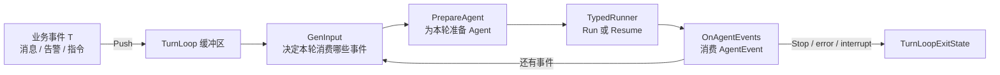
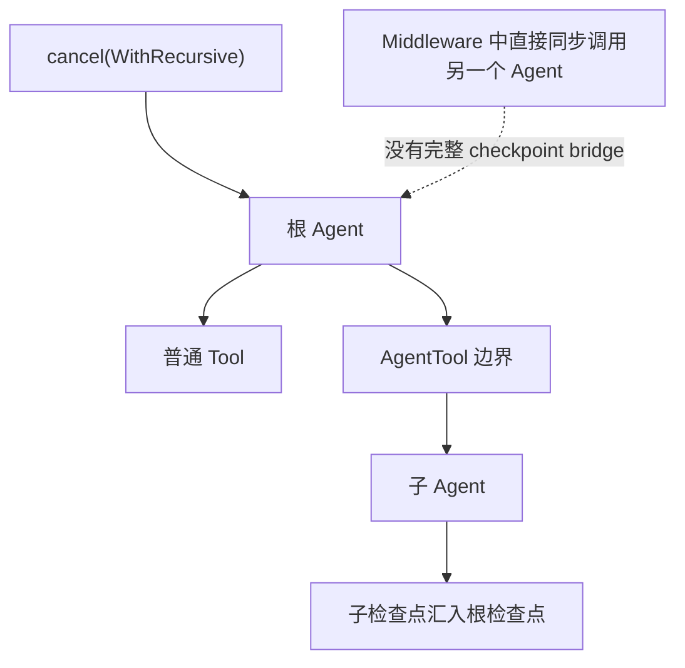

# Cancel 与 TurnLoop：从一次执行到持续运行的 Agent

普通 `Runner.Run` 解决的是“一次输入，运行到完成”。真实 Agent 服务还会遇到另外两类问题：

1. 用户点了停止，希望本轮尽快结束，但又不想破坏可恢复状态；
2. 新消息、告警或任务不断到来，需要缓冲、抢占当前轮、继续下一轮，并在进程重启后恢复。

当前源码分别用 `WithCancel` 和 `TurnLoop` 解决这两层问题。`TurnLoop` 不是 `LoopAgent` 的新名字：`LoopAgent` 是一个固定次数的组合 Agent；`TurnLoop` 是包在 Agent 外面的、可持续接收业务事件的运行循环。

## 1. 三个概念先分开

| 概念 | 控制对象 | 输入来源 | 生命周期 | 典型用途 |
| --- | --- | --- | --- | --- |
| `Runner.Run` | 一次 Agent 执行 | 一个 `AgentInput` | 执行结束即返回 | 聊天请求、单任务执行 |
| `LoopAgent` | 一组子 Agent | 一个 `AgentInput` | 最多循环 `MaxIterations` | reviewer ↔ writer、多 Agent 迭代 |
| `TurnLoop[T, M]` | 连续的多个 Agent turn | 多次 `Push(T)` | 显式 `Stop` 或上下文结束 | 常驻助手、实时事件、可抢占任务 |



<p class="diagram-caption">TurnLoop 不取代 Agent 或 Runner；它在 Runner 外增加业务事件缓冲、轮次规划、抢占、停止和跨进程恢复。</p>

## 2. 单次 Agent 的取消 API

### 2.1 建立取消能力

`WithCancel` 一次返回两个值：传给本次运行的 `AgentRunOption`，以及稍后由其他 goroutine 调用的取消函数。

```go
cancelOpt, cancel := adk.WithCancel()
events := runner.Run(ctx, messages, cancelOpt)

// 另一个 goroutine，例如 HTTP disconnect 或“停止生成”按钮：
handle, contributed := cancel(
    adk.WithAgentCancelMode(adk.CancelAfterChatModel),
    adk.WithAgentCancelTimeout(5*time.Second),
)
if contributed {
    cancelErr := handle.Wait()
    _ = cancelErr
}
```

`contributed` 不是“取消成功”的最终结果。它表示这次调用的选项是否赶在取消状态定型前被合并进去。最终结果由 `handle.Wait()` 给出。

### 2.2 三种取消时机

| `CancelMode` | 何时中止 | 优点 | 代价 |
| --- | --- | --- | --- |
| `CancelImmediate` | 收到信号后立即协作式终止 | 响应最快 | 可能在模型流或工具中间停止 |
| `CancelAfterChatModel` | 下一次模型调用完成后 | 保留完整模型输出边界 | 慢模型调用期间仍要等待 |
| `CancelAfterToolCalls` | 当前一组工具调用完成后 | 不留下半执行工具轮次 | 慢工具期间仍要等待 |

`CancelMode` 是位掩码。下面表示到达任一安全点即取消：

```go
adk.WithAgentCancelMode(
    adk.CancelAfterChatModel | adk.CancelAfterToolCalls,
)
```

这里的“立即”也不是杀线程。Go 无法强杀任意用户代码；工具或中间件若无视 `ctx.Done()`、不结束流，也无法被框架瞬间终止。

### 2.3 超时升级与递归传播

`WithAgentCancelTimeout(d)` 只对安全点模式生效。如果在期限内没有到安全点，框架把请求升级为 `CancelImmediate`。即使升级，仍会尝试保存可供 `Runner.Resume` 使用的检查点。

默认取消只针对根 Agent。`WithRecursive()` 会把取消传播到由 ADK 管理、具备 checkpoint 边界的子 Agent：



直接在 Middleware 中同步调用另一个 ChatModelAgent，不会自动建立可定向恢复的子检查点桥。立即取消仍可通过 Context 协作式向下传播，但不能假设它具有与 AgentTool 相同的恢复语义。

### 2.4 从事件流识别取消

取消结果通过 `AgentEvent.Err` 返回：

```go
for {
    event, ok := events.Next()
    if !ok {
        break
    }
    if event.Err == nil {
        continue
    }

    var ce *adk.CancelError
    if errors.As(event.Err, &ce) {
        log.Printf("mode=%v escalated=%v timeout=%v",
            ce.Info.Mode, ce.Info.Escalated, ce.Info.Timeout)
        for _, ic := range ce.InterruptContexts {
            log.Printf("resume target=%s", ic.ID)
        }
        continue
    }
}
```

`CancelHandle.Wait` 报告的是“取消请求本身”的结局，而不是 Agent 的业务错误：

- `nil`：取消已生效；
- `ErrCancelTimeout`：等待安全点超时，并已升级为立即取消；
- `ErrExecutionEnded`：执行先结束，取消没有生效。

如果取消已经活跃，此时恰好发生业务 `Interrupt`，框架会把该中断吸收到 `CancelError`。业务中断数据并没有丢：它仍在 checkpoint 中，恢复后原路径会再次触发。

## 3. 为什么还需要 TurnLoop

`WithCancel` 只管理一轮执行。它不回答以下问题：新输入放在哪里、当前轮取消后谁启动下一轮、哪些输入已消费、进程重启后怎样找回未处理输入。

`TurnLoop[T, M]` 把这些职责组合起来：

- `T`：业务事件类型，如聊天消息、队列任务、告警；
- `M`：Agent 消息类型，只能是 `*schema.Message` 或 `*schema.AgenticMessage`；
- 内部 buffer：接收并发 `Push`；
- 每一轮内部创建 `TypedRunner[M]`；
- 自动给本轮挂接 `WithCancel`；
- 可选 Store + CheckpointID：持久化 Runner 状态和事件归属。

## 4. TurnLoopConfig 的四个阶段

```go
type TurnLoopConfig[T any, M MessageType] struct {
    GenInput     func(context.Context, *TurnLoop[T, M], []T) (*GenInputResult[T, M], error)
    GenResume    func(context.Context, *TurnLoop[T, M], []T, []T, []T) (*GenResumeResult[T, M], error)
    PrepareAgent func(context.Context, *TurnLoop[T, M], []T) (TypedAgent[M], error)
    OnAgentEvents func(context.Context, *TurnContext[T, M], *AsyncIterator[*TypedAgentEvent[M]]) error

    Store        CheckPointStore
    CheckpointID string
}
```

### 4.1 GenInput：做本轮业务决策

`GenInput` 一次拿到当前 buffer 的全部快照。它必须明确划分：

- `Consumed`：本轮处理，成功后不再回到 buffer；
- `Remaining`：本轮不处理，立即放回 buffer；
- 两者都没有出现的项：主动丢弃；
- `Input`：转换后的 Agent 输入；
- `RunOpts`：本轮 Agent 选项；
- `RunCtx`：可选的本轮 Context，但必须从传入 Context 派生。

这就是 `T → AgentInput[M]` 的业务适配层。这里适合做批处理、优先级合并和去重，不适合直接调用模型。

### 4.2 PrepareAgent：做本轮装配

`PrepareAgent` 接收本轮 `Consumed`，返回真正执行的 Agent。它可以按租户、任务类型或权限装配不同工具和 Middleware。

不要在这里消费事件流；该职责属于 `OnAgentEvents`。不要把每轮输入拼接逻辑藏在这里；该职责属于 `GenInput`。

### 4.3 OnAgentEvents：消费事件而不是改写执行

它获得 `TurnContext`：

| 字段 | 含义 |
| --- | --- |
| `Consumed` | 触发当前轮的业务事件 |
| `Loop` | 可继续 `Push` 或 `Stop` |
| `Preempted` | 本轮是否被成功抢占 |
| `Stopped` | 本轮是否因 Stop 进入取消 |
| `StopCause()` | Stop 携带的业务原因 |

若未提供回调，默认实现会排空事件，并返回遇到的第一个错误。自定义回调不应把抢占产生的 `CancelError` 再返回；框架需要自己区分“抢占后进入下一轮”和“Stop 后退出”。只返回确实要终止整个 TurnLoop 的观察器错误。

### 4.4 GenResume：恢复时重新做业务选择

只有 checkpoint 含有“上一轮中途停止的 Runner 状态”时才调用。三个输入集合分别是：

- `interruptedItems`：中断时正在处理；
- `unhandledItems`：旧进程退出时尚未处理；
- `newItems`：新进程调用 `Run` 前又 Push 进来的。

`GenResumeResult` 可带 `ResumeParams` 做定向恢复，也必须重新声明 `Consumed` 与 `Remaining`。这一步让业务决定“继续旧轮、合并新消息，还是放弃某些旧事件”。

## 5. 一轮是怎样跑起来的

```mermaid
sequenceDiagram
    participant P as Producer
    participant L as TurnLoop
    participant G as GenInput
    participant A as PrepareAgent
    participant R as TypedRunner
    participant O as OnAgentEvents

    P->>L: Push(item)
    L->>L: Receive + TakeAll
    L->>G: items 快照
    G-->>L: Input / Consumed / Remaining
    L->>L: Remaining 放回 buffer
    L->>A: consumed
    A-->>L: TypedAgent
    L->>R: Run 或 Resume + 自动 checkpointID
    R-->>O: AsyncIterator&lt;AgentEvent&gt;
    O-->>L: 消费完成 / callback error
    alt 正常结束且还有 item
        L->>G: 规划下一轮
    else Stop / context / interrupt / fatal error
        L->>L: 保存 exit state 与 checkpoint
    end
```

`Run(ctx)` 本身不阻塞，只启动后台 goroutine。`Wait()` 才等待退出。`Run` 只生效一次；若永远不调用 `Run`，`Wait` 会永远阻塞。

## 6. Push 与抢占

普通 Push 只入队：

```go
accepted, ack := loop.Push(item)
// 普通 Push 的 ack 为 nil
```

抢占式 Push 会先把新事件放入 buffer，再请求当前轮在安全点取消：

```go
accepted, ack := loop.Push(
    urgent,
    adk.WithPreempt[Item, *schema.Message](adk.AnySafePoint),
)
if accepted && ack != nil {
    <-ack // 已经尝试把取消提交给 Push 当时观察到的那一轮
}
```

| 选项 | 行为 |
| --- | --- |
| `WithPreempt(safePoint)` | 在模型后、工具后或任一安全点抢占 |
| `WithPreemptTimeout(safePoint, d)` | 超时后升级为 immediate，并递归清理子 Agent |
| `WithPreemptDelay(d)` | 延迟提交，但仍绑定 Push 当时看到的 turn ID |
| `WithPushStrategy(fn)` | 根据当前 `TurnContext` 动态决定是否抢占 |

`SafePoint(0)` 是非法值。TurnLoop 的抢占 API 故意不直接暴露 immediate：抢占代表“新任务接管”，优先保证当前轮在确定边界收束；只有安全点超时才升级。

`ack` 关闭也不等于 Agent 已经退出，只表示抢占请求已被解析并尝试提交，而且它可能因目标轮已经结束而成为 no-op。

## 7. Stop 的五种意图

```go
loop.Stop() // 当前轮自然完成，在 turn 边界退出

loop.Stop(adk.WithGraceful())
loop.Stop(adk.WithGracefulTimeout(10 * time.Second))
loop.Stop(adk.WithImmediate())
loop.Stop(adk.UntilIdleFor(30 * time.Second))
```

| 调用 | 当前运行轮 | 后续轮 | 恢复定位 |
| --- | --- | --- | --- |
| `Stop()` | 自然跑完 | 不再开始 | turn 边界 |
| `WithGraceful()` | 最近安全点取消 | 不再开始 | 可保存中断点 |
| `WithGracefulTimeout(d)` | 安全点，超时 immediate | 不再开始 | 可保存中断点 |
| `WithImmediate()` | 立即协作式取消 | 不再开始 | 可保存中断点 |
| `UntilIdleFor(d)` | 不影响运行轮 | 连续空闲 d 后停止 | turn 边界 |

还可附加：

- `WithStopCause("deployment")`：记录业务原因；第一次非空值生效；
- `WithSkipCheckpoint()`：明确不打算恢复；该标记是粘性的；
- `UntilIdleFor` 与取消选项同一次传入时，取消选项会被忽略。

## 8. ExitState 不只是 error

```go
state := loop.Wait()

log.Println(state.ExitReason)
log.Println(state.UnhandledItems)
log.Println(state.InterruptedItems)
log.Println(state.StopCause)
log.Println(state.CheckpointAttempted, state.CheckpointErr)

late := state.TakeLateItems()
```

必须分别处理：

- `ExitReason`：运行为什么结束；可能是 `CancelError`、`InterruptError`、Context error 或 callback error；
- `CheckpointErr`：退出点保存是否失败，不会混进 `ExitReason`；
- `UnhandledItems`：已接受但尚未消费；
- `InterruptedItems`：正在运行时被 cancel/interrupt；
- `TakeLateItems`：Stop 以后 Push 失败的事件。

`TakeLateItems` 是幂等的，但调用后再 Push 会 panic，防止调用方在已经接管 late items 后继续悄悄丢数据。

## 9. 最小骨架

```go
type Item struct {
    Text string
}

loop := adk.NewTurnLoop(adk.TurnLoopConfig[Item, *schema.Message]{
    GenInput: func(ctx context.Context,
        loop *adk.TurnLoop[Item, *schema.Message],
        items []Item,
    ) (*adk.GenInputResult[Item, *schema.Message], error) {
        current := items[:1]
        return &adk.GenInputResult[Item, *schema.Message]{
            Input: &adk.AgentInput{Messages: []adk.Message{
                schema.UserMessage(current[0].Text),
            }},
            Consumed:  current,
            Remaining: items[1:],
        }, nil
    },
    PrepareAgent: func(ctx context.Context,
        loop *adk.TurnLoop[Item, *schema.Message],
        consumed []Item,
    ) (adk.Agent, error) {
        return agent, nil
    },
    OnAgentEvents: func(ctx context.Context,
        tc *adk.TurnContext[Item, *schema.Message],
        events *adk.AsyncIterator[*adk.AgentEvent],
    ) error {
        for {
            event, ok := events.Next()
            if !ok {
                return nil
            }
            if event.Err != nil {
                var ce *adk.CancelError
                if errors.As(event.Err, &ce) {
                    // 交给 TurnLoop 判断是 preempt 继续，还是 stop 退出。
                    continue
                }
                return event.Err
            }
            // 发送消息、动作或流片段给客户端。
        }
    },
})

loop.Push(Item{Text: "hello"})
loop.Run(ctx)

// ...更多生产者继续 Push

loop.Stop(adk.UntilIdleFor(30 * time.Second))
exit := loop.Wait()
```

生产代码还应添加 `Store`、`CheckpointID` 与 `GenResume`；如果 `Store` 启用，`T` 必须能被 gob 编解码。

## 10. 选型与常见错误

### 用 WithCancel，而不是 TurnLoop

- HTTP 请求内的一次生成；
- UI 的“停止回答”；
- 调用方已经自己管理消息队列和下一轮调度。

### 用 TurnLoop

- 多个生产者持续投递事件；
- 新输入需要抢占旧输入；
- 需要同时保存 Agent checkpoint 与业务事件归属；
- 需要优雅停机、空闲退出和 late item 回收。

### 常见错误

1. 不排空 `AgentEvent`：流式执行和回调都可能因背压无法结束。
2. 把 `ack` 当成抢占完成：它只确认请求已解析。
3. `OnAgentEvents` 返回抢占的 `CancelError`：会把“继续下一轮”误变为“整个 loop 失败”。
4. 用原始父 Context 替换 `RunCtx`：会丢失 TurnLoop 的取消链；必须从回调参数派生。
5. 启用 Store，但 `T` 无法 gob 编码：checkpoint 保存会失败。
6. 在 `PrepareAgent` 每轮重建昂贵、无状态的组件：可复用的 Model、Tool、Backend 应在外部准备，只把本轮差异放进配置。

## 11. 源码阅读路线

1. `adk/cancel.go`：取消状态机、模式、结果与 `WithCancel`；
2. `adk/turn_buffer.go`：Push buffer 的并发语义；
3. `adk/turn_loop.go` 的 `TurnLoopConfig`、`Push`、`Stop`；
4. `runAgentAndHandleEvents`：TurnLoop 怎样驱动 Runner、识别 cancel/interrupt；
5. `tryLoadCheckpoint` 与 cleanup：业务 item 和 Runner bytes 怎样一起保存。

读完后再回到 [Runner 与运行上下文](./runner-context.md)、[中断、检查点与恢复](./interrupt-resume.md)，会更容易区分“一轮内的恢复”与“多轮事件循环恢复”。
