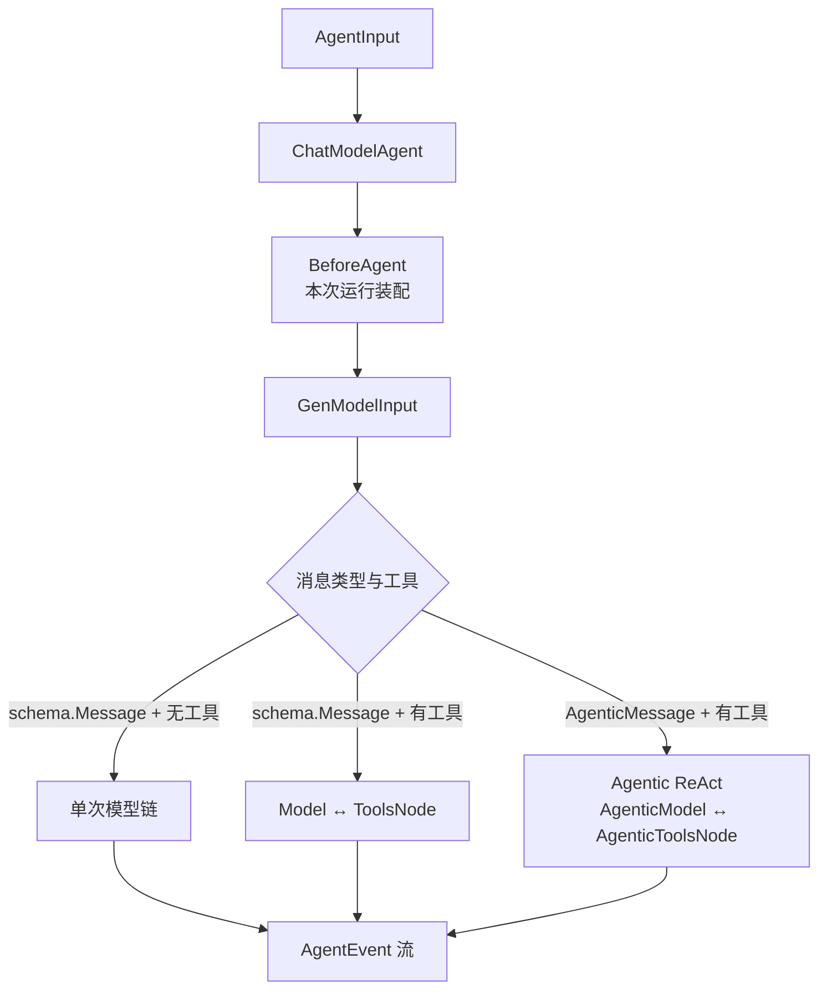
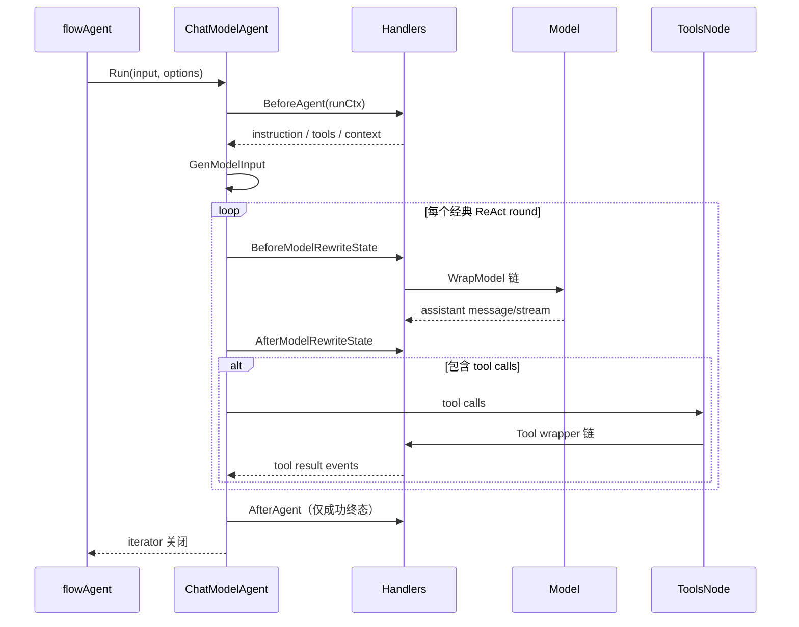

# ChatModelAgent：模型、工具与 ReAct 的装配器

`ChatModelAgent` 是 `TypedChatModelAgent[*schema.Message]` 的别名，也是多数应用使用的 ADK Agent 实现。它不等于模型：模型只完成一次 Generate/Stream；ChatModelAgent 负责输入构造、模型/工具循环、Middleware、重试、故障转移、事件、取消、中断和恢复。



## 1. 两条类型路径

```go
type ChatModelAgent = TypedChatModelAgent[*schema.Message]
type ChatModelAgentConfig = TypedChatModelAgentConfig[*schema.Message]
```

| 路径 | Model 类型 | 工具循环在哪里 | 当前限制 |
| --- | --- | --- | --- |
| `*schema.Message` | `model.BaseChatModel`（通过 `BaseModel[M]` 约束） | ADK 的 ReAct Graph | 完整能力 |
| `*schema.AgenticMessage` | `model.AgenticModel` | ADK Agentic ReAct Graph | ContentBlocks 与 AgenticToolsNode；Typed wrappers |

`Model` 字段的声明是 `model.BaseModel[M]`。经典路径不再要求配置值必须写成旧的 `model.ToolCallingChatModel`；若使用工具，具体模型必须支持 `model.WithTools` option。

完整泛型关系和当前源码注释/实现不一致项见 [Typed Agent 与 AgenticMessage](./typed-agent-agentic.md)。本章流程对两条路径都成立，具体消息/ToolsNode 类型不同。

## 2. 配置字段按执行阶段分类

```go
type TypedChatModelAgentConfig[M adk.MessageType] struct {
    Name, Description, Instruction string
    Model                          model.BaseModel[M]
    ToolsConfig                    adk.ToolsConfig
    GenModelInput                  adk.TypedGenModelInput[M]
    MaxIterations                  int

    Handlers          []adk.TypedChatModelAgentMiddleware[M]
    ModelRetryConfig  *adk.TypedModelRetryConfig[M]
    ModelFailoverConfig *adk.ModelFailoverConfig[M]

    Middlewares []adk.AgentMiddleware // Deprecated
    Exit        tool.BaseTool          // 当前不推荐的 transfer-based 路径
    OutputKey   string                 // 同上
}
```

| 配置 | 何时消费 | 影响 |
| --- | --- | --- |
| `Name` / `Description` | Agent/AgentTool 元数据 | 独立运行可为空；包装 AgentTool 时必须非空 |
| `Instruction` | 每次 GenModelInput | 默认变成 System message |
| `Model` | 每次模型轮次 | 生成 assistant message |
| `ToolsConfig` | Run 准备与 ToolsNode | 工具实现、ToolInfo、ReturnDirectly、Tool wrappers |
| `GenModelInput` | 一次 Run 的输入边界 | Instruction + AgentInput → `[]M` |
| `Handlers` | Run、模型、工具各阶段 | 当前推荐扩展入口 |
| `ModelRetryConfig` | 单个 Model 边界内 | 同模型重新尝试 |
| `ModelFailoverConfig` | retry 外层 | 切换到另一个 Model |
| `MaxIterations` | ReAct state | 模型生成轮次上限，默认 20 |

只有 `Model` 是构造时硬性必填。Failover 配置存在时，`ShouldFailover` 与 `GetFailoverModel` 也必须非 nil。

## 3. 一次 Run 的阶段



每一层能拿到的信息不同：

- `BeforeAgent`：本次 Instruction、真实 Tool 实例、ReturnDirectly；
- model state hooks：本轮 Messages、ToolInfos、DeferredToolInfos；
- `WrapModel`：实际 BaseModel 和 model options；
- Tool wrappers：Name、CallID、参数、结果流；
- `AfterAgent`：成功终态的完整 state。

因此“每轮动态召回记忆”适合 model 前 state hook，“按租户增加真实 Tool”适合 BeforeAgent，“Tool 权限”适合 Tool wrapper。详见 [执行阶段与组件选型](./component-positioning.md)。

## 4. 默认输入生成

经典消息默认逻辑：

```text
Instruction 非空 → SystemMessage
SessionValues 非空 → 用 FString 展开 Instruction
追加 input.Messages
```

若 SessionValues 存在，Instruction 中的字面 `{}` 也会被当成 FString 占位符。系统提示包含 JSON 而你又不想格式化时，应提供自定义 `GenModelInput`。

AgenticMessage 默认使用 `SystemAgenticMessage`，直接追加输入，不走经典 FString 分支。

`GenModelInput` 是“Agent 输入 → 模型历史”的边界；它不是每个 ReAct round 都重新执行的 history hook。每轮压缩、动态 Tool 可见性应放 `BeforeModelRewriteState`。

## 5. 两条路径如何选择无工具链与 ReAct

最终可执行工具为空时，两种消息路径都只需要一次模型调用；有任意真实 Tool、AgentTool、兼容 Transfer/Exit Tool 时，分别进入经典 ReAct 或 Agentic ReAct。

```text
无 Tool：AgentInput → GenModelInput → Model → AgentEvent

有 Tool：TypedAgentInput[M] → GenModelInput → typed ReAct state
                                ├─ BaseChatModel / AgenticModel
                                ├─ tool-call branch
                                ├─ ToolsNode / AgenticToolsNode
                                └─ terminal / cancel branch
```

“配置里没有 `ToolsConfig.Tools`”不一定无工具，因为 `BeforeAgent` handlers 还可以在本次 Run 动态增加工具。

## 6. State 里有什么

```go
type TypedChatModelAgentState[M MessageType] struct {
    Messages          []M
    ToolInfos         []*schema.ToolInfo
    DeferredToolInfos []*schema.ToolInfo
}
```

- `Messages`：当前 ChatModelAgent 的模型历史，不是整个多 Agent runSession；
- `ToolInfos`：本轮立即发给模型的工具 schema；
- `DeferredToolInfos`：允许模型原生延迟检索的 schema；
- state hook 返回的新 state 会进入后续轮次和 checkpoint。

要增加一个真正可执行 Tool，修改 `BeforeAgent` 的 `runCtx.Tools`；只想改变模型本轮看见哪些已注册工具，修改 state 的 ToolInfos。两者不能混为一谈。

## 7. Handler 与旧 Middleware

当前入口：

```go
agent, err := adk.NewChatModelAgent(ctx, &adk.ChatModelAgentConfig{
    Model: model,
    Handlers: []adk.ChatModelAgentMiddleware{
        summaryHandler,
        toolPolicyHandler,
    },
})
```

`Middlewares []AgentMiddleware` 仍在 Config 中，但已 Deprecated。兼容顺序是旧 model-before → 新 model-before → 内部 wrappers → 新 model-after → 旧 model-after。不要在两套 API 中重复注册相同逻辑。

Handler 的九个方法、Context 传播、Tool 洋葱顺序见 [Middleware 新旧 API](./middleware-current.md)，八类官方组件见 [内置 Middleware](./builtin-middlewares.md)。

## 8. AgentEvent 由谁产生

当前默认机制是 event sender wrappers：

- `eventSenderModelWrapper`：把模型 message/stream 转为 Assistant 事件；
- `eventSenderToolWrapper`：把最终处理后的 Tool result 转为 Tool 事件；
- 运行/Graph 边界：把 error、interrupt、cancel 转为错误或 Action 事件。

默认 sender 在用户 wrapper 外层，所以事件包含所有用户 wrapper 修改后的结果。需要控制事件发送位置时，可把 `NewEventSenderModelWrapper()` / `NewEventSenderToolWrapper()` 显式放进 Handlers；框架检测到后会跳过默认 sender，避免重复。

组件 Callback 是另一条观察链；`adk.WithCallbacks` 又提供 Agent 级事件流副本。三者职责见 [Callback 与 AgentEvent](./callbacks.md)。

## 9. Retry 不只是“错误再试一次”

`TypedModelRetryConfig[M].ShouldRetry` 得到 `TypedRetryContext`：

- 当前 attempt；
- 本次输入消息与 options；
- 完整输出、部分流输出或空流；
- 调用错误。

返回 `TypedRetryDecision` 可以：

| 字段 | 含义 |
| --- | --- |
| `Retry` | 是否重试 |
| `RewriteError` | 接受失败但换成更明确错误，或把不合格成功输出改为错误 |
| `ModifiedInputMessages` | 下一次 retry 使用的新输入 |
| `PersistModifiedInputMessages` | 是否写回 Agent history |
| `AdditionalOptions` | 给下次尝试追加 model options |
| `Backoff` | 本次自定义退避 |
| `RejectReason` | 附到 `WillRetryError`，供事件/诊断读取 |

因此 retry 也能处理“模型成功返回，但 JSON/内容质量不合格”。流式输出需要先被完整读取或读到错误，框架才能决定是否重试；被拒绝的 attempt 通过 `WillRetryError` 标记，不应作为正常历史保留。

## 10. Failover 在 Retry 外层

```text
failover attempt
  └─ 当前 model
       └─ retry cycle
            ├─ attempt 0
            ├─ attempt 1
            └─ exhausted → RetryExhaustedError
  └─ ShouldFailover(output, err)
       └─ GetFailoverModel → 下一个 model + 可选转换输入
```

当两者同时配置，Failover 看到的错误通常是 `RetryExhaustedError`，原始错误在 `LastErr`。成功模型会成为该 Agent 执行上下文中的 last-success model，后续调用优先尝试它。

Context 已取消、Compose interrupt 或 `ErrStreamCanceled` 不触发 failover，因为这些不是 provider 健康问题。

## 11. 取消安全点

本次运行传入 `adk.WithCancel()` 后：

- 模型流由 cancel monitor 监视 immediate cancel；
- ReAct 在模型后与一组 Tool 后检查 safe-point cancel；
- 流式 Tool 有专门 cancel monitor；
- 最终通过 `CancelError` 携带恢复所需 interrupt contexts。

Tool wrapper 必须传播 `ErrStreamCanceled`，Retry/Failover 也会明确跳过该错误。完整状态机见 [Cancel 与 TurnLoop](./cancel-turn-loop.md)。

## 12. Run、Session 与长期记忆的边界

ChatModelAgent struct 保存可复用配置，不保存某个用户的长期会话。一次请求的模型历史在 state；跨 Agent 事件在 runSession；跨独立 Runner.Run 的数据需要应用自己的 Store/Memory。

```text
ChatModelAgent fields   → 可复用能力配置
ChatModelAgentState     → 本次 Agent 内 ReAct 历史
runSession.Events       → 本次多 Agent 事件账本
CheckPointStore         → 被中断执行的恢复现场
业务 Memory/Database    → 跨请求用户记忆
```

不要为了“记住上次聊天”把 messages 塞进 ChatModelAgent 字段，这会造成并发用户串话。

## 13. Resume 做什么

ChatModelAgent 的中断 state 是内部 Compose checkpoint bytes。Resume 使用相同 Agent 结构和同一 run function 解释 checkpoint，而不是重新从用户输入开始。

`ResumeWithParams` 最终可按 interrupt context ID 提供目标数据。恢复前若要调整历史，可使用恢复数据/HistoryModifier 机制；不要手工伪造 Tool message 绕过 checkpoint 地址。

## 14. 当前不推荐的配置

`Exit`、`OutputKey`、传统 Parent/SubAgents Transfer 和相关 option 仍能运行，但当前源码明确标注 transfer-based full-context sharing 为 `NOT RECOMMENDED`。多数多 Agent 场景优先：

1. 主 ChatModelAgent 把子 Agent 包为 AgentTool；
2. 需要通用深度任务时使用 DeepAgent；
3. 只有确定性固定控制流才保留 Workflow。

## 15. 最小当前写法

```go
summaryMW, err := summarization.New(ctx, &summarization.Config{
    Model: summaryModel,
})
if err != nil {
    return err
}

agent, err := adk.NewChatModelAgent(ctx, &adk.ChatModelAgentConfig{
    Name:        "assistant",
    Description: "answer questions and use tools",
    Instruction: "Be concise and verify tool results.",
    Model:       chatModel,
    ToolsConfig: adk.ToolsConfig{
        ToolsNodeConfig: compose.ToolsNodeConfig{
            Tools: []tool.BaseTool{searchTool},
        },
    },
    Handlers: []adk.ChatModelAgentMiddleware{summaryMW},
    MaxIterations: 12,
})
```

`Name` 和 `Description` 对独立运行不是构造必填，但要把它包装成 AgentTool 时必须设置。

## 16. 源码阅读路线

1. `adk/chatmodel.go`：Config、Run/Resume、运行配置和两类消息分流；
2. `adk/handler.go`：当前扩展协议；
3. `adk/wrappers.go`：模型/工具 wrapper、事件发送与 cancel monitor；
4. `adk/react.go`：经典与 Agentic 执行图；
5. `adk/retry_chatmodel.go`：输出感知 retry；
6. `adk/failover_chatmodel.go`：多模型切换；
7. `adk/cancel.go`：取消状态机；
8. `adk/callback.go`：Agent 级 Callback。
