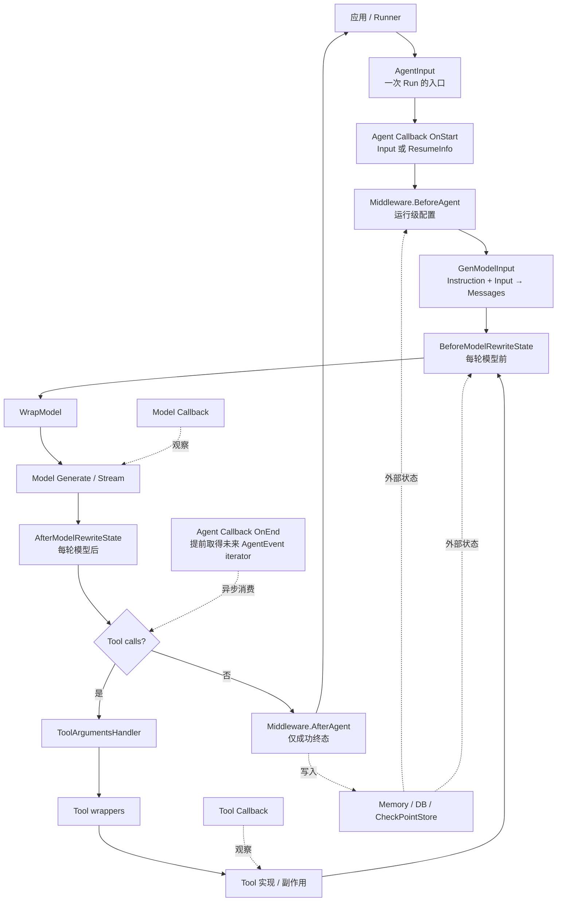
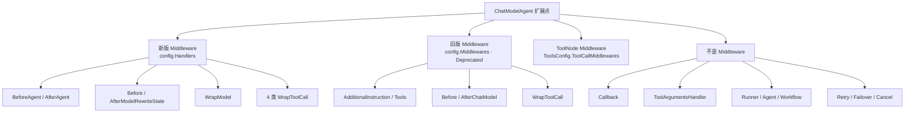
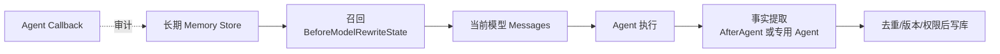

# 从执行阶段、可见信息和控制能力选择组件

Tool、Middleware、Callback、自定义 Agent、Runner、Workflow 都“能写代码、能调服务”，所以不能仅凭“能不能实现”选组件。正确判断需要同时回答三个问题：

1. 它在生命周期的哪个阶段执行？
2. 执行时能拿到哪些信息？
3. 它的返回契约允许改变什么？

再补两个工程问题：失败影响一次 Tool、一次模型轮次还是整次 Agent？状态需要活多久、能否 checkpoint？

## 1. 一张总时间线



<p class="diagram-caption">同一个“记忆”需求可能跨召回、注入、压缩和写回多个阶段；不是随便挑一个能访问数据库的组件。</p>

## 2. 组件能力矩阵

先把最容易混淆的一点说清楚：表格里出现“Before”“After”“Wrap”不代表它自动属于 Middleware。必须看它定义在哪个接口或配置字段中。

本文使用以下归属标签：

- **新版 MW**：`TypedChatModelAgentMiddleware[M]`，经典消息别名为 `ChatModelAgentMiddleware`，配置在 `TypedChatModelAgentConfig.Handlers`；这是当前推荐 API。
- **旧版 MW**：`AgentMiddleware` struct，配置在已经 Deprecated 的 `TypedChatModelAgentConfig.Middlewares`；它是兼容 API。
- **ToolNode MW**：`compose.ToolMiddleware`，配置在 `ToolsConfig.ToolCallMiddlewares`，或被旧版 `AgentMiddleware.WrapToolCall` 间接加入；它不是新版 `ChatModelAgentMiddleware`。
- **非 MW**：Callback、Runner、Tool 本体、Agent、重试配置等其他扩展点。



<p class="diagram-caption">三种名字里都可能出现“Middleware”，但接口层次不同：新版是 ADK Agent 接口，旧版是兼容 struct，ToolNode MW 是 compose 工具节点包装器。</p>

### 2.1 Middleware 家族能力矩阵

| 方法或字段 | 归属 | 配置入口 | 状态 | 何时执行 | 能拿到 / 能改变什么 | 失败范围 |
| --- | --- | --- | --- | --- | --- | --- |
| `BeforeAgent` | **新版 MW** | `Handlers` | 推荐 | 每次 Run/Resume 一次 | `ChatModelAgentContext`：Instruction、真实 Tools、ReturnDirectly、ToolSearchTool；可返回新 context/runCtx | 本次 Agent |
| `BeforeModelRewriteState` | **新版 MW** | `Handlers` | 推荐 | 每个模型轮次前 | 完整 Messages、ToolInfos、DeferredToolInfos、ModelContext；返回的新 state 会持久到后续轮次 | 当前 Agent 执行 |
| `WrapModel` | **新版 MW** | `Handlers` | 推荐 | 每次 Model Generate/Stream 周围 | `model.BaseModel[M]`、model options、输出流/error；可包装、路由、替换结果 | 当前模型调用，错误可终止 Agent |
| `AfterModelRewriteState` | **新版 MW** | `Handlers` | 推荐 | 每次模型成功返回后 | 已含 assistant 输出的 state；可返回下一轮使用的新 state/context | 当前 Agent |
| `WrapInvokableToolCall` | **新版 MW** | `Handlers` | 推荐 | 同步普通 ToolCall 周围 | name、call ID、args、result/error；可拒绝调用或替换结果 | 单次 ToolCall |
| `WrapStreamableToolCall` | **新版 MW** | `Handlers` | 推荐 | 流式普通 ToolCall 周围 | name、call ID、args、stream/error；可包装流 | 单次 ToolCall |
| `WrapEnhancedInvokableToolCall` | **新版 MW** | `Handlers` | 推荐 | 同步 Enhanced ToolCall 周围 | 结构化 `ToolResult` 与中断信息；可包装/替换 | 单次 ToolCall |
| `WrapEnhancedStreamableToolCall` | **新版 MW** | `Handlers` | 推荐 | 流式 Enhanced ToolCall 周围 | 结构化结果流与中断信息；可包装流 | 单次 ToolCall |
| `AfterAgent` | **新版 MW** | `Handlers` | 推荐 | 成功终态一次 | 最终 `TypedChatModelAgentState[M]`；只能返回 context/error，错误、取消、interrupt 路径不保证执行 | 成功收尾 |
| `AdditionalInstruction` | **旧版 MW** | `Middlewares` | Deprecated | 构造时收集，首次准备基础执行上下文时合并 | 静态字符串；不能按本次请求动态返回 context | Agent 基础配置 |
| `AdditionalTools` | **旧版 MW** | `Middlewares` | Deprecated | 构造时收集，首次准备基础执行上下文时合并 | 静态 Tool 实例；不适合请求级权限筛选 | Agent 基础配置 |
| `BeforeChatModel` | **旧版 MW** | `Middlewares` | Deprecated | 每个经典消息模型轮次前 | `ChatModelAgentState`；原地修改，没有返回新 context；Agentic 路径不会执行 | 当前 Agent |
| `AfterChatModel` | **旧版 MW** | `Middlewares` | Deprecated | 每个经典消息模型轮次后 | `ChatModelAgentState`；原地修改，没有返回新 context；Agentic 路径不会执行 | 当前 Agent |
| `WrapToolCall` | **旧版 MW → ToolNode MW** | `Middlewares` | Deprecated | Tool endpoint 周围 | 实际类型是 `compose.ToolMiddleware`，有普通/流式/Enhanced 四个 endpoint；被收集进 Tool wrapper 链 | 单次 ToolCall |
| `ToolCallMiddlewares` | **ToolNode MW** | `ToolsConfig` | 可用，但不是新版 ADK MW | Tool endpoint 周围 | `[]compose.ToolMiddleware`；直接包装工具节点，不含 Agent/Model hook | 单次 ToolCall |

> 快速判断：代码写在 `Handlers: []adk.ChatModelAgentMiddleware{...}` 中，就是新版 Middleware；写在 `Middlewares: []adk.AgentMiddleware{...}` 中，就是待淘汰的旧版；写在 `ToolsConfig.ToolCallMiddlewares` 中，则是 compose ToolNode Middleware。

### 2.2 非 Middleware 组件能力矩阵

| 组件/阶段 | 归属 | 何时执行 | 能拿到什么 | 能改变什么 | 失败范围 |
| --- | --- | --- | --- | --- | --- |
| Runner 边界 | **非 MW** | 整次 Run/Resume 前后 | 用户、请求、全部 AgentEvent、checkpoint ID | 是否运行/恢复、持久化、最终响应 | 整次请求 |
| Agent Callback | **非 MW · Callback** | OnStart；事件转发建立时触发 OnEnd | Input 或 ResumeInfo；未来持续产生值的独立事件流；RunInfo | 只返回 Context，不能替换事件 | OnEnd 同步读会死锁；异步慢消费会堆积内存 |
| Model Callback | **非 MW · Callback** | 模型 Start/End/Error | 模型输入输出和 RunInfo | 只派生 Context | 观察为主 |
| Tool Callback | **非 MW · Callback** | Tool Start/End/Error | Tool 输入输出与 RunInfo | 只派生 Context | 观察为主 |
| `ToolArgumentsHandler` | **非 MW · ToolsConfig hook** | 所有 Tool wrapper 前 | canonical tool name + JSON arguments | 返回修正后的参数 | 单次 ToolCall |
| Tool 实现 | **非 MW · Component** | 模型决定调用时 | 自身参数、Context、Tool options | 真实查询/副作用/业务 interrupt | 业务操作 |
| `ModelRetryConfig` | **非 MW · 策略配置** | 模型失败或结果满足重试判断时 | attempt、输入、输出/error | 是否重试、退避、是否持久修改输入 | 当前模型阶段 |
| `ModelFailoverConfig` | **非 MW · 策略配置** | 模型失败切换时 | error、候选模型和历史成功模型 | 选择另一个模型 | 当前模型阶段 |
| Custom Agent | **非 MW · Agent** | 自己的 Run/Resume | 完整 AgentInput、options、外部服务 | 任意 AgentEvent/Action/Err | 自己定义 |
| AgentTool | **非 MW · Tool/Agent 适配器** | 父模型调用工具时 | Tool args、父边界、子 Agent 配置 | 启动子 Runner，返回 Tool result | 子 Agent 调用边界 |
| Workflow Agent | **非 MW · Agent 容器** | child 之间 | session history、lane/iteration、interrupt state | 固定顺序/并发/循环 | 组合层 |
| `WithCancel` / TurnLoop | **非 MW · 运行控制** | safe point / turn 边界 | 当前运行、buffer、checkpoint | cancel、preempt、stop、resume | 当前 Run/Turn |

## 3. 为什么“Callback 也能写数据库”不代表记忆应放 Callback

Callback 的签名只返回 Context：

```go
OnEnd(ctx, info, output) context.Context
```

它不能把 output 替换为 summary，也不能阻止一个危险 Tool 已经产生的副作用。它最擅长：

- tracing、metrics、日志；
- 记录“发生了什么”的审计流水；
- 异步复制 AgentEvent 到观察系统；
- 对所有组件做统一低侵入观测。

如果写记忆只是“保存完整事件日志”，Agent Callback 很合适；如果要判断哪些事实值得保存、把召回结果注入模型、控制 token 预算，则还需要 Agent/Middleware/MemoryService。

## 4. 新版与旧版 Middleware 的完整归属树

新版下面这些不是彼此独立的组件名，而是同一个 `TypedChatModelAgentMiddleware[M]` 的方法：

```text
ChatModelAgentMiddleware
  ├─ BeforeAgent
  ├─ BeforeModelRewriteState
  ├─ WrapModel
  ├─ AfterModelRewriteState
  ├─ WrapInvokableToolCall
  ├─ WrapStreamableToolCall
  ├─ WrapEnhancedInvokableToolCall
  ├─ WrapEnhancedStreamableToolCall
  └─ AfterAgent
```

经典消息版 `ChatModelAgentMiddleware` 只是 `TypedChatModelAgentMiddleware[*schema.Message]` 的类型别名。文档按执行阶段分别讨论这些方法，是为了说明时机，不代表 `BeforeModelRewriteState`、`WrapModel` 或四种 Tool wrapper 脱离了 Middleware。实现时通常嵌入 `BaseChatModelAgentMiddleware`，只覆盖需要的方法。

旧版则是一个字段集合，不是上述 interface：

```text
AgentMiddleware                         // 旧版兼容 struct
  ├─ AdditionalInstruction
  ├─ AdditionalTools
  ├─ BeforeChatModel                    // 仅经典 Message 路径
  ├─ AfterChatModel                     // 仅经典 Message 路径
  └─ WrapToolCall: compose.ToolMiddleware
       ├─ Invokable
       ├─ Streamable
       ├─ EnhancedInvokable
       └─ EnhancedStreamable
```

它仍能运行，但承载它的 `config.Middlewares` 字段已经 Deprecated，官方要求迁移到 `config.Handlers`。特别注意：旧 `WrapToolCall` 的值本身又是 `compose.ToolMiddleware`，所以它最终进入 ToolNode wrapper 链；这就是为什么只写“Tool wrapper”会让人误以为它一定属于新版 Middleware。完整执行顺序和迁移方式见 [Middleware 新旧 API](./middleware-current.md)。

## 5. 运行级：BeforeAgent 能做什么

```go
BeforeAgent(
    ctx context.Context,
    runCtx *ChatModelAgentContext,
) (context.Context, *ChatModelAgentContext, error)
```

它能看到并修改本次 Run 的：

- `Instruction`；
- `Tools []tool.BaseTool`：真实可执行实现；
- `ReturnDirectly`；
- `ToolSearchTool`。

适合：按租户/权限装配 Tool、加载本次语言/区域规则、注入稳定运行级 instruction。它只执行一次，不适合“每次模型轮次检查 token”。

若修改 Tools，最好复制 slice 和 runCtx 再返回，避免多个并发 Run 污染共享底层数组。

## 6. 模型前：BeforeModelRewriteState 为什么适合 Summary 与召回

```go
BeforeModelRewriteState(ctx, state, modelCtx)
    → (newCtx, newState, error)
```

此时能看到真正要进入模型的完整 Messages，含前一轮 Tool results；还能看到 ToolInfos。返回的新 state 会成为本轮模型输入和后续轮次的事实来源。

适合：

- token 预算与 summarization；
- 长期记忆召回后插入“参考事实”；
- 修复悬空 ToolCall；
- 临时注入 Agents.md；
- 动态筛选模型本轮可见 ToolInfos；
- prompt injection 检查和拒绝。

不适合：真正执行有副作用的业务操作；那属于 Tool。

## 7. WrapModel 与 Model Callback 的区别

两者都围绕模型，但契约不同：

| 问题 | WrapModel | Model Callback |
| --- | --- | --- |
| 能换 Model 吗 | 能 | 不能 |
| 能改输入/option 吗 | 能，通过 wrapper | 不能通过返回值 |
| 能替换输出/error 吗 | 能 | 不能 |
| 能统一 tracing 吗 | 能，但侵入较强 | 最合适 |
| 能观察每次 provider retry 吗 | 取决于位于 retry 链内外 | 内层 model callback 可观察 attempt |

模型路由、响应格式强校验和模型级缓存可用 WrapModel。纯耗时、token、trace 用 Callback，避免改变执行语义。

## 8. 模型后：AfterModelRewriteState 的边界

模型输出已追加到 state 后调用。它能校验、归一化或标记 assistant message，返回的新 state 供 Tool 分支/下一轮使用。

但要注意“修改 state”与“客户端已经收到的 event”之间的顺序。默认 model event sender 位于用户 WrapModel 外，state hook 又处于模型 wrapper 之后；如果目标是保证用户看到脱敏后的最终 event，应在恰当的 Model wrapper/显式 event sender 位置完成，而不能想当然地把 After hook 当成 HTTP 响应拦截器。

## 9. ToolArgumentsHandler、Tool wrapper 与 Tool 实现

### 参数修复：ToolArgumentsHandler

只看到 name 和 arguments，发生在 Tool wrappers 之前。适合 JSON 修复、默认值、兼容字段名。它没有完整 Tool result，也不应做真实权限决策。

### 横切控制：Tool wrapper

发生在副作用边界，拿到 Name、CallID、参数，并能决定是否调用 next。适合：

- 强制权限和租户隔离；
- 幂等、限流、缓存；
- Tool 级 retry；
- 大结果卸载；
- 参数/结果脱敏；
- 精确审计。

提示模型“不要调用危险工具”只是软约束；真正授权必须在 wrapper 或 Tool service 内再做一次。

### 业务能力：Tool

Tool 应表达有清晰输入 schema 的查询或副作用。若逻辑需要自己多轮调用模型、持续产生 AgentEvent、支持中断恢复，它已经更像 Agent，应包装为 AgentTool，而不是把复杂自治流程硬塞进 Tool。

## 10. AfterAgent 为什么适合“成功后写一次”，又为什么不够

`AfterAgent` 每次 ChatModelAgent 成功终态执行一次，因此比 model-after hook 更适合：

- 从最终 state 提取候选记忆；
- 写一次成功指标；
- 清理 run-local 临时状态；
- 提交一次性会话总结。

但 error、cancel、超迭代、interrupt 路径可能不执行 `AfterAgent`。若要求“无论成功失败都记审计”，应使用 Agent Callback/Runner 边界。若中断时必须持久化业务状态，应使用 checkpoint 或外部事务，而不是依赖 AfterAgent。

## 11. Run-local、Context、Session、Memory 的生命周期

| 状态容器 | 生命周期 | 可恢复 | 适合 |
| --- | --- | --- | --- |
| `context.Context` value | 调用链 | 通常不序列化 | 身份、trace、deadline、轻量请求信息 |
| Middleware run-local | 一次 Agent Run/Resume 链 | 可随 state checkpoint；值须可序列化 | handler 跨阶段缓存、一次性标记 |
| session values | 一次根 Agent 树 | checkpoint 可保存 | child 之间共享小型业务值 |
| ChatModelAgentState | 一次 Agent ReAct | Graph checkpoint | Messages、模型可见 Tools |
| CheckPointStore | 被暂停的执行 | 是 | 执行现场，不是长期知识库 |
| Memory/DB/Retriever | 跨请求/跨进程 | 由应用保证 | 用户偏好、事实、文档、审计 |

不要把数据库连接、mutex、函数或 StreamReader 放进 run-local/session state；恢复序列化会失败。

## 12. 记忆系统应拆成四个功能

“记忆”不是一个 hook：



| 子功能 | 组件选择 | 原因 |
| --- | --- | --- |
| 长期存储 | 外部 MemoryService/DB | 跨 Run、可查询、可治理 |
| 按当前问题召回 | `BeforeModelRewriteState` 调 Retriever | 有完整当前 Messages，能注入本轮输入 |
| 提取值得保存的事实 | `AfterAgent` 或专用 Agent | 看到较完整成功结果，避免每个 ReAct round 重复写 |
| 失败/取消审计 | Agent Callback/Runner | 覆盖非成功路径 |
| 用户显式“记住这个” | Tool | 用户意图明确，需要权限、确认和可见结果 |

## 13. Summary 至少有三种，不应混在一起

| Summary 类型 | 目的 | 最合适组件 |
| --- | --- | --- |
| 上下文压缩 summary | 降低下一次模型输入 token | summarization Middleware 的 model-before 阶段 |
| 业务 summary | 生成会议纪要/报告给用户 | Tool 或专用 Agent |
| 多分支 synthesis | 合并 Parallel/多个 Agent 的结论 | Synthesizer Agent 或父 ChatModelAgent |

上下文 summary 是运行时维护，不一定直接展示；业务 summary 是受用户验收的输出；synthesis 需要理解多来源冲突。只因为都叫 summary 就塞进同一 Callback，会失去正确的输入与控制边界。

## 14. Agent、AgentTool 与 Workflow 怎么选

| 需求 | 选择 |
| --- | --- |
| 一个可独立命名、测试、产生多事件的能力 | Custom Agent/ChatModelAgent |
| 父模型按语义选择并等待子能力结果 | AgentTool |
| 固定 A→B、并行 fan-out/join、有限循环 | Workflow Agent（注意当前 NOT RECOMMENDED 的官方总体定位） |
| 持续接收外部业务事件并抢占当前轮 | TurnLoop |
| 纯粹一个外部动作 | Tool |

Workflow 决定“谁何时运行”；Middleware 改变一个 ChatModelAgent 内部边界；Callback 观察组件；它们不是互相替代的同层方案。

## 15. 常见需求的决策表

| 需求 | 必须拿到的信息 | 必须控制什么 | 放置位置 |
| --- | --- | --- | --- |
| 按租户提供不同真实 Tools | tenant + Tool 实例 | 模型可见与实际可执行集合一致 | `BeforeAgent` |
| 每轮上下文超限 | 完整 Messages + ToolInfos | 替换历史并延续后续轮次 | `BeforeModelRewriteState` / summarization |
| Tool result 一产生就很大 | call ID + 原始结果 | 进入历史前卸载 | reduction Tool wrapper |
| 模型输出 JSON 不合格要重试 | 输入 + 完整/部分输出 + error | retry、改输入/options | `ModelRetryConfig.ShouldRetry` |
| 主模型故障切备用模型 | output/error + attempt | 选择另一 Model | `ModelFailoverConfig` |
| 危险工具授权 | user + name + args | 副作用前拒绝 | Tool wrapper + service |
| 最终成功后写一次记忆 | 最终 state + 用户身份 | 外部存储写入 | `AfterAgent` + MemoryService |
| 所有结果都要审计 | Input/ResumeInfo + 完整事件流 | 只观察，包括失败/取消 | Agent Callback |
| 用户点停止但要可恢复 | 当前运行 + safe point | 取消与 checkpoint | `WithCancel` |
| 新消息抢占旧任务 | 业务 item buffer + 当前 turn | Push/preempt/下一轮 | TurnLoop |

## 16. 反例

### 16.1 在 Callback 中强行改输出

Handler 不返回新 output。即使原地修改指针，也依赖不稳定共享语义，并可能发生在事件已发送之后。需要改行为就用 Middleware wrapper/state hook。

### 16.2 在 system prompt 里做权限

Prompt 只能影响模型意愿，不能成为安全边界。Tool wrapper/Tool service 必须重新验证身份和参数。

### 16.3 在每轮 model-after 写长期记忆

一次用户请求可能有很多模型轮次，产生半成品、ToolCall 和失败 attempt。会重复写、污染长期事实。成功终态写入放 AfterAgent；全路径审计放 Callback。

### 16.4 用 Context 当数据库

Context 适合传播，不适合查询、版本控制、跨请求保存。长期记忆进入外部 Store。

### 16.5 用 Middleware 替代业务 Tool

若用户需要知道操作结果、确认参数或重试业务错误，隐藏在 Middleware 会让行为不可见。业务能力应该显式成为 Tool。

## 17. 最终判断算法

```text
1. 先定位发生阶段：Run、每轮模型前后、Model endpoint、Tool endpoint、成功终态、整次请求？
2. 列出必须信息：Messages、ToolInfos、真实 Tools、call ID、完整 AgentEvent、外部用户身份？
3. 列出必须控制：只观察、改 Context、改 State、拒绝副作用、替换结果、选择下一个 Agent？
4. 确定状态寿命：单次调用、Run 内、session、checkpoint、跨请求？
5. 确定失败语义：记录并继续，还是必须中止 Tool/Model/Agent？
6. 选择最窄但足够的组件，并对安全控制做纵深防御。
```

源码对照：`adk/handler.go`、`adk/chatmodel.go`、`adk/wrappers.go`、`adk/callback.go`、`compose/tool_node.go`、`adk/turn_loop.go`。
