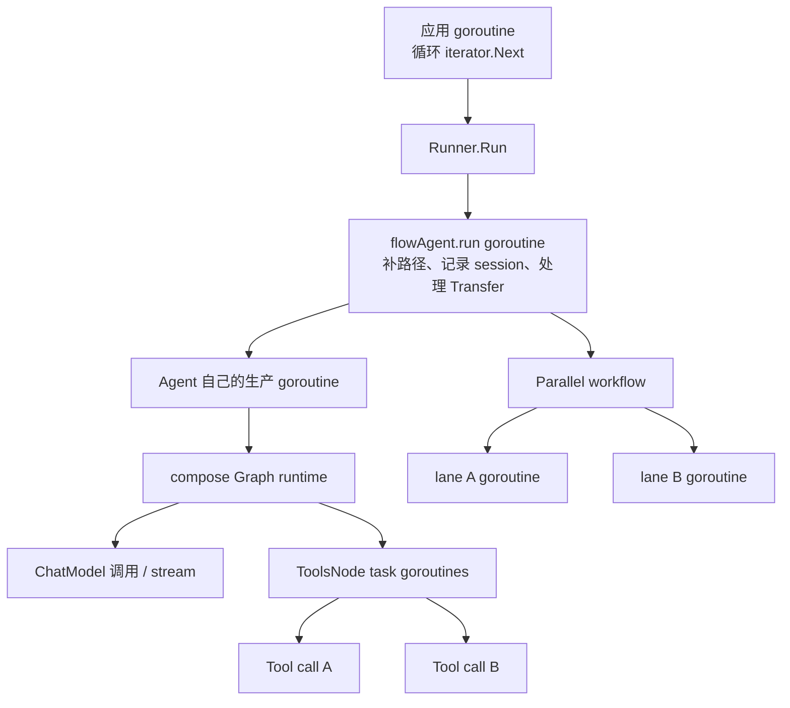
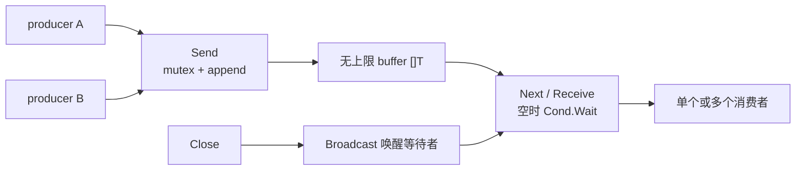
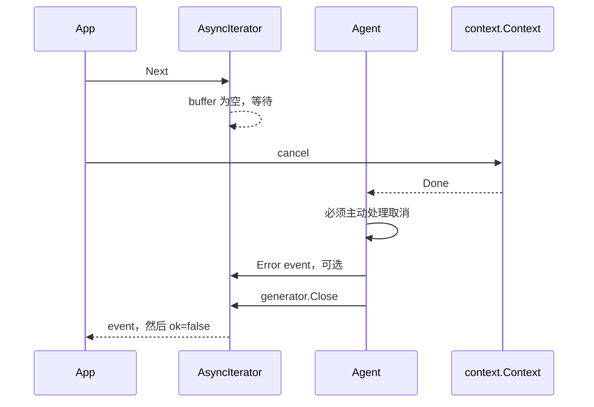
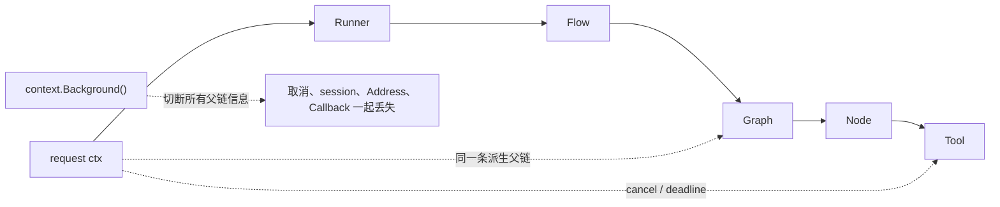
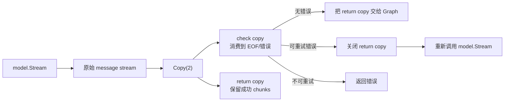
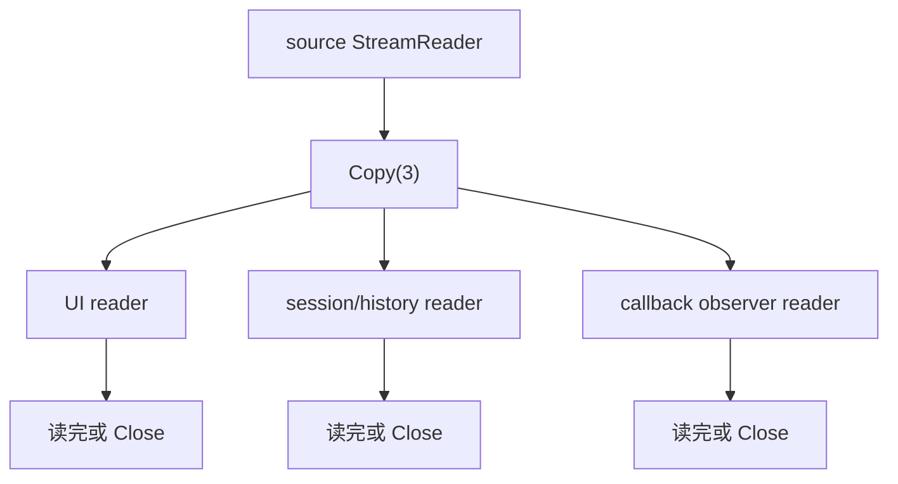
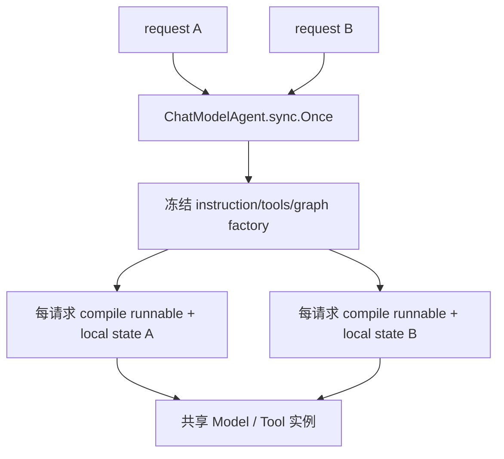
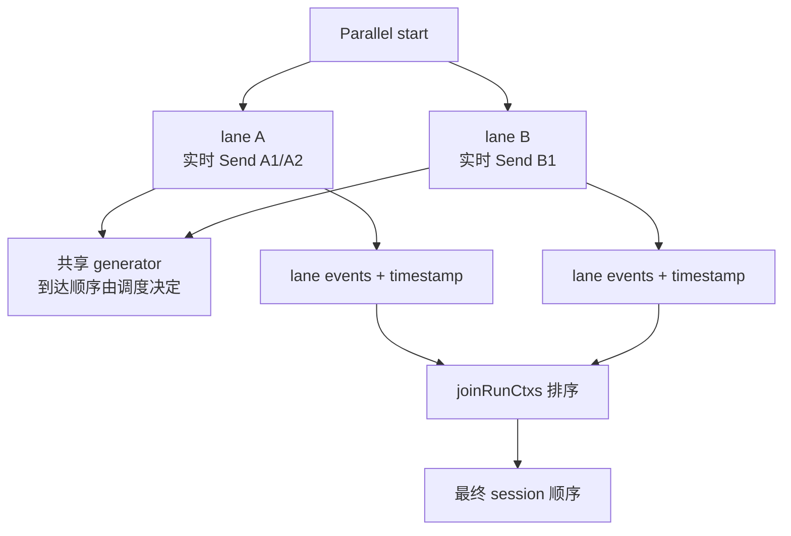
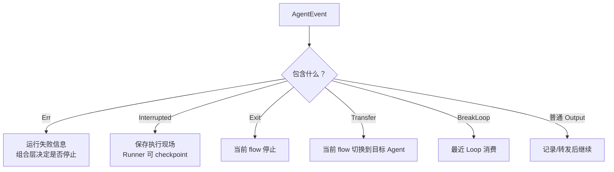

# 并发、取消、错误与流所有权

ADK 的公开 API 看起来像普通函数调用，但内部同时存在 iterator 队列、Agent goroutine、Graph task、并行 workflow lane、并行 tool call 和流复制。如果只看类型签名，很容易误判谁在阻塞、谁负责关闭、错误会在哪一层停止。

这一章专门建立运行时安全模型。

## 一次运行可能有哪些 goroutine



实际数量取决于 Agent 结构。重点不是背下 goroutine 数，而是知道：返回 iterator 只代表生产任务已经启动，不代表工作已完成。

## AsyncIterator 为什么不会给生产者背压

底层 `internal.UnboundedChan` 用 slice、mutex 和 condition variable 实现：



精确语义：

- Send 只等待短暂的 mutex，不等待消费者处理；
- 多 producer 和多 consumer 在容器层面安全；
- 同一 producer 内的发送顺序保留；多个 producer 的相对顺序由锁竞争决定；
- Close 后先读完 buffer，再得到 `ok=false`；
- 重复 Close 不报错；
- Close 后 Send 会 panic；
- 没有队列长度、限速和丢弃策略。

### 为什么这很重要

假设 Tool 每 10ms 发一个进度事件，WebSocket 客户端每秒只能处理 10 个，UnboundedChan 不会让 Tool 变慢，而会让差值留在内存中。长任务需要在业务层做：

- 进度合并，例如每 500ms 发送最新状态；
- 限制事件内容大小；
- 确保 HTTP/SSE/WebSocket writer 持续 drain；
- 客户端断开时取消 ctx；
- 监控队列外围的内存和任务时长。

## Next 为什么可能永远阻塞

`AsyncIterator.Next()` 只有 `(value, ok)`，没有 Context 参数。如果生产者既不 Send 也不 Close，消费者就一直等待 condition variable。



取消 Context 不会直接操作 iterator 的底层 channel。每一层生产者必须把取消传播到它正在等待的模型、Tool、远程请求或 select 分支，并最终关闭自己的 generator。

## 调用方的推荐消费循环

```go
iter := runner.Run(ctx, messages, opts...)

for {
    event, ok := iter.Next()
    if !ok {
        break
    }

    if event.Err != nil {
        // 记录后通常仍继续 drain，直到框架关闭 iterator。
        handleError(event.Err)
        continue
    }

    if event.Action != nil && event.Action.Interrupted != nil {
        persistUIState(event.Action.Interrupted)
        continue
    }

    if event.Output != nil && event.Output.MessageOutput != nil {
        consumeMessage(event.Output.MessageOutput)
    }
}
```

Error event 不是 iterator 的返回 error；Interrupt 也不是普通失败。三条通道必须分别处理。

## Context 取消能传播到哪里

只要代码继续使用传入 ctx，它会带着：

- deadline/cancel；
- ADK runContext；
- core Address 和 resume state；
- callback manager；
- compose local state 访问能力；
- Tool call ID。



如果只想为某个远程调用设置更短超时，使用 `context.WithTimeout(ctx, ...)`，不要换成 Background。

## ModelRetry 的取消边界

模型请求本身收到原 ctx，Provider 若正确实现就能响应取消。当前 retry 的退避也已改成 `contextAwareSleep`：

```text
模型失败
  → ShouldRetry(ctx, retryCtx)
     或兼容 IsRetryAble(ctx, err)
  → RetryDecision.Backoff / BackoffFunc 计算 duration
  → select(ctx.Done, time.After(duration))
  → 到期后发起下一次模型调用
```

因此 Context 在 backoff 期间取消时，不必等完整 duration；`contextAwareSleep` 会返回 `ctx.Err()`。这仍然是协作式取消：Provider 自己的请求和自定义 `ShouldRetry` / `BackoffFunc` 也必须尊重传入 Context。

默认重试次数语义：`MaxRetries=3` 表示初始调用一次，加三次重试，共最多四次模型请求。

## 流式模型开启 retry 后发生了什么

流式请求的错误可能出现在 Stream 返回之后。retry wrapper 会复制 reader：



为了判断一次 stream 是否完整成功，wrapper 会把检查副本读到结束。Graph 的分支判断和后续 Tool 执行可能因此等到本轮流结束；callback 分出来的观察流则是另一条所有权链，不能与 Graph reader 混为一谈。

`WillRetryError` 用于告诉 session 历史重建：这条失败 stream 将被重试，不要把残缺 assistant 内容加入下一 Agent 的上下文。

## StreamReader 的核心规则

把 StreamReader 理解成一次性水管：

1. `Recv` 消耗数据；
2. 同一个 reader 不能交给两个独立消费者；
3. 需要多个消费者时先 `Copy(N)`；
4. 每个副本都必须被读完或 Close；
5. Copy 复制消费通道，不保证消息 chunk 对象深拷贝；
6. Gob checkpoint 会 concat stream，恢复后不保留 token chunk 边界。



最常见 bug 是中间件为了记录内容把 reader 读完，然后把同一个 reader 返回给 next；下游只能得到 EOF。

## `GetMessage` 的两种版本不要混用

| API | 行为 | 适合场景 |
| --- | --- | --- |
| `MessageVariant.GetMessage()` | 直接消费当前 reader | 确定之后无人再读 |
| `adk.GetMessage(event)` | Copy(2)，消费一份，把另一份放回 event | 读取全文后还要继续传 event |

`adk.GetMessage` 返回的 event 仍是原外壳，但内部 reader 已更新。后续代码应继续使用返回值，明确所有权交接。

## AgentEvent copy 到底安全到什么程度

`copyAgentEvent` 会新建：

- AgentEvent 外壳；
- AgentOutput 外壳；
- MessageVariant 外壳；
- RunPath slice；
- streaming reader 副本。

但以下仍共享：

- 非流 Message 指针；
- stream 中的 Message chunk 对象；
- AgentAction 指针；
- CustomizedOutput 内部对象；
- error 值。

所以复制后可以安全补 AgentName、替换外壳字段、扩展 RunPath、独立 Recv；不能假设可以并发修改 Message.Content 或 CustomizedOutput 中的 map。

## Runner 和 ChatModelAgent 能否并发复用

### Runner

Runner.Run 每次创建新的根 runContext/session，因此 Runner 外壳没有每请求可变字段。但是它共享：

- Agent 实例；
- CheckPointStore 实现；
- streaming 配置。

因此 Agent 和 Store 必须支持并发；checkpoint ID 必须避免跨请求碰撞。

### ChatModelAgent

`buildRunFunc` 使用 `sync.Once`，并在首次构建后 frozen。多个请求可复用已确定的配置，但仍要求：

- Model Provider 支持并发调用；
- Tool 实现支持并发；
- Middleware 闭包没有未同步的请求级字段；
- Agent struct 不存放某个用户的 Messages；
- 首次并发调用时接受只有一个 goroutine完成初始化、其他调用等待。



## Session Values 的锁只保护 map

`AddSessionValue`、`GetSessionValue` 对 Values map 加 mutex，但 value 是浅层引用：

```go
itemsAny, _ := adk.GetSessionValue(ctx, "items")
items := itemsAny.([]string)
items = append(items, "new") // 共享底层数组仍可能竞态
```

Parallel lane 又故意共享同一 Values map 和 mutex。因此推荐写入不可变值，或者取出后复制、构造新对象，再通过 AddSessionValue 整体替换。

多个 lane 对同 key 写入即使没有 data race，业务结果仍是 last-writer-wins，顺序不确定。

## Parallel workflow 的两条顺序



UI 事件到达顺序和最终 session 历史顺序不是同一合同。即使 join 按纳秒时间戳排序，相同时间戳也没有额外稳定 tie-break；业务不能依赖并行回答的严格先后。

## Parallel 并不是 fail-fast

每个 child 已经启动后：

- 普通 Error event 会被转发，但不会自动取消兄弟分支；
- Exit/BreakLoop 只是该分支的事件，不会撤回已经开始的其他分支；
- workflow 等待所有 goroutine `wg.Wait()`；
- Interrupt 会停止对应 lane 的消费，最后与其他叶子合成 CompositeInterrupt；
- 只有业务自己取消共享 ctx，其他分支才有机会提前停止。

外部副作用必须按照“兄弟分支仍可能继续运行”设计。

## Error、Interrupt、Action 的停止边界



Action 的控制效果还受 RunPath 精确匹配限制。AgentTool 内部的 Exit、Transfer、BreakLoop 不会控制父 Agent；只有 Interrupt 通过 CompositeInterrupt 穿过工具边界。

## panic recover 的真实边界

| 位置 | 是否有框架 recover | 结果 |
| --- | --- | --- |
| `typedRunnerHandleIterImpl` goroutine | 有 | 转成 Error event 并 Close |
| `flowAgent.run` goroutine | 有 | 转成 Error event并 Close |
| ChatModelAgent Run/Resume goroutine | 有 | 转成 Error event并 Close |
| Workflow Run/Resume goroutine | 有 | 转成 Error event并 Close |
| Parallel 每个 lane goroutine | 有 | 向共享 generator 发 Error event |
| 自定义 Agent.Run 同步调用本身 | 不保证 | panic 可能直接返回到调用方 |
| 自定义 Agent 自建 goroutine | 没有自动覆盖 | 未 recover 会终止进程 |
| Provider/Tool 自建后台 goroutine | 取决于实现 | 必须自行负责 |

框架 recover 是最后保险，不是业务错误处理 API。panic 被包装后虽然能看到 stack，但当前操作的外部副作用可能已经发生。

## Checkpoint 与并发恢复

CheckPointStore 接口只有 Get/Set，没有 CAS、版本或 delete：

```go
type CheckPointStore interface {
    Get(ctx context.Context, id string) ([]byte, bool, error)
    Set(ctx context.Context, id string, data []byte) error
}
```

同一个 checkpoint ID 被两个请求同时 Resume 时，框架本身不提供单消费者锁。两边可能都读取同一快照、重复执行恢复后的 Tool 或业务写入。

生产 Store/业务层应考虑：

- checkpoint ID 唯一性；
- 领取锁或状态机；
- 恢复幂等键；
- 重复批准去重；
- TTL 与清理；
- 再次中断覆盖同一 key 的一致性。

## 外部副作用为什么必须幂等

checkpoint 能恢复 Go/Graph 状态，不能回滚：

- 已发送 HTTP 请求；
- 已写数据库；
- 已发消息；
- 已扣款或退款；
- 已执行的第三方 Tool。

安全模式通常是：

```text
业务 operation ID
  → Tool 先查询是否已完成
  → 未完成才执行
  → 在业务事务中记录结果
  → Resume/Retry 再次调用时返回已有结果
```

不要把“从 checkpoint 恢复”理解为数据库事务回滚。

## 常见故障速查

| 症状 | 高概率原因 | 先查什么 |
| --- | --- | --- |
| Next 永远不返回 | producer 未 Send/Close，或底层调用不响应 ctx | 所有 goroutine 退出路径 |
| 内存持续涨 | Unbounded queue 被慢消费者堆积 | 事件产生速率、客户端断开 |
| 页面/日志只看到半条流 | reader 被上游提前消费 | Copy/Close 所有权 |
| Parallel 偶现不同结果 | 多 lane 写同 key 或依赖到达顺序 | session value 与事件顺序 |
| 取消后仍等很久 | Provider 不响应 ctx 或 retry 正在 Sleep | timeout、retry backoff |
| 恢复后操作执行两次 | checkpoint 被并发 Resume，或 Tool 无幂等 | 领取锁、operation ID |
| 子 Agent 的 Exit 不能停父 Agent | AgentTool Action 隔离 | 应返回 Tool 结果或设计父层动作 |
| error 后还有事件 | 生产者继续 Send，当前组合层不 fail-fast | fatal error 后主动 return |

## 并发测试建议

```bash
go test -race ./adk/...
go test -run TestAsyncIteratorPair_Concurrency ./adk
go test -run TestForkJoinRunCtx ./adk
go test -run TestParallelAgent ./adk
go test -run TestChatModelParallelToolInterruptAndResume ./adk
```

自定义实现还应增加：

- 100 个并发 Runner.Run 共享同一 Agent 实例；
- 客户端消费速度显著低于生产速度；
- 模型流在中间 chunk 返回错误；
- 取消发生在模型请求、Tool 请求、retry backoff 和 Parallel lane 中；
- 同一 checkpoint 两次并发 Resume；
- 两个同名 ToolCall 并行发送 Action，验证以 CallID 隔离。

继续阅读：[事件与流所有权](./events.md)、[Workflow 并行语义](./workflows.md)、[自定义 Agent](./custom-agent.md)、[调试与测试手册](./debugging-testing.md)。

<div class="source-path">队列：internal/channel.go、adk/utils.go<br>并行 session：adk/runctx.go、adk/workflow.go<br>模型重试：adk/retry_chatmodel.go<br>panic 边界：adk/runner.go、adk/flow.go、adk/chatmodel.go</div>
