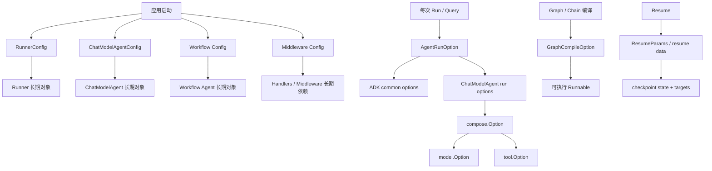
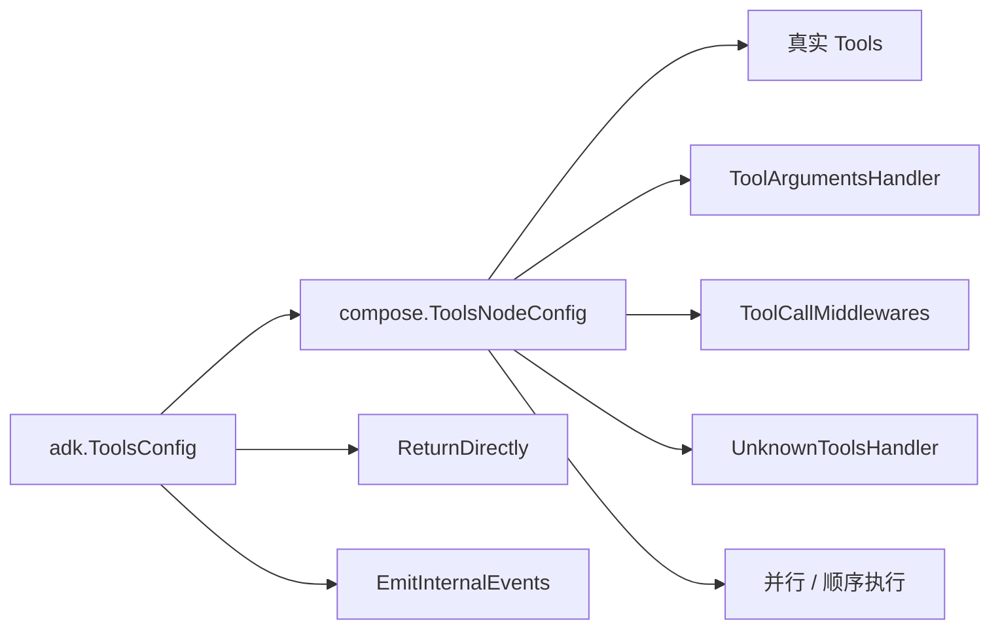
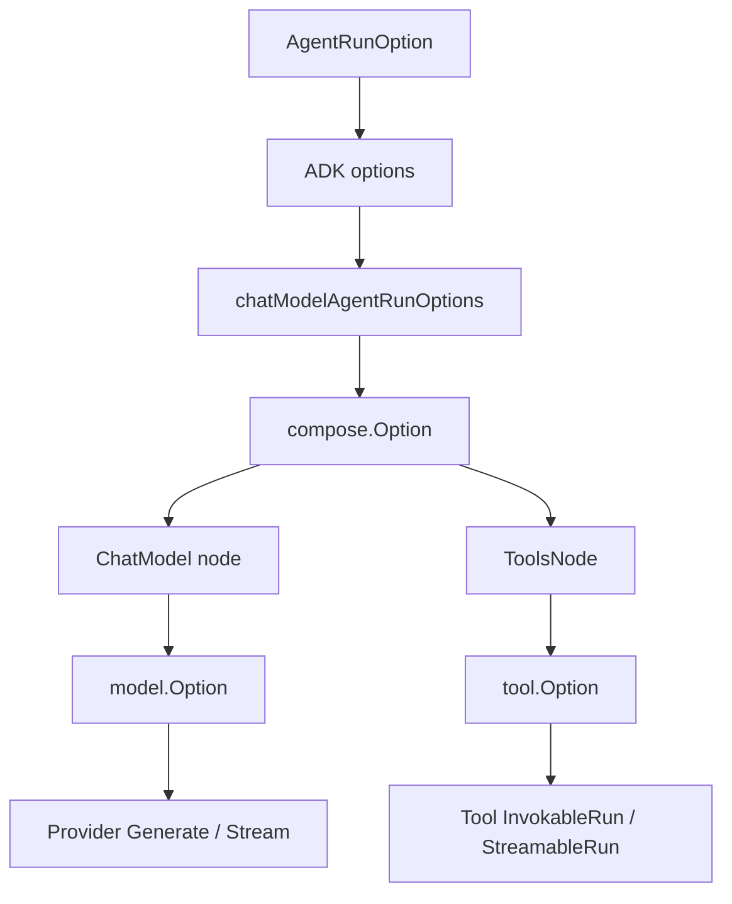

# ADK 配置分层全景

ADK 里有很多名字叫 `Config`、`Option`、`State` 的东西。第一次读源码时，很容易产生一种错觉：它们都是“把字段填进去”，然后框架统一读取。

实际上它们属于不同的生命周期。最重要的不是记住每个字段，而是先回答：

1. 谁创建它？
2. 它会活多久？
3. 哪一层会读取它？
4. 它最终会被转换成什么？

## 1. 先记住这一张配置地图



一句话记忆：

```text
Config       = 这个长期对象是什么
RunOption    = 这一次怎么运行
CompileOption= Graph 编译成什么样
model.Option = 这一次模型调用怎么发
tool.Option  = 这一次 Tool 调用怎么发
State        = 下一轮继续依赖什么
ResumeParams = 中断后从哪里、带什么数据继续
```

## 2. 先看生命周期，而不是字段名

| 配置层 | 典型类型 | 谁创建 | 典型生命周期 | 主要消费者 |
| --- | --- | --- | --- | --- |
| 应用/Runner 层 | `RunnerConfig` | 应用启动 | 进程或服务生命周期 | `Runner` |
| Agent 层 | `TypedChatModelAgentConfig[M]` | 应用启动 | Agent 复用期间 | `ChatModelAgent` |
| Tool 层 | `ToolsConfig`、`compose.ToolsNodeConfig` | Agent 构造 | Agent 配置生命周期 | `ToolsNode` / ReAct |
| Handler 层 | `Handlers`、旧 `Middlewares` | Agent 构造 | Agent 复用期间，方法在运行时执行 | wrapper 和 state hook |
| Middleware 自身 | `agentsmd.Config`、`reduction.Config` 等 | 应用启动 | Middleware 复用期间 | 对应 Middleware |
| 单次运行层 | `AgentRunOption` | 每次 `Run/Query/Resume` | 一次运行或一次恢复 | Runner、flowAgent、具体 Agent |
| Graph 编译层 | `GraphCompileOption` | `Compile` / 构造 Runnable | 编译结果生命周期 | compose Graph |
| 模型调用层 | `model.Option` | 每次模型调用前 | 一次 `Generate/Stream` | ChatModel/provider |
| Tool 调用层 | `tool.Option` | 每次 Tool 调用前 | 一次 `InvokableRun/StreamableRun` | Tool |
| 恢复层 | `ResumeParams` | 调用 `ResumeWithParams` | 一次恢复 | Runner、interrupt target |
| 运行状态层 | `ChatModelAgentState`、Graph state | 框架运行时 | 当前 Run，可 checkpoint | 下一轮、Resume |

两个非常重要的区别：

- `ChatModelAgentConfig` 可以复用，但里面的 `Messages` 不应该存在；消息属于每次运行的 state。
- `AgentRunOption` 可以每次不同，但它不会永久修改 Agent 的 Config。

## 3. RunnerConfig：配置“从哪里开始跑”

源码类型：`adk/runner.go`。

```go
type RunnerConfig struct {
    Agent           Agent
    EnableStreaming bool
    CheckPointStore CheckPointStore
}
```

它只有三个核心问题：

| 字段 | 小白解释 | 什么时候读取 |
| --- | --- | --- |
| `Agent` | 这张工单交给谁做 | 每次 Run 时包成 `flowAgent` |
| `EnableStreaming` | 是否允许消息内容逐块返回 | Runner 创建 `AgentInput` 时写入 |
| `CheckPointStore` | 中断时把现场放在哪里 | 发生 interrupt/cancel 和 Resume 时 |

`CheckPointStore` 不是普通的对话数据库。它保存的是“暂停的执行现场”：Graph state、Agent 路径、interrupt 目标等。用户昨天说过什么，除非应用自己存储并重新加载，否则不会因为配置了 CheckPointStore 就自动变成长期记忆。

```text
RunnerConfig
  ↓ NewRunner
Runner { root Agent, streaming, store }
  ↓ 每次 Query
root runContext + runSession + flowAgent
```

`checkPointID` 通常不放在 `RunnerConfig`，因为它属于某一次请求，应通过 `WithCheckPointID` 这类 Run Option 提供。

## 4. ChatModelAgentConfig：配置“这个 Agent 是谁”

源码类型：`adk/chatmodel.go` 的 `TypedChatModelAgentConfig[M]`。

可以把它分成六组，而不是把二十多个字段看成一张平表。

### 4.1 身份组

```go
Name        string
Description string
```

- `Name` 用于 RunPath、事件来源、Transfer、AgentTool 名称；
- `Description` 帮助父模型理解子 Agent 能做什么；
- 独立运行时可以为空，但包装成 `AgentTool` 时必须能生成有效的 ToolInfo。

### 4.2 模型输入组

```go
Instruction   string
GenModelInput TypedGenModelInput[M]
```

`Instruction` 是 Agent 的稳定身份规则；`GenModelInput` 是“AgentInput 如何变成模型 Messages”的转换器。

默认流程：

```text
Instruction
  → System Message
  → SessionValues 做 FString 替换
  → AgentInput.Messages 追加在后面
  → []M 交给 Model
```

如果需求是“每轮根据当前历史删除旧 Tool result”，不要改 `GenModelInput`，应放在 `BeforeModelRewriteState`。前者偏向入口转换，后者才是每轮模型前的 state 改写。

### 4.3 模型本体组

```go
Model model.BaseModel[M]
```

`Model` 是能力依赖，不是一次调用的选项。温度、停止词、provider 特有参数等，通常通过每次 Run 的 `WithChatModelOptions` 进入 `model.Option`，而不是修改 Agent Config 里的 Model。

### 4.4 工具与终止组

```go
ToolsConfig    ToolsConfig
Exit           tool.BaseTool
OutputKey      string
MaxIterations  int
```

- `ToolsConfig` 决定有哪些真实 Tool、如何执行、是否直接返回；
- `Exit` 是一个特殊的结束工具；
- `OutputKey` 把结果写入 session value，属于兼容 transfer 的旧路径，当前不推荐依赖它传递完整上下文；
- `MaxIterations` 限制模型 ↔ Tool 循环次数，避免模型无限调用。

注意：即使用户没有手动添加 Tool，只要配置了 Transfer 或 Exit，运行期也可能被注入隐式 Tool，于是仍会进入 ReAct 分支。

### 4.5 扩展组

```go
Handlers    []TypedChatModelAgentMiddleware[M]
Middlewares []AgentMiddleware // Deprecated
```

它们都是 Agent 的长期依赖，但方法在运行时执行：

```text
Handlers（新版）
  BeforeAgent → 每次 Run/Resume
  BeforeModelRewriteState → 每个模型轮次前
  WrapModel → 每次模型调用
  Wrap*ToolCall → 每次 Tool 调用
  AfterModelRewriteState → 每次模型成功后
  AfterAgent → 成功终态

Middlewares（旧版）
  AdditionalInstruction/Tools → 基础执行上下文准备时
  Before/AfterChatModel → 经典消息路径每个模型轮次
  WrapToolCall → compose ToolNode wrapper 链
```

新代码优先使用 `Handlers`。不要把旧 `Middlewares` 和新版 Handler 当成两套可以随便混合的同名接口；它们的字段、返回值、Agentic 支持范围都不同。

### 4.6 失败策略组

```go
ModelRetryConfig   *TypedModelRetryConfig[M]
ModelFailoverConfig *ModelFailoverConfig[M]
```

- Retry：同一个模型调用失败后是否重试、是否改变输入、如何等待；
- Failover：模型失败后是否切换备用模型。

它们是策略配置，不是 Middleware。需要改变整个模型调用链时才用 `WrapModel`；只决定“失败后重试还是换模型”时用这两个配置更清晰。

## 5. ToolsConfig：配置“模型能看到什么、实际能执行什么”

```go
type ToolsConfig struct {
    compose.ToolsNodeConfig
    ReturnDirectly     map[string]bool
    EmitInternalEvents bool
}
```

`ToolsConfig` 嵌入了 `compose.ToolsNodeConfig`，所以它不是一个完全独立的 ADK 配置。



### 5.1 `Tools`：工具本体

```go
Tools: []tool.BaseTool{weatherTool, calendarTool}
```

这决定实际可执行能力。模型是否能看到每个 Tool 的 schema，还要经过 `Info(ctx)` 和可能的 `BeforeAgent`、`BeforeModelRewriteState` 筛选。

### 5.2 `ToolCallMiddlewares`：ToolNode 层包装

它的类型是 `[]compose.ToolMiddleware`，不是 `[]adk.ChatModelAgentMiddleware`。它只关心 Tool endpoint：

```text
ToolCallMiddlewares
  → Invokable
  → Streamable
  → EnhancedInvokable
  → EnhancedStreamable
```

新版 ADK Handler 的四个 `Wrap*ToolCall` 最终也会转换到这一类 endpoint wrapper，但 Handler 还拥有 Agent、Model、State 等其他 hook。

### 5.3 `ReturnDirectly`：Tool 结果要不要再问模型

```go
ReturnDirectly: map[string]bool{
    "get_weather": false,
    "download_file": true,
}
```

- `false`：Tool 结果写回 Messages，再回到模型生成解释；
- `true`：Tool 结果可以直接成为本次 Agent 的返回结果。

它是 ReAct 分支的控制配置，不是 Tool 本身的属性。

### 5.4 `EmitInternalEvents`：嵌套 Agent 的事件是否透传

当一个 Agent 被包装为 `AgentTool` 时，子 Agent 的内部事件默认不会作为父 Agent 的 session 历史；打开该配置可以把内部动态转发给外层调用方，但这些事件仍不等于父 Agent 的 State。

## 6. Handler 配置与运行时执行不是一回事

这一点经常让小白困惑：为什么 `Handlers` 写在 Agent Config，却能每次请求看到不同的用户？

因为 Config 里保存的是 Handler 对象，Handler 的方法在运行时被调用：

```text
应用启动
  → 保存 policyMiddleware 对象

第 1 次 Run
  → BeforeAgent(ctx with tenant=A, runCtx)

第 2 次 Run
  → BeforeAgent(ctx with tenant=B, runCtx)
```

所以：

- Handler 自身可以长期复用；
- `ctx`、`runCtx`、`state` 是本次执行传入的；
- 不要把用户 ID、当前 Messages、上一次 Run 的临时结果写进 Handler 的共享字段；
- 需要跨阶段的小数据，用 run-local/context；需要跨请求的事实，用外部 Store。

## 7. AgentRunOption：配置“这次怎么跑”

源码类型：`adk.AgentRunOption`。

典型调用：

```go
iter := runner.Run(ctx, messages,
    adk.WithSessionValues(map[string]any{"User": "小明"}),
    adk.WithCallbacks(traceHandler),
    adk.WithCheckPointID("weather-1001"),
)
```

常见 Run Option 可按消费者分组：

| Option | 谁消费 | 作用 |
| --- | --- | --- |
| `WithSessionValues` | Runner / GenModelInput | 本次运行的模板变量和 session 值 |
| `WithCallbacks` | Agent Callback 初始化 | 本次运行追加观察 Handler |
| `WithCancel` | Runner / cancel monitor | 本次运行可取消，并按模式保存现场 |
| `WithCheckPointID` | Runner / checkpoint bridge | 指定本次中断现场 ID |
| `WithChatModelOptions` | ChatModelAgent | 把 `model.Option` 带到模型节点 |
| `WithToolOptions` | ToolsNode | 把 `tool.Option` 带到 Tool 调用 |
| `WithAgentToolRunOptions` | AgentTool | 给嵌套 Agent 传一组 Run Option |
| `DesignateAgent` | flowAgent | 只让指定名字的 Agent 看到该 Option |
| `WithSkipTransferMessages` | Transfer 路径 | 不转发转交消息 |

### 7.1 为什么 Option 是一个列表而不是一个大 struct

ADK 可能有很多不同类型的 Agent：ChatModelAgent、Workflow Agent、自定义 Agent、AgentTool。统一定义一个包含所有字段的巨大 struct，会让每个 Agent 都背负不属于自己的字段。

ADK 的做法是：一个 `AgentRunOption` 内部包着一个“针对某种具体 options 类型的函数”。每一层只尝试取自己认识的函数：

```text
同一 opts 列表
  ├─ Runner 取 *adk.options
  ├─ ChatModelAgent 取 *chatModelAgentRunOptions
  ├─ compose 取自己的 Option
  └─ 自定义 Agent 取 *MyAgentOptions
```

类型不匹配通常意味着“这一层忽略它”，而不是报错。所以自定义 Option 时要特别注意类型是否写对。

### 7.2 `DesignateAgent` 是可见性过滤，不是执行路由

```go
opt := adk.WithChatModelOptions(model.WithTemperature(0.2))
opt = opt.DesignateAgent("researcher")
```

这表示名为 `researcher` 的 Agent 可以看到该 Option；它不会把任务转交给 `researcher`。Transfer、AgentTool 和 DesignateAgent 是三个不同概念。

## 8. Option 怎样一路转换到 Model 和 Tool



例如：

```go
adk.WithChatModelOptions(
    model.WithTemperature(0.2),
)
```

不会修改 `ChatModelAgentConfig.Model`，而是走：

```text
AgentRunOption
  → chatModelAgentRunOptions.chatModelOptions
  → compose.Option
  → ChatModel node
  → model.Option
  → provider request
```

同理，`WithToolOptions` 不会修改 `ToolsConfig.Tools`，它只影响这次 Tool invocation。

## 9. GraphCompileOption：配置“图怎样编译”

这是 `compose` 层的配置，不是 ADK 的 `AgentRunOption`。

常见类型：

```go
graph.Compile(ctx,
    compose.WithGraphName("order_flow"),
    compose.WithMaxRunSteps(100),
    compose.WithCheckPointStore(store),
    compose.WithSerializer(serializer),
)
```

| CompileOption | 影响 |
| --- | --- |
| `WithGraphName` | Graph 名称、调试和 Address 信息 |
| `WithMaxRunSteps` | 防止 Graph 循环无限运行 |
| `WithCheckPointStore` | Graph 节点状态的 checkpoint 存储 |
| `WithSerializer` | Graph state 如何序列化 |
| `WithNodeTriggerMode` | 节点在前驱完成到什么条件时触发 |
| `WithEagerExecutionDisabled` | 是否等待 super step 再执行 |

ChatModelAgent 内部也会编译 ReAct Graph，但它会把 ADK 的 `MaxIterations`、ToolInfo、Retry、Cancel、event sender 等语义先转换成 Graph 能理解的结构。

不要把 `WithMaxRunSteps` 当成 `MaxIterations`：

- `MaxIterations` 限制 Agent 的模型循环；
- `WithMaxRunSteps` 限制 compose Graph 的执行步数；
- 两者属于不同层，不能互相替代。

## 10. Workflow Config：配置“多个 Agent 怎样组合”

当前源码有三类基础 Workflow 配置：

```go
SequentialAgentConfig{
    Name: "pipeline",
    SubAgents: []adk.Agent{extractor, reviewer},
}

ParallelAgentConfig{
    Name: "fanout",
    SubAgents: []adk.Agent{weather, traffic},
}

LoopAgentConfig{
    Name: "retry_loop",
    SubAgents: []adk.Agent{checker},
    MaxIterations: 3,
}
```

它们主要配置：

- Workflow 自己的 Name/Description；
- 子 Agent 列表；
- Loop 的最大迭代次数。

Workflow Config 决定“谁先跑、谁并行、谁重复”，不负责模型温度、Tool 权限或摘要策略。那些仍应配置在具体子 Agent 或其 Handler 上。

当前源码对基于 transfer/full-context sharing 的 Workflow Agent 有 NOT RECOMMENDED 提示。实际选型时，应评估 `AgentTool`、DeepAgent 或其他组合方式。

## 11. Middleware 自身的 Config：它决定“规则怎么工作”

Middleware Config 和 `ChatModelAgentConfig.Handlers` 是两层：

```go
summaryMW, err := summarization.New(ctx, &summarization.Config{
    Model:       summaryModel,
    TokenCounter: counter,
    Trigger:     trigger,
})

agent, err := adk.NewChatModelAgent(ctx, &adk.ChatModelAgentConfig{
    Model:   model,
    Handlers: []adk.ChatModelAgentMiddleware{summaryMW},
})
```

- `summarization.Config`：摘要 Middleware 自己需要什么模型、阈值、策略；
- `Handlers`：把这个已经构造好的 Middleware 接到 ChatModelAgent 的生命周期上。

类似地：

| Middleware Config | 主要控制 |
| --- | --- |
| `agentsmd.Config` | Backend、文件路径、import、大小限制、warning |
| `summarization.Config` | 摘要模型、token counter、触发阈值、finalizer |
| `reduction.Config` | Tool 结果截断、卸载、清理阈值 |
| `filesystem.Config` | Backend、文件工具、shell 和 instruction |
| `skill.Config` | 技能目录、Backend、加载和 fork 行为 |
| `plantask.Config` | 任务 Backend、目录和任务 Tool |

这些 Config 不是 Runner Option。它们通常在应用启动时构造成一个 Middleware，再放入 `Handlers`。

## 12. Resume 和 Cancel 的配置不是普通 State

中断时需要两类信息：

```text
checkpoint
  = 当时的执行状态、Graph state、Agent 路径

ResumeParams.Targets
  = 这次恢复要给哪个 interrupt address 什么数据
```

```go
iter, err := runner.ResumeWithParams(ctx, "approval-1001", &adk.ResumeParams{
    Targets: map[string]any{
        "agent:weather_assistant/tools/confirm": "approved",
    },
})
```

Checkpoint 解释“暂停时是什么样”，ResumeParams 解释“现在给暂停点什么输入”。不要把 resume data 直接写成普通 session value，也不要把 checkpoint 当成长期 Memory。

Cancel 也有层级：

| Cancel 配置 | 作用 |
| --- | --- |
| `WithCancel()` | 为一次运行创建可取消句柄 |
| `WithAgentCancelMode(...)` | 选择立即取消、模型后安全点、Tool 后安全点 |
| `WithAgentCancelTimeout(...)` | 安全点迟迟不到时升级为 immediate |
| `WithRecursive()` | 向 checkpoint-aware 子 Agent 传播取消 |

这些设置决定运行控制，不是 Middleware，也不是 Model Retry。

## 13. 一次配置到底在哪个阶段被读取

```mermaid
flowchart LR
    C["构造期 Config"] --> P["保存到长期对象"]
    P --> B["Run 前准备 exec context"]
    B --> H["BeforeAgent"]
    H --> G["GenModelInput / ToolInfo"]
    G --> R["ReAct / Graph Runnable"]
    R --> BM["BeforeModelRewriteState"]
    BM --> MO["model.Option / Tool Option"]
    MO --> Call["一次真实 Model / Tool 调用"]
    Call --> S["State 持续到下一轮"]
    S --> CP["需要时 checkpoint"]
```



按源码执行时序可以这样读：

1. 构造器校验 Config，并保存长期依赖；
2. 第一次需要运行时准备基础 exec context，并生成 ToolInfo；
3. 每次 Run/Resume 应用 `BeforeAgent`，得到本次 instruction/tools；
4. 根据最终 Tool 集选择无工具 Chain 或 ReAct Graph；
5. 每轮模型前应用 State Middleware；
6. 将 Run Option 拆成 Model、Tool、Graph 各自能认识的 Option；
7. 真实调用完成后把结果写回 State，再决定下一轮或终态；
8. 发生 interrupt/cancel 时把 State 和 Graph 现场桥接到 checkpoint。

## 14. 选择配置位置的反例

### 把用户 ID 写进 Agent Config

错误原因：Agent 可能被多个用户并发复用，字段会互相覆盖。

正确做法：`WithSessionValues` 或请求 Context；需要跨请求则写外部 Store。

### 为一次请求改变 `MaxIterations`

不要修改共享 Agent Config。应该使用支持该语义的 Run Option 或创建明确的 Agent 实例；共享 Config 应保持线程安全和可预测。

### 用 `WithChatModelOptions` 改 Tool 权限

它只会到 Model 节点，不能阻止真实 Tool 执行。权限必须放 `BeforeAgent`、Tool wrapper 或 Tool service。

### 用 GraphCompileOption 改本次用户问题

CompileOption 影响 Runnable 的结构，代价和生命周期都更长。本次用户输入应走 `Run` 的 messages 或 `AgentRunOption`。

### 把摘要结果塞进 Context 当长期记忆

Context 只解决调用链传播。摘要要跨 Query 使用，应写入应用的 Summary Store，并在下次 Run 的模型前召回。

## 15. 小白配置检查清单

写配置前逐项回答：

```text
[ ] 这是启动时固定的，还是每次请求才变化？
[ ] 它影响 Runner、Agent、Graph、Model 还是 Tool？
[ ] 它会被哪一个函数读取？
[ ] 它是否会改变下一轮 State？
[ ] 它是否应该进入 checkpoint？
[ ] 它是否应该跨 Query 保存？如果是，为什么没有外部 Store？
[ ] 它的失败应该影响一次调用、一次 Tool、一次 Agent，还是整个 Runner？
[ ] 它是新版 Handler、旧 Middleware，还是 compose ToolNode Middleware？
```

如果仍然无法判断，回到四个关键词：

```text
长期对象 → Config
单次执行 → AgentRunOption
真实调用 → model.Option / tool.Option
跨轮状态 → State；跨请求事实 → 外部 Store
```

## 16. 与已有章节的关系

- 想看字段如何转成内部对象：读 [Config 与 Option 转换全链路](./config-option-flow.md)；
- 想看 Agent 每个配置何时执行：读 [完整生命周期](./lifecycle.md)；
- 想看新版/旧版 Middleware 配置：读 [Middleware 新旧 API](./middleware-current.md)；
- 想看 Tool、Callback、Middleware 该怎么选：读 [执行阶段与组件选型](./component-positioning.md)；
- 想看 Context 与状态的区别：读 [Context 的逐层传播](./context-flow.md) 和 [状态、历史与记忆](./state-and-memory.md)；
- 想从小白案例串起来：读 [从一句话到一次 Agent 运行](./zero-to-agent.md)。

这页解决的是“配置放哪一层、什么时候生效”；具体源码函数和边界行为仍以各专门章节为准。
