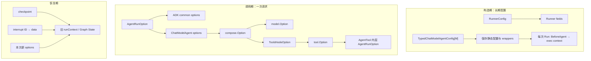
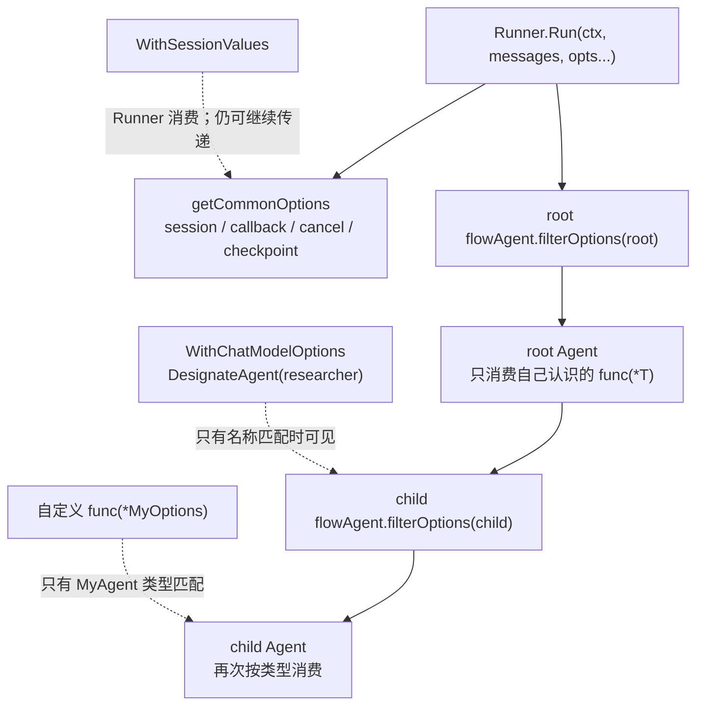
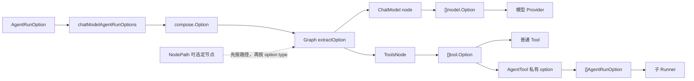

# Config 与 Option 的转换全链路

::: warning Middleware 配置已演进
当前主入口是 `Handlers []TypedChatModelAgentMiddleware[M]`；`Middlewares []AgentMiddleware` 仍保留兼容但已 Deprecated。下文同时解释“当前主链”和“旧字段如何继续被折叠”，迁移关系见 [Middleware 新旧 API](./middleware-current.md)。
:::

初学者阅读 Eino ADK 源码时，很容易把名字里的 `Config`、`Option`、`ToolsConfig`、`GraphCompileOption` 当成“都是配置”。它们的确都在影响行为，但处在完全不同的时间和层级。

最先建立这张心智图：



沿着箭头找最终消费者：Runner 不认识 temperature，ChatModel 不认识 session value，Tool 也不会读取 ChatModelAgentConfig。

```text
创建期（长期保留）
RunnerConfig ─────→ Runner 字段
TypedChatModelAgentConfig[M] ─→ TypedChatModelAgent 字段
                                  │ 每次 Run 准备 exec context
                                  ├─ Handlers.BeforeAgent 动态改 instruction/tools
                                  ├─ classic Message：无工具链或 ReAct
                                  └─ AgenticMessage：agentic model chain

编译期（生成 Runnable）
GraphCompileOption ───→ graph name / state / checkpoint / max steps ...

每次调用（短期）
AgentRunOption
   ├─ ADK 通用选项 → Runner / flowAgent 直接消费
   └─ ChatModelAgent 选项
          ↓ getComposeOptions
       compose.Option
          ├─ ChatModel node → []model.Option
          ├─ ToolsNode       → ToolsNodeOption → []tool.Option
          └─ Graph runtime  → callback / state modifier / checkpoint ID
```

一句话区分：**Config 决定“这个 Agent 是什么”，RunOption 决定“这一次怎么跑”，CompileOption 决定“图编译成什么样的 Runnable”。**

## 一、RunnerConfig 几乎是直接映射

```go
type RunnerConfig struct {
    Agent           Agent
    EnableStreaming bool
    CheckPointStore CheckPointStore
}
```

`NewRunner` 没有复杂的转换，它把三个字段直接存入 `Runner`：

| Config 字段 | Runner 字段 | 何时消费 |
| --- | --- | --- |
| `Agent` | `a` | 每次 Run/Resume 时包成 flowAgent |
| `EnableStreaming` | `enableStreaming` | Run 时写入 `AgentInput.EnableStreaming` |
| `CheckPointStore` | `store` | 中断时保存、Resume 时读取 |

`checkPointID` 不在 `RunnerConfig` 里，因为它通常属于某一次请求，由运行 Option 提供。Store 是长期依赖，ID 是本次实例标识，两者不应该混在同一个生命周期。

## 二、ChatModelAgentConfig 先被“归一化”

`NewChatModelAgent` 是经典消息入口，内部调用 `NewTypedChatModelAgent[*schema.Message]`。它要求 Model 非 nil，并将 Config 归一化为 Agent 的稳定字段；Name/Description 独立运行可为空，包装为 AgentTool 时才要求非空。

```go
type TypedChatModelAgentConfig[M MessageType] struct {
    Name             string
    Description      string
    Instruction      string
    Model            model.BaseModel[M]
    ToolsConfig      ToolsConfig
    GenModelInput    TypedGenModelInput[M]
    Exit             tool.BaseTool
    OutputKey        string
    MaxIterations    int
    Handlers         []TypedChatModelAgentMiddleware[M]
    ModelRetryConfig *TypedModelRetryConfig[M]
    ModelFailoverConfig *ModelFailoverConfig[M]
    Middlewares      []AgentMiddleware // Deprecated
}
```

### 当前 Handler 在运行期展开

构造器只保存 Handlers。第一次 Run/Resume 时，`buildRunFunc` 在 `sync.Once` 中调用 `prepareExecContext`，生成并缓存包含静态 instruction/tools、隐式 transfer/exit tool、兼容 Middleware 和 ToolInfo 的基准 `execContext`。此后**每次** Run/Resume，`getRunFunc` 都从该基准调用 `applyBeforeAgent`：复制本次 instruction/tools/ReturnDirectly，按顺序执行 Handlers，再重新生成本次 ToolInfo。因而动态行为来自 `applyBeforeAgent`，不是反复执行 `prepareExecContext`。

每个模型轮次再执行 state hooks 与 model wrappers；Tool wrappers 则在真实端点周围执行。Handlers 不是创建期被拆成几个静态 slice 的旧模型。

### 兼容 Middleware 仍会按能力进入不同阶段

每个 `AgentMiddleware` 可同时携带四类扩展：附加 instruction、附加 tools、模型前后 hooks、tool-call wrapper。当前实现不是在构造器中一次性拆成五个永久 slice，而是在不同时间读取这些字段：

```text
构造 NewTypedChatModelAgent
  Middlewares[i].WrapToolCall
    → 收集并追加到 ToolCallMiddlewares

首次 prepareExecContext（sync.Once）
  Middlewares[i].AdditionalInstruction
    → 基准 instruction 字符串追加
  Middlewares[i].AdditionalTools
    → 基准真实 Tools 追加

每次 typedStateModelWrapper.Generate / Stream（仅经典 Message）
  Middlewares[i].BeforeChatModel
    → 新 BeforeModelRewriteState 之前
  Middlewares[i].AfterChatModel
    → 新 AfterModelRewriteState 之后
```

这表明旧 Middleware 不是 `AgentRunOption`：它仍属于 Agent 的长期配置。两个旧 model hook 会按每轮调用读取，但在 AgenticMessage 路径上不执行；完整兼容行为见 [兼容版 Middleware](./middleware.md)。

### GenModelInput 的默认值

如果没传 `GenModelInput`，会使用 `defaultGenModelInput`：

1. 有 instruction 时构造 system message；
2. 读取 session values；
3. 用 f-string 替换 `{User}` 这类占位符；
4. 将原 `AgentInput.Messages` 追加在 system message 后。

因此 session value 不是被 Runner 直接改写到 prompt，而是到 `GenModelInput` 这一层才被读取和格式化。

## 三、为什么可执行结构要到 Run 时才能确定

Agent 在构造后还可以建立父子关系；更重要的是，新版 `BeforeAgent` 每次运行都可能改变 Instruction 和真实 Tool 集。所以静态 Config 并不足以提前决定“本次是否有 Tool”和本次 ToolInfo。

每次执行准备阶段会做以下转换（底层仍复用稳定 run function 框架）：

```text
ChatModelAgent 稳定字段
   ├─ copy instruction
   ├─ copy ToolsNodeConfig
   ├─ copy ReturnDirectly map
   ├─ 有可转交 Agent：加 transfer instruction + transfer tool
   ├─ 有 Exit：加 exit tool + ReturnDirectly
   ├─ BeforeAgent handlers 修改本次配置
   └─ 按本次最终 tools 数量分支
        ├─ 0 个：简单 Chain
        └─ >0 个：reactConfig → newReact
```

注意：用户没配置普通 Tool，也不一定走“无工具”分支。只要有可 Transfer 的 Agent 或 `Exit`，构建阶段就会注入工具，最后仍然走 ReAct。

父子关系仍应在第一次 Run 前完成；但不要由此误推断 Handlers 只能静态修改工具。`BeforeAgent` 的设计目的正是每次 Run 动态装配。

## 四、ToolsConfig 到 ToolsNodeConfig 的转换

ADK 的 `ToolsConfig` 是对 compose 的一层扩展：

```go
type ToolsConfig struct {
    compose.ToolsNodeConfig
    ReturnDirectly   map[string]bool
    EmitInternalEvents bool
}
```

`compose.ToolsNodeConfig` 主要包含：

- `Tools`：实际工具列表；
- `UnknownToolsHandler`：模型请求不存在的工具时如何处理；
- `ExecuteSequentially`：多 tool call 是顺序还是并行；
- `ToolArgumentsHandler`：调用前改写 arguments；
- `ToolCallMiddlewares`：包装 invokable/streamable tool call。

ADK 新增的两个字段不属于普通 ToolsNode 能理解的语义：

- `ReturnDirectly`：决定 ReAct 分支在某工具返回后直接 END，还是回到 ChatModel；
- `EmitInternalEvents`：决定 AgentTool 的内部事件是否转发到外层 generator。

因此 `buildRunFunc` 会将嵌入的 `ToolsNodeConfig` 交给 `reactConfig`，将 `ReturnDirectly` 单独交给 ReAct 的分支判定，将 `EmitInternalEvents` 留到每次 Run 时注入 Tool Option。

## 五、reactConfig 如何变成 Graph

经典 Message 路径的执行配置是 ChatModelAgent 与 compose Graph 之间的桥；AgenticMessage 路径则不构建同等的 ToolsNode ReAct 循环：

```text
reactConfig
  ├─ model
  ├─ *ToolsNodeConfig
  ├─ toolsReturnDirectly
  ├─ maxIterations
  ├─ old before/after hooks + current handlers
  ├─ retry / failover / cancel
  └─ model and tool event senders
          ↓ newReact
  Graph[[]Message, Message]
  START → ChatModel → (有 tool calls?) → ToolsNode → ChatModel
                       └─ (直返/无调用) → END
```

`newReact` 的关键转换包括：

1. 建立 Graph state generator；`MaxIterations <= 0` 时默认剩余 20 次；
2. 遍历本次最终工具并调用 `Info(ctx)`，生成模型可读的 `ToolInfo`；
3. 组织 failover → retry → event sender → Handler WrapModel → callback injection 链；
4. 通过 model options 把 ToolInfos 传给模型；
5. 在用户 Tool wrappers 外放置默认 event sender，并加入流式取消监控；
6. `NewToolNode` 将普通/流式/Enhanced 四类 middleware 绑定到端点，并为可转换模式做适配；
7. 建立 ChatModel 与 ToolsNode 之间的条件边。

这时得到的还是 Graph 定义。真正的 runnable 是在 run closure 中构建外层 Chain 并 Compile 得到的。

## 六、GraphCompileOption 不是 AgentRunOption

ChatModelAgent 构造 runnable 时使用的编译配置包括：

```go
compose.WithGraphName(a.name)
compose.WithCheckPointStore(store)
compose.WithSerializer(&gobSerializer{})
compose.WithMaxRunSteps(math.MaxInt)
```

| CompileOption | 作用 |
| --- | --- |
| GraphName | 设定 runnable 名称，也影响 Address/callback 信息 |
| CheckPointStore | 为 compose 图提供 checkpoint 存储 |
| Serializer | 序列化 Graph state，ADK 使用 gob bridge |
| MaxRunSteps | 图执行步数上限 |
| GenLocalState | 创建 Graph 局部 state，通常在 NewGraph/NewChain 时设定 |

ReAct 自己用 remaining iterations 控制 Agent 迭代。外层 compose 的 `MaxRunSteps` 被设成 `math.MaxInt`，是为了避免 compose 的通用步数限制比 ADK 的迭代语义更早截断执行。

CompileOption 在构建 runnable 时消费；`AgentRunOption` 则是每个请求都可以不同。不要为了给单次调用设置 temperature 而重新 Compile Graph。

## 七、AgentRunOption 是怎么同时被多层“挑选”的

```go
type AgentRunOption struct {
    implSpecificOptFn any
    agentNames        []string
}
```

它里面的 `implSpecificOptFn` 故意是 `any`。一个 Option 通过 `WrapImplSpecificOptFn(func(*T))` 包装某种确切类型的修改函数。消费者用 `GetImplSpecificOptions[T]` 尝试类型断言：

```go
optFn, ok := opt.implSpecificOptFn.(func(*T))
if ok {
    optFn(base)
}
```

因此同一个 `[]AgentRunOption` 可以穿过多层，每层只消费自己认识的函数类型：

```text
WithSessionValues       → func(*adk.options)               ADK 通用层认识
WithCallbacks           → func(*adk.options)               Agent callback 层认识
WithCancel              → func(*adk.options)               可取消执行层认识
WithChatModelOptions    → func(*chatModelAgentRunOptions)  ChatModelAgent 认识
自定义 Agent Option     → func(*MyAgentOptions)             只有自定义 Agent 认识
```

不匹配的 Option 不会报错，只是对该消费者无效。这个机制实现了“一条 Option 列表通过异构 Agent 树传播”，但也意味着自定义 Option 的泛型类型写错时可能会静默不生效。

### DesignateAgent 再做一层可见性过滤

```go
opt := adk.WithChatModelOptions(...).DesignateAgent("researcher")
```

`flowAgent.Run` 在调用具体 Agent 前执行 `filterOptions(agentName, opts)`：

- `agentNames` 为空：所有 Agent 可见；
- 包含当前 Agent 名：可见；
- 否则：不传给当前具体 Agent。

Runner 在此之前已经用原始 opts 读取 ADK common options。所以需要区分“Runner 对 Option 的消费”与“具体 Agent 的可见性”。



<p class="diagram-caption">同一份 AgentRunOption 列表会被多层查看：先按 Agent 名过滤，再按内部函数的确切类型挑选；不匹配通常是静默忽略。</p>

## 八、getComposeOptions：ADK 到 compose 的正式边界

ChatModelAgent 认识的每次运行配置是：

```go
type chatModelAgentRunOptions struct {
    chatModelOptions []model.Option
    toolOptions      []tool.Option
    agentToolOptions map[string][]AgentRunOption
    historyModifier  func(context.Context, []Message) []Message
}
```

`getComposeOptions` 做三组转换。

### 1. ChatModel options

```text
WithChatModelOptions([]model.Option)
  → chatModelAgentRunOptions.chatModelOptions
  → compose.WithChatModelOption(...)
  → compose.Option{options: []model.Option}
  → 运行时只分发给 ChatModel 节点
```

### 2. Tool options 和 AgentTool options

```text
WithToolOptions([]tool.Option)
  ┐
  ├─→ []tool.Option
  │       → compose.WithToolOption(...)
  │       → compose.WithToolsNodeOption(...)
  ┘       → compose.Option{options: []ToolsNodeOption}

WithAgentToolRunOptions(map[toolName][]AgentRunOption)
  → withAgentToolOptions(toolName, agentOpts)
  → 一个内部 tool.Option
  → 合并进上面的 []tool.Option
```

第二条很容看晕：AgentTool 对外就是一个 Tool，所以“传给内部 Agent 的 `AgentRunOption`”需要先包成“外层 Tool 可接收的 `tool.Option`”，等具体 AgentTool 执行时再解包。



<p class="diagram-caption">Option 不会“一股脑传到底”：每一层拆信封，只拿属于自己的类型；AgentTool 因为外表是 Tool，会发生一次额外的包装与解包。</p>

### 3. History modifier

已废弃的 `WithHistoryModifier` 被转成 `compose.WithStateModifier`，它在恢复前将 Graph state 断言为 `*adk.State`，再改写 `Messages`。新 API 是通过 `ChatModelAgentResumeData.HistoryModifier` 提供，但最终仍转成同样的 state modifier。

`ChatModelAgent.Run` 还会无条件追加内部 `bridgeCheckpointID`，让 ADK 外层 checkpoint 能将 compose 子图状态作为一块字节桥接起来。

## 九、compose.Option 如何分发到正确节点

`compose.Option` 是一个运行时信封，可以装载：

- `options []any`：具体组件 Option；
- callback handlers；
- `paths []*NodePath`：目标节点/子图路径；
- checkpoint ID、state modifier、最大步数等 Graph 运行配置。

Graph 运行前的 `extractOption` 按两种规则分发。

### 没有指定 path

- 普通组件节点：比较 `reflect.TypeOf(opt.options[0])` 与节点声明的 `optionType`，类型相同才分发；
- 子图节点：将整个 `compose.Option` 传给子图，让子图继续做下一层分发；
- 纯 callback Option：回调已经被加到 Context，不作为普通 options 发给组件。

### 指定 path

例如只想影响 `ReAct/tools`：

```text
NodePath["ReAct", "tools"]
  ↓ 外层 Chain 发现 ReAct 是子图
NodePath["tools"]
  ↓ ReAct Graph 找到 tools 节点
ToolsNodeOption
```

如果 path 指向不存在的 node，或将 `model.Option` 指派给只接收 `ToolsNodeOption` 的 node，`extractOption` 会显式报错。而没有 path 时依靠类型做广播过滤。

## 十、最后一公里：model.Option 与 tool.Option

### model.Option

ChatModel node 收到 `[]any` 后，通用 wrapper 会断言成 `[]model.Option`，再传给实际 provider 的 `Generate/Stream`。Provider 可以同时读取：

- model package 定义的 common options；
- 某个 provider 自己的 implementation-specific options。

例如 temperature、stop words、模型请求的额外参数，都应该在这一条链中传递，而不是塞进 Context value。

### ToolsNodeOption 再到 tool.Option

ToolsNode 先解析自己的 Option，拿到其中的 `ToolOptions`。真正调用某个 Tool 时，这些 `tool.Option` 才会传到 Tool 的 `InvokableRun` 或 `StreamableRun`。Tool 内部再用与 ADK 类似的 implementation-specific 解析机制拿到自己能识别的配置。

```text
AgentRunOption
  → chatModelAgentRunOptions.toolOptions
  → compose.Option<ToolsNodeOption>
  → ToolsNodeOptions.ToolOptions
  → []tool.Option
  → 某个 Tool 的 impl-specific options
```

这就是为什么不能把 `WithToolOptions` 直接理解为“它改了 ToolsConfig”。`ToolsConfig` 是静态的工具结构；`WithToolOptions` 携带的是这一次 tool invocation 的参数。

## 十一、ADK 额外注入的运行 Option

除了用户传入的 Option，ChatModelAgent 还会根据运行情况动态追加：

| 条件 | 追加的 Option | 用途 |
| --- | --- | --- |
| 所有 Run/Resume | `compose.WithCheckPointID(bridgeCheckpointID)` | ADK 与 compose checkpoint 桥接 |
| `EmitInternalEvents=true` | ToolsNode → ToolOption → event generator | 向外转发 AgentTool 内部事件 |
| `AgentInput.EnableStreaming=true` | ToolsNode → ToolOption → streaming flag | 让 AgentTool 内层按流式运行 |
| 每次模型/Tool 调用 | 默认 event sender wrappers | 将 model/tool 输出转成 AgentEvent |
| 使用 `adk.WithCallbacks` | Agent callback handlers | 观察 Input/ResumeInfo 和独立 AgentEvent iterator |
| 使用 `adk.WithCancel` | cancel context + model/tool monitors | immediate 或安全点取消 |

这些都是运行期 Option，不会回写用户的 `ChatModelAgentConfig`。

## 十二、Resume 时的配置反向转换

Resume 有两条同时发生的恢复链。

### ADK 层：恢复目标进 Context

```text
ResumeParams.Targets map[interruptID]data
  → core.BatchResumeWithData(ctx, targets)
  → globalResumeInfo
  → AppendAddressSegment 形成 Address 后，反查该 Address 对应的 interrupt ID 并领取
```

这里的 map key 必须使用中断事件返回的 `InterruptCtx.ID`，不是 `Address.String()`；Address 是框架内部重新对齐组件位置的依据。详细匹配见 [Context 的逐层传播](./context-flow.md) 和 [中断、检查点与恢复](./interrupt-resume.md)。

### ChatModelAgent 层：恢复数据变成 state modifier

```text
ChatModelAgentResumeData.HistoryModifier
  → compose.WithStateModifier
  → 恢复 Graph state 时修改 *adk.State.Messages
```

同时 checkpoint 中的 `[]byte` 被包成 `newResumeBridgeStore(stateByte)`，再作为 compose checkpoint store 交给重新编译的 runnable。所以 Resume 不是特殊的另一套 Graph，而是“同一构图逻辑 + 恢复 store + runtime state modifier + Context 中的定位数据”。

## 十三、一个完整例子的转换过程

```go
iter := runner.Query(ctx, "查天气",
    adk.WithSessionValues(map[string]any{"User": "Alice"}),
    adk.WithChatModelOptions([]model.Option{modelOpt}),
    adk.WithToolOptions([]tool.Option{toolOpt}),
)
```

这三个 Option 并不在同一层被一次性解析：

1. Runner 用 `GetImplSpecificOptions[adk.options]` 只识别 `WithSessionValues`；
2. `AddSessionValues` 把 `User=Alice` 写入 runSession；
3. flowAgent 按 Agent 名称过滤 Option；
4. ChatModelAgent 用 `GetImplSpecificOptions[chatModelAgentRunOptions]` 识别后两个；
5. `modelOpt` 被包成 `compose.WithChatModelOption`；
6. `toolOpt` 先进 `compose.WithToolOption`，再被 `compose.WithToolsNodeOption` 外包；
7. Graph `extractOption` 将两类信封分发到 ChatModel node 和 ToolsNode；
8. ChatModel provider 最终解析 `modelOpt`；
9. 真正的 Tool 在被调用时最终解析 `toolOpt`；
10. system prompt 在 `defaultGenModelInput` 中从 Context 读 session，将 `{User}` 替换为 `Alice`。

这个例子同时说明：Option 传播链与 Context 传播链是并行的。Option 负责显式调用参数，Context 负责跨层运行环境。

## 十四、常见误区

### 误区 1：改了 Config，已构建的 Agent 会自动变

Config 在构造时被拷贝/归一化。构造后修改原 Config 不应被当成动态更新 API。需要按请求改变 instruction 或真实工具时，用 `Handlers.BeforeAgent` 返回本次运行配置；不要修改原 Config 或 Agent 的私有字段。

### 误区 2：WithToolOptions 可以在运行时新增 Tool

`WithToolOptions` 传递的是 `tool.Option`，不是 `tool.BaseTool`。要增加工具，应放入静态 `ToolsConfig`，或在新版 Middleware 的 `BeforeAgent` 修改 `runCtx.Tools`。旧 `AdditionalTools` 只用于兼容。

### 误区 3：所有 AgentRunOption 都会传到所有子 Agent

`DesignateAgent` 会做名称过滤；AgentTool 的内层 Agent Option 还需要通过 `WithAgentToolRunOptions` 按 tool name 包装传递。

### 误区 4：compose.Option 被放在 Context 里

大部分组件 Option 走函数参数与 `extractOption` 分发，不是 Context value。Callback manager、Graph state、checkpoint/resume 辅助信息才会在运行中进入 Context。

### 误区 5：MaxIterations 就是 MaxRunSteps

`MaxIterations` 是 ReAct 语义下的模型生成轮次；`MaxRunSteps` 是 compose executor 的通用图步数保护。一轮 ReAct 可以包含 ChatModel、分支、ToolsNode 等多个 graph step，两者不是 1:1。

## 十五、源码定位清单

| 要追踪的问题 | 源码文件 |
| --- | --- |
| RunnerConfig 如何落到 Runner | `adk/runner.go` |
| AgentRunOption 的泛型函数包装 | `adk/call_option.go` |
| ChatModelAgentConfig 归一化 | `adk/chatmodel.go` 的 `NewChatModelAgent` |
| 首次冻结基准 exec context | `adk/chatmodel.go` 的 `prepareExecContext` / `buildRunFunc` |
| 每次运行生成动态 exec context | `adk/chatmodel.go` 的 `applyBeforeAgent` / `getRunFunc` |
| 经典/Agentic 运行分支 | `adk/chatmodel.go`、`adk/react.go` |
| ADK Option 转 compose.Option | `adk/chatmodel.go` 的 `getComposeOptions` |
| reactConfig 转 Graph | `adk/react.go` 的 `newReact` |
| ToolsNodeConfig 与 ToolOptions | `compose/tool_node.go` |
| compose.Option 定义 | `compose/graph_call_options.go` |
| Option 按类型/path 分发 | `compose/utils.go` 的 `extractOption` |
| GraphCompileOption | `compose/graph_compile_options.go` 与编译执行代码 |
| model/tool 叶子 Option | `components/model/option.go`、`components/tool/option.go` |

读源码时可以始终问三个问题：这个配置是构造时还是调用时生效？它的最终消费者是 Runner、Graph、Model 还是 Tool？它通过函数 options 传递，还是在 Context 中传播？能回答这三个问题，配置链就不会再混乱。
