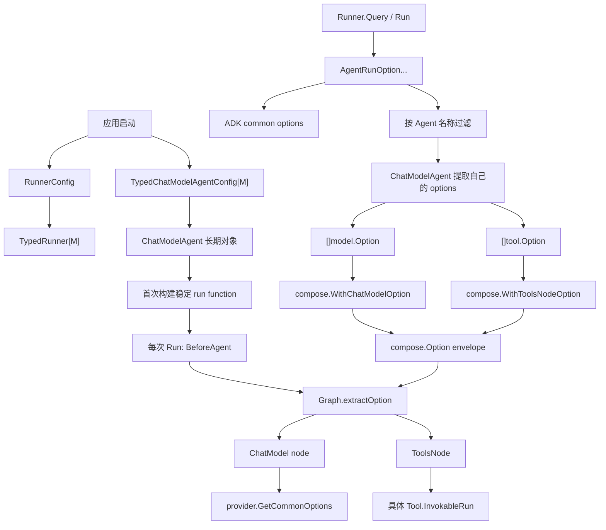
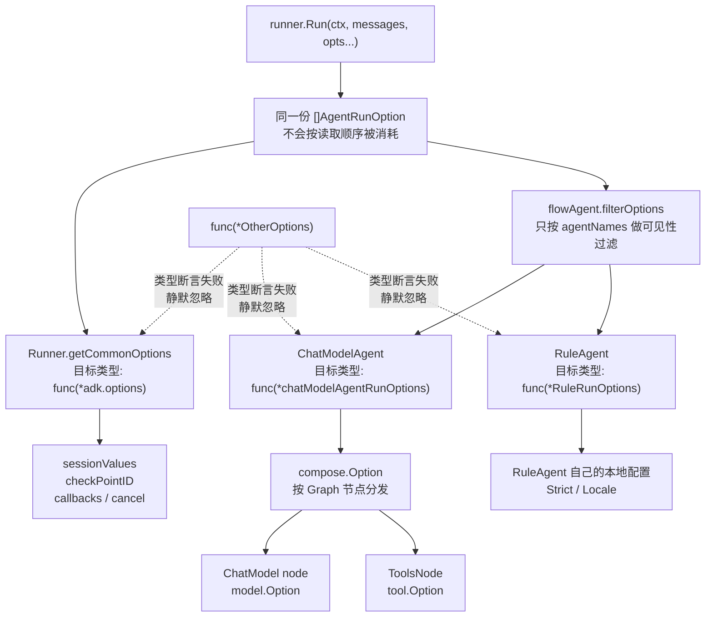

# Config 与 Option 的转换全链路

::: warning 先记住一个结论
`Config`、`AgentRunOption`、`compose.Option`、`model.Option`、`tool.Option` 不是同一种“配置”。它们由不同对象创建，在不同时间生效，最后也由不同消费者读取。

本章用一条真实请求把它们串起来：**构造 Agent → 创建 Runner → `Query` 传入 Option → flowAgent 过滤 → ChatModelAgent 提取 → compose Graph 分发 → Model/Tool 读取。**

当前新版 Middleware 使用 `Handlers`；旧的 `Middlewares` 仍可兼容执行，但已经 Deprecated。详见 [Middleware 新旧 API](./middleware-current.md)。
:::

## 1. 先用四个问题分辨它们

初学者不要先背字段名。看到任何 `Config` 或 `Option`，先问四件事：

| 问题 | 要找的答案 | 例子 |
| --- | --- | --- |
| 谁创建？ | 应用、Runner、Agent、Graph 还是某个叶子组件 | 应用创建 `RunnerConfig`；ChatModelAgent 创建 `compose.Option` |
| 什么时候生效？ | 构造期、首次运行、每次 Run、每次模型调用还是每次 Tool 调用 | `Handlers.BeforeAgent` 每次 Run；`model.WithTemperature` 每次模型调用 |
| 谁读取？ | Runner、flowAgent、ChatModelAgent、Graph、Model、Tool | Runner 读取 `WithSessionValues`；Tool 读取自己的 `tool.Option` |
| 变成什么？ | 字段、Context、Graph state、compose envelope 还是叶子参数 | `model.Option` 最终变成 provider 的 `Options` |

一句话记忆：

```text
Config        = 这个长期对象是什么
AgentRunOption= 这一次 Agent 怎么运行
compose.Option= 这一次 Graph 如何分发运行参数
model.Option  = 这一次模型调用怎么发
tool.Option   = 这一次 Tool 调用怎么发
State         = 下一轮模型和 Resume 依赖的运行状态
ResumeParams  = 中断后从哪里、带什么数据继续
```

不要把“名字里都有 Option/Config”理解成“它们可以互换”。`model.WithTemperature` 不能放进 `ChatModelAgentConfig`，`tool.Option` 也不能用来新增 Tool。

## 2. 一次请求的总链路

下面这张图是本章唯一需要反复回看的主图。每个箭头都表示一次“换包装”或“挑选”：



对应源码的关键事实是：

1. `RunnerConfig` 和 `TypedChatModelAgentConfig` 在构造时保存到长期对象；
2. `AgentRunOption` 从 `Query/Run/Resume` 进入，生命周期通常只覆盖一次运行；
3. 同一份 `AgentRunOption` 会被多层尝试读取，每层只消费自己认识的函数类型；
4. ChatModelAgent 把自己认识的运行选项转换成 `compose.Option`；
5. Graph 再按节点类型和 `NodePath` 将 envelope 分发给 Model 或 ToolsNode；
6. 只有到了叶子组件，`model.Option` 或 `tool.Option` 才会变成真正的模型/工具参数。

## 3. 生命周期地图：每一类对象活多久

| 层级 | 典型类型 | 创建时间 | 主要生命周期 | 最终消费者 |
| --- | --- | --- | --- | --- |
| Runner | `RunnerConfig` / `TypedRunnerConfig[M]` | 应用启动 | Runner 复用期间 | `TypedRunner` |
| Agent | `TypedChatModelAgentConfig[M]` | 应用启动 | Agent 复用期间 | ChatModelAgent |
| Tool 拓扑 | `ToolsConfig` / `compose.ToolsNodeConfig` | Agent 构造 | Agent 配置期间 | ReAct / ToolsNode |
| Middleware | `Handlers`、旧 `Middlewares` | Agent 构造 | Agent 复用；方法在运行时执行 | state/model/tool wrapper |
| 单次运行 | `AgentRunOption` | 每次 `Run/Query/Resume` | 一次运行或一次恢复 | Runner、flowAgent、具体 Agent |
| Graph 编译 | `GraphCompileOption` | `Chain.Compile` | 编译出的 Runnable 生命周期 | compose Graph |
| 模型调用 | `model.Option` | 每次 `Generate/Stream` 前 | 一次模型调用 | Model/provider |
| Tool 调用 | `tool.Option` | 每次 `InvokableRun/StreamableRun` 前 | 一次 Tool 调用 | 具体 Tool |
| 运行状态 | `runSession`、Graph state、`state.Messages` | Run 时创建 | 当前 Run，可被 checkpoint | 下一轮、Resume |
| 恢复参数 | `ResumeParams`、`ChatModelAgentResumeData` | `Resume*` 调用 | 一次恢复 | Runner、interrupt、Graph state |

两个边界必须记牢：

- `ChatModelAgentConfig` 可以被复用，但不应该把本次对话的消息放进 Config；消息属于 `AgentInput` 和 Graph state。
- `AgentRunOption` 可以每次不同，但不会永久修改 Agent 的 Config。

## 4. 可运行 Demo：先看输出，再读转换

仓库新增了一个不依赖外部 API Key 的完整示例：

```text
docs/examples/adk-config-options/main.go
```

在仓库根目录运行：

```bash
go run ./docs/examples/adk-config-options
```

下面直接嵌入完整源码。文档和仓库中的 `.go` 文件使用同一份内容，读者可以先在页面里阅读，再复制命令运行；后续修改示例文件时，页面会自动显示最新版本。

### 完整 Demo 源码

<<< @/examples/adk-config-options/main.go

它使用一个 fake model 和一个 fake tool，把四个结果打印出来：

```text
MODEL: system="你是 小明 的订单助手" temperature=0.2 tools=1
TOOL: user=小明 prefix="查询结果：" args={"id":"A100"}
MODEL: system="你是 小明 的订单助手" temperature=0.2 tools=1
EVENT: 最终回答：查询结果：订单 A100 已发货
```

这个输出本身就是转换链的证据：

| 输出 | 证明了什么 | 来自哪里 |
| --- | --- | --- |
| `小明` 出现在 system message | Session Value 没有直接改模型，而是在 `GenModelInput` 中格式化 instruction | `WithSessionValues` → `runSession.Values` → `defaultGenModelInput` |
| `temperature=0.2` | ChatModelAgent 运行选项已经到达 Model provider | `WithChatModelOptions` → `compose.WithChatModelOption` → `model.GetCommonOptions` |
| `tools=1` | 静态 ToolsConfig 生成了本次模型可见的 ToolInfo | `ToolsConfig` → `execContext` → `model.WithTools` |
| `prefix="查询结果："` | Tool option 穿过了 ToolsNode，最终到达具体 Tool | `WithToolOptions` → `ToolsNodeOption` → `tool.GetImplSpecificOptions` |
| 模型调用两次 | 第一次产生 ToolCall，Tool 执行后 ReAct 回到 Model | `ChatModelAgent` 的 ReAct Graph |

这段 Demo 的完整代码还演示了一个容易遗漏的点：`WithChatModelOptions` 可以用 `DesignateAgent("order_assistant")` 限定只给指定 Agent；`WithToolOptions` 如果没有指定 Agent，则会继续随 Agent 树传播到能识别它的 ChatModelAgent。

## 5. 第一层：RunnerConfig 如何落到 Runner

源码入口：`adk/runner.go`。

```go
type RunnerConfig struct {
    Agent           Agent
    EnableStreaming bool
    CheckPointStore CheckPointStore
}
```

`NewRunner` 基本是直接映射：

| Config 字段 | Runner 中保存的字段 | 何时消费 |
| --- | --- | --- |
| `Agent` | `a` | 每次 Run/Resume 时包成 flowAgent |
| `EnableStreaming` | `enableStreaming` | `Run` 时写入 `AgentInput.EnableStreaming` |
| `CheckPointStore` | `store` | 中断保存、Resume 读取 |

`checkPointID` 不在 `RunnerConfig` 中，而是由 `WithCheckPointID` 作为一次运行选项提供。这样同一个 Runner 可以服务多个会话：Store 是长期依赖，checkpoint ID 是一次运行的实例标识。

```go
runner := adk.NewRunner(ctx, adk.RunnerConfig{
    Agent:           agent,
    EnableStreaming: true,
    CheckPointStore: store,
})

iter := runner.Query(ctx, "你好",
    adk.WithCheckPointID("conversation-001"),
)
```

此时还没有把 `WithCheckPointID` 交给 Model 或 Tool；Runner 先在 ADK common options 中读取它，用于外层 checkpoint 处理。

## 6. 第二层：ChatModelAgentConfig 如何变成长期 Agent

### 6.1 构造器做什么

`NewChatModelAgent` 是经典 `*schema.Message` 的便利入口，内部调用泛型构造器：

```go
type TypedChatModelAgentConfig[M MessageType] struct {
    Name                string
    Description         string
    Instruction         string
    Model               model.BaseModel[M]
    ToolsConfig         ToolsConfig
    GenModelInput       TypedGenModelInput[M]
    Exit                tool.BaseTool
    OutputKey           string
    MaxIterations       int
    Handlers            []TypedChatModelAgentMiddleware[M]
    ModelRetryConfig    *TypedModelRetryConfig[M]
    ModelFailoverConfig *ModelFailoverConfig[M]
    Middlewares         []AgentMiddleware // Deprecated
}
```

构造器会：

1. 检查 Model 是否为空；
2. 没有自定义 `GenModelInput` 时选择默认实现；
3. 复制 ToolsConfig 中的工具和 Tool middleware；
4. 给 Tool 链加入默认 event sender 和 cancel monitor；
5. 保存 instruction、model、handlers、旧 middlewares、重试和 failover 配置；
6. **不立即执行模型，也不立即建立每次运行的 session。**

因此下面的代码只是在创建长期对象：

```go
agent, err := adk.NewChatModelAgent(ctx, &adk.ChatModelAgentConfig{
    Name:        "assistant",
    Description: "订单助手",
    Instruction: "你是 {User} 的订单助手",
    Model:       chatModel,
    ToolsConfig: adk.ToolsConfig{
        ToolsNodeConfig: compose.ToolsNodeConfig{Tools: tools},
    },
    Handlers: []adk.ChatModelAgentMiddleware{handler},
})
```

### 6.2 首次 Run 与后续 Run 的区别

ChatModelAgent 不是每次都从 Config 重新完整构造。源码分成两段：

```text
第一次 Run/Resume
  → sync.Once
  → prepareExecContext
  → 保存基准 instruction / tools / ReturnDirectly / ToolInfo
  → buildRunFunc
  → 无工具：Chain；有工具：ReAct Graph

每次 Run/Resume
  → 从基准 execContext 复制一份
  → applyBeforeAgent
  → 本次 handlers 修改 instruction / tools / ReturnDirectly
  → 必要时重建 Graph
  → 读取本次 AgentRunOption
  → 执行
```

这解释了两个看似矛盾的事实：

- Config 是长期配置，构造后不应该通过修改原 Config 动态改变 Agent；
- 新版 Handler 的 `BeforeAgent` 又确实可以每次运行动态改变工具和 instruction。

动态改变发生在“本次运行的复制品”上，而不是改写长期 Agent。

## 7. ToolsConfig：静态拓扑，不是单次 Tool 参数

```go
type ToolsConfig struct {
    compose.ToolsNodeConfig
    ReturnDirectly     map[string]bool
    EmitInternalEvents bool
}
```

### 7.1 `compose.ToolsNodeConfig` 的职责

它描述 ToolsNode 的长期能力和拓扑：

- `Tools`：实际的 Tool 列表；
- `UnknownToolsHandler`：模型请求未知工具时的处理；
- `ExecuteSequentially`：多个 Tool call 顺序或并行；
- `ToolArgumentsHandler`：调用前改写 JSON arguments；
- `ToolCallMiddlewares`：包裹 Tool endpoint。

### 7.2 ADK 额外字段的职责

- `ReturnDirectly`：某个 Tool 成功后是否直接结束 ReAct，而不是回到模型；
- `EmitInternalEvents`：AgentTool 子 Agent 的内部事件是否向外层 generator 转发。

构造时它们会进入 `execContext` 或 ReAct 配置；运行时 `EmitInternalEvents` 还会被转换成一次性的 Tool option。它们都不是 `WithToolOptions` 的替代品。

```text
ToolsConfig.Tools
  → 静态 Tool 拓扑
  → genToolInfos
  → model.WithTools(ToolInfo...)

WithToolOptions(...)
  → 本次 Tool 调用参数
  → 不增加 Tool，不改变模型可见 ToolInfo
```

## 8. Handlers 与旧 Middlewares 在哪一层生效

### 8.1 新版 Handlers

新版 Handler 同时拥有多个生命周期方法，但不要把它们看成构造时拆开的配置字段：

```text
BeforeAgent
  → 每次 Run 前读取本次 ChatModelAgentContext
  → 可以修改 Instruction / Tools / ReturnDirectly

BeforeModelRewriteState
  → 每次模型调用前读取 state.Messages / ToolInfos
  → 可以返回改写后的 state 和 Context

WrapModel
  → 包裹真正的 Model.Generate / Stream

WrapToolCall
  → 包裹真正的 Tool endpoint

AfterModelRewriteState
  → 模型调用后改写 Graph state

AfterAgent
  → 当前 Agent 完成后读取最终 state
```

所以 `Handlers` 是长期挂载在 Agent 上的能力；方法是在运行阶段执行。

### 8.2 旧版 Middlewares

旧 `AgentMiddleware` 仍按不同阶段读取：

```text
AdditionalInstruction / AdditionalTools
  → prepareExecContext：加入基准 instruction / tools

BeforeChatModel / AfterChatModel
  → 每轮经典 Message 模型调用前后

WrapToolCall
  → 构造时收集到 ToolCallMiddlewares
```

旧 API 不等于 `AgentRunOption`，也不会因为放进 `Middlewares` 就变成每次运行动态配置。新项目应使用 `Handlers`，旧字段只用于迁移和理解历史代码。

## 9. 第三层：同一份 AgentRunOption 为什么能被多层读取

这一节是整章最容易被一句话带过、但也是最容易误解的地方。先纠正一个直觉：

```text
不是：
opts → Runner 取走 → ChatModelAgent 再取剩下的 → compose 再取剩下的

而是：
同一份 opts
  ├─ Runner 读取自己认识的部分
  ├─ flowAgent 按名称筛掉不可见的部分
  ├─ ChatModelAgent 读取自己认识的部分
  ├─ 自定义 Agent 读取自己认识的部分
  └─ 每一层通常都不会修改原 opts，也不会把已读 Option 删除
```

可以把它想象成一叠写有不同收件人的信封。每个部门都拿到这叠信：只拆自己能识别的信封，其余原样放回，继续交给下一层。

### 9.1 `AgentRunOption` 里面究竟装了什么

源码中的容器非常小：

```go
type AgentRunOption struct {
    implSpecificOptFn any
    agentNames        []string
}
```

它不是一个包含 `sessionValues`、`temperature`、`toolOptions`、`ruleOptions` 的大结构体。每个 Option 实际上只保存两样东西：

1. 一个可选的“修改函数”；
2. 一个可选的 Agent 名称白名单。

```go
func WrapImplSpecificOptFn[T any](optFn func(*T)) AgentRunOption {
    return AgentRunOption{
        implSpecificOptFn: optFn,
    }
}
```

例如下面三个 Option，表面上都是 `AgentRunOption`，但 `implSpecificOptFn` 里面的动态函数类型不同：

```go
WithSessionValues(...)
    // func(*adk.options)

WithChatModelOptions(...)
    // func(*chatModelAgentRunOptions)

WithRuleLocale(...)
    // func(*RuleRunOptions)
```

`any` 只是让它们能够放进同一个容器；它不会把三个结构体的字段合并，也不会自动做字段映射。

### 9.2 为什么“按类型取出”能工作

消费者使用泛型函数取 Option：

```go
func GetImplSpecificOptions[T any](base *T, opts ...AgentRunOption) *T {
    if base == nil {
        base = new(T)
    }
    for _, opt := range opts {
        if opt.implSpecificOptFn == nil {
            continue
        }
        optFn, ok := opt.implSpecificOptFn.(func(*T))
        if ok {
            optFn(base)
        }
    }
    return base
}
```

关键在这句：

```go
opt.implSpecificOptFn.(func(*T))
```

这是 Go 的**精确动态类型断言**，不是“只要字段相似就能转换”。

```text
func(*adk.options)              ≠ func(*chatModelAgentRunOptions)
func(*RuleRunOptions)           ≠ func(*OtherRuleRunOptions)
```

所以：

- 类型相同：断言成功，执行函数，修改当前消费者自己的 `base`；
- 类型不同：断言失败，跳过，不报错；
- Option 本身没有被删除，也没有被修改；
- 每个消费者通常传入自己的 `base`，因此互相不会看到对方的字段。

这里的“静默忽略”是设计结果，不是异常路径。它让一份 options 可以穿过异构 Agent 树，但也带来一个代价：自定义 Option 的目标类型写错，可能表现为“不生效但不报错”。

### 9.3 用同一份 opts 做一次完整推演

假设调用方写了下面的代码：

```go
opts := []adk.AgentRunOption{
    adk.WithSessionValues(map[string]any{"User": "小明"}),
    adk.WithChatModelOptions(
        []model.Option{model.WithTemperature(0.2)},
    ),
    adk.WithToolOptions(
        []tool.Option{withLookupPrefix("查询结果：")},
    ),
    WithRuleLocale("zh-CN"),
}

iter := runner.Run(ctx, messages, opts...)
```

这四个元素在内存里大致是：

| `opts` 元素 | 内部函数的动态类型 | 名称限制 | 谁应该读取 |
| --- | --- | --- | --- |
| `WithSessionValues` | `func(*adk.options)` | 无 | Runner / flowAgent common runtime |
| `WithChatModelOptions` | `func(*chatModelAgentRunOptions)` | 无或指定 Agent | ChatModelAgent |
| `WithToolOptions` | `func(*chatModelAgentRunOptions)` | 无或指定 Agent | ChatModelAgent |
| `WithRuleLocale` | `func(*RuleRunOptions)` | 无或指定 Agent | RuleAgent |

#### 第 1 站：Runner 读取 common options

`TypedRunner.Run` 首先调用：

```go
o := getCommonOptions(nil, opts...)
```

它实际只寻找 `func(*adk.options)`：

```text
WithSessionValues       → 匹配，写入 o.sessionValues
WithChatModelOptions    → 不匹配，跳过
WithToolOptions         → 不匹配，跳过
WithRuleLocale           → 不匹配，跳过
```

接下来 Runner 创建本次 `runContext/runSession`，把 `o.sessionValues` 写入 `runSession.Values`。**Runner 没有把另外三个 Option 删除。** 它仍然把原始 `opts` 传给后面的 flowAgent。

#### 第 2 站：flowAgent 按 Agent 名称过滤

如果所有 Option 都没有 `DesignateAgent`，当前 Agent 都能看到它们；如果某项带了名称限制，则先做可见性过滤：

```text
当前 Agent 名 = "order_assistant"

WithChatModelOptions(...).DesignateAgent("researcher")
  → 被 filterOptions 丢弃

WithRuleLocale("zh-CN").DesignateAgent("rule_agent")
  → 被丢弃

WithSessionValues(...)
  → 没有名称限制，保留
```

注意：`filterOptions` 只检查 `agentNames`，不检查 `implSpecificOptFn` 的类型。类型匹配是在具体 Agent 内部才发生的。

#### 第 3 站：ChatModelAgent 读取自己的 options

ChatModelAgent 调用：

```go
runOpts := GetImplSpecificOptions[chatModelAgentRunOptions](nil, filteredOpts...)
```

结果是一个新的 `chatModelAgentRunOptions`：

```text
chatModelOptions = [model.WithTemperature(0.2)]
toolOptions      = [withLookupPrefix("查询结果：")]
agentToolOptions = nil
historyModifier  = nil
```

它不会得到 `sessionValues`，因为 `func(*adk.options)` 不是 `func(*chatModelAgentRunOptions)`；也不会得到 `RuleRunOptions`。

然后 ChatModelAgent 将自己的两个字段换成 compose envelope：

```text
chatModelOptions
  → compose.WithChatModelOption

toolOptions
  → compose.WithToolsNodeOption(compose.WithToolOption(...))
```

#### 第 4 站：自定义 RuleAgent 读取自己的 options

如果同一棵 Agent 树中还有一个自定义 `RuleAgent`，它会这样读取：

```go
ruleOpts := adk.GetImplSpecificOptions(&RuleRunOptions{
    Locale: "zh-CN",
}, filteredOpts...)
```

结果只有 `WithRuleLocale` 会修改它：

```text
Strict = false          // 没有对应 Option，保留默认值
Locale = "zh-CN"       // WithRuleLocale 写入
```

它看不到 ChatModelAgent 的 `chatModelOptions`，也不需要知道 `compose.Option` 的存在。

#### 第 5 站：Graph 和叶子组件继续读取

ChatModelAgent 产生的 `compose.Option` 进入 Graph 后，才继续分发：

```text
compose.WithChatModelOption(model.WithTemperature(0.2))
  → ChatModel node
  → provider 的 model.GetCommonOptions
  → Options.Temperature = 0.2

compose.WithToolsNodeOption(compose.WithToolOption(withLookupPrefix(...)))
  → ToolsNode
  → lookupOrder.InvokableRun(..., opts...)
  → tool.GetImplSpecificOptions[lookupOptions]
  → Prefix = "查询结果："
```

完整路径不是“一个 Option 被所有层共同修改”，而是：

```text
同一 opts slice
  ├─ common Option → Runner 写入 runSession
  ├─ ChatModel Option → ChatModelAgent 换成 compose.Option → Model
  ├─ Tool Option → ChatModelAgent 换成 ToolsNodeOption → Tool
  └─ Rule Option → RuleAgent 写入自己的 RuleRunOptions
```

### 9.4 用一张图理解“同一份 opts，不同的本地视图”



图中最重要的是 `Raw`：它不是一个“已经被 Runner 消费空”的队列，而是同一份只读选项列表。每层只是创建自己的本地结果对象。

### 9.5 自定义 Agent Option 的完整最小写法

假设你写了一个只负责规则校验的 Agent，不希望它知道 ChatModelAgent 的配置：

下面代码省略了 import 块；完整可运行的事件迭代器写法可参见[第一个可运行 Agent](./first-agent.md)。这里故意把重点放在 Option 的定义、过滤和读取。

```go
type RuleRunOptions struct {
    Strict bool
    Locale string
}

func WithRuleLocale(locale string) adk.AgentRunOption {
    return adk.WrapImplSpecificOptFn(func(o *RuleRunOptions) {
        o.Locale = locale
    })
}

func WithStrictRule(strict bool) adk.AgentRunOption {
    return adk.WrapImplSpecificOptFn(func(o *RuleRunOptions) {
        o.Strict = strict
    })
}

type RuleAgent struct{}

func (*RuleAgent) Name(context.Context) string { return "rule_agent" }

func (*RuleAgent) Description(context.Context) string { return "执行规则校验" }

func (a *RuleAgent) Run(
    ctx context.Context,
    input *adk.AgentInput,
    opts ...adk.AgentRunOption,
) *adk.AsyncIterator[*adk.AgentEvent] {
    runOpts := adk.GetImplSpecificOptions(&RuleRunOptions{
        Locale: "zh-CN", // 默认值
    }, opts...)

    // 这里只使用 RuleAgent 自己的 option 类型。
    // WithSessionValues、WithChatModelOptions 等会自动被跳过。
    log.Printf("strict=%v locale=%s", runOpts.Strict, runOpts.Locale)

    iter, gen := adk.NewAsyncIteratorPair[*adk.AgentEvent]()
    go func() {
        defer gen.Close()
        _ = input
        text := fmt.Sprintf("locale=%s strict=%v", runOpts.Locale, runOpts.Strict)
        gen.Send(adk.EventFromMessage(
            schema.AssistantMessage(text, nil), nil, schema.Assistant, "",
        ))
    }()
    return iter
}
```

调用：

```go
runner.Query(ctx, "检查合同",
    WithStrictRule(true).DesignateAgent("rule_agent"),
    WithRuleLocale("en-US").DesignateAgent("rule_agent"),
    adk.WithSessionValues(map[string]any{"User": "小明"}),
)
```

这里有两道门：

```text
第一道门：DesignateAgent("rule_agent")
  → 当前 Agent 名不匹配，Option 根本不会传入 RuleAgent.Run

第二道门：GetImplSpecificOptions[*RuleRunOptions]
  → 名称匹配后，只有 func(*RuleRunOptions) 会真正执行
```

所以调试自定义 Option 时，必须同时检查：

1. 当前 Agent 的 `Name(ctx)` 是否和 `DesignateAgent` 完全一致；
2. Option 是否真的传到了该 Agent；
3. `WrapImplSpecificOptFn` 的目标类型是否就是 Agent 读取的类型；
4. Agent 是否调用了 `GetImplSpecificOptions`；
5. 是否在读取之后又被默认值或后续逻辑覆盖。

### 9.6 `WithCallbacks` 为什么看起来像被读取了两次

`WithCallbacks` 使用的是 common 类型 `func(*adk.options)`。Runner 会先读取它，得到 handlers；flowAgent 在进入具体 Agent 时也会用过滤后的 options 初始化 Agent callback。

这不是同一个 handler 被无意执行两次，而是两个阶段分别需要它：

```text
Runner/common 层
  → 识别 callback option，建立本次运行的公共取消/回调上下文

flowAgent/Agent 层
  → 按当前 Agent 名称决定哪些 handler 在该 Agent 边界触发
```

Workflow 还会过滤已经在父层应用过的 callback，防止嵌套 child 因为继承 Context 又被原始 option 重复追加。详见 [Callback 与 AgentEvent](./callbacks.md)。

### 9.7 这一机制的优点和代价

优点：

- 一份 `opts` 可以穿过 Runner、Workflow、AgentTool 和自定义 Agent；
- 不同 Agent 不需要共享一个巨大的配置结构体；
- 新增组件可以定义自己的 options 类型，不修改核心 `AgentRunOption`；
- `DesignateAgent` 可以在同一棵 Agent 树里精确指定接收者。

代价：

- 类型不匹配通常静默忽略；
- 只看调用点不容易知道最终谁会消费；
- callback、cancel 等 common option 可能在多个生命周期边界被观察；
- AgentTool 还会把子 AgentRunOption 再包成 Tool option，调试层次更多。

因此排查“Option 没生效”时，不要只打印 Option 创建处，而要沿着这条顺序检查：

```text
创建函数
  → DesignateAgent 是否允许当前 Agent
  → Agent.Run 是否收到 opts
  → GetImplSpecificOptions 的 T 是否一致
  → 是否转换成 compose.Option
  → Graph 是否把 Option 分发到目标节点
  → 叶子 Model/Tool 是否真正读取
```

## 10. 第四层：ChatModelAgent 把 AgentRunOption 转成 compose.Option

ChatModelAgent 专门读取的运行选项是：

```go
type chatModelAgentRunOptions struct {
    chatModelOptions   []model.Option
    toolOptions        []tool.Option
    agentToolOptions   map[string][]AgentRunOption
    historyModifier    func(context.Context, []Message) []Message
    afterToolCallsHook func(context.Context) error
}
```

三个最常用入口的转换如下：

### 10.1 Model option

```text
WithChatModelOptions([]model.Option)
  → chatModelAgentRunOptions.chatModelOptions
  → compose.WithChatModelOption(...)
  → compose.Option
  → ChatModel node
  → model.Generate/Stream(..., opts...)
```

### 10.2 Tool option

```text
WithToolOptions([]tool.Option)
  → chatModelAgentRunOptions.toolOptions
  → compose.WithToolsNodeOption(compose.WithToolOption(...))
  → compose.Option
  → ToolsNode
  → Tool.InvokableRun/StreamableRun(..., opts...)
```

注意这里没有修改 `ToolsConfig.Tools`。它只是为本次调用准备参数。

### 10.3 AgentTool 的内层 Agent option

```text
WithAgentToolRunOptions(map[toolName][]AgentRunOption)
  → 外层 ChatModelAgent 取出 map
  → 包成一个私有 tool.Option
  → AgentTool 被调用时按自己的工具名取回
  → 解包成 []AgentRunOption
  → 子 Runner.Run / Resume
```

这就是“Option 两次换壳”：子 Agent 的 `AgentRunOption` 先伪装成外层 Tool 的 `tool.Option`，直到 AgentTool 真正执行时再还原。详细边界见 [AgentTool 与转交](./tools-transfer.md)。

### 10.4 Resume 时的 HistoryModifier

旧 `WithHistoryModifier` 也会被转成 `compose.WithStateModifier`，在恢复 Graph state 时修改 `*adk.State.Messages`。新版推荐通过 `ChatModelAgentResumeData.HistoryModifier` 传入，语义仍是“恢复前改写 Graph state”，不是修改 Config。

## 11. 第五层：compose.Option 如何分发到 Graph 节点

`compose.Option` 是运行时 envelope，可能包含：

- 具体组件 options；
- callback handlers；
- `NodePath`；
- checkpoint ID、state modifier、最大步数等 Graph 运行配置。

Graph 的 `extractOption` 主要按两种模式分发：

### 11.1 没有 NodePath：按类型广播过滤

```text
compose.Option{model.Option}
  → 只交给声明接收 model.Option 的 ChatModel node

compose.Option{ToolsNodeOption}
  → 只交给 ToolsNode

无法匹配的节点
  → 不消费，不会把 model.Option 错传给 Tool
```

### 11.2 指定 NodePath：先按路径下沉，再按类型

```text
NodePath["ReAct", "tools"]
  → 外层 Chain 发现 ReAct 是子图
  → 下沉为 NodePath["tools"]
  → ReAct Graph 找到 tools 节点
  → ToolsNode 接收 ToolsNodeOption
```

如果 path 指向不存在的节点，或把 `model.Option` 指给只接收 `ToolsNodeOption` 的节点，Graph 会显式报错。没有 path 时则依赖类型过滤。

## 12. 第六层：Model 与 Tool 读取自己的叶子 Option

### 12.1 Model option

Model 侧有两类 option：

```text
model.WithTemperature(0.2)
model.WithMaxTokens(512)
model.WithToolChoice(...)
  → model.Option.apply
  → model.GetCommonOptions
  → provider 的 Options
```

也可以有 provider 自己的 implementation-specific option：

```go
func WithProviderParam(v string) model.Option {
    return model.WrapImplSpecificOptFn(func(o *providerOptions) {
        o.Param = v
    })
}
```

ADK 不应该把 temperature 塞进 Context value；它属于 Model 调用 option。

### 12.2 Tool option

Tool option 的读取完全由 Tool 实现负责：

```go
type lookupOptions struct{ Prefix string }

func withPrefix(prefix string) tool.Option {
    return tool.WrapImplSpecificOptFn(func(o *lookupOptions) {
        o.Prefix = prefix
    })
}

func (t *LookupTool) InvokableRun(
    ctx context.Context,
    argumentsInJSON string,
    opts ...tool.Option,
) (string, error) {
    options := tool.GetImplSpecificOptions[lookupOptions](nil, opts...)
    // 使用 options.Prefix 执行本次调用
    return options.Prefix + "result", nil
}
```

完整路径是：

```text
AgentRunOption
  → chatModelAgentRunOptions.toolOptions
  → compose.Option<ToolsNodeOption>
  → ToolsNodeOptions.ToolOptions
  → tool.Option
  → 具体 Tool 的 impl-specific options
```

## 13. 静态拓扑与动态参数的边界

下面这张表是最实用的选型速查：

| 想改变什么 | 应该使用 | 不应该使用 |
| --- | --- | --- |
| 增加一个长期可用 Tool | `ToolsConfig.Tools` | `WithToolOptions` |
| 每次 Run 动态决定 Tool | 新版 `Handlers.BeforeAgent` | 修改原始 Config |
| 改本次模型 temperature | `WithChatModelOptions(model.WithTemperature(...))` | Context value |
| 给本次 Tool 传业务参数 | `WithToolOptions` | 重新构造 Agent |
| 给某个 Agent 传参数 | `.DesignateAgent(name)` | 在 Tool 名称上猜测 |
| 给 AgentTool 的子 Agent 传参数 | `WithAgentToolRunOptions` | 普通 `WithToolOptions` |
| 给模型前的消息做裁剪 | `BeforeModelRewriteState` / 内置 reduction | Callback 原地改 input |
| 保存跨 Run 状态 | Session/Checkpoint/外部 Store | 把状态塞进 Config |

核心判断是：**拓扑放 Config，单次参数放 Option，模型上下文放 State，跨请求数据放 Store。**

## 14. Resume：恢复不是重新 Query

Resume 同时恢复两条链：

### 14.1 Runner 层

```text
Runner.Resume(checkPointID, opts...)
  → 从 CheckPointStore 读取 checkpoint
  → 恢复 runContext / runSession / interrupt tree
  → 恢复原始 streaming 模式
  → 将本次新 AgentRunOption 叠加到恢复运行
```

Resume 时 `WithSessionValues` 可以写入新的 session value；但它不会清空 checkpoint 中已有的 Values。

### 14.2 Graph 层

```text
ChatModelAgentResumeData.HistoryModifier
  → compose.WithStateModifier
  → 恢复 Graph state 时改写 state.Messages

checkpoint 中的 []byte
  → bridgeStore
  → ChatModelAgent.Resume
  → 同一 ReAct/Chain 拓扑继续运行
```

因此 Resume 不是“重新创建一个全新的 Graph”，而是**同一构图逻辑 + 恢复 Store + state modifier + interrupt 定位数据**。

`ResumeParams.Targets` 的 key 需要使用中断事件返回的 interrupt ID；Address 是框架内部用于重新定位组件的路径，两者不能混用。详见 [中断、检查点与恢复](./interrupt-resume.md)。

## 15. 把完整 Demo 拆成 8 个观察点

以 `docs/examples/adk-config-options/main.go` 为例，可以在断点或日志中依次观察：

```text
观察点 1：NewChatModelAgent
  → Config 进入 Agent 长期字段

观察点 2：NewRunner
  → RunnerConfig 进入 TypedRunner

观察点 3：Runner.Query
  → query 变成 UserMessage

观察点 4：getCommonOptions
  → SessionValues / ChatModelOptions / ToolOptions 各自封装

观察点 5：flowAgent
  → 按 Agent 名称过滤 DesignateAgent

观察点 6：ChatModelAgent.getRunFunc
  → 基准 execContext + 本次 BeforeAgent

观察点 7：getComposeOptions + Graph.extractOption
  → model.Option 和 tool.Option 分别进入 Model/ToolsNode

观察点 8：叶子组件
  → model.GetCommonOptions / tool.GetImplSpecificOptions 真正读取参数
```

只要在这八个点打印对象，就不会再把“Config 没生效”“Option 没生效”“State 没恢复”混成同一类问题。

## 16. 常见错误与正确修复

### 错误 1：构造后修改原 Config

```go
conf.Instruction = "new instruction" // 不应作为动态更新 API
```

构造器会把配置归一化并保存到 Agent。需要按请求动态修改，应使用新版 Handler 的 `BeforeAgent`，修改本次 `ChatModelAgentContext`。

### 错误 2：用 WithToolOptions 添加 Tool

`WithToolOptions` 只携带调用参数，不携带 `tool.BaseTool`。新增工具应放入 `ToolsConfig.Tools`，或在 `BeforeAgent` 修改本次 `runCtx.Tools`。

### 错误 3：把所有 AgentRunOption 都当成全树广播

`DesignateAgent` 会按名称过滤；Workflow 还会过滤已经在父层应用过的 Callback，避免嵌套 Agent 重复触发。AgentTool 的子 Agent option 还必须经过 `WithAgentToolRunOptions` 包装。

### 错误 4：把 `MaxIterations` 和 `MaxRunSteps` 当成一个数字

- `MaxIterations`：ReAct 语义下的模型生成轮数；
- `MaxRunSteps`：compose executor 的图步骤保护。

一轮 ReAct 可能包含 ChatModel、条件边、ToolsNode 等多个 Graph step，两者不是 1:1。

### 错误 5：把 Callback 当作修改 Model input 的地方

Callback 是观察协议，输入输出可能被多个 Handler 共享。要改 `state.Messages`、ToolInfo 或 instruction，使用 Middleware 对应阶段的 hook。

## 17. 源码阅读顺序

建议按下面顺序读，而不是从文件名随机跳转：

1. `adk/runner.go`：Config 如何进入 Runner，Query/Resume 如何启动；
2. `adk/call_option.go`：common option、`WrapImplSpecificOptFn`、`DesignateAgent`；
3. `adk/chatmodel.go`：Agent Config、`prepareExecContext`、`applyBeforeAgent`、`getComposeOptions`；
4. `adk/react.go`：ReAct config 如何变成 Graph；
5. `compose/graph_call_options.go`、`compose/utils.go`：Option envelope 和 `extractOption`；
6. `compose/tool_node.go`：ToolsNodeOption 如何变成 Tool option；
7. `components/model/option.go`、`components/tool/option.go`：叶子组件如何读取 option；
8. `docs/examples/adk-config-options/main.go`：用日志验证上面的每一步。

最后始终问三个问题：**这个值在哪一层创建？最终谁读取？它影响的是拓扑、一次调用，还是运行状态？** 只要这三个问题能回答，Config 与 Option 的转换链就不会混乱。
