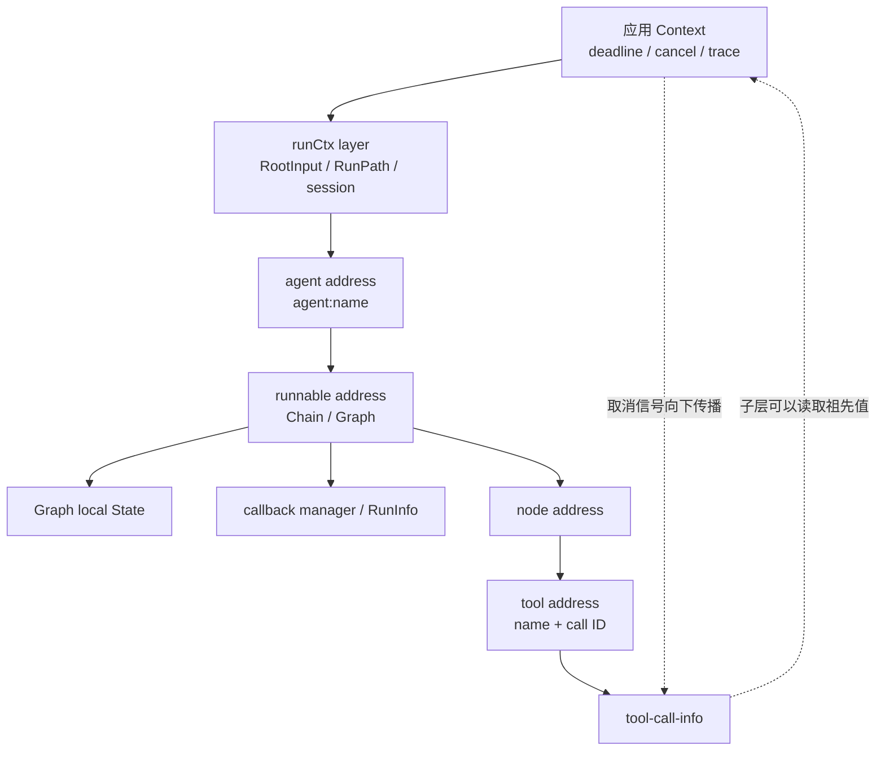
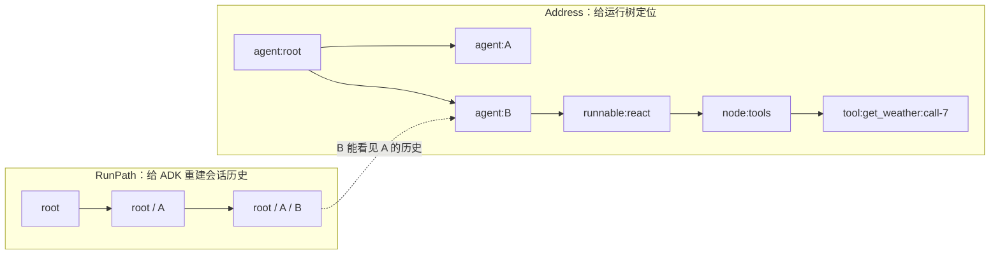
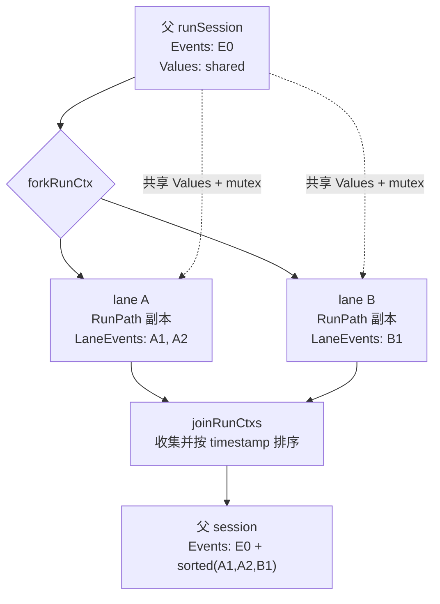

# Context 的逐层传播

这一章不是泛泛介绍 Go 的 `context.Context`，而是回答一个更具体的问题：**一次 ADK 请求从 `Runner` 走到 Agent、Graph、Node、ChatModel 和 Tool 时，`ctx` 究竟被包了多少层，每层放了什么？**

先记住一个结论：Eino 没有把同一个 `context.Context` 对象不断修改。`context.WithValue(parent, key, value)` 会返回一个**指向 parent 的新包装层**。所以“Context 转换”的本质是：



图中每个方框不是修改旧 Context，而是用旧 Context 作为 parent 派生一个新对象。最底层 Tool 能沿父链读取上面的值；最上层应用 Context 看不到 Tool 后来追加的值。

```text
应用 ctx
  └─ runCtx 层                 ADK 会话、历史、RunPath
      └─ agent address 层      当前 Agent 的结构地址
          └─ runnable address 层   Chain / Graph
              ├─ graph state 层    Graph 局部状态
              ├─ callback 层       回调管理器和 RunInfo
              └─ node address 层   当前节点
                  └─ tool address 层   tool name + tool call ID
                      └─ tool-call-info 层
```

子 Context 能读到所有父层值；父 Context 不能看到子层新增的值。这个单向性，是理解并行分支、嵌套 Graph 和恢复定位的基础。

## 一次真实调用中 ctx 如何变化

以下面的应用代码为起点：

```go
iter := runner.Query(
    ctx,
    "帮我查北京天气",
    adk.WithSessionValues(map[string]any{"User": "Alice"}),
    adk.WithChatModelOptions([]model.Option{/* ... */}),
)
```

### 第 0 层：应用传入的 ctx

这层通常只有应用自己的 deadline、cancellation、trace ID 和业务值。后面所有 `WithValue` 都以它为祖先，因此取消信号会一直传到模型和工具。

### 第 1 层：Runner 建立 root runContext

`Runner.Run` 先组装 `AgentInput`，再调用：

```go
ctx = ctxWithNewRunCtx(ctx, input, o.sharedParentSession)
AddSessionValues(ctx, o.sessionValues)
```

`ctxWithNewRunCtx` 通过私有的 `runCtxKey{}` 放入：

```go
type runContext struct {
    RootInput *AgentInput
    RunPath   []RunStep
    Session   *runSession
}
```

这里有两个容易误解的点：

- `AddSessionValues` **不再派生 Context**，而是找到 Context 里的 `runSession` 指针，加锁后改 `Values` map。
- `AgentRunOption` 也没有整体塞进 Context。Runner 用 `getCommonOptions` 先解析出 session values、checkpoint ID 等通用字段。

初始时 `RunPath` 还是空的，`RootInput` 是用户原始消息，`Session.Events` 也是空的。

### 第 2 层：flowAgent 派生 Agent 语义上下文

`Runner` 不直接调用裸 Agent，而是先用 `toFlowAgent` 包装。`flowAgent.Run` 做两次派生：

```go
ctx, runCtx = initRunCtx(ctx, agentName, input)
ctx = AppendAddressSegment(ctx, AddressSegmentAgent, agentName)
```

`initRunCtx` 会浅共享会话、深拷贝 `RunPath` 外壳，再追加当前 Agent：

```text
RunPath: []
   ↓ initRunCtx("weather_agent")
RunPath: [weather_agent]
```

`AppendAddressSegment` 另外建立结构地址：

```text
Address: agent:weather_agent
```

此时的 `ctx` 同时能查到 `runCtxKey{}` 和 `addrCtxKey{}`。接着 `genAgentInput` 用 `RootInput + Session.Events` 重建当前 Agent 看到的历史。所以 `AgentInput` 是显式参数，而会话日志是 Context 中 run session 间接引用的数据，两者不是同一个东西。

### 第 3 层：ChatModelAgent 把 ADK 运行参数转为 compose 参数

`ChatModelAgent.Run` 保留原 ctx，但将 `AgentRunOption` 转成 `[]compose.Option`，然后调用已构造的 Chain/ReAct runnable。这一步主要是**参数转换**，不是 Context 转换；详见[Config 与 Option 转换](./config-option-flow.md)。

### 第 4 层：compose 追加 runnable 地址

Graph/Chain 进入统一 runnable 入口后，会先追加：

```text
agent:weather_agent
  ↓
agent:weather_agent;runnable:weather_agent
```

ReAct 作为 Chain 中的子图，还会出现更深的 runnable/node segment。地址不是用来给模型看的 prompt，它是运行时定位符。

### 第 5 层：Graph 建立局部状态链

如果 Graph 有 `GenLocalState`，运行时会把 `*internalState` 放到 `stateKey{}` 下：

```go
type internalState struct {
    state  any
    mu     sync.Mutex
    parent *internalState
}
```

嵌套 Graph 不会把外层 state 覆盖丢失，而是用 `parent` 连成链：

```text
inner State (*InnerState)
    │ parent
    ▼
outer State (*OuterState)
```

ReAct 图的具体 local state 是 `*adk.State`；无工具 ChatModel Chain 则使用 `*ChatModelAgentState`。上图使用泛化类型，是为了表达任意嵌套 Graph 的 state parent 机制，不表示这两个 ADK state 在每条路径上都同时存在。

`compose.ProcessState[T]` 从内向外按 Go 类型查找，找到后锁住那一层的 mutex。如果内外两层 state 类型相同，内层会遮蔽外层，这就像编程语言的词法作用域。

### 第 6 层：Callback 管理器进入 Context

`initGraphCallbacks` 会从 `compose.Option` 提取 callback handler，在 Context 中放入 callback manager 和当前 `RunInfo`。节点、模型、工具不需要把 handler 一层层当函数参数传下去，只要继续传 ctx 就可以触发同一条 callback 链。

Callback 的 `OnStart` 可以返回新 ctx。后续运行必须使用这个返回值，否则 handler 注入的 trace/span 上下文就会丢失。流式 callback 则会为每个 handler 和业务消费者复制 `StreamReader`，避免一个消费者把流提前读完。

### 第 7 层：节点任务追加 node 地址

Graph executor 为每个 task 派生子 Context：

```text
...;runnable:ReAct;node:chat_model
...;runnable:ReAct;node:tools
```

并行节点从同一个父 Context 分叉，各自获得独立 node address，不会将 A 节点的地址错误变成 B 的父地址。

### 第 8 层：ToolsNode 追加 tool 地址和调用信息

模型可以在一条 assistant message 中同时发出多个 tool call，甚至两次调用同名工具。因此工具地址不只有 tool name：

```text
...;node:tools;tool:get_weather:call_abc
...;node:tools;tool:get_weather:call_xyz
```

segment 中 `ID=get_weather`，`SubID=toolCallID`。ToolsNode 还会用另一个私有 key 放入 `toolCallInfo`，让工具内部可以通过 `compose.GetToolCallID(ctx)` 得到精确的 call ID。

ChatModelAgent 的 `eventSenderToolWrapper` 从同一条 Context 中取得本次 Agent 的 event generator，把 Tool 结果写成 `AgentEvent`。AgentTool 又会消费内层 Runner 的事件并决定是否透传。这个 sender 不是 Callback；但 sender、Callback、ToolCallID、取消和恢复信息都依赖 Context 正确向 Tool 传播。

## RunPath 与 Address：两种“我在哪里”

| 维度 | `runContext.RunPath` | `core.Address` |
| --- | --- | --- |
| 面向谁 | ADK 的 Agent 会话 | ADK + compose 整个执行树 |
| 内容 | Agent 名称序列 | agent/runnable/node/tool segment |
| 主要用途 | 历史归属、事件来源、Transfer | callback 层级、interrupt 定位、resume 匹配 |
| 并行时 | fork 后各有拷贝 | 每个任务从父地址派生 |
| 顺序同级 Agent | 可用 `updateRunPathOnly` 累积 | 不应伪造成嵌套地址 |

例如 SequentialAgent 先跑 A 再跑 B，B 需要知道 A 的历史，所以 RunPath 可以累积；但 A 和 B 是同级结构，B 的 Address 不应该变成 A 的子地址。`updateRunPathOnly` 就是为这个区别存在的。



<p class="diagram-caption">同一段顺序流程可以在 RunPath 中累积历史，但 Address 仍按真实父子结构分叉；两者不能互相替代。</p>

## 并行 workflow 为什么要 fork/join runContext

并行分支如果共享同一个事件 slice，会同时有竞态和历史顺序不稳定的问题。`forkRunCtx` 为每条 lane 建新 `runSession` 外壳，具体共享关系如下：

| 数据 | 是否共享 | 原因 |
| --- | --- | --- |
| `RootInput` | 共享指针 | 各分支都从同一请求开始 |
| `RunPath` | 拷贝 slice | 每条分支独立追加 Agent |
| 已提交 `Events` | 共享 | 分支都能看到 fork 前历史 |
| `Values` + mutex | 共享 | session KV 在整个运行中共享 |
| `LaneEvents` | 每分支独立 | 新事件先在 lane 内累积 |

`joinRunCtxs` 在分支结束时拉平 lane events，按事件创建的纳秒时间戳排序，再提交到父 lane 或主日志。因此“并行 Agent 共享 session”不等于“所有字段都指向同一个可变对象”。



<p class="diagram-caption">lane 的“事件日志外壳”彼此隔离，Values 却共享；因此不会并发 append 同一个 slice，但业务值仍可能发生写入竞争。</p>

## AgentTool 为什么有 sharedParentSession

Agent 作为 Tool 运行时，内层 `Runner` 会设置私有的 `withSharedParentSession()`。`ctxWithNewRunCtx` 会创建新 session 外壳，但共享父 session 的 `Values` 和 mutex；它**不共享 Events**。

这个设计同时满足：

- 内层 Agent 能读写用户、租户、认证信息等 session KV；
- 内层 Agent 的过程事件不直接污染外层 Agent 建模用的会话日志；
- 如果开启 `EmitInternalEvents`，内层事件可以实时展示给用户，但源码明确规定这些转发事件不写入外层 session。

`ClearRunCtx(ctx)` 则是更彻底的隔离：它在新 Context 层中把 `runCtxKey{}` 显式设为 `nil`，适用于“自定义 Agent 内又包了一套多 Agent”，不希望内外两套 RunPath/session 穿透的情况。

## 中断与恢复时 Context 如何“反向对齐”

恢复不是从原 goroutine 接着执行。原运行已经停止，`Runner.ResumeWithParams` 使用新的应用 ctx，再把 checkpoint 里的运行状态装回去：

```text
新应用 ctx
  ├─ setRunCtx(反序列化的 runContext)
  ├─ PopulateInterruptState(id → address, id → state)
  └─ BatchResumeWithData(id → 业务恢复数据)
```

`globalResumeInfo` 在 Context 中保存四类表：恢复数据、恢复数据是否被消费、中断状态、中断 ID 对应的 Address。重跑结构时，每次 `AppendAddressSegment` 都会将新算出的当前地址与 checkpoint 地址精确比对：

1. 地址完全相等：领取属于自己的 interrupt state 和 resume data；
2. 当前地址是目标地址的祖先：标记为 resume target，让组合组件继续向下走；
3. 一份状态或数据被领取后标记 used，避免同名或重试路径重复消费。

所以 Address 必须稳定。Agent 改名、Graph 改名、node key 改变，都可能让旧 checkpoint 无法在新结构中对齐。

### compose 自己还会派生哪些恢复 Context

- `checkPointKey{}`：子图运行时携带子 checkpoint；
- `stateModifierKey{}`：恢复前对指定 Graph state 做一次修改；
- `graphCancelChanKey{}`：`WithGraphInterrupt` 为外部中断放入取消通道；
- `globalResumeInfoKey{}`：跨 ADK/compose 结构共享的定位和恢复数据。

## 不同数据究竟存在哪里

| 数据 | 承载位置 | 生命周期 | 是否进 checkpoint |
| --- | --- | --- | --- |
| deadline/cancel | 应用 Context 父链 | 本次调用 | 否 |
| `RootInput` | `runContext` | ADK 会话 | 是 |
| `RunPath` | `runContext` | Agent 路径 | 是 |
| session KV | `runSession.Values` | ADK 会话 | 是，但值必须可序列化 |
| Agent 历史 | `runSession.Events` | ADK 会话 | 是 |
| 结构地址 | `addrCtx` | 当前组件调用 | 地址映射进中断 checkpoint |
| Graph local state | `internalState` 链 | 一次 Graph 执行 | 有 checkpoint 时序列化 |
| callbacks | callback manager | 本次调用 | 否 |
| model/tool options | 函数 options | 本次组件调用 | 否 |
| resume data | `globalResumeInfo` | 本次 Resume | 否，由调用方重新提供 |

## 最常见的 Context 丢失 bug

### 在 Agent 或 Tool 内换成 context.Background

```go
// 错误：从父链上脱离
result, err := dependency.Call(context.Background(), input)

// 正确：继续传递当前 ctx
result, err := dependency.Call(ctx, input)
```

第一种写法会同时丢掉：用户取消、session values、RunPath、Address、Graph state、callbacks、tool call ID 和 resume data。有时模型还能返回结果，但 tracing 断链、恢复失效，这种 bug 更难查。

### 忽略 callback 返回的 ctx

Callback 是允许返回派生 Context 的。自定义执行包装如果只调用 callback 却不接收新 ctx，后续 span 层级可能不正确。

### 把 session map 当成无锁全局变量

`GetSessionValues` 返回的是拷贝，直接修改返回 map 不会写回 session。要使用 `AddSessionValue(s)`。这些 API 通过 session mutex 保护共享 map。

## 源码阅读路线

建议按以下顺序对照：

1. `adk/runner.go`：根 runContext 的创建与恢复；
2. `adk/runctx.go`：runSession、fork/join、RunPath；
3. `adk/flow.go`：Agent 边界的 ctx 派生；
4. `internal/core/address.go`：Address 与 global resume info；
5. `compose/generic_graph.go` 和 `compose/graph_run.go`：runnable/node/state 上下文；
6. `compose/state.go`：嵌套 state 链；
7. `compose/utils.go` 与 `callbacks/`：callback context；
8. `compose/tool_node.go`：tool address 和 tool-call-info。

下一章会追踪与 Context 并行的另一条链：[Config 与 Option 如何一层层转到模型和工具](./config-option-flow.md)。
