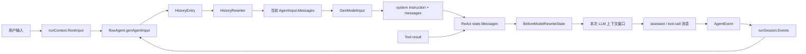
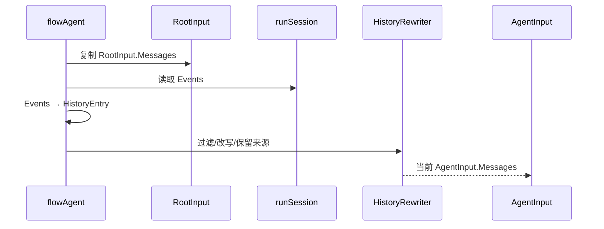
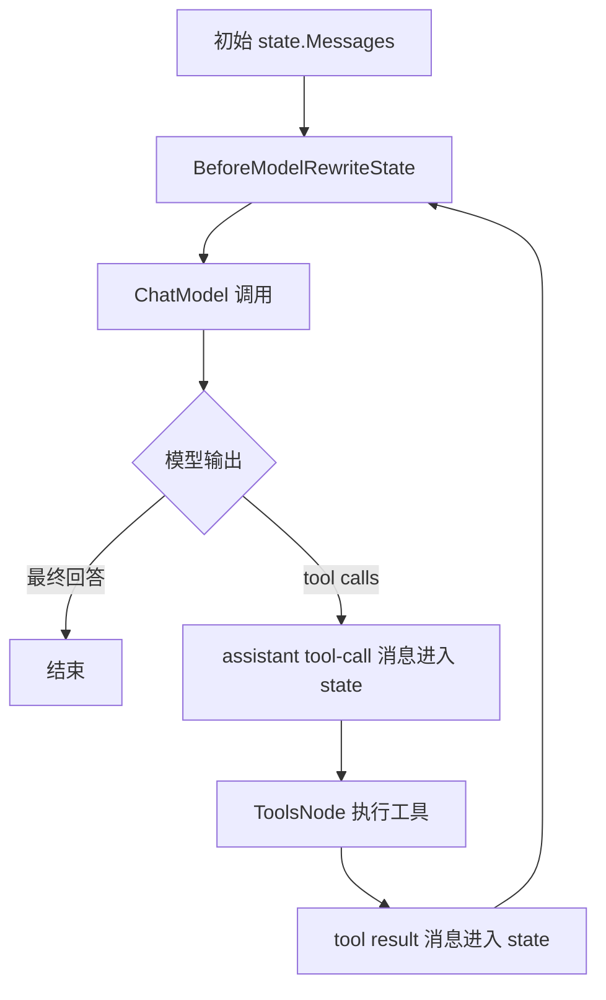

# LLM 上下文窗口与消息存储：一条消息如何走到模型

前面的章节已经分别介绍了 `runSession`、ReAct `state` 和 checkpoint。这里把它们串成一个小白可以跟踪的链路：**用户消息在哪里保存？Agent 的回复什么时候加入历史？下一次 LLM 调用到底拿到哪些消息？上下文窗口超长时在哪一层压缩？**

::: tip 配套 Demo
对应 [Demo 阶梯](./demo-ladder.md) 的 Demo 3～7：先装配 ChatModelAgent，再观察 Tool 消息如何进入 state，最后加入 Reduction 或 Summary。
:::

先记住一句话：

> ADK 不把“所有持久化历史”直接原样交给模型。它先保存不同层级的数据，再在具体执行阶段投影、重写，最后形成本次模型 API 调用的 `[]Message`。



## 1. “消息”其实有四份视图

同一段用户话术或模型回复，在不同阶段可能出现在不同对象里。它们不是四份互相自动同步的数据库记录，而是不同用途的投影。

| 视图 | 代表对象 | 存什么 | 主要用途 | 生命周期 |
| --- | --- | --- | --- | --- |
| 根输入 | `runContext.RootInput.Messages` | 本次 Runner 最初收到的用户消息 | 为整个 Agent 树提供起点 | 一次 Run/Resume |
| 跨 Agent 事件历史 | `runSession.Events` | AgentEvent 的消息、来源 Agent、RunPath、Action 外的输出 | 进入下一个 Agent 时重建输入 | 一次运行；中断 checkpoint 可恢复 |
| 当前 Agent 输入 | `AgentInput.Messages` | RootInput 与 session event 经重写后的消息 | 交给某个 Agent 开始执行 | 一次 Agent 进入，通常是临时值 |
| 当前 Graph 状态 | `typedState.Messages` / `State.Messages` | system、user、assistant、tool 的 ReAct 对话 | 当前 ChatModelAgent 的下一轮模型调用 | 一次 Agent 图；Graph checkpoint 可恢复 |

因此，`runSession.Events` 不是模型的最终上下文，`state.Messages` 也不是跨所有 Agent 的全局历史。

## 2. 第一步：RootInput 与 session Events 拼成 AgentInput

### 2.1 RootInput 保存原始起点

Runner 启动时把调用方输入放进 `runContext.RootInput`。在多 Agent 流程中，子 Agent 可能收到 `nil` input；这不代表它没有上下文，而是 `flowAgent` 会从根输入和共享 session 重新生成一份适合它的输入。

```text
RootInput.Messages = [用户：帮我分析订单]
Session.Events     = [协调 Agent 的回答、工具结果、转交信息]
```

### 2.2 `genAgentInput` 不直接复制所有字符串

`flowAgent.genAgentInput` 做的事情是：

1. 深拷贝 `RootInput`，避免本层修改根输入；
2. 读取 `runSession.getEvents()`；
3. 把事件包装成 `HistoryEntry`，保留 `AgentName` 和来源信息；
4. 根据 `skipTransferMessages` 过滤转交边界消息；
5. 从事件中提取消息，必要时把 stream 物化；
6. 调用 `HistoryRewriter`，得到当前 Agent 的 `AgentInput.Messages`。

默认重写器会把其他 Agent 的消息改写成带来源的上下文，避免模型误以为“别的 Agent 的回答”是当前用户刚刚说的话。自定义 `HistoryRewriter` 可以做 Agent 隔离、角色映射、历史摘要或只保留最近事件，但它发生在**进入 Agent 之前**。



## 3. 第二步：GenModelInput 把 AgentInput 变成模型输入

对默认的 `ChatModelAgent`，`GenModelInput` 的规则非常直接：

```text
最终消息 = [可选 System instruction] + AgentInput.Messages
```

如果 instruction 是 FString 模板，并且 `Session.Values` 不为空，默认实现会先用 session values 格式化 system message；然后才拼接用户与历史消息。也就是说，下面这些东西会影响模型第一次看到的输入：

- Agent 配置的 instruction；
- `AddSessionValue` 写入的变量；
- RootInput；
- 由 session Events 重建并经 HistoryRewriter 改写的消息；
- 自定义 `GenModelInput` 添加的系统提示、检索结果或外部记忆。

自定义 `GenModelInput` 是 Agent 级别的入口：它可以完全替换默认拼接规则，但它拿到的是当前 Agent 的 `instruction` 和 `AgentInput`，不是未经过滤的全局事件数据库。

## 4. 第三步：ReAct State 形成当前 ChatModelAgent 的消息序列

`ChatModelAgent` 把 `GenModelInput` 的结果送进 compose ReAct 图。图的 `Init` 节点会把初始消息追加到局部 `state.Messages`：

```text
state.Messages = [
  System(instruction),
  User(原始问题),
  ...HistoryRewriter 生成的历史
]
```

### 4.1 `state.Messages` 是不是聊天历史

最准确的说法是：**它是当前 ChatModelAgent 的局部对话状态，不是整个 Runner 的全局聊天历史。**

它可能包含三种来源的消息：

1. 当前 Agent 收到的 `AgentInput.Messages`，其中可能已经带有应用传入的历史；
2. 当前 ReAct 循环中新产生的 assistant 消息、tool-call 和 tool-result；
3. 模型前 middleware 注入、裁剪或替换后的消息。

所以，`state.Messages` 的范围通常是：

```text
一次 Runner.Run
  └─ 一个 ChatModelAgent 的一次 Run
      └─ 一张局部 state.Messages
          ├─ 进入该 Agent 时的历史视图
          ├─ 本 Agent 的模型输出
          └─ 本 Agent 的工具调用结果
```

如果一次 Runner 运行的是 Workflow：

```text
Runner.Run
  ├─ Planner ChatModelAgent → state.Messages A
  ├─ Researcher ChatModelAgent → state.Messages B
  └─ Writer ChatModelAgent → state.Messages C
```

A、B、C 不是同一个数组。它们各自属于不同的 ChatModelAgent 图；Agent 之间需要通过 `runSession.Events`、`HistoryRewriter`、AgentTool 输入或显式 Workflow 输出传递信息。

| 问题 | `state.Messages` 的答案 |
| --- | --- |
| 是不是用户从注册以来的全部聊天记录？ | 不是 |
| 是不是整个 Runner 的所有 Agent 消息？ | 不是 |
| 是不是当前 ChatModelAgent 此刻可能发给模型的消息集合？ | 通常是，但模型前 middleware 还可以改写 |
| 是否只包含本轮新消息？ | 不是，进入 Agent 时传入的历史也会被放进去 |
| Runner 成功结束后是否自动保留到下一次？ | 不会，除非应用或 checkpoint 自己保存 |
| 中断恢复时是否可能被恢复？ | 是，Graph checkpoint 保存了它所属的局部 state |

之后每一轮大致是：



因此，如果模型先请求工具再继续回答，下一次模型调用看到的通常是：

```text
[system,
 user,
 历史 assistant/tool 消息,
 assistant(tool_calls),
 tool(result)]
```

`AfterToolCalls` 会把工具结果追加到 state；下一条边回到 ChatModel，所以工具结果会进入下一次 LLM 上下文。工具调用的中间事件也可能被发送给用户，但“发送成 AgentEvent”和“加入 state.Messages”是两个不同动作。

## 5. 哪些消息会被保存，哪些只是本次调用的临时拼接

### 5.1 `runSession.Events` 的保存边界

flowAgent 只把**当前 RunPath、非 interrupt** 的 AgentEvent 复制进 session。它保存的是跨 Agent 历史投影，而不是每个 Graph 节点的完整 state。

- 普通运行期间：在内存里保存；Run 结束后自然消失，除非应用自行保存；
- 发生可恢复中断时：`runSession` 随 `runContext` 被外层 Runner 编码到 checkpoint；
- interrupt event 本身：不进入普通 Events，而走 interrupt tree 和 `InterruptState`；
- AgentTool 内部透传给 UI 的事件：不一定写入父 session，避免父历史重复。

### 5.2 `state.Messages` 的保存边界

它属于某个 ChatModelAgent 的 compose Graph：

- 正常运行：在 Graph 的 local state 中不断更新；
- Graph 中断并配置 store：由 compose serializer 保存；
- ChatModelAgent 中断：内部 bridge store 取出 bytes，再被外层 Runner 放进 `InterruptID2State`；
- 恢复：先恢复外层 interrupt tree，再把 bytes 交给叶子 Graph，恢复 `state.Messages`。

这解释了为什么仅查看 `runSession.Events` 可能看不到“等待中的 tool call”或“剩余轮数”：这些属于 Graph 局部状态。

### 5.3 AgentEvent、Callback 和 UI 不是长期消息库

`AgentEvent` 是运行时输出协议，Callback 是观察/扩展入口，UI 是消费方。它们可以把消息写入数据库，但 ADK 默认不会因为事件发出就替你建立跨请求 Conversation Store。

如果产品需要长期聊天记录，应该明确建立应用层存储，例如：

```text
ConversationStore
  ├─ conversation_id
  ├─ raw_messages / event ids
  ├─ summary_coverage
  └─ recent messages
```

下一次请求由应用先加载 `summary + recent messages`，再放入 `Runner.Run` 的 input；不要期待上一次 Run 的 `runSession` 自动出现在下一次 Run。

### 5.4 不接外部存储时，历史究竟放在哪里

可以把“不接外部存储”分成两个时间范围来看：

```text
一次 Run 尚未结束：
  ctx
   └─ runContext
       ├─ RootInput.Messages
       └─ runSession
           ├─ Events
           └─ Values
  ChatModelAgent 内部：state.Messages

一次 Run 结束以后：
  上述对象没有被外部引用时，随 Go 对象一起变成可回收的进程内存
```

也就是说，默认情况下：

- `Runner` 不会把上一轮对话放进自己下次 `Run` 的输入；
- `Agent` 实例只保存 instruction、model、tools、middleware 等配置，不保存某个用户的历史；
- `runSession.Events` 只属于当前运行树，不能当成跨请求 Conversation Store；
- `state.Messages` 只属于当前 ChatModelAgent 图，正常成功结束后不会自动留给下一次调用；
- `AgentEvent` 被发送给 UI 或 callback，也不等于已经写入数据库。

最小的“无外部数据库”多轮对话，必须由调用方自己在进程内维护消息切片：

```go
var conversation []*schema.Message

func query(ctx context.Context, runner *adk.Runner, text string) (string, error) {
    conversation = append(conversation, schema.UserMessage(text))

    iter := runner.Run(ctx, conversation)
    var answer *schema.Message
    for {
        event, ok := iter.Next()
        if !ok {
            break
        }
        if event.Err != nil {
            return "", event.Err
        }
        if event.Output != nil && event.Output.MessageOutput != nil {
            answer, _ = event.Output.GetMessage()
        }
    }

    if answer != nil {
        conversation = append(conversation, answer)
        return answer.Content, nil
    }
    return "", nil
}
```

这里的 `conversation` 是**应用自己的进程内变量**，不是 ADK 自动保存的历史。它只能在当前进程、当前实例中使用：

| 事件 | 进程内 `conversation` | ADK `runSession` | 下次 Runner.Run 是否自动看到 |
| --- | --- | --- | --- |
| 同一进程、调用方继续传入切片 | 仍在 | 上一次 session 已结束 | 只有调用方再次传入才看得到 |
| 服务重启 | 丢失 | 丢失 | 看不到 |
| 多实例负载均衡到另一实例 | 通常看不到 | 看不到 | 看不到 |
| 配置内存版 CheckPointStore | 可保存中断恢复快照 | 可恢复 checkpoint | 只对对应 checkpoint 生效，不是普通聊天历史 |

因此“没有外部存储”并不等于“没有消息”，而是消息只停留在当前请求或调用方自己管理的进程内存中。要跨请求、跨进程、跨重启保留历史，必须由应用选择数据库、Redis、对象存储或其他 ConversationStore；要支持中断后继续执行，还需要额外配置 `CheckPointStore`。

## 6. 上下文窗口到底在哪里计算

“上下文窗口”指的是**某一次 ChatModel/AgenticModel 调用实际提交的消息和工具定义**，不是 checkpoint 的字节长度，也不是 session Events 的条数。

可以用下面的公式理解：

```text
本次模型输入 ≈
  system instruction
+ 当前 AgentInput 历史
+ 当前 ReAct state 中已完成的 assistant/tool 轮次
+ BeforeModelRewriteState 注入的内容
+ tool definitions / deferred tool definitions 的开销
```

它通常会小于或等于当前 `state.Messages` 的全部内容，因为模型包装器或 middleware 可能在调用前进一步改写；也可能因为工具 schema、系统提示和检索内容而大于“肉眼看到的聊天消息”所估计的长度。

## 7. 超窗、裁剪和 Summary 应该在哪一层做

不同问题要放在不同层：

| 目标 | 执行位置 | 适合机制 |
| --- | --- | --- |
| 子 Agent 不应看到父 Agent 全部历史 | Agent 进入前 | `HistoryRewriter` |
| 每次模型调用前裁剪最近窗口 | 模型前 | 新版 `BeforeModelRewriteState` middleware |
| 根据语义压缩旧对话 | 模型前 | summarization middleware / 自定义 state rewrite |
| 多个 Agent 结果合并成报告 | 流程步骤 | 显式 Summarizer Agent |
| 跨多个 Query 保存事实 | 请求之外 | 应用级 MemoryStore / ConversationStore |
| 保存中断位置并继续执行 | 中断时 | Graph checkpoint + Runner CheckPointStore |

一个可靠的窗口治理顺序通常是：

```text
ConversationStore 读取长期 summary + recent raw messages
  → Runner.RootInput
  → HistoryRewriter 做 Agent 视角过滤
  → GenModelInput 加 instruction / 外部上下文
  → BeforeModelRewriteState 按 token budget 裁剪或摘要
  → ChatModel 调用
```

不要把“裁剪后的 state”误当成“删除了原始历史”：它只改变当前模型看到的视图。原始历史是否删除，取决于应用层 ConversationStore 的保留策略。

### 7.1 这里说的“裁剪”具体包括什么

“裁剪”不是一个单一动作，至少要分成下面几类：

| 方式 | 是否调用模型 | 处理对象 | 典型实现 | 结果 |
| --- | --- | --- | --- | --- |
| Tool 结果截断 | 否 | 刚返回的单个超大 Tool 结果 | `reduction` 的 Truncation 阶段 | 完整结果写 Backend，消息换成可检索提示 |
| 历史 Tool 轮次清理 | 否 | 较老的 assistant tool-call + tool-result 对 | `reduction` 的 Clear 阶段 | 清除/外置旧工具内容，保留最近轮次 |
| 语义记忆压缩 | 是，调用摘要模型 | 一段旧对话或完整消息历史 | `summarization` middleware | 用 summary + recent messages 替换原历史 |
| 普通窗口截断 | 否 | 任意旧消息或字符/token 超预算部分 | 自定义 `BeforeModelRewriteState` | 直接保留最近 N 条或 N tokens |
| 记忆召回 | 可能调用检索/模型 | 外部 MemoryStore 的相关事实 | `BeforeModelRewriteState` + MemoryService | 向 state 注入相关消息，不是裁剪 |

最容易混淆的是前两种：

```text
Tool 执行完成
  └─ 结果太大？
      ├─ 是：Truncation
      │    完整内容 → Backend
      │    state 中只放“已保存，请用 read_file/检索工具读取”的提示
      │
下一次模型调用前
  └─ 全部历史 token 太多？
      ├─ 是：Clear
      │    旧的 tool-call/result round → 清理或外置
      │    最近若干轮 → 保留
```

所以你提到的“大文件结果裁剪”属于 `reduction` 的 Tool 结果保护；“记忆压缩”如果指把旧聊天概括成一段 summary，则属于 `summarization`，不是简单删字符串。两者都可能最终改变 `state.Messages`，但目的、触发点、是否调用模型和是否能恢复原文都不同：

- **Truncation/Clear** 追求确定性地减少 token，通常不理解文本语义；如果配置 Backend，原文仍可被工具重新读取。
- **Summarization** 追求保留语义，调用摘要模型，原始消息是否保留取决于 `Finalize` 和应用自己的 Transcript/ConversationStore 策略。
- **Memory recall** 是增加与当前问题相关的信息，不是把旧信息删掉。

## 8. 一个完整例子

假设用户连续发来三轮消息，第二轮触发工具：

```text
第 1 次 Run 输入：User("查订单 1001")
  RootInput = [User("查订单 1001")]
  AgentInput = [System(...), User("查订单 1001")]
  state.Messages = 同上
  模型输出 Assistant(tool_call=get_order)
  ToolsNode 输出 Tool(order=1001, status=shipped)
  state.Messages 追加 assistant(tool_call) + tool(result)

第 2 次模型调用：
  [System, User, Assistant(tool_call), Tool(result)]
  模型输出 Assistant("订单已发货")

下一次用户请求：
  应用从 ConversationStore 加载历史/summary
  再创建新的 Runner.Run
  不会自动复用上一次 runSession 指针
```

如果第二次模型调用前发生中断，checkpoint 需要同时保留：

```text
外层：RootInput + runSession.Events + RunPath
内层：ReAct state.Messages + tool call / workflow interrupt state
```

恢复时先还原外层运行树，再恢复内层 Graph，才能从“等待工具结果”这个节点继续，而不是重新把用户问题从头执行。

## 9. 调试时分别打印四层内容

排查“模型为什么看不到某条消息”时，不要只打印最终请求。建议分别观察：

```text
1. RootInput.Messages
2. runSession.Events（事件来源、RunPath、是否被记录）
3. HistoryRewriter 输出的 AgentInput.Messages
4. BeforeModelRewriteState 之后的 state.Messages
```

定位规律：

- 第 1 层没有：调用方没有把消息传给 Runner；
- 第 2 层没有：事件没有被当前 flowAgent 记录，可能是 RunPath、interrupt 或 AgentTool 边界；
- 第 3 层没有：HistoryRewriter 过滤、改写或 summary 丢掉了它；
- 第 4 层没有：GenModelInput 或模型前 middleware 修改了 state；
- 第 4 层有但模型仍异常：检查工具 schema、system instruction、模型适配器和 token budget。

相关章节：

- [状态、历史与记忆](/adk/state-and-memory)
- [Runner 持久化读写链](/adk/runner-persistence)
- [新版 Middleware](/adk/middleware-current)
- [Agent 组装最佳实践](/adk/agent-composition-best-practices)
