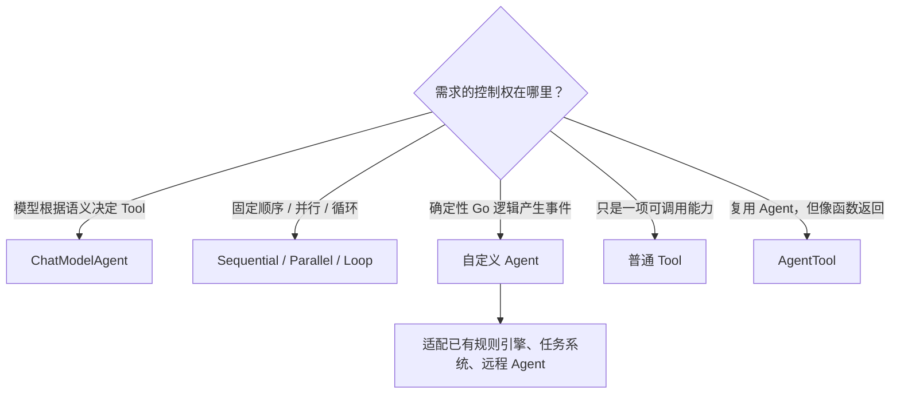
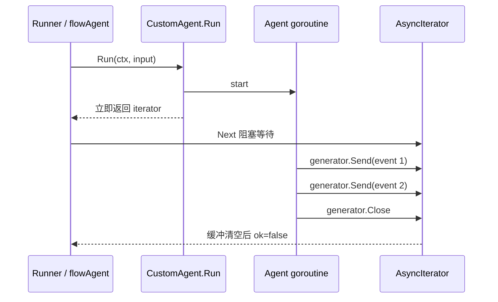
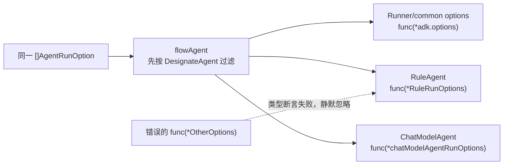
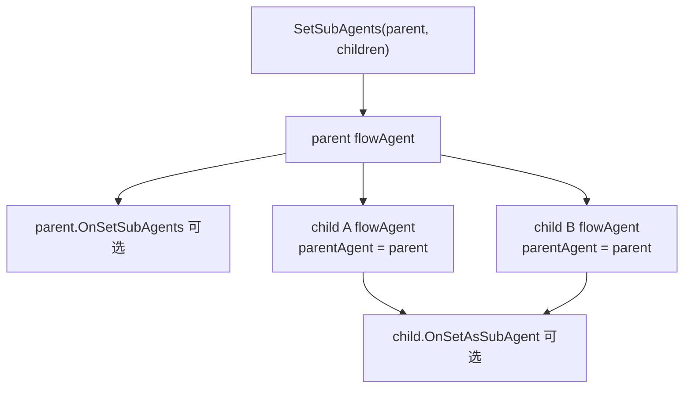
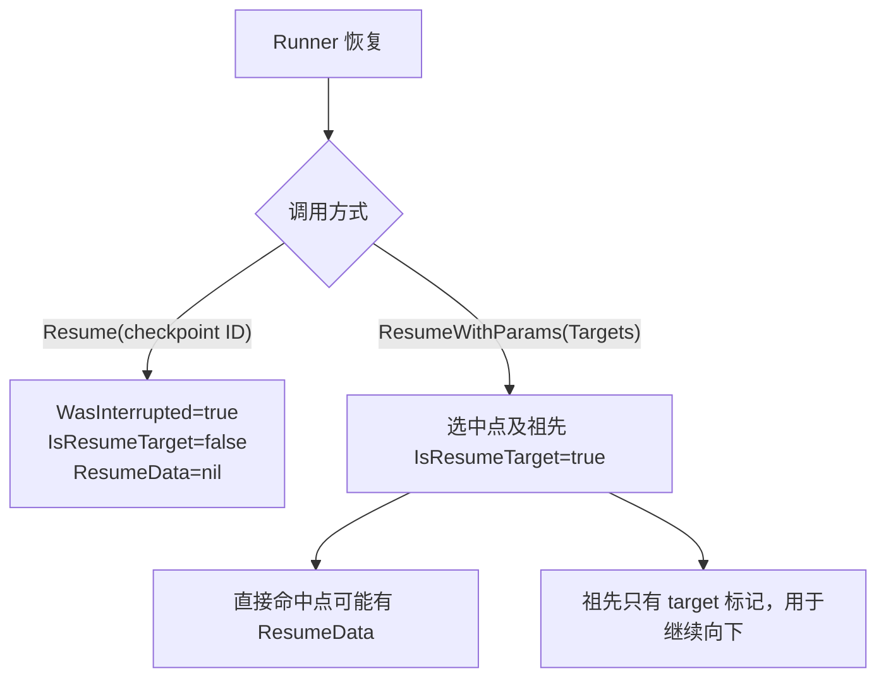
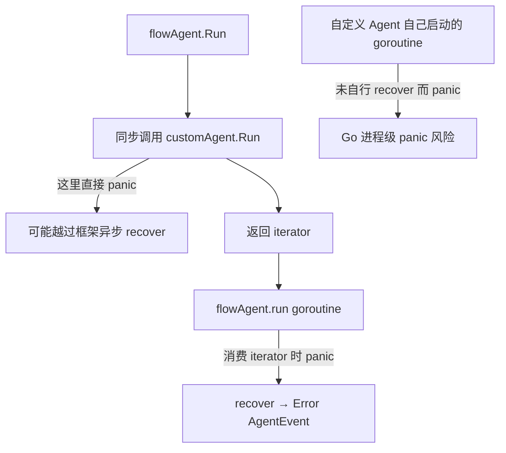

# 自定义 Agent 与 ResumableAgent 实战

`ChatModelAgent` 适合“模型决定下一步”的场景；自定义 Agent 适合确定性规则、已有业务状态机、第三方工作流适配器，或需要完全控制事件形状的场景。

这一章不只展示接口，还解释框架会替你补什么、不会替你补什么，以及一个自定义 Agent 怎样安全地进入 Runner、Workflow、Transfer 和 Resume 体系。

## 先判断是否真的需要自定义 Agent



如果你只是想在模型调用前删几条历史，不要写 Agent，使用 Middleware；如果只是记录耗时，不要写 Agent，使用 Callback。

## Agent 接口的逐方法契约

```go
type Agent interface {
    Name(ctx context.Context) string
    Description(ctx context.Context) string
    Run(ctx context.Context, input *AgentInput,
        options ...AgentRunOption) *AsyncIterator[*AgentEvent]
}
```

### Name

Name 不只是日志标签。它参与：

- RunPath；
- Agent Address；
- `DesignateAgent` 的 Option 过滤；
- Transfer 目标查找；
- AgentTool 的 Tool 名；
- Resume 地址匹配。

同一棵 Agent 树内应保持唯一、稳定。checkpoint 存活期间更名会破坏恢复。

### Description

Description 在 AgentTool 中成为 `ToolInfo.Desc`，在 ChatModelAgent 子 Agent 中进入 transfer instruction。它应该回答“什么任务应交给我”，而不是写实现细节。

### Run

Run 返回事件迭代器，不直接返回最终字符串。一次 Agent 可以依次产生：

- 中间 assistant 消息；
- Tool 消息；
- CustomizedOutput；
- Transfer、Exit、BreakLoop 等 Action；
- Error event；
- Interrupt event。

接口要求每个返回事件的外壳可被框架修改；其中若包含 MessageStream，该 reader 必须由当前消费者独占。

## 最小但完整的确定性 Agent

```go
package myagent

import (
    "context"
    "errors"
    "strings"

    "github.com/cloudwego/eino/adk"
    "github.com/cloudwego/eino/schema"
)

type RuleAgent struct {
    name        string
    description string
}

var errEmptyInput = errors.New("rule agent: empty input")

func classify(content string) string {
    if strings.Contains(content, "退款") {
        return "route: refund"
    }
    return "route: general"
}

func NewRuleAgent() *RuleAgent {
    return &RuleAgent{
        name:        "rule_router",
        description: "Classifies a request with deterministic business rules.",
    }
}

func (a *RuleAgent) Name(context.Context) string {
    return a.name
}

func (a *RuleAgent) Description(context.Context) string {
    return a.description
}

func (a *RuleAgent) Run(
    ctx context.Context,
    input *adk.AgentInput,
    opts ...adk.AgentRunOption,
) *adk.AsyncIterator[*adk.AgentEvent] {
    iter, gen := adk.NewAsyncIteratorPair[*adk.AgentEvent]()

    go func() {
        defer gen.Close()

        select {
        case <-ctx.Done():
            gen.Send(&adk.AgentEvent{Err: ctx.Err()})
            return
        default:
        }

        if input == nil || len(input.Messages) == 0 {
            gen.Send(&adk.AgentEvent{Err: errEmptyInput})
            return
        }

        result := classify(input.Messages[len(input.Messages)-1].Content)
        gen.Send(adk.EventFromMessage(
            schema.AssistantMessage(result, nil),
            nil,
            schema.Assistant,
            "",
        ))
    }()

    return iter
}
```

框架会在外层 flowAgent 中补 `AgentName` 和 `RunPath`，所以普通自定义 Agent 不要猜测或伪造它们。直接调用 `agent.Run` 时没有这层补全；通过 Runner 运行才有完整 ADK 语义。

## 为什么通常在 Run 里启动 goroutine



不是语法要求，而是响应性要求。如果在返回 iterator 之前执行远程请求，调用者连第一个 `Next` 都拿不到，取消和流式展示也更难管理。

只有立刻生成一个小事件的 Agent 才适合同步 Send 后返回。耗时工作、多个事件或外部 I/O 建议放 goroutine。

## Iterator/Generator 的真实实现边界

`NewAsyncIteratorPair` 底层使用 `internal.UnboundedChan`：

- Send 有 mutex，可由多个 goroutine 调用；
- 队列没有容量上限，Send 不会因消费者慢而形成背压；
- Close 是幂等的；
- Close 后剩余缓冲仍能读完；
- 缓冲为空且 closed 时，`Next()` 返回 `ok=false`；
- Send after Close 会 panic；
- `Next()` 自身不接收 Context，取消必须让生产者停止并 Close。

::: warning 慢消费者风险
Unbounded 不等于免费。如果 Agent 持续高速 Send、调用方不消费，内存会持续增长。生产代码应限制事件频率、合并细粒度进度，或在上层保证持续 drain。
:::

## 事件应该怎样构造

### 普通 assistant 消息

```go
event := adk.EventFromMessage(
    schema.AssistantMessage("done", nil),
    nil,
    schema.Assistant,
    "",
)
```

### 流式 assistant 消息

```go
stream := schema.StreamReaderFromArray([]*schema.Message{
    schema.AssistantMessage("part 1", nil),
    schema.AssistantMessage("part 2", nil),
})
stream.SetAutomaticClose()

event := adk.EventFromMessage(
    nil,
    stream,
    schema.Assistant,
    "",
)
```

不要同时填写 Message 和 MessageStream。`IsStreaming` 由 `EventFromMessage` 根据 stream 是否为 nil 设置。

### 自定义结构化输出

```go
event := &adk.AgentEvent{
    Output: &adk.AgentOutput{
        CustomizedOutput: &RiskResult{
            Level:  "high",
            Reason: "amount exceeds threshold",
        },
    },
}
```

CustomizedOutput 不会被 `copyAgentEvent` 深拷贝。若它会被多个消费者并发读取，应在发送后视为不可变对象。

### Error event

```go
gen.Send(&adk.AgentEvent{Err: fmt.Errorf("lookup order: %w", err)})
return
```

Agent 接口没有 `(iterator, error)`，运行期错误通过事件表达。构造期错误应由你的构造函数返回。

## 错误事件发出后会不会自动停止

不会由所有层统一停止：

| 消费者 | 看到 `event.Err` 后的行为 |
| --- | --- |
| 普通 flowAgent | 仍然转发；自定义 Agent 若继续发送，后续事件仍可能到达 |
| Sequential/Loop workflow | 发送该 error event 后停止当前 workflow |
| Parallel workflow | 转发错误，但等待其他已启动分支 |
| AgentTool | 立即将 event.Err 作为 Tool error 返回 |
| ChatModelAgent | 内部实现通常发错后关闭 generator |

因此自定义 Agent 的推荐约定是：发出 fatal Error event 后立即 return，避免不同组合方式下出现含糊结果。

## 自定义 AgentRunOption

AgentRunOption 是一个可以穿过异构 Agent 树的信封。自定义 Agent 只会消费与自己 options 类型完全匹配的函数。

```go
type RuleRunOptions struct {
    Strict bool
    Locale string
}

func WithStrictRule(strict bool) adk.AgentRunOption {
    return adk.WrapImplSpecificOptFn(func(o *RuleRunOptions) {
        o.Strict = strict
    })
}

func WithRuleLocale(locale string) adk.AgentRunOption {
    return adk.WrapImplSpecificOptFn(func(o *RuleRunOptions) {
        o.Locale = locale
    })
}
```

在 Run 中解析：

```go
o := adk.GetImplSpecificOptions(&RuleRunOptions{
    Locale: "zh-CN",
}, opts...)
```



调试 Option 时必须同时检查名称可见性和函数类型；两者任一不匹配都可能表现为“不报错但不生效”。

## Action：让外层控制流做决定

### Transfer

```go
gen.Send(&adk.AgentEvent{
    Action: adk.NewTransferToAgentAction("billing_agent"),
})
```

Transfer 目标必须是当前 flowAgent 的直接 subAgent 或 parent。只有事件 RunPath 与当前 flowAgent 精确匹配时，Action 才能影响这一层控制流。

### Exit

```go
gen.Send(&adk.AgentEvent{Action: adk.NewExitAction()})
```

Exit 终止当前 flow 链；若 Agent 被包成 AgentTool，Exit 不会越过工具边界终止父 Agent。

### BreakLoop

```go
gen.Send(&adk.AgentEvent{
    Action: adk.NewBreakLoopAction(a.Name(ctx)),
})
```

它由最近的 LoopAgent 消费并写入 `Done=true`、`CurrentIterations=i`。它是程序化控制信号，不是给 LLM 直接构造的 Tool schema。

## 自定义 Agent 如何接入子 Agent

建立结构使用：

```go
root, err := adk.SetSubAgents(ctx, parent, []adk.Agent{billing, support})
```

SetSubAgents 会完成：

1. 把 parent 转成 flowAgent；
2. 拒绝重复设置 subAgents；
3. 调用 parent 的可选 `OnSetSubAgents`；
4. 拒绝把已有 parent 的 child 再挂一次；
5. 调用 child 的可选 `OnSetAsSubAgent`；
6. 配置禁止回传父级时调用 `OnDisallowTransferToParent`。

自定义 Agent 只有在需要根据树结构生成 prompt、Tool 或内部路由时才实现 `OnSubAgents`。实际 Transfer 查找仍由 flowAgent 的树负责。



## ResumableAgent 多了什么

```go
type ResumableAgent interface {
    Agent
    Resume(ctx context.Context, info *ResumeInfo,
        opts ...AgentRunOption) *AsyncIterator[*AgentEvent]
}
```

Run 负责首次路径，Resume 负责从本层旧状态继续。`ResumeInfo` 中五个字段需要分别理解：

| 字段 | 含义 |
| --- | --- |
| `EnableStreaming` | 首次运行的 streaming 配置 |
| `WasInterrupted` | 当前 Agent 地址是否在旧 signal map 中 |
| `InterruptState` | 当前 Agent 上次保存的 state |
| `IsResumeTarget` | 当前 Agent 或其后代是否被 Targets 选中 |
| `ResumeData` | 当前 Agent 自己收到的新业务数据 |

## 一个面向定向恢复的审批 Agent

```go
type ApprovalState struct {
    RequestID string
    Amount    int64
}

type ApprovalDecision struct {
    Approved bool
    Comment  string
}

func init() {
    schema.RegisterName[*ApprovalState]("myapp_approval_state_v1")
}

type ApprovalAgent struct {
    name string
}

func (a *ApprovalAgent) Name(context.Context) string { return a.name }
func (a *ApprovalAgent) Description(context.Context) string {
    return "Waits for a human refund decision."
}

func (a *ApprovalAgent) Run(
    ctx context.Context,
    input *adk.AgentInput,
    _ ...adk.AgentRunOption,
) *adk.AsyncIterator[*adk.AgentEvent] {
    state := &ApprovalState{
        RequestID: requestIDFrom(input),
        Amount:    amountFrom(input),
    }
    return oneEvent(adk.StatefulInterrupt(
        ctx,
        map[string]any{
            "title":  "请审批退款",
            "amount": state.Amount,
        },
        state,
    ))
}

func (a *ApprovalAgent) Resume(
    ctx context.Context,
    info *adk.ResumeInfo,
    _ ...adk.AgentRunOption,
) *adk.AsyncIterator[*adk.AgentEvent] {
    state, ok := info.InterruptState.(*ApprovalState)
    if !info.WasInterrupted || !ok {
        return oneEvent(&adk.AgentEvent{
            Err: fmt.Errorf("invalid approval state: %T", info.InterruptState),
        })
    }

    // 定向恢复中，本 Agent 未被选择时必须再次中断，保留现场。
    if !info.IsResumeTarget {
        return oneEvent(adk.StatefulInterrupt(
            ctx, "仍在等待审批", state,
        ))
    }

    decision, ok := info.ResumeData.(*ApprovalDecision)
    if !ok {
        return oneEvent(&adk.AgentEvent{
            Err: fmt.Errorf("invalid approval decision: %T", info.ResumeData),
        })
    }

    content := "refund rejected"
    if decision.Approved {
        content = "refund approved"
    }
    return oneEvent(adk.EventFromMessage(
        schema.AssistantMessage(content, nil), nil,
        schema.Assistant, "",
    ))
}

func oneEvent(e *adk.AgentEvent) *adk.AsyncIterator[*adk.AgentEvent] {
    iter, gen := adk.NewAsyncIteratorPair[*adk.AgentEvent]()
    gen.Send(e)
    gen.Close()
    return iter
}
```

示例中的 `requestIDFrom` 和 `amountFrom` 代表业务自己的输入解析函数；其余部分展示的是完整的 ADK 中断/恢复协议。

注意 `schema.RegisterName` 是 checkpoint 兼容协议的一部分。只要 checkpoint 可能跨发布存在，类型名和已导出字段语义就要稳定。

## 隐式 Resume 与定向 Resume 要选一种协议



上一段代码采用“定向恢复协议”，所以普通 `Resume` 会再次中断。如果你的业务只有一个“继续”按钮，可以把 `WasInterrupted=true` 解释为隐式批准；不要把两套规则混在一起。

## 什么时候使用 Interrupt、StatefulInterrupt、CompositeInterrupt

| 构造器 | 谁使用 | state | child signals |
| --- | --- | --- | --- |
| `Interrupt` | 无本地恢复进度的叶子 Agent | nil | 无 |
| `StatefulInterrupt` | 有本地进度的叶子 Agent | 当前 Agent state | 无 |
| `CompositeInterrupt` | 包装子组件的组合 Agent | 当前组合层 state | 一个或多个 |

自定义组合 Agent 收到多个并行叶子中断时，必须先合成一个 CompositeInterrupt。Runner 收到多个独立根 signal 会认为组合层违反协议。

## 自定义 Agent 内再运行一套多 Agent

如果外层自定义 Agent 内部创建另一个 Runner，通常要先决定是否共享外层 ADK session：

```go
innerCtx := adk.ClearRunCtx(ctx)
iter := innerRunner.Run(innerCtx, messages)
```

`ClearRunCtx` 只显式清除 ADK 的 runContext，因此：

- 内层获得新的 RootInput、RunPath、Events 和 Values；
- 原 Context 的 deadline/cancel 仍保留；
- callback manager 仍可能沿 Context 传播；
- core Address 也没有被这个 API 清除，执行定位仍可能表现为嵌套。

若你需要完全不同的观测或地址域，应设计明确的适配边界，而不是把 Context 换成 `context.Background()`；后者还会丢掉取消信号。

## panic 到底由谁捕获

框架在 flowAgent 后处理 goroutine、Runner checkpoint wrapper、ChatModelAgent goroutine、Workflow goroutine等位置做 recover，但这不是全局 try/catch。



最安全的约定仍然是：预期错误转成 Error event；自己的 goroutine 自己负责 recover；不要依赖外层碰巧存在的恢复点。

## Context 取消的正确实现

`AsyncIterator.Next()` 没有 Context 参数，因此生产者必须观察传入的 ctx：

```go
select {
case <-ctx.Done():
    gen.Send(&adk.AgentEvent{Err: ctx.Err()})
    return
case result := <-resultCh:
    gen.Send(toEvent(result))
}
```

外部调用方取消以后仍建议继续 drain iterator，直到 `ok=false`，让已启动的包装层有机会关闭 stream 和 generator。

## 自定义 Agent 的测试矩阵

至少覆盖：

| 类别 | 用例 |
| --- | --- |
| 输入 | nil、空 messages、多消息、streaming true/false |
| Option | 默认值、指定 Agent、生效类型、错误类型被忽略 |
| 事件 | 多事件顺序、Error 后停止、stream reader 可独占消费 |
| Context | 正常完成、取消、deadline |
| Action | Transfer 目标存在/不存在、Exit、AgentTool 边界隔离 |
| Interrupt | 无 state、有 state、错误 state 类型、未选目标再次中断 |
| Resume | implicit、target with nil、target with typed data |
| 并发 | 同一 Agent 实例被多个 Runner.Run 并发复用 |
| panic | 同步路径和 Agent 自有 goroutine |

```go
func collect(iter *adk.AsyncIterator[*adk.AgentEvent]) []*adk.AgentEvent {
    var events []*adk.AgentEvent
    for {
        event, ok := iter.Next()
        if !ok {
            return events
        }
        events = append(events, event)
    }
}
```

测试 streaming event 时必须真正 Recv/Close reader；只断言 `IsStreaming=true` 会漏掉流中间错误和所有权问题。

## 上线前检查清单

- Agent struct 只保存可并发复用的配置，不保存单请求 history；
- Name 在同一树内唯一，并在 checkpoint 生命周期内稳定；
- Run 尽快返回 iterator，耗时工作放入受控 goroutine；
- 所有退出路径最终 Close generator；
- fatal Error event 后停止发送；
- 生产者响应 Context 取消；
- streaming reader 为事件独占并设置 automatic close；
- Send 后不再修改共享 Message、Action、CustomizedOutput；
- 自定义 Option 同时测试 DesignateAgent 和泛型类型；
- state、session value、自定义 checkpoint 数据可 gob 编码；
- Resume 明确采用 implicit 还是 targeted 协议；
- 外部副作用有业务幂等键，不能依赖 checkpoint 回滚。

继续阅读：[事件与异步迭代器](./events.md)、[Runner 与运行上下文](./runner-context.md)、[中断与恢复](./interrupt-resume.md)、[并发、取消与错误边界](./concurrency-errors.md)。

<div class="source-path">接口：adk/interface.go<br>异步迭代器：adk/utils.go、internal/channel.go<br>flow 包装：adk/flow.go<br>恢复信息：adk/interrupt.go、internal/core/resume.go</div>
