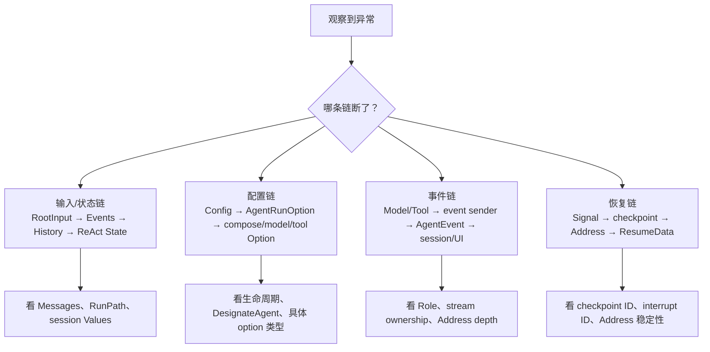
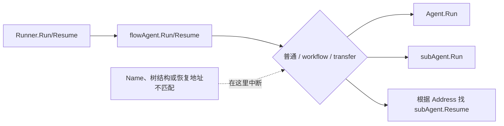
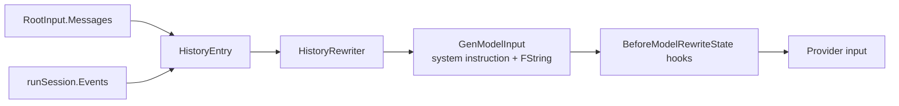
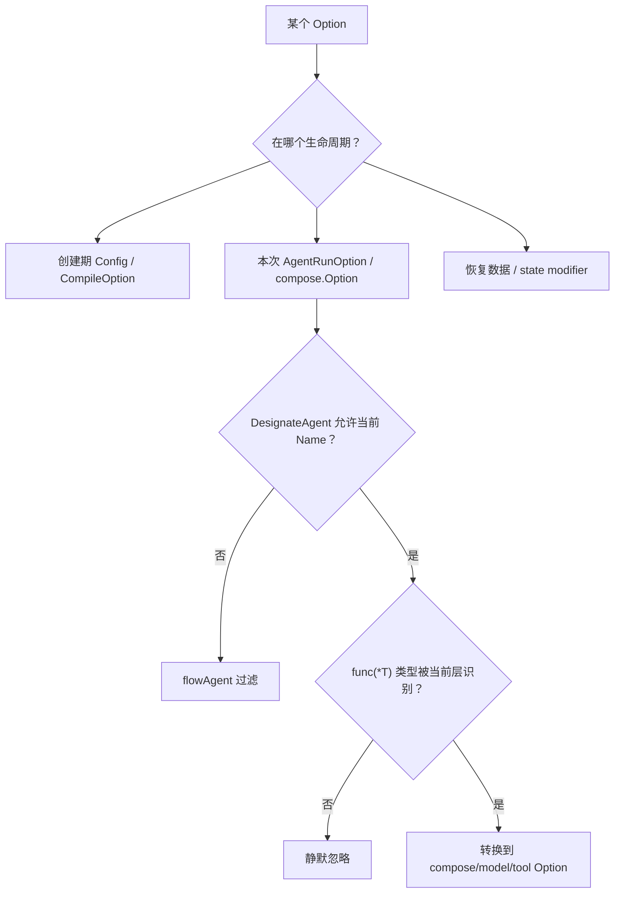
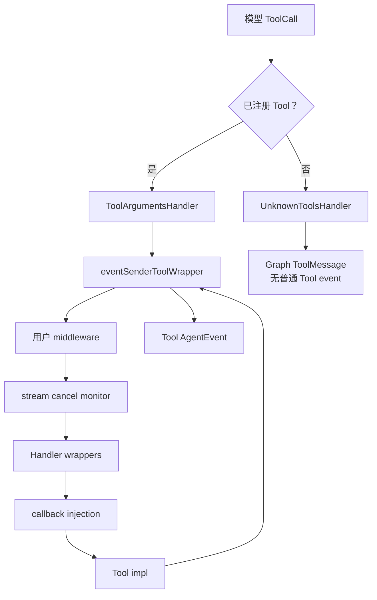
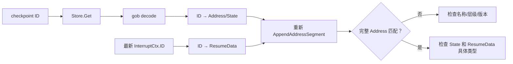
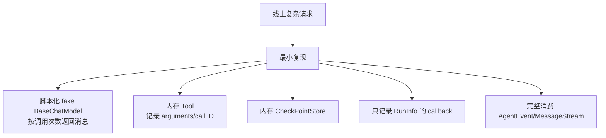

# ADK 调试、测试与源码定位手册

复杂 Agent 问题通常不是“模型回答错了”这么简单，而是输入在某层被改写、Option 在某层被过滤、事件被某个消费者读掉、Action 因 RunPath 不匹配被忽略，或恢复地址与旧 checkpoint 不再一致。

本章给出一套可重复的定位方法：先判断问题属于哪条链，再记录最少但足够的字段，最后用仓库测试确认源码语义。

## 先把问题归到四条链



不要一开始同时打印所有 Context value 或整个 checkpoint。先归类，能显著缩小范围。

## 建议为每个请求保存的诊断字段

| 字段 | 在哪里取得 | 解决什么问题 |
| --- | --- | --- |
| business request ID | 应用入口 | 跨系统串联 |
| checkpoint ID | 应用生成 | 定位恢复快照 |
| AgentName | AgentEvent | 事件来源 |
| RunPath | AgentEvent | ADK 语义归属、Action gating |
| Role/ToolName | MessageVariant | 区分模型与工具消息 |
| ToolCallID | Message.ToolCalls / ToolMessage | 并行同名调用 |
| interrupt ID | InterruptCtx.ID | Resume Targets key |
| interrupt Address | InterruptCtx.Address | 恢复结构诊断 |
| callback component/type/name | RunInfo | 组件级 tracing |
| streaming / non-streaming | AgentInput、MessageVariant | 判断流所有权路径 |
| retry attempt | retry 日志 / callback context | 区分新一轮 ReAct 与同一模型重试 |

不要记录完整用户 prompt、Tool 参数或模型结果，除非业务隐私策略明确允许。多数结构问题只需要长度、角色、ID、名称和路径。

## 一个安全的 AgentEvent 摘要器

```go
type EventSummary struct {
    Agent       string
    RunPath     []string
    HasOutput   bool
    Streaming   bool
    Role        string
    ToolName    string
    HasError    bool
    HasAction   bool
    Interrupted bool
}

func summarize(e *adk.AgentEvent) EventSummary {
    s := EventSummary{
        Agent:     e.AgentName,
        HasError:  e.Err != nil,
        HasAction: e.Action != nil,
    }

    for i := range e.RunPath {
        s.RunPath = append(s.RunPath, e.RunPath[i].String())
    }

    if e.Output != nil && e.Output.MessageOutput != nil {
        mv := e.Output.MessageOutput
        s.HasOutput = true
        s.Streaming = mv.IsStreaming
        s.Role = string(mv.Role)
        s.ToolName = mv.ToolName
    }

    if e.Action != nil {
        s.Interrupted = e.Action.Interrupted != nil
    }
    return s
}
```

摘要器不读取 MessageStream，所以不会改变所有权。需要记录最终文本时，先确认后续是否还要传递该 event；必要时使用 `adk.GetMessage` 保留另一份 reader。

## 症状一：Agent 根本没有被调用

按顺序检查：

1. RunnerConfig.Agent 是否为预期对象；
2. Workflow 的 SubAgents 是否真的包含它；
3. Transfer 目标 name 是否与 Agent.Name 完全一致；
4. AgentTool 的 Tool name 是否被模型实际选择；
5. Resume 是否因旧 Address 找不到当前 Agent；
6. Parallel Resume 中它是否属于已完成分支，因此按设计不重跑。



最有效的断点是 `flowAgent.Run`、`flowAgent.Resume`、`getAgent` 和 `getNextResumeAgent(s)`。

## 症状二：Agent 收到的 Messages 不符合预期

模型前的 Messages 至少可能被四次改变：



分别记录每一步的 `len(messages)`、Role 序列、ToolCallID，不必先打印 Content。

常见误判：

- 把其他 Agent 的 Assistant 消息当作当前 Agent 原生历史；默认 rewriter 会改成 UserMessage；
- 认为 System message 来自 RootInput；ChatModelAgent 通常在 GenModelInput 中追加；
- 认为 AgentTool full history 是原样复制；它会删最后的 ToolCall、移除 System、改写角色；
- 认为 AfterModelRewriteState 改写 state 就能替换当前 node 返回值；它主要影响下一轮状态。

## 症状三：Option 不生效

用三问法：



### 逐层断点

| Option | 先看函数 |
| --- | --- |
| WithSessionValues | `Runner.Run → getCommonOptions → AddSessionValues` |
| DesignateAgent | `flowAgent.Run → filterOptions` |
| WithChatModelOptions | `getComposeOptions → compose.WithChatModelOption` |
| WithToolOptions | `getComposeOptions → ToolsNodeOption → ToolOptions` |
| WithAgentToolRunOptions | `withAgentToolOptions → getOptionsByAgentName` |
| History modifier | `compose.WithStateModifier` |
| checkpoint ID | `typedRunnerHandleIterImpl/runnerSaveCheckPointImpl` |

无报错不代表 Option 已被消费；implementation-specific 类型断言失败就是静默路径。

## 症状四：Tool 已执行，但没有 Tool AgentEvent

检查 Tool 走的是哪条路径：



还要检查：

- callback handler 的 Address depth 是否命中当前 ChatModelAgent；
- Tool 是否自行声明 callbacks enabled，导致通用 wrapper 按设计不再包；
- ReturnDirectly Tool event 是否被暂存到 ToolsNode End 才发送；
- streaming Tool 结果的事件副本是否被上游读空；
- AgentTool internal event 是否开启 EmitInternalEvents。

## 症状五：看到重复的 Assistant 或 Tool 事件

高概率原因：

- Provider 声明 `IsCallbacksEnabled=true`，但外层又手动发送同一业务事件；
- 自定义 Tool 自己触发 callbacks，同时没有正确声明 Checker；
- UI 同时展示 AgentTool internal event 和父 Agent 正式 ToolMessage，却没有按 RunPath/Role 区分；
- consumer 重连后重放自己的缓存，不是 ADK 重复生产；
- ReturnDirectly 暂存事件与普通 event sender 路径被自定义代码同时发送。

观察事件时至少打印 AgentName、RunPath、Role、ToolName、ToolCallID，不能只按文本去重。

## 症状六：流式事件是空的或只剩 EOF

沿所有权链找第一个 Recv：

```text
Provider stream
  → retry Copy
  → callback Copy
  → Graph branch Copy
  → AgentEvent copy
  → history / UI / middleware consumer
```

在每个中间件和 callback 上检查：

- 是否调用了 Recv/Concat；
- 读取前是否 Copy；
- 返回的是原 reader、消费后的 reader，还是新 reader；
- 每个副本是否 Close；
- 读取错误是否被包装成 WillRetryError；
- checkpoint 是否已把流 concat 成完整 Message。

不要通过“再读一次看看”调试同一个 reader，这会继续改变现场。

## 症状七：Action 明明发了却没有效果

flowAgent 只让 RunPath 与当前执行精确匹配的 Action 控制本层。

| 现象 | 解释 |
| --- | --- |
| AgentTool 内部 Exit 没有终止父 Agent | 工具边界隔离 |
| AgentTool 内部 Transfer 没有切换父级角色 | 工具边界隔离 |
| 嵌套 internal event 能展示但不改变父 session | RunPath 不精确匹配 |
| Workflow child 的 BreakLoop 被最近 Loop 消费 | Action 的目标层级 |
| Transfer 报 agent not found | 目标不是直接 subAgent/parent 或 name 不一致 |

断点放在 `flowAgent.run` 的两处 `exactRunPathMatch`，分别查看事件记录 gating 和 Action gating。

## 症状八：checkpoint 保存了但不能恢复

按顺序验证：

1. 首次 Run 是否真的传了 WithCheckPointID；
2. Store.Set 是否成功，Interrupt 前是否出现保存 Error event；
3. Resume 使用的 checkpoint ID 是否完全一致；
4. Targets key 是否来自最新 `InterruptCtx.ID`；
5. Agent/Tool/Graph/node 名称和层级是否变化；
6. 自定义 state 的具体类型是否注册并保持兼容；
7. ResumeData 的实际指针/值类型是否与类型断言相同；
8. 是否有两个请求并发 Resume 同一个 checkpoint。



不要只检查公开 Address。底层完整地址还包含 runnable/node 段，Graph 结构变化也可能影响恢复。

## 症状九：恢复后重复执行外部操作

先区分：

- 框架结构为了到达目标而重新执行组合层；
- 已完成 Parallel lane 是否被 checkpoint state 跳过；
- Tool 自身是否在中断前已经完成副作用；
- 两个 Resume 请求是否同时领取同一 checkpoint；
- 模型 retry 是否只是模型重试，而非 Tool 重试；
- 业务接口是否支持 operation ID 幂等。

checkpoint 不提供 exactly-once。数据库写入、消息发送、扣款退款必须用业务事务和幂等键保护。

## 从入口到故障点的断点路线

### 普通 ChatModelAgent

```text
adk/runner.go: Runner.Run
  → adk/flow.go: flowAgent.Run
  → adk/flow.go: genAgentInput
  → adk/chatmodel.go: ChatModelAgent.Run
  → adk/chatmodel.go: getRunFunc / buildRunFunc
  → adk/wrappers.go: typedStateModelWrapper
  → compose Graph runtime
  → adk/wrappers.go: event sender wrappers
  → adk/flow.go: flowAgent.run
```

### AgentTool

```text
compose/tool_node.go
  → adk/wrappers.go: eventSenderToolWrapper
  → adk/agent_tool.go: agentTool.InvokableRun
  → child Runner.Run / Resume
  → 迭代 child AgentEvent
  → 最后事件 Message.Content
```

### Interrupt/Resume

```text
leaf Interrupt/StatefulInterrupt
  → CompositeInterrupt layers
  → typedRunnerHandleIterImpl
  → saveCheckPoint
  → ResumeWithParams
  → loadCheckPoint
  → PopulateInterruptState / BatchResumeWithData
  → flowAgent.Resume / buildResumeInfo
```

## 仓库测试就是可执行规格

| 想确认的行为 | 先读/运行的测试 |
| --- | --- |
| Runner Run/Query/streaming | `adk/runner_test.go` |
| Transfer 与历史 | `adk/flow_test.go` |
| Session Values、fork/join | `adk/runctx_test.go` |
| ReAct 分支、ReturnDirectly | `adk/react_test.go`、`adk/chatmodel_test.go` |
| AgentTool 输入、事件、Action 隔离 | `adk/agent_tool_test.go` |
| Sequential/Parallel/Loop | `adk/workflow_test.go` |
| 所有层级中断恢复 | `adk/interrupt_test.go` |
| 确定性 Transfer 包装 | `adk/deterministic_transfer_test.go` |
| 非流/流模型重试 | `adk/chatmodel_retry_test.go` |
| Option 类型和可见性 | `adk/call_option.go`、`adk/callback_integration_test.go`、`adk/workflow_test.go` |
| Iterator、stream 缓存、gob | `adk/utils_test.go` |
| Callback manager 顺序 | `callbacks/interface_test.go` |
| ToolsNode 参数、并行、中断 | `compose/tool_node_test.go` |

## 推荐测试命令

完整 ADK：

```bash
go test ./adk/...
```

带 race detector：

```bash
go test -race ./adk/...
```

针对单条路径：

```bash
go test -run TestChatModelAgentToolInterrupt ./adk
go test -run TestChatModelParallelToolInterruptAndResume ./adk
go test -run TestParallelWorkflowResumeWithEvents ./adk
go test -run TestConcurrentSameToolSendToolGenActionUsesToolCallID ./adk
go test -run TestSequentialWorkflow_RetryAbleStreamError_SuccessfulRetry ./adk
```

显示子测试和日志：

```bash
go test -v -run 'TestChatModelAgentRun|TestReact' ./adk
```

## 编写最小复现时怎样替换真实依赖



脚本化 Model 应记录每次输入 Messages，并按序返回：ToolCall、ToolCall、最终 answer。这样可以精确断言 Before/After、history、retry 和工具循环，而不受真实模型随机性影响。

内存 Store 至少要加 mutex；测试并发 Resume 时不要复用一个无锁 map，否则测到的可能是测试替身 data race。

## 断言事件时不要只看数量

一条有工具请求至少断言：

- AgentName；
- RunPath；
- MessageVariant.Role；
- ToolName 和 ToolCallID 配对；
- streaming reader 的实际完整内容；
- Action 是否只挂在预期 Tool event；
- Error 后是否结束；
- session 最终是否包含/排除该事件；
- Resume 后已完成分支是否没有重复调用。

只断言“共 4 个事件”很容易在重复事件和漏事件同时发生时误通过。

## 变更源码后的回归矩阵

| 修改区域 | 最少回归 |
| --- | --- |
| AgentEvent/MessageVariant | utils、flow、agent_tool、interrupt |
| RunPath/history | flow、runctx、workflow、agent_tool |
| Address/resume | interrupt、workflow、agent_tool、compose resume |
| ChatModel wrapper/callback | wrappers、chatmodel、retry、callbacks |
| Tool middleware/event sender | wrappers、chatmodel、agent_tool、tool_node |
| Workflow state | workflow、interrupt、gob compatibility |
| AgentRunOption | call_option、workflow、chatmodel、agent_tool |
| stream Copy/Close | utils、retry、callbacks、tool_node |

## 最后一个原则：先证明是哪一层，再修改

很多“修复”会掩盖真正问题：

- Option 不生效就把值塞进 Context；
- 流被读空就重复请求模型；
- Resume 对不上就从头 Run；
- Action 被忽略就直接调用另一个 Agent；
- callback 重复就按文本去重。

这些做法会让状态边界更混乱。先通过路径、类型、所有权和地址证明故障层，再在对应抽象中修复。

继续阅读：[端到端源码追踪](./end-to-end-trace.md)、[Context 传播](./context-flow.md)、[Config/Option](./config-option-flow.md)、[并发与错误边界](./concurrency-errors.md)。

<div class="source-path">ADK 测试：adk/*_test.go<br>Callback 测试：callbacks/interface_test.go<br>ToolsNode 测试：compose/tool_node_test.go<br>完整模块映射：本节侧栏“模块覆盖审计”</div>
