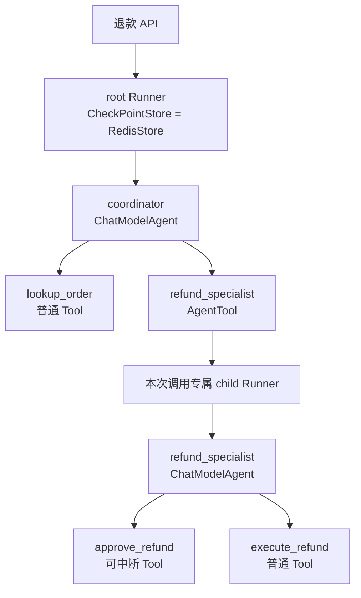
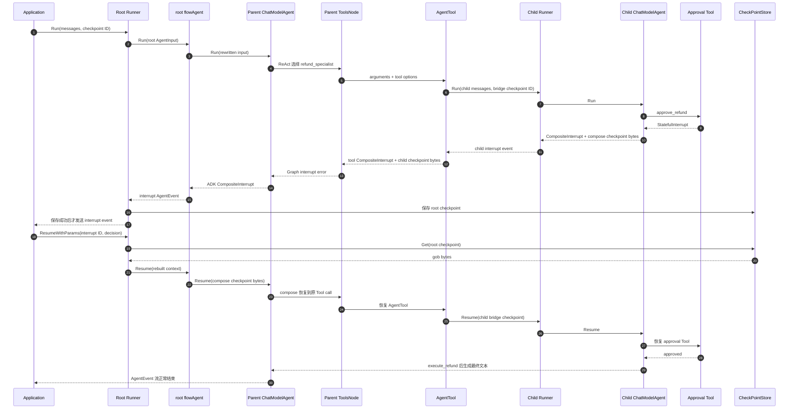
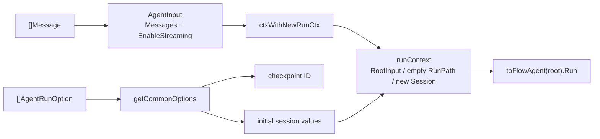
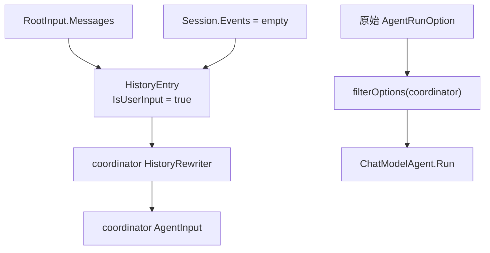
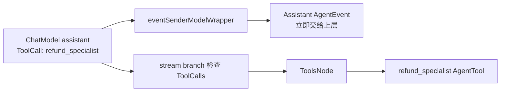
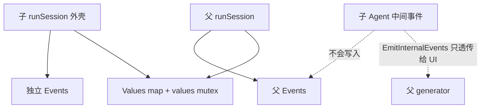
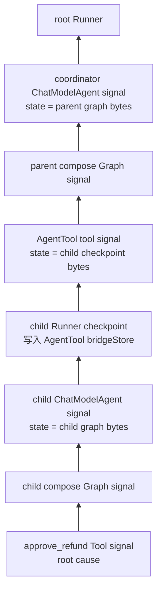
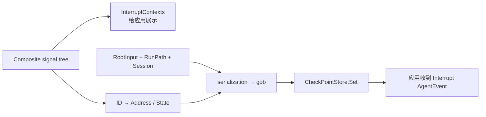
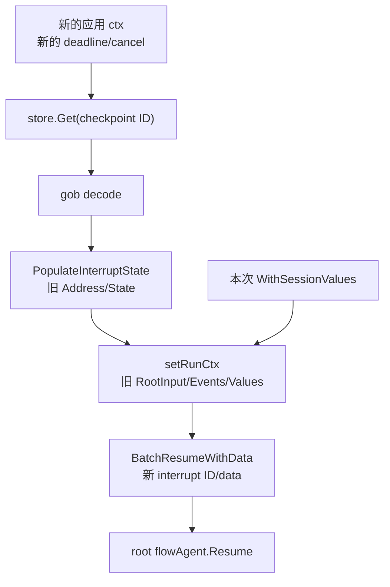
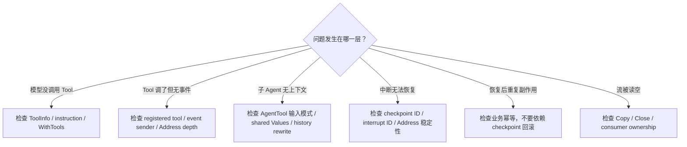

# 一次复杂请求的端到端源码追踪

前面的章节分别解释 Runner、Context、Option、ReAct、AgentTool 和 Interrupt。这一章把它们放进同一个例子：用户要求查询订单并退款，父 Agent 把专业工作交给一个 AgentTool，子 Agent 调用审批 Tool 后中断，应用审批后再从 checkpoint 恢复。

读完以后，你应该能回答：**当前在哪一层、哪个对象持有什么状态、下一个事件从哪里产生、为什么恢复时不会从头调用所有组件。**

## 场景和对象

假设对象关系如下：



配置上的关键点：

- `coordinator.ToolsConfig.Tools` 同时包含订单查询 Tool 和 `NewAgentTool(refundSpecialist)`；
- 父 Agent 开启 `EmitInternalEvents`，所以 UI 可以看到子 Agent 的中间文字；
- 根 Runner 配置业务 CheckPointStore；
- 首次调用传入 `WithCheckPointID("refund:req-42")`；
- 审批 Tool 使用 tool 层的 `StatefulInterrupt`，而不是返回普通 error。

## 先看完整时间线



这不是在原 goroutine 上“解除暂停”。第一次调用已经全部退出；第二段从 `ResumeWithParams` 开始，重新建立 goroutine、Context 和 runnable，再依靠 Address 领取旧状态。

## 阶段 0：创建期只建立配置对象

可以把创建期想成装配机器，而不是启动机器。

```text
NewChatModelAgent(refund specialist config)
  → 归一化 instruction / middlewares / tools
  → 保存字段，尚未 Compile Graph

NewAgentTool(refund specialist)
  → 保存 Agent 引用和输入模式
  → Info() 时把 Agent Name/Description 变成 ToolInfo

NewChatModelAgent(coordinator config)
  → 把 AgentTool 当作普通 BaseTool 保存

NewRunner(root config)
  → 保存 root Agent、streaming 开关、CheckPointStore
```

`ChatModelAgent.buildRunFunc` 由 `sync.Once` 保护，要到首次 Run/Resume 才确定走简单 Chain 还是 ReAct Graph。因此首次请求可能承担 Tool.Info、Model.WithTools 和 Graph 构造成本。

## 阶段 1：Runner 建立根运行环境

入口：`Runner.Run`。



此刻同时存在三种看起来像“输入”的数据：

| 数据 | 内容 | 后续用途 |
| --- | --- | --- |
| `messages` 参数 | 应用给出的原始消息 | 构造 AgentInput |
| `runContext.RootInput` | 根 AgentInput 指针 | 子 Agent 重建输入 |
| `opts` | 本次运行配置 | 被 Runner、flowAgent、具体 Agent 分层消费 |

Runner 不会把 `checkpoint ID` 放进 AgentInput。它仍留在 `AgentRunOption`，到中断或可恢复取消发生时由 `typedRunnerHandleIterImpl` 使用。

## 阶段 2：flowAgent 同时建立 RunPath 和 Address

`flowAgent.Run` 做两次不同的定位：

```text
initRunCtx(ctx, "coordinator", input)
  → RunPath = [coordinator]

AppendAddressSegment(ctx, agent, "coordinator")
  → Address = agent:coordinator
```

然后 `genAgentInput` 从 RootInput 和 session Events 重建当前 Agent 输入。首次进入时 Events 为空，所以主要得到原始用户消息。



RunPath 面向 ADK 会话语义；Address 面向执行树、callback 和恢复。首次看起来相同，是因为都只有一个 Agent；进入 Graph、Tool、AgentTool 后它们就会明显分叉。

## 阶段 3：父 ChatModelAgent 首次冻结结构

父 Agent 有 Tool，因此 `buildRunFunc` 构建 ReAct：

1. 调用每个 Tool 的 `Info(ctx)`；
2. 将 ToolInfo 列表交给 `model.WithTools`；
3. 把默认 `eventSenderToolWrapper` 放到 Tool middleware 列表最外层；
4. 创建 ChatModel node、ToolsNode 和 stream branch；
5. 外面再包 `AgentInput → []Message` 的 Chain；
6. 使用内存 `bridgeStore` 作为 compose checkpoint store。

父 Agent 的地址会继续变成：

```text
agent:coordinator
  ;runnable:coordinator
  ;runnable:ReAct
  ;node:ChatModel
```

公开 ADK 中断信息最终只显示 agent/tool 段，但 compose 内部定位仍使用完整地址。

## 阶段 4：模型输出 AgentTool 调用

第一次模型输出同时走两条路径：



这解释了为什么用户可能先看到一条带 ToolCall 的 Assistant event，随后才看到 Tool event。Graph 数据流决定下一节点，event sender wrapper 把过程转换成对外事件；通用 Callback 在旁路观察组件执行。

## 阶段 5：AgentTool 把 JSON 变成子 Runner 输入

若采用默认输入模式，模型参数：

```json
{"request":"检查订单 1001 是否可以退款"}
```

会变成一条 `UserMessage("检查订单 1001 是否可以退款")`。然后 AgentTool 创建本次调用专属的 `bridgeStore`，并构造内部 Runner：

```text
newInvokableAgentToolRunner(childAgent, bridgeStore, enableStreaming)
  .Run(ctx, childMessages,
       child-specific AgentRunOptions...,
       WithCheckPointID("adk_react_mock_key"),
       withSharedParentSession())
```

固定 ID 不会跨请求冲突，因为 bridgeStore 不是全局 store；每次 AgentTool invocation 都有新实例。

### sharedParentSession 究竟共享什么



子 Agent 可以读取用户 ID、租户等 session value，但它的完整过程不会自动变成父模型历史。父模型最终只接收 AgentTool 返回的 ToolMessage。

## 阶段 6：审批 Tool 产生叶子中断

审批 Tool 首次执行通常遵循：

```text
GetInterruptState(ctx)
  → wasInterrupted = false
  → return tool.StatefulInterrupt(info, localState)
```

此处的 `info` 给人看，例如订单金额与风险；`localState` 给程序恢复，例如已完成校验步骤、幂等键和订单号。不要反过来。

叶子中断被逐层包装：



每一层都保存自己的 state，并将下一层 signal 放在 `Subs` 中。最外层 Runner 按协议只应看到一个已经汇总的根 signal。

## 阶段 7：先保存 checkpoint，再向应用报告

`typedRunnerHandleIterImpl` 识别 `event.Action.internalInterrupted` 后：

1. 将 signal 树转成面向用户的 `InterruptContexts`；
2. 将 signal 树压平为 `interrupt ID → Address` 和 `interrupt ID → State`；
3. 将 runContext、streaming 标志和两张 map 用 gob 编码；
4. 调用业务 CheckPointStore.Set；
5. 最后发送 interrupt event。



如果 Set 失败，Runner 会先发 Error event，再发 Interrupt event。因此应用不能只看到 Interrupt 就认为一定可恢复。

## 阶段 8：应用需要保存哪几个标识

应用至少要保存：

| 标识 | 来源 | 用法 |
| --- | --- | --- |
| checkpoint ID | 应用在 Run 时生成 | Resume 时定位整份快照 |
| interrupt ID | `InterruptCtx.ID` | `ResumeParams.Targets` 的 key |
| Address | `InterruptCtx.Address` | 展示、诊断、审计，不作为 Targets key |
| 业务请求 ID | 应用自己的订单/流程 ID | 幂等与业务数据关联 |

中断恢复后若再次中断，会生成新的 interrupt ID；UI 应替换旧按钮绑定的数据。

## 阶段 9：恢复时 Context 的覆盖顺序

`Runner.resume` 的顺序不是随意的：



新 Context 的取消和 deadline 生效；旧 session 状态从 checkpoint 恢复；本次 `WithSessionValues` 可覆盖同 key 的旧值；Targets 只提供这次批准的数据。

## 阶段 10：Address 如何把状态发还给原组件

重跑结构时，每次 `AppendAddressSegment` 都用新地址匹配 checkpoint 中的地址：

- 完全相等：领取本层 interrupt state；
- Targets 包含该 interrupt ID：领取 resume data；
- 某个未消费目标是当前地址的后代：当前组合层得到 `isResumeTarget=true`，继续向下；
- 状态和数据领取后标记 used，避免重复消费。

因此恢复依赖的是“结构稳定”，而不是调用栈还在。修改 Agent 名、Graph name、node key、Tool name 或层级，都可能让旧地址失配。

## 阶段 11：AgentTool 为什么能恢复子 Runner

父 ToolsNode 恢复原 tool task 时，AgentTool 调用：

```text
tool.GetInterruptState[[]byte](ctx)
  → 取得上次保存的 child Runner checkpoint bytes
  → newResumeBridgeStore(bytes)
  → child Runner.Resume("adk_react_mock_key")
```

子 Runner 再从 bytes 里恢复子 runContext 和子 signal map，继续沿 child Agent、child Graph、approval Tool 的地址向下走。AgentTool 不理解 bytes 内部结构，只负责跨越 Tool 边界保存和回放。

## 阶段 12：批准后怎样回到正常 ReAct

审批 Tool 命中自己的恢复地址后会看到：

```text
wasInterrupted = true
isResumeTarget = true
hasResumeData = true
resumeData = ApprovalDecision{Approved: true}
```

随后它返回正常 Tool result。子 ReAct 将 ToolMessage 加入 Messages，再调用模型；模型可以调用 `execute_refund`，最后产生无 ToolCall 的 assistant answer。结果按相反方向逐层返回：

```text
child final AgentEvent
  → AgentTool 取最后事件的 Message.Content
  → parent ToolMessage
  → parent ReAct 下一轮 ChatModel
  → parent final Assistant AgentEvent
  → root flowAgent 写 session
  → Runner 转发给 Application
```

## 同一时刻究竟有哪些状态

| 层 | 状态对象 | 本例内容 | 生命周期 |
| --- | --- | --- | --- |
| 应用 | checkpoint ID、业务 ID | refund:req-42、order 1001 | 业务定义 |
| Root Runner | `runContext` | 根输入、父 session | 一次根运行/恢复 |
| flowAgent | RunPath | coordinator | Agent 历史语义 |
| core | Address | agent/runnable/node/tool 链 | 一次执行结构 |
| Parent ReAct | `adk.State` | 父 Messages、iterations | 父 Graph |
| AgentTool | bridgeStore | child checkpoint bytes | 一次 tool call |
| Child Runner | child runContext | 子 Events，shared Values | 子运行 |
| Child ReAct | `adk.State` | 子 Messages、tool actions | 子 Graph |
| Approval Tool | tool-local state | 校验进度、幂等键 | 中断点 |

## 事件序列示例

实际事件数取决于模型和是否流式，但逻辑上可能看到：

| 顺序 | AgentName | Role/Action | 是否写父 session |
| --- | --- | --- | --- |
| 1 | coordinator | Assistant ToolCall | 是 |
| 2 | refund_specialist | 内部 Assistant | 否，只透传 |
| 3 | refund_specialist | 内部 Tool result | 否，只透传 |
| 4 | refund_specialist | Interrupt | 否，走 checkpoint |
| 恢复后 5 | refund_specialist | 内部 Tool result | 否，只透传 |
| 6 | refund_specialist | 内部 final Assistant | 否，只透传 |
| 7 | coordinator | refund_specialist Tool result | 是 |
| 8 | coordinator | final Assistant | 是 |

判断是否进入某个 flowAgent 的 session，不看 UI 是否看到了事件，而看事件 RunPath 是否与该 flowAgent 当前 RunPath 精确相等。

## 排错时按这条链问问题



继续阅读：[Context 逐层传播](./context-flow.md)、[Config 与 Option 转换](./config-option-flow.md)、[AgentTool 与 Transfer](./tools-transfer.md)、[Interrupt/Resume](./interrupt-resume.md)。

<div class="source-path">主路径：adk/runner.go → adk/flow.go → adk/chatmodel.go → adk/react.go<br>嵌套 Agent：adk/agent_tool.go<br>中断协议：adk/interrupt.go、internal/core/address.go、internal/core/interrupt.go</div>
