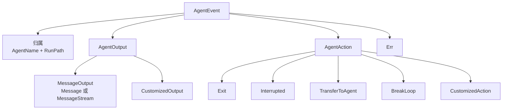
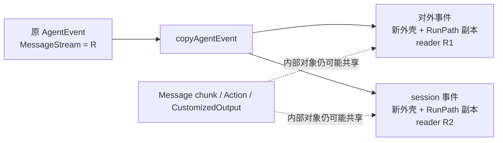
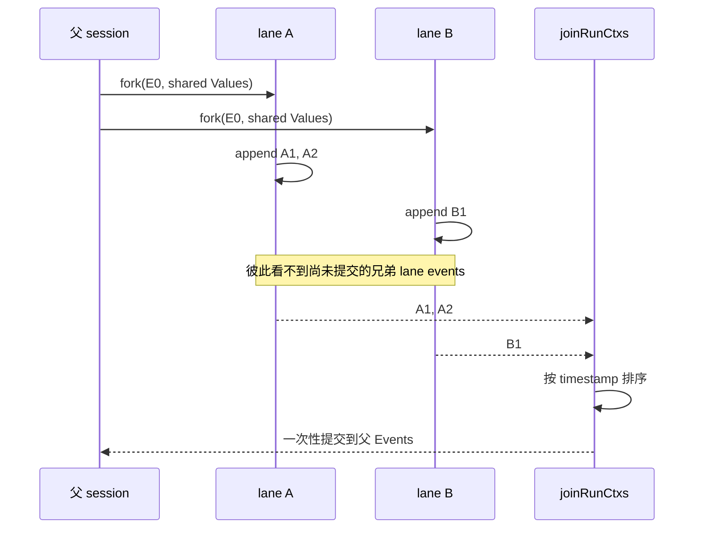

# 事件与异步迭代器

ADK 的基本输出单位不是 Message，而是事件。经典消息路径使用 `AgentEvent`，它是 `TypedAgentEvent[*schema.Message]` 的别名；Agentic 路径使用 `TypedAgentEvent[*schema.AgenticMessage]`。一个 Agent 可以在一次 Run 中发出任意数量事件，调用方逐个消费。

## AgentEvent 数据模型

```go
type TypedAgentEvent[M MessageType] struct {
    AgentName string
    RunPath   []RunStep
    Output    *TypedAgentOutput[M]
    Action    *AgentAction
    Err       error
}

type AgentEvent = TypedAgentEvent[*schema.Message]
```

四个载荷可组合：工具结果事件既可以有 `Output`，也可以带工具产生的 `Action`；中断事件通常有 Action，也可能保留触发前输出；错误通过 `Err` 传递，不伪装成消息。



一个 Event 可以同时连向 Output 和 Action，例如 transfer 工具事件同时有 ToolMessage 与 TransferToAgentAction。消费端不要把这些字段写成只能命中一个的 `else if`。

### Event、Message、Action 的层级

对初学者最容易混淆的是：Message 只是 Event 的一种输出，不是整个运行协议。

```text
AgentEvent
  ├─ 归属：AgentName + RunPath
  ├─ 输出：AgentOutput
  │    ├─ MessageOutput
  │    │    ├─ 完整 Message
  │    │    └─ MessageStream
  │    └─ CustomizedOutput
  ├─ 控制：AgentAction
  └─ 失败：Err
```

因此一次“工具要求转交”的 event 可以同时携带 ToolMessage 与 Transfer Action；UI 展示 ToolMessage，flowAgent 消费 Action。二者不是重复，而是数据面和控制面的分工。

### Output

`AgentOutput` 可以是标准 `MessageOutput` 或任意 `CustomizedOutput`。消息由 `MessageVariant` 表示：

```go
type TypedMessageVariant[M MessageType] struct {
    IsStreaming   bool
    Message       M
    MessageStream *schema.StreamReader[M]
    Role          schema.RoleType
    AgenticRole   schema.AgenticRoleType
    ToolName      string
}
```

经典消息使用 `Role` 和 `ToolName`；AgenticMessage 使用 `AgenticRole`，其 Tool 结果保存在 ContentBlocks 中。两组字段让上层 UI 不必先消费完整 stream 才知道事件角色。经典路径上的 `AgenticRole` 为零值，Agentic 路径上的 `Role`、`ToolName` 为零值。

`EventFromMessage(msg, stream, role, toolName)` 创建经典事件，`EventFromAgenticMessage(msg, stream, agenticRole)` 创建 Agentic 事件。`stream != nil` 时 `IsStreaming=true`，否则保存完整 Message。两者不会填写 AgentName/RunPath；归属通常由外层 flowAgent 补齐。

标准 ChatModelAgent 的事件来源包括：

- `eventSenderModelWrapper`：Assistant 完整消息或 MessageStream；
- `eventSenderToolWrapper`：Tool 完整消息或流；
- ReturnDirectly 收尾逻辑：延迟发出需要直接返回的 Tool event；
- Graph/Run 错误处理：Err 或 Interrupt event。

event sender 与 Callback 是两条相邻但独立的机制，详见 [Callback 与 AgentEvent](./callbacks.md)。

`CustomizedOutput` 适合结构化结果，但 ADK 不会自动把它转成历史 Message。若后续 Agent 必须看见该内容，需要自定义 history rewriter、同步写 session，或额外发标准消息事件。

### Action

`AgentAction` 有五类槽位：`Exit`、`Interrupted`、`TransferToAgent`、`BreakLoop`、`CustomizedAction`。Action 是控制信号，而不是文本约定：workflow 和 flowAgent 可以不解析自然语言就准确响应。

| Action | 谁通常产生 | 谁消费 | 是否跨 AgentTool 边界 |
| --- | --- | --- | --- |
| Exit | Exit tool / 自定义 Agent | 当前 flowAgent | 否 |
| Interrupted | Agent/tool/compose | workflow、Runner | 是，以 CompositeInterrupt 转换 |
| TransferToAgent | transfer tool / 确定性包装 | 当前 flowAgent | 否 |
| BreakLoop | Replanner / 自定义程序 Agent | 最近一层未处理 Loop | 否 |
| CustomizedAction | 业务代码 | 业务自定义层 | 框架不解释 |

`BreakLoopAction.Done` 是防止嵌套 Loop 重复消费的标志。第一层处理它的 Loop 会设 `Done=true` 并填入从 0 开始的 `CurrentIterations`；更外层 Loop 看到 Done 后不再退出。

公开 `Interrupted` 是用户视图，私有 `internalInterrupted` 才承载完整 signal/state 树。应用应读取 `InterruptContexts`，不要依赖内部字段。

### RunPath

`RunPath` 表示从根 Agent 到事件来源的执行序列。其元素 `RunStep` 的 agent name 不导出，由框架设置，防止用户伪造归属。`flowAgent.run` 只在事件路径为空时填充，避免 AgentTool 已经追加过父路径后再次重复。

### RunPath 与 Address 的区别

| 维度 | RunPath | interrupt Address |
| --- | --- | --- |
| 保存位置 | AgentEvent / runContext | Go context 的 core addrCtx |
| segment | 只有 Agent 名 | agent、tool，以及内部 graph/node 等 |
| 主要用途 | 事件归属、历史记录、Action 隔离 | 中断 state 精确匹配与 targeted resume |
| 用户可见性 | AgentEvent 直接暴露，但 RunStep 字段不可写 | InterruptCtx 暴露过滤后的 agent/tool 地址 |

Sequential 运行 peer Agents 时会用 `updateRunPathOnly` 累积执行历史，但不会错误地把 peer 变成嵌套 Address；恢复进入真实子组件时才用 `AppendAddressSegment`。所以两条路径不能互相替代。

### “精确路径匹配”决定什么进入父状态

flowAgent 收到 event 后只对 `event.RunPath == current runCtx.RunPath` 的事件做两件事：

1. 非中断事件复制后写入当前 session Events；
2. 把该事件 Action 记为能够改变当前 Agent 控制流的 `lastAction`。

更深路径的 AgentTool 内部事件仍可展示给用户，但不会污染父 history，也不能让父 flowAgent Exit/Transfer。这里的等于包括长度与每个 RunStep 都相等，不是前缀匹配。

## Iterator / Generator

```go
iter, gen := adk.NewAsyncIteratorPair[*adk.AgentEvent]()
go func() {
    defer gen.Close()
    gen.Send(event)
}()

for event, ok := iter.Next(); ok; event, ok = iter.Next() {
    // consume
}
```

二者共享 `internal.UnboundedChan[T]`。生产者不会因为固定容量缓冲区轻易阻塞，但消费者过慢会带来内存增长，因此“unbounded”不是可以忽略背压的承诺。

Iterator 是 pull 接口，Generator 是 push 接口：

- `Send` 把值送入同一个 unbounded channel；
- `Next` 阻塞到有值或通道关闭，返回 `(zero, false)` 表示结束；
- `Close` 必须由生产方恰好负责一次；
- 多数 ADK goroutine 用 defer 捕获 panic，先发 Error event，再关闭 generator。

Agent 接口要求返回的 AgentEvent 外壳可以被修改，且其中 MessageStream 必须是当前消费者独占的。框架依赖这条约定来安全补 AgentName、RunPath 和 automatic-close 标记。

::: warning 生命周期责任
如果调用方提前停止遍历，仍应关闭已经取得的 MessageStream；框架在内部副本上尽量设置 automatic close，但不能替应用无限期持有的 reader 回收所有资源。
:::

## 流事件的所有权

一个 `MessageStream` 只能安全消费一次。ADK 在需要同时“交给用户”和“写入历史”时调用 `copyAgentEvent`：

1. 深拷贝 RunPath 与事件外壳；
2. 对 streaming message 调用 `StreamReader.Copy(2)`；
3. 原事件与副本各持有独占 reader；
4. 两份 reader 设置 automatic close，未消费也能回收。

Message chunk 本身不会深拷贝，`CustomizedOutput/Action` 也只是引用复制。消费者不应原地修改这些对象。

`copyAgentEvent` 的复制深度如下：

| 字段 | 复制方式 |
| --- | --- |
| AgentEvent / AgentOutput / MessageVariant 外壳 | 新对象 |
| RunPath slice | 新 slice |
| 非流 Message 指针 | 共享 |
| 流 | `Copy(2)` 后各自独占 reader |
| Action | 共享指针 |
| CustomizedOutput | 共享引用 |
| Err | 共享 error 值 |

所以“safe to modify”主要指事件外壳和 RunPath，不代表可以并发修改 Message、Action 或自定义对象内部字段。



<p class="diagram-caption">复制解决的是“两个消费者争抢同一条流”，不是任意对象的深拷贝；共享字段仍应视作只读。</p>

## GetMessage

应用想把流事件读成完整消息时，应使用 `adk.GetMessage`。它先复制 stream，再 concat 副本，并把另一份放回事件，避免辅助读取破坏后续消费者。

内部 `getMessageFromWrappedEvent` 还缓存 concat 结果；并发访问由 mutex 保护。流中出错时将错误保存在 `StreamErr`，成功 chunk 被重新包装，以避免第二次读取或 gob 序列化丢失错误状态。

两个 API 的使用场景不同：

- `MessageVariant.GetMessage()`：直接消费当前 stream，不保留另一份；适合你确定该 event 之后不再被其他逻辑读取；
- `adk.GetMessage(event)`：先 Copy，再消费副本，并把另一 reader 写回 event；适合 UI 既想拿完整文本、后续又要继续传递 event。

注意 `GetMessage` 返回 `(message, event, error)` 中的 event 仍是传入的同一个外壳，只是 streaming reader 已替换。调用方应继续使用返回的 event，以明确表达所有权已经更新。

### 流错误与 retry

session 历史重建读流失败时：

- 普通错误被缓存到 `StreamErr` 并向上返回，避免把残缺 Assistant 消息塞进下一轮上下文；
- `WillRetryError` 表示模型层准备重试，flow history 会跳过该失败事件并继续；
- 已成功读取的 chunks 会重新包装成 reader，保证后续 close/checkpoint 行为有确定对象。

这和 callbacks 的 stream Copy 是两层不同机制：callback manager 为多个 handler 分流，AgentEvent copy 为用户/历史/工具包装等消费者分流。

## Session 中的事件不是“所有看到的事件”

`runSession` 同时保存：

```go
type runSession struct {
    Values map[string]any
    Events []*agentEventWrapper
    LaneEvents *laneEvents
}
```

它不是 Runner 对外输出的逐字日志：

- 只有当前 flowAgent 精确 RunPath 的非中断事件才正式写入；
- AgentTool 内部透传事件不写父 session；
- interrupt 走 signal/checkpoint，不写 Events；
- 没有 MessageOutput 的 Action 事件即使写入，默认 history rewriter 也会跳过消息部分；
- 每条正式事件额外记录纳秒时间戳、已合并流缓存和 StreamErr。

`Values` 与 `Events` 作用也不同：Values 是各 Agent 按 key 共享的结构化状态；Events 用于重建跨 Agent 对话历史。`GetSessionValues` 返回 map 的浅拷贝，value 内部对象仍可能共享。

### Parallel lane 怎样合并事件

Parallel workflow 不能让多个 goroutine 无序直接追加主 Events。`forkRunCtx` 为每个分支创建独立 `LaneEvents`：

```text
child lane
  ├─ 共享：已提交 Events、Values map、values mutex、RootInput
  └─ 独立：runSession 外壳、LaneEvents slice、事件追加路径
```

分支内部可读取“主历史 + 自己从祖先 lane 到当前 lane 的临时历史”，看不到兄弟分支尚未 commit 的事件。全部分支结束后，`joinRunCtxs` 收集叶子 lane events，按事件创建时间戳排序，一次提交到父 lane 或主 Events。



<p class="diagram-caption">UI 实时收到的先后顺序与最终 session 提交顺序是两个概念；前者由调度决定，后者按事件时间戳整理。</p>

这意味着：

- 对外 generator 的实时到达顺序由调度决定；
- 最终 session 历史尝试按纳秒时间戳恢复跨 lane 时间顺序；
- 相同时间戳没有额外稳定 tie-break，业务不应依赖完全确定的并发消息顺序；
- Values 是共享 map，虽然单次读写有 mutex，但多个分支对同 key 的最后写入仍是时序竞争。

## 序列化语义

`MessageVariant.GobEncode` 遇到流会先把流合成单个 Message。恢复后的 `MessageStream` 是只含该完整消息的 reader，而不是原始 token chunk 序列。因此 checkpoint 恢复保证语义内容，不保证原 chunk 边界。

另外，`RunStep` 因 agentName 是非导出字段，实现了自定义 GobEncode/GobDecode；`agentEventWrapper` 在已有 concatenatedMessage 时会先重建单元素 stream，再编码外壳。这些类型标记为 CheckpointSchema，说明事件协议同时也是持久化协议。

`CustomizedOutput`、`CustomizedAction` 和自定义 error 的具体类型如果会进入 session checkpoint，同样需要 gob 可编码并保持注册名稳定。若自定义数据只发给用户但从不被正式记录，要求会不同；不要靠猜测，按实际 RunPath 和记录策略确认。

## 消费循环的正确写法

```go
for event, ok := iter.Next(); ok; event, ok = iter.Next() {
    if event.Err != nil {
        return event.Err
    }
    if event.Action != nil && event.Action.Interrupted != nil {
        return handleInterrupt(event.Action.Interrupted)
    }
    if event.Output != nil && event.Output.MessageOutput != nil {
        msg, _, err := adk.GetMessage(event)
        if err != nil { return err }
        if msg != nil { render(msg) }
    }
}
```

不要假设最后一个事件一定是 Assistant Message；它可能是 Exit、Transfer、Interrupt、自定义输出或 error。

一个更完整的 UI 分发建议是：

```text
收到 AgentEvent
  ├─ Err != nil
  │    └─ 记录失败；若是 WillRetryError 可展示“正在重试”而非终止
  ├─ Action.Interrupted != nil
  │    └─ 保存 checkpoint ID + 最新 InterruptContexts，展示恢复入口
  ├─ Output.MessageOutput != nil
  │    ├─ Role=Assistant → 主回答/思考区
  │    └─ Role=Tool      → 工具区（用 ToolName 标识）
  ├─ Output.CustomizedOutput != nil
  │    └─ 按业务类型渲染
  └─ Action 其他字段
       └─ 更新路由/退出/循环状态，不把它当自然语言输出
```

同一个 event 可命中多个分支，实际代码不要写成互斥 `else if` 后漏掉“消息 + Action”的组合事件。Error 是否立即停止也应按协议决定：多数错误是终止性的，但 retry 可先发 `WillRetryError` 再继续产生新事件。

## 自定义 Agent 的事件契约

实现 `Agent.Run` 时至少保证：

- 每个 goroutine 最终关闭 generator；
- panic 转 Error event 或确保上层能捕获；
- streaming reader 对当前 event 独占，最好启用 automatic close；
- 不手工伪造已有含义的 RunPath；
- 控制动作放 AgentAction，不靠特殊文本让上层解析；
- 需要进入跨 Agent 历史的结果发标准 MessageOutput；
- 最终给 AgentTool 使用时，把可交付文本放在最后消息事件；
- 中断后不要继续执行会改变外部状态的步骤。

<div class="source-path">事件协议：adk/interface.go<br>异步通道与流复制：adk/utils.go</div>
