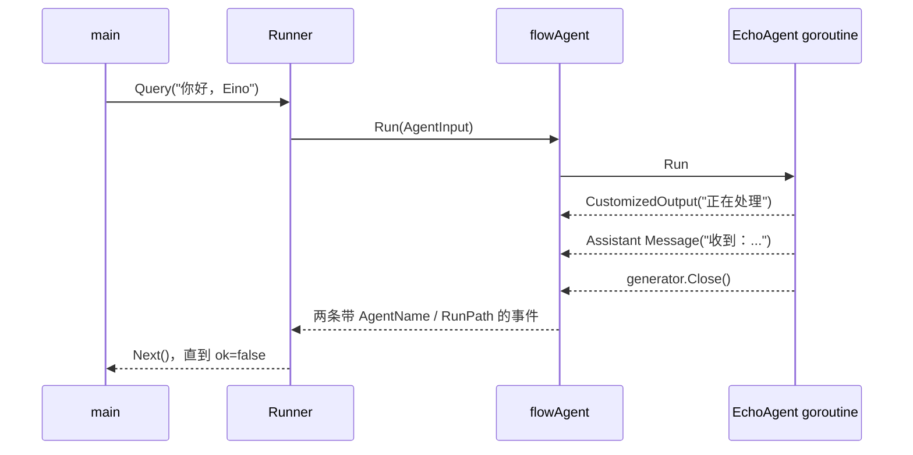

# 第一个可运行 Agent

先不接大模型，手写一个最小 Agent，能最直观地理解协议。然后再把它替换成 ChatModelAgent。

## 目标

实现一个 EchoAgent：收到用户消息后发送两条事件，第一条表示处理进度，第二条返回结果。这个示例只依赖当前 Eino 仓库。



写代码时可以逐条对照图：先立即返回 iterator，再由 goroutine 发送事件，最后关闭 generator；flowAgent 会补路径，应用循环消费。

## 完整代码

```go
package main

import (
    "context"
    "fmt"

    "github.com/cloudwego/eino/adk"
    "github.com/cloudwego/eino/schema"
)

type EchoAgent struct{}

func (EchoAgent) Name(context.Context) string {
    return "echo"
}

func (EchoAgent) Description(context.Context) string {
    return "重复用户输入，用于演示 ADK Agent 生命周期"
}

func (EchoAgent) Run(
    ctx context.Context,
    input *adk.AgentInput,
    opts ...adk.AgentRunOption,
) *adk.AsyncIterator[*adk.AgentEvent] {
    iter, gen := adk.NewAsyncIteratorPair[*adk.AgentEvent]()

    go func() {
        defer gen.Close()

        select {
        case <-ctx.Done():
            gen.Send(&adk.AgentEvent{Err: ctx.Err()})
            return
        default:
        }

        gen.Send(&adk.AgentEvent{
            Output: &adk.AgentOutput{
                CustomizedOutput: "正在处理",
            },
        })

        if input == nil || len(input.Messages) == 0 {
            gen.Send(&adk.AgentEvent{Err: fmt.Errorf("没有输入消息")})
            return
        }

        last := input.Messages[len(input.Messages)-1]
        gen.Send(adk.EventFromMessage(
            schema.AssistantMessage("收到："+last.Content, nil),
            nil,
            schema.Assistant,
            "",
        ))
    }()

    return iter
}

func main() {
    ctx := context.Background()
    runner := adk.NewRunner(ctx, adk.RunnerConfig{
        Agent: EchoAgent{},
    })

    iter := runner.Query(ctx, "你好，Eino")
    for {
        event, ok := iter.Next()
        if !ok {
            break
        }

        if event.Err != nil {
            fmt.Println("错误：", event.Err)
            continue
        }

        if event.Output != nil && event.Output.CustomizedOutput != nil {
            fmt.Println("进度：", event.Output.CustomizedOutput)
        }

        if event.Output != nil && event.Output.MessageOutput != nil {
            msg, _, err := adk.GetMessage(event)
            if err != nil {
                fmt.Println("读取消息失败：", err)
                continue
            }
            if msg != nil {
                fmt.Println("回答：", msg.Content)
            }
        }
    }
}
```

输出大致为：

```text
进度： 正在处理
回答： 收到：你好，Eino
```

## 逐段解释

### Name 与 Description

即使只有一个 Agent 也要实现。进入 flowAgent 后，框架会用 Name 构建 RunPath；包装成 AgentTool 时 Name/Description 又会成为工具 schema。

Name 应短、稳定、在当前 Agent 树内唯一。不要把请求 ID 拼到 Name；请求级标识放 context 或 session values。

### 为什么 Run 返回 Iterator

如果返回 `(*Message, error)`，只能在全部完成后交付一个结果。Iterator 允许 Agent：

- 先报告进度；
- 再报告工具调用；
- 流式发送模型内容；
- 最后发控制 Action；
- 在任意阶段报告错误。

### 为什么需要 goroutine

Run 应尽快返回 iterator。如果直接在 Run 中执行耗时网络请求，调用者拿不到 iterator，自然也无法实时消费事件。

常用模板是：

```go
iter, gen := adk.NewAsyncIteratorPair[T]()
go func() {
    defer gen.Close()
    // 执行工作并 gen.Send(...)
}()
return iter
```

### 为什么 defer Close

Iterator 没有单独的“完成事件”。generator.Close 后，消费者下一次 `Next()` 得到 `ok=false`，这是正常结束信号。

漏掉 Close 会让调用方永久等待。即使发生 error event，也必须关闭 generator；error event 和 EOF 是两个不同信号。

### 为什么检查 context

Runner 不会强杀 Agent 的 goroutine。应用取消请求时，Agent 和它调用的外部服务需要观察 `ctx.Done()`。实际 HTTP/数据库调用也应接收相同 context。

### 为什么事件里没有 AgentName / RunPath

自定义 Agent 可以不填。外层 flowAgent 发现 RunPath 为空时，会设置当前 Agent 名和路径。这避免每个自定义 Agent 都重复框架工作。

如果 Agent 主动转发某个子 Agent 的事件，则应保留子事件已有的 RunPath，flowAgent 不会覆盖非空路径。

## 用 Runner 和直接 Run 的区别

以下代码也能工作：

```go
iter := (EchoAgent{}).Run(ctx, &adk.AgentInput{
    Messages: []*schema.Message{schema.UserMessage("hello")},
})
```

但它没有 Runner 建立的 root runContext，无法完整获得：

- 根 RootInput 与 session；
- WithSessionValues；
- flowAgent 的历史记录和 Transfer；
- checkpoint 持久化；
- 统一 RunPath。

因此单元测试可以直接 Run，应用入口建议使用 Runner。

## 增加流式消息

一个 streaming event 内部持有 `MessageStream`。可以用 `schema.Pipe` 构造：

```go
reader, writer := schema.Pipe[*schema.Message](0)

gen.Send(adk.EventFromMessage(
    nil,
    reader,
    schema.Assistant,
    "",
))

go func() {
    defer writer.Close()
    writer.Send(schema.AssistantMessage("你", nil), nil)
    writer.Send(schema.AssistantMessage("好", nil), nil)
}()
```

生产代码要避免外层 generator 已关闭而消息 writer 仍无限工作，并正确处理 reader 提前关闭。

## 增加自定义 Option

```go
type echoOptions struct {
    Prefix string
}

func WithEchoPrefix(prefix string) adk.AgentRunOption {
    return adk.WrapImplSpecificOptFn(func(o *echoOptions) {
        o.Prefix = prefix
    })
}
```

Run 内读取：

```go
o := adk.GetImplSpecificOptions(&echoOptions{Prefix: "收到："}, opts...)
```

调用时可限定目标：

```go
runner.Query(ctx, "hello", WithEchoPrefix("Echo: ").DesignateAgent("echo"))
```

如果 EchoAgent 被放进多 Agent 树，flowAgent 会先按 Agent name 过滤 Option，再交给 Run。

## 增加可恢复中断

下面的 ApprovalAgent 第一次执行时暂停，恢复后读取审批结果：

```go
type ApprovalState struct {
    Request string
}

func init() {
    // InterruptState 以 any 保存具体值，Gob 解码前需要稳定类型名。
    schema.RegisterName[*ApprovalState]("example_approval_state")
}

type ApprovalAgent struct{}

func (ApprovalAgent) Name(context.Context) string { return "approval" }
func (ApprovalAgent) Description(context.Context) string { return "等待人工审批" }

func (ApprovalAgent) Run(ctx context.Context, input *adk.AgentInput,
    opts ...adk.AgentRunOption) *adk.AsyncIterator[*adk.AgentEvent] {
    iter, gen := adk.NewAsyncIteratorPair[*adk.AgentEvent]()
    go func() {
        defer gen.Close()
        request := input.Messages[len(input.Messages)-1].Content
        gen.Send(adk.StatefulInterrupt(
            ctx,
            map[string]any{"question": "是否批准？", "request": request},
            &ApprovalState{Request: request},
        ))
    }()
    return iter
}

func (ApprovalAgent) Resume(ctx context.Context, info *adk.ResumeInfo,
    opts ...adk.AgentRunOption) *adk.AsyncIterator[*adk.AgentEvent] {
    iter, gen := adk.NewAsyncIteratorPair[*adk.AgentEvent]()
    go func() {
        defer gen.Close()

        state, ok := info.InterruptState.(*ApprovalState)
        if !ok {
            gen.Send(&adk.AgentEvent{Err: fmt.Errorf("恢复状态类型错误")})
            return
        }

        approved, ok := info.ResumeData.(bool)
        if !info.IsResumeTarget || !ok {
            gen.Send(adk.StatefulInterrupt(ctx, "仍需审批", state))
            return
        }

        result := fmt.Sprintf("请求 %q，审批结果：%v", state.Request, approved)
        gen.Send(adk.EventFromMessage(
            schema.AssistantMessage(result, nil), nil, schema.Assistant, "",
        ))
    }()
    return iter
}
```

要让 gob checkpoint 识别自定义接口类型，必要时使用 `schema.RegisterName` 注册稳定名称。实际 Resume 目标来自 interrupt event 的 `InterruptContexts[i].ID`。

### 一个最小内存 CheckPointStore

```go
type MemoryStore struct {
    mu   sync.Mutex
    data map[string][]byte
}

func NewMemoryStore() *MemoryStore {
    return &MemoryStore{data: map[string][]byte{}}
}

func (s *MemoryStore) Get(_ context.Context, id string) ([]byte, bool, error) {
    s.mu.Lock()
    defer s.mu.Unlock()
    b, ok := s.data[id]
    if !ok {
        return nil, false, nil
    }
    // 返回副本，避免调用方修改 store 内部数据。
    return append([]byte(nil), b...), true, nil
}

func (s *MemoryStore) Set(_ context.Context, id string, b []byte) error {
    s.mu.Lock()
    defer s.mu.Unlock()
    s.data[id] = append([]byte(nil), b...)
    return nil
}
```

### 从中断到恢复

```go
store := NewMemoryStore()
runner := adk.NewRunner(ctx, adk.RunnerConfig{
    Agent:           ApprovalAgent{},
    CheckPointStore: store,
})

const checkpointID = "approval-request-001"
iter := runner.Query(
    ctx,
    "退款 100 元",
    adk.WithCheckPointID(checkpointID),
)

var targetID string
for event, ok := iter.Next(); ok; event, ok = iter.Next() {
    if event.Err != nil {
        panic(event.Err)
    }
    if event.Action != nil && event.Action.Interrupted != nil {
        contexts := event.Action.Interrupted.InterruptContexts
        if len(contexts) == 0 {
            panic("没有可恢复中断点")
        }
        targetID = contexts[0].ID
        fmt.Println("等待审批：", contexts[0].Info)
    }
}

if targetID == "" {
    panic("Agent 没有中断")
}

resumeIter, err := runner.ResumeWithParams(
    ctx,
    checkpointID,
    &adk.ResumeParams{
        Targets: map[string]any{
            targetID: true, // true 表示批准
        },
    },
)
if err != nil {
    panic(err)
}

if err := consume(resumeIter); err != nil {
    panic(err)
}
```

这个例子展示了两类 ID：checkpointID 由应用定义，用来从 store 找整份快照；targetID 由中断系统生成，用来告诉框架要恢复快照中的哪个中断点。两者不能混用。

## 换成 ChatModelAgent

完成上述自定义 Agent 后，可以理解 ChatModelAgent 只是替你实现了 Run/Resume：

```go
agent, err := adk.NewChatModelAgent(ctx, &adk.ChatModelAgentConfig{
    Name:        "assistant",
    Description: "回答问题并按需调用工具",
    Instruction: "你是一个可靠的助手。",
    Model:       modelImpl,
    ToolsConfig: adk.ToolsConfig{
        ToolsNodeConfig: compose.ToolsNodeConfig{
            Tools: []tool.BaseTool{myTool},
        },
    },
})
```

`modelImpl` 和真实工具通常来自 `eino-ext` 或你的实现。之后 Runner 和事件消费代码完全不变，这正是 Agent 接口的价值。

## 一个更稳健的事件消费者

```go
func consume(iter *adk.AsyncIterator[*adk.AgentEvent]) error {
    for {
        event, ok := iter.Next()
        if !ok { return nil }
        if event == nil { continue }

        if event.Err != nil { return event.Err }

        if action := event.Action; action != nil {
            switch {
            case action.Interrupted != nil:
                return fmt.Errorf("执行已中断，等待外部恢复")
            case action.TransferToAgent != nil:
                fmt.Println("转交到：", action.TransferToAgent.DestAgentName)
            case action.Exit:
                fmt.Println("Agent 主动结束")
            case action.BreakLoop != nil:
                fmt.Println("循环结束")
            }
        }

        if event.Output == nil { continue }
        if event.Output.CustomizedOutput != nil {
            fmt.Printf("自定义输出：%v\n", event.Output.CustomizedOutput)
        }
        if event.Output.MessageOutput != nil {
            msg, _, err := adk.GetMessage(event)
            if err != nil { return err }
            if msg != nil {
                fmt.Printf("[%s/%s] %s\n",
                    event.AgentName,
                    event.Output.MessageOutput.Role,
                    msg.Content,
                )
            }
        }
    }
}
```

真实流式 UI 通常不会直接 `GetMessage`，而是读取 MessageStream 并逐 chunk 渲染。无论哪种方式，都要同时处理 Action 和 Err。

## 初学者检查清单

- Agent Name 在当前树中唯一；
- Run 立即返回 iterator；
- goroutine 始终 defer generator.Close；
- 错误以 AgentEvent.Err 输出；
- 长任务观察 context；
- streaming reader 不被多个消费者直接读取；
- 自定义 state 可序列化；
- 应用通过 Runner 启动；
- 消费端不假设最后事件一定是答案。
