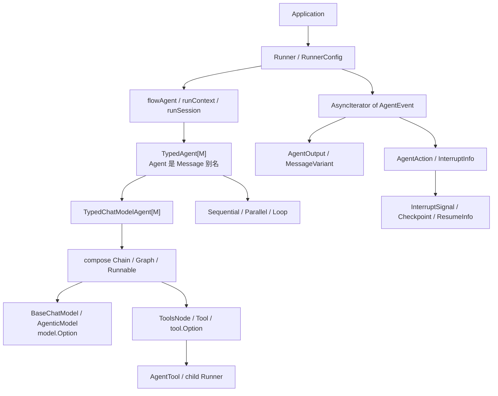

# ADK 术语与类型速查

这一页是阅读源码时的“翻译表”。遇到同名的 Context、State、Option 或 ID，先回到这里确认它属于哪一层。

## 一张类型地图



## 角色和对象

| 术语 | 小白解释 | 精确边界 |
| --- | --- | --- |
| Agent | 能持续产生事件的执行角色 | `Name + Description + Run` 接口，不必包含模型 |
| TypedAgent | 按消息协议泛型化的 Agent | `M` 只能是 `*schema.Message` 或 `*schema.AgenticMessage`；`Agent` 是前者别名 |
| ResumableAgent | 能从中断现场继续的 Agent | 在 Agent 上增加 `Resume(ctx, ResumeInfo, opts)` |
| ChatModel | 一次模型调用能力 | 输入 Messages，输出 Message/stream，不管理 Agent 会话 |
| BaseChatModel | 经典 `schema.Message` 模型协议 | ChatModelAgent 的经典路径；使用 Tool 时必须支持 `model.WithTools` |
| AgenticModel | `schema.AgenticMessage` 模型协议 | TypedChatModelAgent 的 agentic 单次执行路径 |
| Tool | 一个可调用能力 | 由 ToolsNode 按模型 ToolCall 执行 |
| ToolMiddleware | 包围每次真实 Tool endpoint 的行为层 | 能改输入/输出/error，也能拒绝调用，适合权限、缓存、幂等和卸载 |
| AgentMiddleware | 旧版 ChatModelAgent 的能力装配 struct | 已废弃；可追加 instruction/tools、模型前后 hooks 和 ToolMiddleware |
| ChatModelAgentMiddleware | 新版 ChatModelAgent 扩展接口 | 通过 `Handlers` 注册，覆盖 Agent、Model、Tool 多阶段 |
| Callback Handler | 组件生命周期观察器 | 可读 input/output/error 并派生 Context，但不能通过返回值替换它们 |
| AgentTool | 外表是 Tool、内部运行 Agent | 创建子 Runner，最后一个事件的文本成为 Tool result |
| Runner | `TypedRunner[*schema.Message]` 别名 | 建 root session、包 flowAgent、保存/加载 checkpoint |
| TurnLoop | 包在 Runner 外的持续事件循环 | Push、缓冲、抢占、Stop、业务 item 与 checkpoint 一起恢复 |
| flowAgent | Agent 的内部运行外壳 | 重写历史、补 RunPath、记录 Events、处理 Transfer/Resume 路由 |
| Workflow Agent | 用代码确定 child 的先后、并发或重复关系 | Sequential、Parallel、Loop；通过事件历史传递上下文，并保存 index/lane/iteration 恢复状态 |
| Summarizer Agent | 显式合并多个业务输出的 Agent | 通常位于 Parallel join 之后；不同于模型窗口压缩和长期会话摘要 |
| MemoryStore | 应用自定义的跨请求记忆服务 | 当前 ADK 没有统一内置接口；通常基于数据库或 Retriever/Indexer 封装 |
| Prebuilt Agent | 官方组合好的高阶模式 | Supervisor、Plan-Execute-Replan、Deep Agent |
| compose Runnable | 编译后的可调用图/链 | 被 ChatModelAgent 内部使用，也可独立使用 |

## 配置和 Option

| 术语 | 何时生效 | 谁消费 |
| --- | --- | --- |
| RunnerConfig | 创建 Runner 时 | NewRunner 直接保存字段 |
| ChatModelAgentConfig | 创建 Agent 时归一化，运行时由 BeforeAgent 生成本次配置 | NewChatModelAgent/prepareExecContext |
| ToolsConfig | 静态工具基础配置 | ChatModelAgent → 本次 exec context → ToolsNodeConfig |
| AgentMiddleware | 旧版创建期聚合扩展 | 已废弃；ChatModelAgent 构造和 ReAct build |
| ChatModelAgentMiddleware | 新版运行期 Handler | 每次 Run、每轮 Model、每次 ToolCall 和成功终态 |
| AgentOption | 包装 flowAgent 时 | `AgentWithOptions/toFlowAgent` |
| AgentRunOption | 每次 Run/Resume | Callback、取消、checkpoint、session、model/tool options 等分层消费 |
| DesignateAgent | 每次调用的名称过滤 | flowAgent.filterOptions |
| GraphCompileOption | Compile 时 | Graph 名、Store、Serializer、步数限制 |
| compose.Option | Runnable Invoke/Stream 时 | Graph runtime 按 path/type 分发 |
| model.Option | 单次模型调用 | ChatModel Provider |
| tool.Option | 单次 Tool 调用 | ToolsNode/具体 Tool/AgentTool |
| implementation-specific option | 在统一 Option 中携带具体类型函数 | `GetImplSpecificOptions[T]` 通过类型断言消费 |

## 输入、历史和状态

| 术语 | 保存什么 | 生命周期 |
| --- | --- | --- |
| AgentInput | 当前 Agent 的 Messages 和 streaming 标志 | 一次 Agent 调用 |
| RootInput | 根 Runner 最初的 AgentInput | 一次 Agent 树运行/恢复 |
| HistoryEntry | 带来源 AgentName 的待重写消息 | flowAgent 生成输入时临时存在 |
| HistoryRewriter | RootInput + Events 到当前 Agent Messages 的转换 | 每次 Agent 进入前执行 |
| runContext | RootInput、RunPath、Session | 通过 Go Context 传播 |
| runSession | Events、Values、并行 LaneEvents | 一次根运行 |
| Session Values | Agent 树共享的小型 KV | 一次运行；checkpoint 时可序列化 |
| Session Events | flowAgent 正式记录的事件历史 | 跨 Agent 重建输入 |
| LaneEvents | Parallel 分支未提交事件 | fork 到 join 或 checkpoint |
| ReAct State | Messages、iterations、Tool actions 等 | 一个 ChatModelAgent Graph 运行 |
| ChatModelAgentState | Middleware 暴露的 Messages + ToolInfos + DeferredToolInfos | 每次 model pre/post hook |
| Run-local state | 同一次 Run 跨 Handler 共享的小状态 | 可随 interrupt/resume 保存；不是长期记忆 |
| Checkpoint | 执行现场的 gob 快照 | 从 Interrupt 保存到 Resume |
| Long-term memory | 跨独立请求的用户历史 | 应用数据库负责，不是 ADK session |
| OutputKey | 将最终 Content 写进 Session Values 的 key | 同一运行内供后续 Agent 使用 |

## 路径和身份

| 术语 | 例子 | 用途 |
| --- | --- | --- |
| AgentName | `refund_specialist` | 事件来源、Option/Transfer/Tool name |
| RunPath | `root / planner / worker` | ADK 历史归属和 Action gating |
| Address | `agent:root;node:tools;tool:x:call-7` | callback 层级、中断状态、Resume 匹配 |
| AddressSegment | type + ID + SubID | 构成 Address 的一级 |
| SubID | ToolCallID | 区分并行调用同名 Tool |
| checkpoint ID | `order-1001-v1` | Store 中整份 checkpoint 的 key |
| interrupt ID | UUID | ResumeParams.Targets 的 key |
| ToolCallID | 模型生成的 call ID | Assistant ToolCall 与 ToolMessage 配对 |
| RunInfo | callback 当前组件的类型和名称 | tracing/metrics，不保证全局唯一 |

RunPath 和 Address 最容易混淆：前者允许 Sequential 同级 Agent 累积历史；后者必须反映真实运行树。

## 事件和流

| 术语 | 含义 |
| --- | --- |
| AgentEvent | Agent 的统一异步输出单元 |
| AgentOutput | MessageOutput 或 CustomizedOutput |
| MessageVariant | 完整 Message 与 MessageStream 的二选一外壳 |
| Agentic MessageVariant | AgenticMessage/stream 的外壳 | 使用 `AgenticRole`，不依赖经典 `Role/ToolName` |
| AgentAction | Exit、Transfer、BreakLoop、Interrupt 或自定义控制信号 |
| AsyncIterator | 调用方用 Next 消费事件的接口 |
| AsyncGenerator | 生产方用 Send/Close 写事件的接口 |
| UnboundedChan | Iterator/Generator 底层无界队列 |
| StreamReader | 一次性消费的流；多消费者必须 Copy |
| automatic close | 未消费 reader 的回收保险机制 |
| copyAgentEvent | 复制事件外壳、RunPath 和 stream reader，不深拷贝所有内容 |
| GetMessage | 将 MessageVariant/AgentEvent 的流拼成完整消息 |
| EOF | iterator/stream 正常结束，不是 Error event |

## Middleware 和 Callback

::: warning 新旧名称
当前推荐使用 `Handlers []ChatModelAgentMiddleware`。旧字段仍在当前源码中用于兼容，但已 Deprecated；完整映射见 [Middleware 新旧 API](./middleware-current.md)。
:::

`BeforeAgent`、`BeforeModelRewriteState`、`WrapModel`、四个 Tool wrappers、`AfterModelRewriteState` 和 `AfterAgent` 都属于新版 ChatModelAgent Middleware。`ToolArgumentsHandler` 和 Callback 是相邻扩展机制，不属于它。

| 术语 | 源码归属 | 能否修改行为 | 典型用途 |
| --- | --- | --- | --- |
| ChatModelAgentMiddleware | `adk/handler.go` interface | 横跨 Run、Model、Tool 阶段 | 当前 Agent 横切能力入口 |
| BeforeAgent / AfterAgent | 新 Middleware 方法 | 运行级装配/成功终态收尾 | 动态工具、成功后写记忆 |
| Before/AfterModelRewriteState | 新 Middleware 方法 | 返回并持久化新 state/context | 摘要、历史修复、输出校验 |
| WrapModel / Wrap*ToolCall | 新 Middleware 方法 | 洋葱式包围真实端点 | 路由、权限、缓存、卸载 |
| AgentMiddleware | `adk.AgentMiddleware` 兼容 struct | 旧 instruction/tools/hooks/wrapper | Deprecated，不再新增使用 |
| ToolMiddleware | 独立的 `compose.ToolMiddleware` 类型 | 能改输入/结果/error，也能不调用 next | 权限、审计、结果卸载 |
| ToolArgumentsHandler | `ToolsNodeConfig` 字段；不属于 Middleware | 在 middleware 前改 arguments | 参数修复、默认值 |
| UnknownToolsHandler | `ToolsNodeConfig` 字段；不属于 Middleware | 处理未注册 Tool name | fallback；绕过注册 Tool middleware/event sender |
| Callback Handler | `callbacks.Handler`；不属于 Middleware | 主要观察，只返回 Context | tracing、metrics、日志 |
| callback manager | Callback 内部机制 | Context 中的 handlers + RunInfo | 负责嵌套组件的 callback 顺序 |
| event sender wrappers | ADK 默认 Model/Tool wrappers | 包装 Model 与 Tool endpoint | 把最终处理结果发送成 AgentEvent |
| Agent Callback | `adk.WithCallbacks` + `adk/callback.go` | 观察 Input/ResumeInfo 与独立事件流 | 单次 Agent tracing、审计、指标 |
| ReturnDirectly | `ToolsConfig` 配置；不属于 Middleware | Tool result 直接成为 Graph output | 跳过下一轮模型 |

## Transfer、Action 和 Workflow

| 术语 | 控制效果 |
| --- | --- |
| TransferToAgent | 当前 flowAgent 完成后运行直接 child 或 parent |
| deterministic transfer | 不靠 LLM ToolCall，包装器在正常结束后固定转交 |
| Exit | 停止当前 flow；不穿过 AgentTool 边界控制父 Agent |
| BreakLoop | 停止最近的 LoopAgent，并标记已处理 |
| Sequential | 按顺序运行 child，RunPath 累积 |
| Parallel | 多 lane 并发，Values 共享，Events 延迟 join |
| Loop | 重复运行完整 child 列表；MaxIterations=0 表示无上限 |
| Action gating | 只有精确 RunPath 的 Action 才控制当前 flow |

## Interrupt 和 Resume

| 术语 | 含义 |
| --- | --- |
| Interrupt | 无本地 state 的叶子暂停 |
| StatefulInterrupt | 保存当前组件 state 的叶子暂停 |
| CompositeInterrupt | 组合层保存自己的 state，并包装 child signals |
| InterruptSignal | 内部树形 error/signal，包含 ID、Address、State 和 Subs |
| InterruptCtx | 给应用的根因视图，包含 Parent 链 |
| InterruptState | `State + LayerSpecificPayload` |
| ResumeInfo | ADK 传给 ResumableAgent 的恢复视图 |
| WasInterrupted | 当前地址是否存在旧 state |
| IsResumeTarget | 当前组件或其后代是否被本次 Targets 选择 |
| ResumeData | 直接命中当前 interrupt ID 的新数据 |
| PopulateInterruptState | 把 checkpoint 的 ID/Address/State map 放回 Context |
| BatchResumeWithData | 把本次 ID/data Targets 放入 Context |
| bridgeStore | ChatModelAgent/AgentTool 跨 compose 边界传 checkpoint bytes 的内存 Store |

## Retry 和错误

| 术语 | 含义 |
| --- | --- |
| Error event | `AgentEvent.Err`，运行期失败信息 |
| ErrExceedMaxIterations | ReAct 模型轮次用尽 |
| ModelRetryConfig | 只包装 ChatModel 调用的 retry 策略 |
| MaxRetries | 额外重试次数，不包含初次调用 |
| RetryExhaustedError | 所有重试用尽，保存 LastErr |
| WillRetryError | 标记流错误将重试，历史重建应跳过残缺事件 |
| panic recovery | 部分框架 goroutine 的最后保险，不覆盖所有自定义 goroutine |

## 三组最重要的对比

### Agent、Runner、ChatModelAgent

```text
Agent           = 契约
ChatModelAgent  = 官方的一种 Agent 实现
Runner          = 应用启动/恢复 Agent 的入口
```

### Config、State、Context

```text
Config   = 对象长期如何工作
State    = 当前执行已经走到哪里
Context  = 当前调用如何把取消和运行环境传到下层
```

### Error、Interrupt、EOF

```text
Error      = 运行失败信息
Interrupt  = 有意暂停，并可能保存现场
EOF        = iterator/stream 正常结束
```

## 按术语跳转到详细章节

| 主题 | 章节 |
| --- | --- |
| 对象关系 | [Agent、Runner、ChatModelAgent](./roles-and-boundaries.md) |
| 完整运行 | [端到端源码追踪](./end-to-end-trace.md) |
| Context/RunPath/Address | [Context 逐层传播](./context-flow.md) |
| Config/Option | [Config 与 Option 转换](./config-option-flow.md) |
| Event/Stream | [事件与异步迭代器](./events.md) |
| Middleware/Callback | [Middleware](./middleware.md)、[Callback](./callbacks.md) |
| Transfer/AgentTool | [AgentTool 与转交](./tools-transfer.md) |
| Interrupt/Resume | [中断、检查点与恢复](./interrupt-resume.md) |
| 并发与错误 | [并发、取消与错误边界](./concurrency-errors.md) |
| 定位源码 | [调试与测试手册](./debugging-testing.md) |

<div class="source-path">公开类型：adk/interface.go、adk/runner.go、adk/interrupt.go<br>运行状态：adk/runctx.go、adk/react.go<br>底层地址：internal/core/address.go</div>
