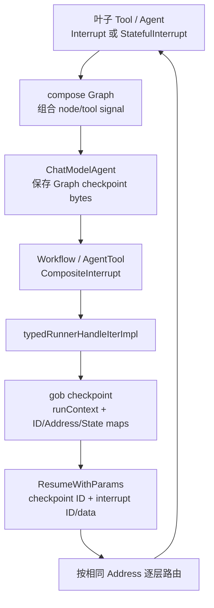
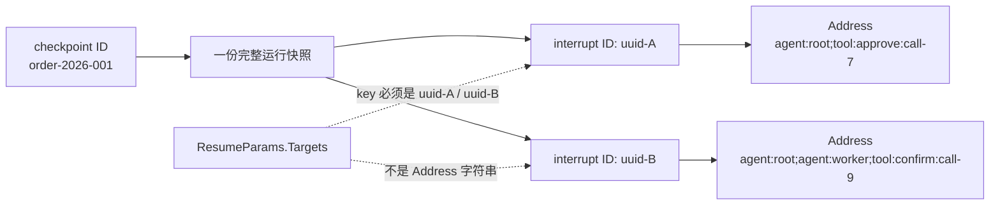
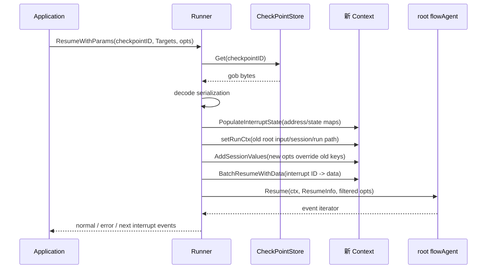

# 中断、检查点与恢复

ADK 的中断协议需要跨越 Agent、workflow、AgentTool 和 compose Graph。核心原则是：叶子保存自己的局部状态，组合层逐层包装，顶层 Runner 一次性持久化整棵中断树。



恢复不是让原 goroutine 从暂停位置醒来，而是加载快照后重新执行相同结构；每层通过 Address 领取自己的旧 state，并把 resume data 继续传向目标叶子。

## 三种中断构造器

| API | 用途 | 保存内容 |
| --- | --- | --- |
| `Interrupt(ctx, info)` | 无内部进度的暂停 | 面向用户的 info |
| `StatefulInterrupt(ctx, info, state)` | 自定义 Agent 需要恢复局部状态 | info + 可序列化 state |
| `CompositeInterrupt(ctx, info, state, children...)` | workflow / AgentTool 汇总子中断 | 本层 state + 子 signal |

三者都调用 `internal/core.Interrupt`，并把当前 RunPath 作为 layer payload。返回事件内部持有 `InterruptSignal`；公开部分只暴露结构化 `InterruptContexts`。

### `info`、`state` 和 child signal 不要混用

一次中断实际上有三种面向不同对象的数据：

| 数据 | 谁使用 | 是否进入用户可见 `InterruptCtx` | 是否进 checkpoint |
| --- | --- | --- | --- |
| `info` | UI / 审批人 / 调用方 | 是，成为 `InterruptCtx.Info` | 当前 checkpoint 不保存完整 info/parent 链；仅另存根事件的 legacy `Data` |
| `state` | 中断组件自己的 Resume 实现 | 否 | 是，成为 `InterruptState.State` |
| child signals | workflow、AgentTool 等组合层 | 最终展开成 root-cause contexts | 是，整棵树被扁平化保存 |

例如人工审批时，`info` 可以是“是否允许退款 100 元”，`state` 可以是流程已完成到第 3 步的结构体，`ResumeData` 才是稍后用户提交的“同意/拒绝”。这三者生命周期不同。

`Interrupt` 的 state 为 nil，适用于 Resume 时可以从外部数据或共享 session 继续的叶子；`StatefulInterrupt` 适用于需要恢复局部程序计数器的叶子；`CompositeInterrupt` 应由组合层使用，而不是让业务叶子手工伪造一棵没有必要的树。

### signal 树怎样形成

叶子中断由 core 标记 `IsRootCause=true`。每经过一层组合组件，它都创建一个新的父 signal：

```text
Sequential signal                 ← state: InterruptIndex
└─ ChatModelAgent signal          ← state: compose checkpoint bytes
   └─ AgentTool signal            ← state: child Runner checkpoint bytes
      └─ approval tool signal     ← root cause, state: tool-local progress
```

上层 Runner 只应该看到一个根 signal。Parallel workflow 即使同时有多个叶子中断，也会把它们合并到同一个 Parallel signal 的 `Subs`；如果 Runner 连续收到两个未合并的根中断，源码会 panic，因为这代表组合层违反了协议。

## 地址与 ID

每个中断点有层级 `Address`，由 agent/tool segment 构成。core 会为中断分配 ID，并可将 signal 转成：

- `InterruptID2Address`
- `InterruptID2State`

这两张 map 进入 checkpoint。恢复时 `PopulateInterruptState` 把它们重新注入 context，后续 `buildResumeInfo` 根据当前地址判断：

- `WasInterrupted`：这一层是否在原中断链上；
- `InterruptState`：这一层保存的状态；
- `IsResumeTarget`：调用方是否明确选择该叶子；
- `ResumeData`：调用方提供的数据。

### 三种“ID”必须分清

| 名称 | 示例 | 作用 |
| --- | --- | --- |
| checkpoint ID | `order-2026-001` | `CheckPointStore.Get/Set` 的 key，定位整次运行快照 |
| interrupt ID | 随机 UUID | 定位这棵快照中的一个具体中断点，是 `ResumeParams.Targets` 的 key |
| Address | `agent:root;agent:worker;tool:approve:call-7` | 描述组件层级，供路由、展示和诊断 |

::: danger 当前 API 的关键细节
`ResumeParams.Targets` 的 key 应使用中断事件返回的 `InterruptCtx.ID`，不是 `Address.String()`。源码中的部分注释把它宽泛地称为 address，但实现 `BatchResumeWithData` 和仓库测试都按 interrupt ID 查找。最稳妥的做法是原样保存并回传 `InterruptCtx.ID`。
:::



<p class="diagram-caption">checkpoint ID 找整箱快照，interrupt ID 找箱内某个暂停点，Address 描述该暂停点在执行树中的位置。</p>

ADK 对用户只保留 `agent` 和 `tool` 两种地址段。compose 内部的 graph/node 等段仍参与底层恢复，但 `ToInterruptContexts(...allowedAddressSegmentTypes)` 会：

1. 从 signal 树中只输出 root-cause context；
2. 给每个 root cause 保留可向上追溯的 `Parent` 链；
3. 从公开 Address 中移除非 agent/tool segment；
4. 从 Parent 链跳过末段类型不允许公开的中间 context。

因此用户看到的是稳定的 ADK 视图，不是 compose 内部节点布局的完整泄漏。

### Address 是怎样在运行时恢复状态的

`AppendAddressSegment` 每进入 Agent/Tool 就复制父 Address 并追加一段。恢复 context 里保存着 `interruptID → Address/State/Data`，新地址一形成就会按完整 Address 匹配：

- 第一次匹配到该地址时，注入对应 `interruptState`；
- 若该 interrupt ID 在 Targets 中，注入 `resumeData` 并设置 `isResumeTarget`；
- 若 Targets 指向其后代，也会把当前组合层标为 target，使它继续向下执行；
- state 和 resume data 都有 used 标记，同一份数据不会被地址相同的后续组件重复消费。

这解释了为什么 Agent 名称、层级和并行 tool-call 的 SubID 必须稳定。恢复不是按“差不多相同的类型”匹配，而是按运行地址精确对齐。

## Runner 的持久化顺序

`typedRunnerHandleIterImpl` 看到内部 interrupt signal 后：

1. 断言一次运行只产生一个已汇总的根中断；
2. 生成面向用户的 InterruptContexts；
3. 如果有 checkpoint ID，先 `saveCheckPoint`；
4. 保存成功或报告保存错误后，才把 interrupt event 发送给应用。

“先保存、后通知”消除了竞态：应用收到中断后立即 Resume，不会读到尚未写入的 checkpoint。

更完整的 Runner 生命周期如下：

```text
Run(messages, AgentRunOption...)
  → getCommonOptions
  → 任意 Agent 包成 flowAgent
  → AgentInput{Messages, Runner.EnableStreaming}
  → ctxWithNewRunCtx（RootInput + Session + RunPath）
  → AddSessionValues
  → flowAgent.Run
  → 若 store != nil 或启用 WithCancel，用 typedRunnerHandleIterImpl 包装输出

typedRunnerHandleIterImpl
  → 普通事件：直接发送
  → interrupt：重新生成公开 InterruptContexts
       → 有 checkpoint ID：gob encode + store.Set
       → 保存失败：先发送 Err 事件
       → 再发送 interrupt 事件
```

仅配置 `CheckPointStore` 还不够；首次 Run 必须通过 `WithCheckPointID(id)` 提供 key，Runner 才会保存。反过来，没有 store 时，Run 仍能把中断事件交给用户，但 `Resume` 会直接报 `store is nil`。

若 `store.Set` 失败，当前实现会发送一个保存失败的 Error event，随后仍发送 Interrupt event。应用不能看到 Interrupt 就假定一定可恢复，应同时监控此前的 Err 事件，或让 store 的一致性由业务保证。

## Checkpoint 内容

ADK 根 payload 使用 gob 编码：

```go
type serialization struct {
    RunCtx              *runContext
    Info                *InterruptInfo // 兼容旧版本
    EnableStreaming     bool
    InterruptID2Address map[string]Address
    InterruptID2State   map[string]core.InterruptState
}
```

因此 run context 中的自定义 session values、customized output/state 必须可被 gob 序列化，并保持注册类型名称稳定。标有 `CheckpointSchema` 的结构属于兼容性协议，字段不能随意删除或改义。

保存时 signal 树不会直接以指针树形态编码，而被转换成两张 map：

```text
InterruptSignal tree
  ├─ interruptID → Address
  └─ interruptID → InterruptState{
       State: 组件局部状态,
       LayerSpecificPayload: 该层 RunPath 等私有载荷,
     }
```

`RunCtx` 则包含根输入与 `runSession`。session 的 `Events` 是用于后续历史重建的正式事件，`Values` 是 `AddSessionValue` 维护的共享键值；两者都可能影响恢复结果。

当前序列化没有保存每层 signal 的 `Info`、`IsRootCause` 和父子关系；父子路由在恢复时根据 Address 前缀重新推导。顶层 `serialization.Info` 只为兼容旧版本保留 `InterruptInfo.Data`。因此审批 UI 若恢复后仍要展示原始问题，应自行持久化首次收到的 `InterruptContexts`，或让未恢复叶子重新中断时生成最新 info。

`EnableStreaming` 来自 Runner 构造配置而不是本次 Agent 自己临时判断。恢复后框架会把它放进顶层 `ResumeInfo`，再逐层传给子 Agent，确保 Run/Resume 的消息输出模式一致。

### gob 类型兼容

接口字段里的自定义具体类型必须注册。仓库内部会为 `serialization`、workflow state、ReAct State、确定性转交 state 等注册稳定名称；业务自己的 `state`、session value 或 customized data 也应遵循相同原则。

```go
type ApprovalState struct {
    OrderID string
    Step    int
}

func init() {
    schema.RegisterName[*ApprovalState]("my_app_approval_state_v1")
}
```

升级时应优先新增可选字段，避免重命名已注册类型、改变字段语义或把可导出字段改为不可导出。checkpoint 并不是只在当前进程内短暂使用时才需要考虑兼容：只要 store 能跨发布保留，它就是持久化协议。

## Resume 与 ResumeWithParams

`Resume(checkpointID)` 是“隐式恢复全部”：不提供具体 target data，适合简单确认。

`ResumeWithParams` 接收 interrupt ID → data：

```go
iter, err := runner.ResumeWithParams(ctx, checkpointID, &adk.ResumeParams{
    Targets: map[string]any{
        interruptCtx.ID: approvalPayload,
    },
})
```

被明确选中的组件通过 resume context 取得数据。未选中的叶子必须再次 interrupt 以保留现场；组合 Agent 通常继续向下路由，并在子级再次中断时重新包装。

### load 与 context 重建顺序

`Runner.resume` 的顺序决定了哪些数据覆盖哪些数据：

1. `store.Get(checkpointID)`；
2. gob decode 得到 `serialization`；
3. `PopulateInterruptState` 把 Address/State map 写进 context；
4. 读取本次新的 `AgentRunOption`；
5. 若是 AgentTool 的 shared-parent 模式，用当前父 session 的 Values/mutex 替换 checkpoint 中对应对象；
6. 修复旧 checkpoint 中可能为 nil 的 mutex/Values；
7. `setRunCtx` 恢复根输入、session 事件与 RunPath；
8. `AddSessionValues` 把本次传入值写入恢复后的 session，所以同 key 可覆盖旧值；
9. `BatchResumeWithData` 注入 Targets；
10. 将根 Agent 再包成 flowAgent，调用 Resume；
11. 使用同一 checkpoint ID 再次进入 `typedRunnerHandleIterImpl`，若重新中断就覆盖该 key 的快照。

这就是配置转换的完整边界：checkpoint 保存旧的运行现场，本次 Resume options 可以补充/覆盖 session 值，但不会替换 Runner 自己的 Agent、store 或 streaming 配置。



<p class="diagram-caption">恢复使用的是新的应用 Context；框架不是唤醒旧 goroutine，而是加载快照、重建 Context，再沿同一结构重放到目标地址。</p>

### `Resume` 与空 Targets 并非完全一样的业务表达

`Resume(checkpointID)` 不调用 `BatchResumeWithData`，所以各层能看到 `WasInterrupted=true`，但 `IsResumeTarget=false`。它适合“只要知道这是恢复流程就继续”的简单叶子。

`ResumeWithParams(... Targets{id:nil})` 会把该点及其祖先标成 resume target；由于 value 为 nil，目标处 `IsResumeTarget=true`、`ResumeData=nil`。这适合明确批准某个中断点但不需要额外载荷的场景。

因此自定义 ResumableAgent 不应只判断 `ResumeData != nil`。应分别理解：

| 字段 | 含义 |
| --- | --- |
| `WasInterrupted` | 当前地址是否属于旧 signal 树 |
| `InterruptState` | 旧中断时本层保存的 state，可能为 nil |
| `IsResumeTarget` | 本层或其后代是否在本次 Targets 中 |
| `ResumeData` | 本层 ID 对应的非 nil 数据，类型由业务约定 |

### 自定义 ResumableAgent 模板

```go
func (a *approvalAgent) Resume(
    ctx context.Context,
    info *adk.ResumeInfo,
    _ ...adk.AgentRunOption,
) *adk.AsyncIterator[*adk.AgentEvent] {
    if !info.WasInterrupted {
        return errorIter(errors.New("resume called on a fresh agent"))
    }

    st, ok := info.InterruptState.(*ApprovalState)
    if !ok || st == nil {
        return errorIter(errors.New("invalid approval checkpoint state"))
    }

    if !info.IsResumeTarget {
        // 其他并行叶子被批准；本叶子必须保留自己的现场。
        return oneEvent(adk.StatefulInterrupt(ctx, "still waiting", st))
    }

    approved, ok := info.ResumeData.(bool)
    if !ok {
        return errorIter(errors.New("approval result must be bool"))
    }
    return continueOrder(st, approved)
}
```

示例里的 `errorIter/oneEvent` 是应用辅助函数。关键模式是：验证 state 类型、区分 target、未命中时重新中断、只在直接目标处消费业务数据。

## Workflow 如何恢复

- Sequential 保存 `InterruptIndex`，恢复时重建前序 RunPath，从被中断子 Agent 开始；
- Loop 保存 iteration 与 sub-agent index，重建此前所有步骤路径；
- Parallel 保存每条 lane 的事件和中断信息，恢复时只启动原先中断的分支，已完成分支不重跑。

每层 workflow 都生成 CompositeInterrupt。向上只有一个 signal，向下仍保留每个叶子的地址和 state。

路由时，串行型 flow/Sequential/Loop 调用 `getNextResumeAgent`，要求当前层下面只有一个立即子恢复点；发现多个会报“concurrent transfer is not supported”。Parallel 则调用 `getNextResumeAgents` 获得多个分支集合，再只为这些 lane 建 goroutine。

每下沉一层，`buildResumeInfo` 都会：追加 agent Address、按地址取 state、读取 target/data，再把 ADK `RunPath` 更新到相同 Agent。Address 负责恢复匹配，RunPath 负责事件归属；两者相关但不是同一对象。

## ChatModelAgent 与 compose 的桥

ChatModelAgent 内部 ReAct Graph 有自己的 compose checkpoint。`bridgeStore` 暂存在 ADK 内存中；运行错误处理识别 compose InterruptInfo 后取出 bytes，构造 ADK CompositeInterrupt。恢复时把 bytes 放回 bridgeStore，再调用内部 Graph Resume。

这层桥接让 ADK 不需要理解 Graph channel/state 的序列化细节。

完整转换链是：

```text
compose node/tool interrupt error
  → runnable Invoke/Stream 返回 interrupt error
  → ChatModelAgent.handleRunFuncError 提取 compose InterruptInfo
  → FromInterruptContexts 重建 compose signal
  → bridgeStore.Get 取得 Graph checkpoint bytes
  → ADK CompositeInterrupt(
       info = compose contexts,
       state = graph checkpoint bytes,
       child = compose signal)
  → Runner 把它与外层 flow/workflow 一起持久化

恢复
  → ChatModelAgent.Resume 读取 []byte InterruptState
  → newResumeBridgeStore(bytes)
  → compose Runnable.Resume
  → Graph 按自己的 node/tool address 继续
```

AgentTool 又在 ChatModelAgent 外多做一次相同思想的桥接，所以嵌套结构可能存在多层 bytes。每层只理解自己直接子运行时的 checkpoint，不跨层解析。

ChatModelAgent 还支持 `ChatModelAgentResumeData{HistoryModifier: ...}`，允许在恢复时修改即将交给模型的历史。旧的 `WithHistoryModifier` 已标记 deprecated；新代码应把 resume data 定向传给对应 ChatModelAgent 中断 ID。它修改的是恢复历史，不等同于替换 checkpoint 中完整 session。

## 失败、并发与外部副作用

- checkpoint 只恢复框架内状态，不会回滚已经发出的 HTTP 请求、数据库写入或消息发送；
- store 的 `Set` 覆盖语义、过期与并发控制由实现负责，同一个 checkpoint ID 不应被不相关运行共享；
- Parallel 的多个 root cause 可以一次全部 target，也可以只 target 一部分；未选中的叶子必须再次中断；
- `ResumeWithParams` 当前直接读取 `params.Targets`，调用时不要传 nil `params`；
- 新的 Runner 可以读取旧 checkpoint，但它配置的 Agent 树必须与旧 Address/状态类型兼容；
- 中断事件本身不写 `runSession.Events`，它的用户信息和状态走 signal/checkpoint 专用通道；
- Resume 后再次中断会产生新的 interrupt ID，UI 应更新为最新 contexts，不要长期缓存旧 ID。

## 设计检查清单

- state 使用稳定、可 gob 编码的具体类型；
- 中断发生后停止继续发送会改变业务状态的事件；
- 并行子中断必须先组合，不可让 Runner 收到多个根 signal；
- 外部副作用需要业务幂等，checkpoint 只恢复框架现场；
- checkpoint store 的 key 生命周期、并发覆盖和清理由应用负责。
- UI 同时保存 checkpoint ID 与最新 `InterruptCtx.ID`，不要只保存 Address；
- 恢复时 Agent 名称、层级、工具 call 身份和注册的 gob 类型保持稳定；
- 明确区分 `WasInterrupted`、`IsResumeTarget` 和 `ResumeData != nil`；
- store 保存错误必须当作不可恢复处理，不能只展示审批按钮；
- 为“只恢复一个并行叶子、其他叶子再次中断”编写测试。

<div class="source-path">ADK 协议：adk/interrupt.go、runner.go<br>目标选择：internal/core/interrupt.go、resume.go<br>Graph 桥接：adk/chatmodel.go</div>
