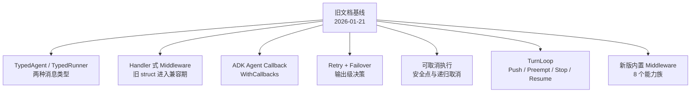

# 最新源码校验报告

本页记录这套文档所依据的源码基线，以及从旧快照升级后发现并修正的差异。它不是发布说明，而是一份“文档结论是否仍能在当前源码中找到证据”的审计清单。

## 1. 校验基线

| 项目 | 当前值 |
| --- | --- |
| 官方仓库 | `https://github.com/cloudwego/eino.git` |
| 分支 | `main` |
| 提交 | `c5c2dc3aedef9e3d391180b4add4c2681237a43b` |
| 提交日期 | 2026-09-17 |
| 提交说明 | `fix(adk): stabilize in-memory filesystem query order (#1297)` |
| 原文档快照 | `38efb3c51101cc1751efa6501718330d1be004ad`，2026-01-21 |
| 中间差距 | 177 个提交 |

::: tip 如何理解“基于最新源码”
正文优先描述上述提交中的真实实现。仍保留的旧 API 会明确标记为“兼容/Deprecated”，不会再把它写成推荐方案。
:::

## 2. 这次升级不是小修补

旧快照到当前提交之间，ADK 增加或重构了多条主链：



<p class="diagram-caption">因此只修正一个 Middleware 页面不够；Agent、Runner、事件、Callback、恢复和最佳实践都需要重新校验。</p>

## 3. 已确认的关键变化

### 3.1 Agent 协议泛型化

当前 ADK 的基础协议是：

```go
type MessageType interface {
    *schema.Message | *schema.AgenticMessage
}

type TypedAgent[M MessageType] interface {
    Name(context.Context) string
    Description(context.Context) string
    Run(context.Context, *TypedAgentInput[M], ...AgentRunOption) *AsyncIterator[*TypedAgentEvent[M]]
}

type Agent = TypedAgent[*schema.Message]
```

`Agent` 没有消失，而是经典消息路径的别名。Runner、Event、Input、MessageVariant、ResumableAgent 和 ChatModelAgent 都有相同的 Typed/别名结构。

文档修正：

- 不再把 ADK 写成只能处理 `*schema.Message`；
- 增加 [Typed Agent 与 AgenticMessage](./typed-agent-agentic.md)；
- 明确两条消息路径的能力并不完全对称。

### 3.2 ChatModelAgent.Model 不再只是 ToolCallingChatModel

当前字段是：

```go
Model model.BaseModel[M]
```

当 `M = *schema.Message` 时，实际模型为 `model.BaseChatModel`，ADK 构建经典 ReAct；当 `M = *schema.AgenticMessage` 时，模型为 `model.AgenticModel`，ADK 构建 `AgenticModel ↔ AgenticToolsNode` 的 Agentic ReAct，ToolCall/ToolResult 用 ContentBlocks 表达。

文档修正：旧页面中“必须实现 `model.ToolCallingChatModel`”的表述改为“经典消息路径使用 BaseChatModel，agentic 路径使用 AgenticModel；两者都由 ADK 通过 model options 与相应 ToolsNode 编排工具”。

同时发现当前源码自身存在一处注释漂移：`TypedChatModelAgent` 注释和 `buildReActRunFunc` 内联注释仍称 agentic 为 single-shot、cancel/retry 未支持，但实际实现调用 `buildAgenticReActRunFunc → newAgenticReact`，测试覆盖多轮 ToolCalling、安全点取消、恢复和 TurnLoop。文档以实现与测试为准，并明确标出该差异。

### 3.3 Middleware 正式进入 Handler 时代

当前源码已直接标记：

```text
AgentMiddleware: Deprecated，未来删除
ChatModelAgentConfig.Middlewares: Deprecated，未来删除
```

替代接口是：

```go
Handlers []TypedChatModelAgentMiddleware[M]
```

新版覆盖 Agent 运行前后、模型每轮前后、模型 wrapper，以及普通/流式/Enhanced Tool wrapper。详见 [Middleware 新旧 API](./middleware-current.md)。

### 3.4 Callback 有了 ADK 级注册入口

旧文档曾写“AgentRunOption 无法直接传入用户 Callback”，当前源码已经不成立。新入口是：

```go
iter := runner.Query(ctx, "hello", adk.WithCallbacks(handler))
```

ADK 还新增：

- `AgentCallbackInput` / `AgentCallbackOutput`；
- `TypedAgentCallbackInput[M]` / `TypedAgentCallbackOutput[M]`；
- `ComponentOfAgent` / `ComponentOfAgenticAgent`；
- 每个 handler 独享一份 AgentEvent iterator copy。

### 3.5 模型可靠性从“错误重试”升级为结果决策

`TypedModelRetryConfig[M]` 的 `ShouldRetry` 能同时检查：

- 完整输出；
- 部分流输出和流错误；
- 输入 Messages；
- model options；
- 当前 retry 次数。

决策还可以替换 retry 输入、选择是否写回 Agent state、追加 model options、改变 backoff、重写最终错误，并向事件流发送 `WillRetryError`。

此外新增 `ModelFailoverConfig[M]`，在 retry 之外切换备用模型，并记住最近成功模型。

### 3.6 取消不再只是 `ctx.Cancel`

`adk.WithCancel()` 返回一次运行的 option 和控制函数。取消模式包括：

- `CancelImmediate`；
- `CancelAfterChatModel`；
- `CancelAfterToolCalls`；
- 位组合与 `WithRecursive()`；
- 安全点等待超时后升级为 immediate。

取消会产生可恢复 checkpoint，并通过 `CancelError` 暴露 interrupt contexts。详见 [取消与 TurnLoop](./cancel-turn-loop.md)。

### 3.7 新增 TurnLoop

`TurnLoop[T, M]` 是面向持续输入的 push-based Agent 运行循环。它不是 `LoopAgent` 的重命名：

| `LoopAgent` | `TurnLoop` |
| --- | --- |
| 固定重复一组 child Agent | 外部不断 Push 业务 item |
| 以 Workflow Action 控制循环 | 以 buffer、turn、preempt、stop 控制循环 |
| 输入来自共享 runSession/history | `GenInput` 决定本轮消费哪些 item |
| 主要是确定性工作流容器 | 主要是长驻助手、消息泵、优先级抢占 |

### 3.8 内置 Middleware 已大幅扩充

当前源码包含：

- `patchtoolcalls`；
- `agentsmd`；
- `summarization`；
- `reduction`；
- `filesystem`；
- `dynamictool/toolsearch`；
- `skill`；
- `plantask`。

其中 Reduction、Filesystem、Skill 仍保留旧构造器用于兼容，但推荐返回 `ChatModelAgentMiddleware` 的新构造器。

### 3.9 `agentsmd` 的包注释与执行路径存在差异

这是本轮源码核验中特别保留的一条“不要只信注释”的案例：

- `adk/middlewares/agentsmd/agentsmd.go` 的包注释说注入是 transient、不会写入 conversation state，并自然排除于 summarization；
- `BeforeModelRewriteState` 实际返回包含 Agents.md 消息的新 state；
- `adk/wrappers.go` 的 Generate/Stream 路径紧接着把 `state.Messages` 写回内部 `typedState`；
- 幂等测试会把第一次返回的 state 直接传给第二次，并依赖 Extra marker 防止重复；另一个测试明确模拟 summarization 删除 marker 后再插入。

所以当前可靠结论是：消息不会自动变成对外 `AgentEvent` 或跨 Query 长期记忆，但会留在本次 ChatModelAgent 的内部 ReAct state，后续轮次和 checkpoint 可能看到。把 `agentsmd` 排在 summarization 后只能隔离本轮新注入，不能绝对保证后续摘要看不到旧 marker。相关章节已按实现标注这一差异，而不是照抄包注释。

## 4. 逐章校验状态

| 章节 | 旧问题 | 当前处理 |
| --- | --- | --- |
| ADK 总览 | 缺 Typed/Agentic、Cancel、TurnLoop | 增补新模块地图 |
| Agent/Runner/ChatModelAgent | 类型只写经典消息路径 | 增补 Typed 别名和两条执行路径 |
| 生命周期 | 缺 BeforeAgent/AfterAgent、取消安全点 | 扩展当前生命周期 |
| Context | 缺 run-local state、cancel context、typed event state | 补充不同生命周期 |
| Config/Option | 只写 Middlewares，漏 Handlers/WithCallbacks/WithCancel | 更新转换链 |
| Middleware | 主体是旧 struct | 当前 Handler 为主，旧 API 独立为兼容附录 |
| Callback | 错称 ADK 无请求级 callback | 改为 `adk.WithCallbacks` |
| Tool/AgentEvent | 缺 TypedEvent 和 AgenticRole | 增加泛型事件差异 |
| Workflow | 未提示官方已不推荐 transfer-based workflow | 加醒目标记和替代建议 |
| 并发/取消 | 只讨论 Context cancel | 增加 CancelMode、安全点和递归语义 |
| 内置 Middleware | 只覆盖三组旧实现 | 按当前八个包重写 |
| 覆盖审计 | 多个路径已删除/移动 | 更新到当前生产文件 |

## 5. 仍然成立的核心结论

升级后，下面这些原文档原则仍由当前源码支持：

- Runner 仍是应用执行、checkpoint 和 resume 的总入口；
- flowAgent 仍负责经典消息路径的历史投影、RunPath、Transfer 和事件归属；
- `AgentEvent` 的 Output、Action、Err 仍不是互斥 union；
- 流仍然是一次消费对象，多消费者必须 Copy；
- Parallel workflow 仍通过 lane events 隔离并发事件写入；
- Session Values 仍是单次根运行共享 KV，不是长期记忆数据库；
- Checkpoint 仍保存执行现场，不保存可执行模型客户端和 Tool 实例；
- 权限必须在 Tool/service 边界硬校验，不能只靠 prompt；
- Summary、记忆、权限、缓存的组件选择仍应从执行阶段、可见信息和控制能力推导。

## 6. 已失效或需要限定的结论

| 旧结论 | 当前结论 |
| --- | --- |
| `AgentMiddleware` 是 ADK 的主要扩展方式 | 它是兼容旧 API；新代码使用 `Handlers` |
| 用户 Callback 只能全局注册 | 可用 `adk.WithCallbacks` 按 Run 注册 |
| ChatModelAgent.Model 是 `ToolCallingChatModel` | 当前是泛型 `model.BaseModel[M]` |
| ADK 只有 `schema.Message` | 当前还支持 `schema.AgenticMessage`，但能力有差异 |
| Reduction 只有 ClearToolResult | 当前 `reduction.New` 同时处理截断、卸载和清理 |
| Filesystem backend 位于 middleware 包内 | 通用 backend 已移到 `adk/filesystem` |
| Skill 直接扫描本地目录 | 当前通过 `Backend`，filesystem 适配器为 `NewBackendFromFilesystem` |
| 取消主要依赖调用方停止读取和 Context | 当前有专用 Cancel API、安全点和可恢复 CancelError |
| 持续对话只能由应用反复调用 Runner | 当前提供 TurnLoop 管理 item buffer、preempt、stop 和 resume |

## 7. 如何自行复核

推荐按以下路径阅读当前源码：

1. `adk/interface.go`：Typed 协议和事件；
2. `adk/runner.go`：TypedRunner、Run/Query/Resume；
3. `adk/chatmodel.go`：TypedChatModelAgentConfig、Handlers、两类模型路径；
4. `adk/handler.go`：新版 Middleware 和 run-local state；
5. `adk/wrappers.go`：模型/Tool wrapper 的真实嵌套；
6. `adk/callback.go`、`adk/call_option.go`：Agent Callback 与 `WithCallbacks`；
7. `adk/cancel.go`：取消状态机；
8. `adk/turn_loop.go`、`adk/turn_buffer.go`：持续 turn 调度；
9. `adk/middlewares/`：当前内置 Handler；
10. 对应 `*_test.go`：顺序、流、错误、取消和恢复边界。

## 8. 文档维护规则

以后每次更新官方源码，应至少自动或人工检查：

1. 文档引用的源码路径是否仍存在；
2. `Deprecated:` 标记是否变化；
3. `Config` 新增字段是否进入配置转换图；
4. 新 Context key 是否改变状态生命周期；
5. 新 wrapper 是否改变 Callback/Middleware/事件顺序；
6. 新生产 `.go` 文件是否在覆盖表中有入口；
7. 正常、流式、error、interrupt、cancel、resume 测试是否仍支持文档结论；
8. VitePress 构建和 Mermaid 渲染是否通过。
