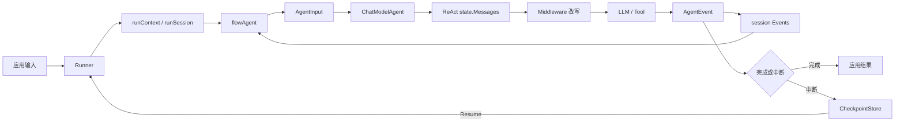
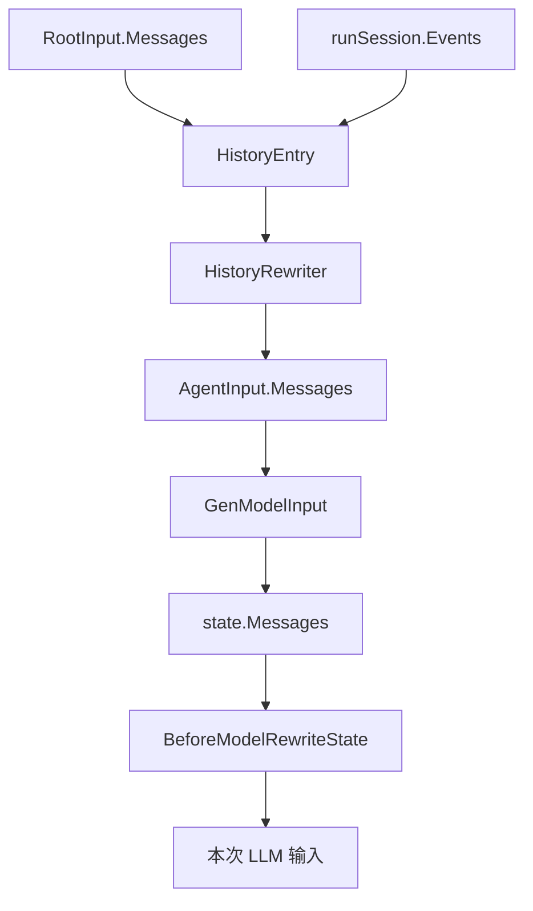

# ADK 学习路线：先建立主线，再进入源码细节

ADK 页面很多，是因为它同时解释运行时、Agent、Workflow、Middleware、Callback、消息历史和中断恢复。初学者不应该把侧边栏当成一个需要从上到下读完的文件列表，而应该沿着**一次请求的生命周期**建立主线，再按问题深入。

如果希望边看边运行代码，先打开 [Demo 阶梯：从事件到恢复](./demo-ladder.md)。它把每一步新增的组件和状态位置标出来，再回到本页阅读对应的源码章节。

## 一条主线先记住



这张图对应五个必须分开的概念：

| 概念 | 一句话理解 | 先读哪一章 |
| --- | --- | --- |
| Runner | 一次根运行的入口与恢复入口 | [Runner 与运行上下文](./runner-context.md) |
| flowAgent | 给 Agent 补上 RunPath、历史、事件归属和转交 | [Agent / Runner / ChatModelAgent](./roles-and-boundaries.md) |
| runContext/session | 一次 Agent 树共享的运行状态 | [Context 的逐层传播](./context-flow.md) |
| state.Messages | 一个 ChatModelAgent 的局部模型工作记忆 | [LLM 上下文窗口与消息存储](./context-window.md) |
| Checkpoint | 中断后继续执行所需的外层和内层快照 | [Runner 持久化读写链](./runner-persistence.md) |

## 路线一：完全没有 Agent 背景

按下面顺序读：

1. [先理解这些概念](./beginner-concepts.md)：弄清 Agent、Runner、Session、Event、State。
2. [小白推演：一次 Agent 请求](./zero-to-agent.md)：从用户输入跟一条最短请求。
3. [Agent / Runner / ChatModelAgent](./roles-and-boundaries.md)：知道三者各自负责什么。
4. [完整生命周期](./lifecycle.md)：把创建、运行、事件、结束、中断放在一条时间线上。
5. [复杂请求端到端追踪](./end-to-end-trace.md)：用一个包含 Tool、Workflow 和中断的场景串起来。

读完这一组，应该能回答：

```text
谁创建一次运行？       Runner
谁补充历史和路径？     flowAgent
谁真正调用模型？       ChatModelAgent / compose Graph
模型输出怎么出来？     AgentEvent / AsyncIterator
下一 Agent 怎么看到历史？ runSession.Events → HistoryRewriter
```

## 路线二：理解“消息到底在哪里”



阅读顺序：

1. [状态、历史与记忆](./state-and-memory.md)：认识不同生命周期的数据。
2. [LLM 上下文窗口与消息存储](./context-window.md)：理解消息拼接、Tool 结果、Summary、Reduction 和长期记忆。
3. [Agent 组装最佳实践](./agent-composition-best-practices.md)：决定记忆、Summary、Retriever 应该放在哪个组件。
4. [新版 Middleware](./middleware-current.md)：学习每轮模型前如何读写 `state.Messages` 和 `ToolInfos`。
5. [内置 Middleware 源码](./builtin-middlewares.md)：查看 summarization、reduction 等实现。

重点区别：`runSession.Events` 是跨 Agent 的历史投影；`state.Messages` 是某个 ChatModelAgent 的局部模型上下文；应用级 ConversationStore 才是跨请求、跨进程的长期历史。

## 路线三：理解 Context 与持久化

1. [Runner 与运行上下文](./runner-context.md)：根 `runContext` 如何创建，子 Agent 如何进入。
2. [Context 的逐层传播](./context-flow.md)：`ctx`、`runContext`、`runSession`、地址和并行 lane 的关系。
3. [Runner 持久化读写链](./runner-persistence.md)：状态怎样从内存编码到 `CheckPointStore`。
4. [中断、检查点与恢复](./interrupt-resume.md)：interrupt tree、叶子状态和 Resume 协议。
5. [Config 与 Option 转换](./config-option-flow.md)：配置如何进入实际执行。

```text
Go context.Context
  └─ runContext
      └─ runSession（Values + Events）

ChatModelAgent
  └─ compose Graph
      └─ local state.Messages

中断时：runContext/session + Graph state
  └─ Runner serialization → CheckPointStore
```

## 路线四：理解 ChatModelAgent 内部

1. [ChatModelAgent](./chat-model-agent.md)：配置、Handlers、Middleware、工具和运行入口。
2. [ReAct 图实现](./react.md)：Init、ChatModel、ToolNode、AfterToolCalls 和循环边。
3. [Callback 与 AgentEvent](./callbacks.md)：观察与控制的区别。
4. [事件与异步迭代器](./events.md)：为什么模型不是只返回一个字符串。
5. [并发、取消与错误边界](./concurrency-errors.md)：goroutine、stream、cancel 和恢复边界。

看到源码时，可以按这张表定位：

| 代码现象 | 应该想到 |
| --- | --- |
| `AgentInput` | 当前 Agent 的输入视图 |
| `state.Messages` | 当前 ChatModelAgent 的模型循环 |
| `AgentEvent` | 对外输出与控制动作 |
| `runSession.Events` | 跨 Agent 历史投影 |
| `compose.ProcessState` | 访问 Graph 局部状态 |
| `BeforeModelRewriteState` | 每轮模型前重写 state |
| `WithCheckPointStore` | Graph 层状态恢复 |
| `WithCheckPointID` | Runner 层根 checkpoint key |

## 路线五：理解 Workflow、AgentTool 和 Transfer

1. [工作流 Agent](./workflows.md)：Sequential、Parallel、Loop 的执行差异。
2. [Workflow 完整案例](./workflow-case-study.md)：并行、合并和恢复。
3. [AgentTool 与转交](./tools-transfer.md)：Agent 作为 Tool 时的边界。
4. [Prebuilt 深入分析](./prebuilt.md)：Supervisor、Deep Agent 等预构建组件。

```text
父 runContext
  ├─ fork lane A → 独立 LaneEvents
  ├─ fork lane B → 独立 LaneEvents
  └─ joinRunCtxs → 按时间合并到父 session
```

## 遇到问题时按现象查

| 现象 | 优先阅读 |
| --- | --- |
| 模型看不到上一轮消息 | [LLM 上下文窗口与消息存储](./context-window.md) |
| 子 Agent 为什么拿到 `nil input` | [Runner 与运行上下文](./runner-context.md) |
| `state.Messages` 和 `session.Events` 的区别 | [状态、历史与记忆](./state-and-memory.md) |
| Summary、Reduction、Memory 应该放哪里 | [Agent 组装最佳实践](./agent-composition-best-practices.md) |
| 中断后恢复不了 | [Runner 持久化读写链](./runner-persistence.md) |
| Middleware 修改后下一轮没生效 | [新版 Middleware](./middleware-current.md) |
| Tool 结果太大 | [内置 Middleware 源码](./builtin-middlewares.md) |
| Workflow 并行后历史顺序不对 | [Workflow 完整案例](./workflow-case-study.md) |

## 最小阅读闭环

如果只想快速建立完整心智模型，读这八页即可：

```text
beginner-concepts
  → zero-to-agent
  → roles-and-boundaries
  → lifecycle
  → context-window
  → runner-persistence
  → middleware-current
  → workflows
```

读完再根据问题进入具体实现页，避免在几十个章节之间来回跳转。

## 目前还值得补充的内容

源码覆盖和“读懂原理”已经比较完整，但如果目标是让一个刚接触 Go/Agent 的读者真正写出生产代码，仍有几处需要继续补齐。这里把“缺什么”和“为什么还不够”明确列出来，避免把“有一个章节”误认为“已经能照着做”。

| 优先级 | 还需要补充 | 当前已有内容 | 还差的最后一块 | 建议的验证方式 |
| --- | --- | --- | --- | --- |
| P0 | 可直接复制运行的示例工程 | [Demo 阶梯](./demo-ladder.md) 有逐步代码片段 | 片段依赖调用方自己补模型、包名和错误处理；仓库本身没有统一的 `examples/adk` 示例目录 | 选一个 mock model，建立可运行的最小 Go 示例，并在 CI 中执行 |
| P0 | AgentTool 与 Workflow 的并排选择 | [AgentTool 与转交](./tools-transfer.md)、[工作流 Agent](./workflows.md) 分别解释 | 还缺同一业务目标的两种实现，让读者看到“返回结果”和“固定编排”的差异 | 用“客服先查订单，再生成回复”分别写 AgentTool 版和 Sequential 版 |
| P0 | Callback 与 Middleware 的同场对照 | [Callback](./callbacks.md)、[新版 Middleware](./middleware-current.md) 已说明定位 | 还缺一个故意把逻辑放错位置的反例，以及修正后的两版代码 | 同时记录耗时、注入记忆、裁剪消息，观察谁能修改输入、谁只能旁路观察 |
| P1 | Typed Agent / `AgenticMessage` 的完整闭环 | [Typed Agent](./typed-agent-agentic.md) 已有类型和执行分支 | 目前更偏协议说明，缺“构造模型 → `TypedRunner.Query` → 消费 typed event → 处理 ContentBlock”的短例子 | 用 mock `AgenticModel` 跑一次带 tool result 的请求 |
| P1 | TurnLoop 的持续运行示例 | [Cancel 与 TurnLoop](./cancel-turn-loop.md) 已解释状态机和 API | 缺少一个能直观看到 `Push`、安全点抢占、`GenResume` 和 late item 的时间线 | 两个 goroutine：一个持续 Push，一个触发 preempt/Stop，打印每轮 consumed/unhandled |
| P1 | Prebuilt 的“什么时候该用”案例 | [Prebuilt 深入分析](./prebuilt.md) 已拆 Supervisor、Plan-Execute、Deep | 目前主要是源码还原，缺少按业务约束选择组件的决策题 | 用“多专家路由 / 有计划任务 / 可编辑文件的长任务”各给一个最小配置 |
| P1 | 可观测性与错误定位的完整链路 | [事件](./events.md)、[调试](./debugging-testing.md)、[Callback](./callbacks.md) 分散讲解 | 缺统一日志字段：`RunPath`、checkpoint ID、session key、state 消息数、model attempt | 让每个 Demo 都输出同一组字段，再用一次中断恢复对照前后日志 |
| P2 | 测试先行的阅读入口 | 各模块末尾有源码路径 | 测试文件是最接近可运行样例的材料，但当前路线没有把测试按学习目标索引出来 | 给每个主题增加“先读哪个 `_test.go`”链接，避免只看实现文件 |

这张表也说明了当前文档的边界：**概念、源码关系和组件定位已经覆盖；下一阶段的重点是把它们收敛成可运行的实验。** 其中 P0 会直接影响初学者能否从文档走到代码，建议优先完成。

### 如何判断一个章节“真的补齐了”

每个主题至少应同时具备四层材料：

```text
1. 定位：它解决什么问题，不解决什么问题
2. 时机：它在一次 Run 的哪个阶段执行
3. 信息：它能读到哪些 ctx / state / event / config
4. 实验：一个可以观察到输入、输出和失败边界的最小 Demo
```

因此，后续新增章节不再只增加 API 列表，而要明确回答“执行时机”和“可见信息”，并附一个能验证这两个结论的示例。现有章节中，前 1～3 层大多已经具备；上表列出的缺口主要集中在第 4 层。
