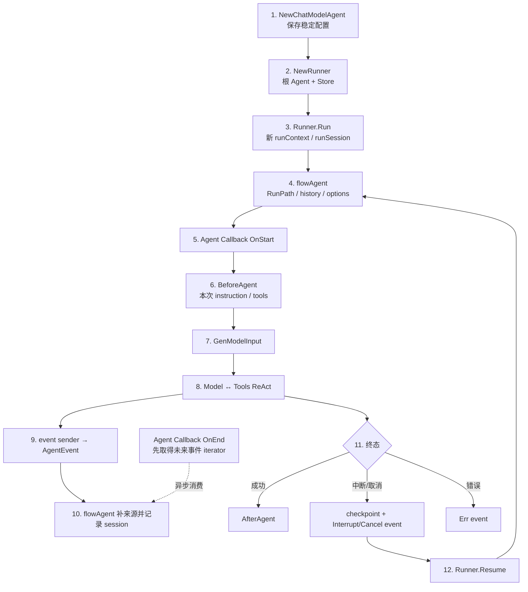
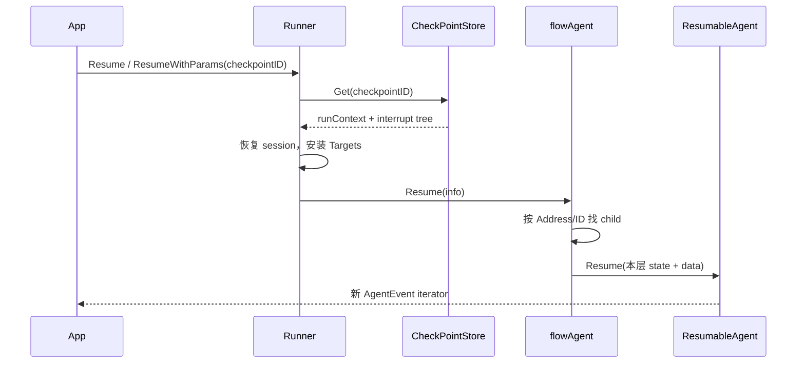

# Agent 的完整生命周期

本章沿一条带天气 Tool 的请求，从长期对象构造一直走到事件结束、取消或恢复。重点是分清：哪些对象被复用，哪些状态每次 Run 新建，哪些步骤每个 ReAct round 重复。

## 1. 全景



## 2. 构造 ChatModelAgent

```go
agent, err := adk.NewChatModelAgent(ctx, &adk.ChatModelAgentConfig{
    Name:        "weather_assistant",
    Description: "查询天气并解释出行建议",
    Instruction: "你是一个谨慎的天气助手。",
    Model:       chatModel,
    ToolsConfig: adk.ToolsConfig{
        ToolsNodeConfig: compose.ToolsNodeConfig{
            Tools: []tool.BaseTool{weatherTool},
        },
    },
    Handlers:      []adk.ChatModelAgentMiddleware{policyMW},
    MaxIterations: 8,
})
```

构造期：

- 校验 Model；Failover 存在时校验两个选择函数；
- 选择默认或自定义 GenModelInput；
- 保存 Model、ToolsConfig、Handlers、retry/failover 等稳定依赖；
- 在静态 Tool wrapper 列表插入默认 event sender、兼容 Middleware wrapper 和流式取消监控；
- 不调用模型，不创建用户 session。

Name/Description 对独立运行不是硬性必填，包装为 AgentTool 时必须非空。

## 3. 构造 Runner

```go
runner := adk.NewRunner(ctx, adk.RunnerConfig{
    Agent:           agent,
    EnableStreaming: true,
    CheckPointStore: store,
})
```

Runner 是应用边界，长期保存根 Agent、默认 streaming 和 checkpoint store。它不保存某个用户的当前消息。

泛型入口 `NewTypedRunner(TypedRunnerConfig[M])` 不需要构造 Context；`NewRunner(ctx, config)` 是经典 Message 便利入口。

## 4. Runner.Run 建立一次根运行

```go
callbackOpt := adk.WithCallbacks(traceHandler)
cancelOpt, cancel := adk.WithCancel()

iter := runner.Run(ctx,
    []*schema.Message{schema.UserMessage("上海明天会下雨吗？")},
    adk.WithSessionValues(map[string]any{"User": "小明"}),
    adk.WithCheckPointID("request-1001"),
    callbackOpt,
    cancelOpt,
)
```

Runner：

1. 解析 ADK common options；
2. 构造 `AgentInput{Messages, EnableStreaming}`；
3. 创建 root runContext/runSession；
4. 保存 RootInput 与 SessionValues；
5. 把根 Agent 包成 flowAgent；
6. 获取内部 iterator；
7. 若有 Store 或 `WithCancel`，用外层 iterator 观察 Interrupt/Cancel；同时具备 Store 和 checkpoint ID 时保存现场。

`WithCallbacks` 和 `WithCancel` 都是本次运行 option，不会改写 Agent 的长期配置。

## 5. flowAgent 建立 Agent 语义

每次进入任意 Agent 前，flowAgent：

- 追加 `RunPath`；
- 向 Context 追加 `agent:<name>` Address segment；
- 用 RootInput + session Events 生成当前 Agent 的 Messages；
- 执行 HistoryRewriter（若有兼容包装）；
- 按 `DesignateAgent` 过滤 options；
- 将事件复制成“交给用户”和“记录 session”两份；
- 处理 Transfer/Interrupt/Resume 路由。

根例子：

```text
RunPath = [weather_assistant]
Address = agent:weather_assistant
```

RunPath 是 Agent 历史归属；Address 是组件/中断定位，二者不能混用。

## 6. Agent Callback OnStart

具体 Agent 运行开始时初始化 callback manager，组件标识为 `ComponentOfAgent`。新运行的 `AgentCallbackInput.Input` 非 nil；恢复时 `ResumeInfo` 非 nil。

全局 handlers 通过 Context 继承；本次 `adk.WithCallbacks` 追加到当前 Agent。嵌套 Workflow 会过滤已继承的 handler option，防止重复执行。

Callback 只观察并派生 Context，不替换 AgentInput。

## 7. BeforeAgent 生成本次执行配置

ChatModelAgent 从静态字段复制：

- Instruction；
- Tools / ToolsNodeConfig；
- ReturnDirectly；
- parent/subagent 兼容关系。

然后所有 Handlers 按注册顺序执行 `BeforeAgent`。它们可按租户增加/移除真实 Tool、追加本次 instruction、设置 tool-search schema，并返回向后传播的新 Context。

这一步结束后才生成 ToolInfo 与本次可执行结构。旧 `AdditionalInstruction/AdditionalTools` 也在兼容链中合并，但不应再作为新代码入口。

## 8. GenModelInput

默认经典逻辑：

1. Instruction 非空时创建 SystemMessage；
2. SessionValues 非空时用 FString 展开 `{User}` 等占位符；
3. 追加 flowAgent 准备好的 AgentInput.Messages。

```text
System: 你是一个谨慎的天气助手。当前用户是小明。
User: 上海明天会下雨吗？
```

AgenticMessage 路径生成 SystemAgenticMessage，不走经典 FString 格式化。

GenModelInput 每个 Agent Run 执行一次；每轮模型前的 history 修改属于 `BeforeModelRewriteState`。

## 9. 选择无工具或 ReAct

第一次 build run function 时，根据执行配置选择：

```text
最终 Tools 为空
  → GenModelInput → wrapped Model

最终 Tools 非空
  → GenModelInput → ReAct Graph
       classic:  BaseChatModel ↔ ToolsNode
       agentic:  AgenticModel  ↔ AgenticToolsNode
```

父/子 Agent 关系在首次运行后冻结，不能再重新设置。Handlers 仍有运行期 hook，但不应依赖修改 Agent 私有配置。

## 10. 第一轮 Model

进入 Model 节点：

1. 检查并递减 RemainingIterations；
2. 将内部 State 转成 `TypedChatModelAgentState`；
3. 运行旧 BeforeChatModel 兼容 hook；
4. 运行新版 `BeforeModelRewriteState`；
5. 进入 failover → retry → event sender → WrapModel → callback injection → provider；
6. 将 provider 输出写入 state；
7. 运行 `AfterModelRewriteState`；
8. 最后运行旧 AfterChatModel 兼容 hook。

假设模型产生 `get_weather` ToolCall。默认 model event sender 生成 assistant AgentEvent，同时 Graph 的 branch 读取自己的流副本判断是否进入工具路径。

事件发送不再依赖旧的专用 model callback bridge；组件 Callback 是并行的观测链。

## 11. 模型后安全点与 Tool 调用

只有输出含 ToolCall 时才经过 CancelAfterChatModel 安全点。若用户已请求该模式，框架保存 assistant ToolCall message 并中断；否则进入 ToolsNode。

Tool 调用顺序：

```text
ToolArgumentsHandler
  → default event sender
  → user ToolsConfig middlewares
  → legacy AgentMiddleware wrapper
  → stream cancel monitor（流式）
  → Handler Tool wrappers
  → callback injection
  → Tool implementation
```

Tool wrapper 可以在真实副作用前做权限、幂等和审计。Prompt 中的“不要做危险操作”不是安全边界。

## 12. Tool 结果回到 State

默认 tool event sender 把最终处理后的结果变成 AgentEvent，并预生成 message ID。

ToolsNode 完成一组调用后，`AfterToolCalls` 节点：

1. 将同一 message ID 写入 state 中的 Tool result；
2. 追加全部结果到 Messages；
3. 调用 `WithAfterToolCallsHook`；
4. 到达 CancelAfterToolCalls 安全点。

若没有取消、也没有 ReturnDirectly，就回到 Model。第二轮看到：System、User、Assistant ToolCall、Tool result。

## 13. 最终回答与成功终态

第二轮模型返回不含 ToolCall 的自然语言回答，branch 走终态：

- 默认 model event sender 已发送最终 assistant AgentEvent；
- 有 Handlers 时 Graph 进入 AfterAgent 节点，按顺序执行 `AfterAgent`；
- Runnable 返回的最终 Message/Stream 主要用于 OutputKey 兼容逻辑和内部完成；
- 没有 OutputKey 时，多余返回流被关闭，避免重复发送。

OutputKey 和 transfer-based full-context 方案在当前源码中均标为不推荐；应用应以 AgentEvent iterator 为主输出。

## 14. Agent Callback OnEnd

`OnEnd` 这个名字容易让人误以为“整次 Agent 已经结束”。由于 Agent 输出是异步流，当前 `flowAgent.run` 的真实顺序是：先创建 Callback iterator，把 `AgentCallbackOutput{Events: copy}` 交给 handlers；handlers 返回后，才开始把底层 Agent 事件转发到 Callback 和主调用方；运行结束时关闭 iterator。

多个 handler 各有独立副本，必须在 `OnEnd` 中启动 goroutine 异步排空并立即返回。若同步调用 `Next()`，事件转发循环尚未启动，可能直接死锁。真正的“输出完成”是该 goroutine 读到 `ok=false`。

这适合整次 Agent 审计、指标和 trace，不应重复把同一事件推给 UI。

## 15. flowAgent 记录事件

每个具体 Agent event 回到 flowAgent 后：

1. 补 AgentName/RunPath；
2. 精确属于当前 RunPath 的事件复制一份写 session；
3. 更深 AgentTool 内部事件只透传，不重复写父历史；
4. 流的每个消费者获得独立 reader；
5. 记录最后一个控制 Action；
6. 上送 Runner/用户 iterator。

因此一次 Run 内有两类历史：ChatModelAgentState 负责单 Agent ReAct；runSession.Events 负责跨 Agent 历史投影。

## 16. 四种结束路径

### 正常完成

各层 generator 关闭，最外 iterator 最终 `Next() → ok=false`。正常完成不会自动把整个 session 写进 CheckPointStore，也不会自动成为下一次 Query 的对话历史。

### 普通错误

Model/Tool/Middleware/AfterAgent error 变成 AgentEvent.Err，执行结束。Callback/应用可以记录，但不应把错误伪造成成功 Message。

### 业务 Interrupt

Compose checkpoint bytes 被包进当前 ADK InterruptState；flowAgent 继续向上构造 interrupt tree；Runner 用业务 CheckpointID 保存根 runContext，并发送带 InterruptContexts 的 Action event。

### Cancel

immediate 或安全点 cancel 最终变成 `CancelError`，也携带恢复目标和 checkpoint。`CancelHandle.Wait()` 只报告取消请求的结局。

## 17. Resume



恢复需要同样的 Agent/Tool/Model 结构来解释 Address 和 state。Checkpoint 保存执行数据，不保存可执行客户端或函数。

新 Run 与 Resume 的区别：

| 维度 | 新 Run | Resume |
| --- | --- | --- |
| RootInput | 新建 | checkpoint 还原 |
| session events/values | 空白 + 本次 options | 从 checkpoint 还原并可合并本次 options |
| 入口 | Agent.Run | ResumableAgent.Resume |
| Graph | 从 START | 从 Compose checkpoint task/channel |
| Resume data | 无 | 按 interrupt ID 发给目标 |

## 18. 对象复用表

| 对象 | 生命周期 | 是否应含用户可变状态 |
| --- | --- | --- |
| Model client / Tool implementation | 长期复用，前提是并发安全 | 否 |
| ChatModelAgent | 长期复用 | 否；只存配置/依赖 |
| Runner | 长期复用 | 否 |
| runContext/runSession | 一次根运行/恢复链 | 是 |
| ChatModelAgent State | 一次 Agent ReAct/恢复链 | 是 |
| Context | 调用链 | 轻量请求值 |
| Checkpoint | 被暂停执行 | 序列化运行状态 |
| Memory/Conversation Store | 跨请求 | 是，由应用治理 |

## 19. 源码阅读路线

1. `adk/runner.go`：根运行与 checkpoint；
2. `adk/flow.go` / `runctx.go`：路径、历史和 session；
3. `adk/callback.go`：Agent callback；
4. `adk/chatmodel.go`：本次 exec context、Run/Resume；
5. `adk/handler.go` / `wrappers.go`：Middleware 与事件；
6. `adk/react.go`：两套 ReAct 与安全点；
7. `adk/interrupt.go` / `cancel.go`：暂停与取消。
