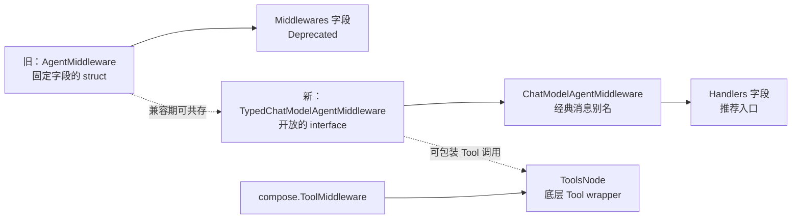
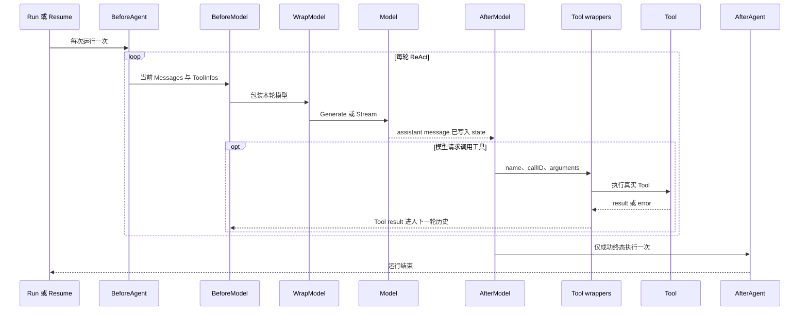
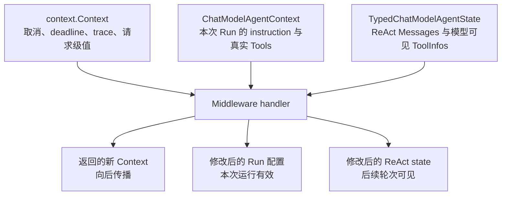
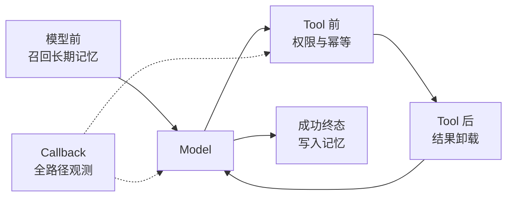

# Middleware 新旧 API：从 AgentMiddleware 迁移到 Handlers

::: warning 先说结论
`adk.AgentMiddleware` 确实是官方正在淘汰的旧版结构体 API。

- 本站当前已基于 **2026-09-17** 的 `main@c5c2dc3` 重新校验；
- 当前源码明确将 `AgentMiddleware` 与 `ChatModelAgentConfig.Middlewares` 标记为 `Deprecated`，并注明未来版本会删除；
- 新代码应使用 `ChatModelAgentMiddleware` / `TypedChatModelAgentMiddleware[M]`，通过 `ChatModelAgentConfig.Handlers` 注册；
- `compose.ToolMiddleware` 是更底层的 ToolsNode wrapper，不等于旧 `AgentMiddleware`，也不能因为名称相似就认为它一起被淘汰。

本页分析当前实现；[兼容版 Middleware 的完整执行机制](./middleware.md)仍保留，用于理解迁移期旧字段怎样被执行。
:::

配套的最小示例见 [Demo 阶梯](./demo-ladder.md) 的 Demo 6～7：先用 `BeforeModelRewriteState` 做机械裁剪，再对比 `reduction` 与 `summarization`。

## 1. 四个名字先分清

“Middleware 新旧版本”最容易混淆，是因为 Eino 同时存在四个相近概念：

| 名称 | 形态 | 所属层级 | 当前定位 |
| --- | --- | --- | --- |
| `adk.AgentMiddleware` | struct | 旧版 ChatModelAgent | 已废弃，保留兼容 |
| `ChatModelAgentConfig.Middlewares` | `[]AgentMiddleware` | 旧版配置入口 | 已废弃，未来删除 |
| `adk.ChatModelAgentMiddleware` | interface 别名 | 新版 ChatModelAgent | 普通 `*schema.Message` 路径的推荐 API |
| `adk.TypedChatModelAgentMiddleware[M]` | 泛型 interface | 新版 TypedChatModelAgent | 新版完整 API |
| `compose.ToolMiddleware` | Tool endpoint wrapper | Compose / ToolsNode | 独立的底层 Tool 扩展点，仍有自己的适用场景 |

`ChatModelAgentMiddleware` 只是泛型接口在经典消息类型上的别名：

```go
type ChatModelAgentMiddleware =
    TypedChatModelAgentMiddleware[*schema.Message]
```

因此日常使用 `ChatModelAgent` 时写 `ChatModelAgentMiddleware`；编写同时支持 `*schema.Message` 和 `*schema.AgenticMessage` 的通用组件时，使用 `TypedChatModelAgentMiddleware[M]`。



<p class="diagram-caption">新旧 ADK Middleware 可以在兼容期共存；compose.ToolMiddleware 是另一层抽象，不在这条替换关系中。</p>

## 2. 为什么旧版会被替换

旧版是一个固定字段集合：

```go
type AgentMiddleware struct {
    AdditionalInstruction string
    AdditionalTools       []tool.BaseTool
    BeforeChatModel       func(context.Context, *ChatModelAgentState) error
    AfterChatModel        func(context.Context, *ChatModelAgentState) error
    WrapToolCall          compose.ToolMiddleware
}
```

它适合“静态拼装”，但有四个结构性限制。

### 2.1 struct 是封闭能力集合

框架只认识这五个字段。即使用户把 `AgentMiddleware` 嵌入自定义 struct，再增加 `WrapModel`、`AfterAgent` 等方法，`[]AgentMiddleware` 也只保留基础 struct，框架无法发现新增能力。

新版改为 interface 后，框架可以继续扩展生命周期方法，用户实现也可以保存自己的 service、policy、配置和并发安全状态。

### 2.2 旧 hook 不能返回新 Context

旧签名只能返回 error：

```go
func(context.Context, *ChatModelAgentState) error
```

这意味着 hook 虽然能读取 Context，却不能把 `context.WithValue`、trace span 或请求级派生信息直接传给后续 handler、Model 和 Tool。

新版 hook 返回 `context.Context`：

```go
(context.Context, *TypedChatModelAgentState[M], error)
```

前一个 handler 返回的 Context 会继续流向后一个 handler和实际调用边界。

### 2.3 旧版缺少“每次 Agent Run”的生命周期

`AdditionalInstruction` 和 `AdditionalTools` 在构造 Agent 时静态合并，无法根据本次用户、租户、权限、会话状态动态选择。

新版增加 `BeforeAgent`：每次 `Run` / `Resume` 开始时都可修改 instruction、真实 Tool 列表和 ReturnDirectly 集合。它解决的是“本次运行需要哪些能力”，而不只是“Agent 创建时有哪些能力”。

### 2.4 旧 Tool wrapper 信息和类型不够完整

旧版借用 `compose.ToolMiddleware`，只覆盖传统 invokable / streamable Tool endpoint。新版 ADK interface 针对 ChatModelAgent 增加四种 wrapper：

- 普通同步 Tool；
- 普通流式 Tool；
- Enhanced 同步 Tool；
- Enhanced 流式 Tool。

每个 wrapper 还会得到 `ToolContext{Name, CallID}`，并能通过返回 endpoint 和 Context 参与 ADK 请求级传播。

## 3. 新版接口到底有哪些阶段

为了便于阅读，下面只保留方法签名，注释转换为后续表格：

```go
type TypedChatModelAgentMiddleware[M MessageType] interface {
    BeforeAgent(
        ctx context.Context,
        runCtx *ChatModelAgentContext,
    ) (context.Context, *ChatModelAgentContext, error)

    BeforeModelRewriteState(
        ctx context.Context,
        state *TypedChatModelAgentState[M],
        mc *TypedModelContext[M],
    ) (context.Context, *TypedChatModelAgentState[M], error)

    WrapModel(
        ctx context.Context,
        m model.BaseModel[M],
        mc *TypedModelContext[M],
    ) (model.BaseModel[M], error)

    AfterModelRewriteState(
        ctx context.Context,
        state *TypedChatModelAgentState[M],
        mc *TypedModelContext[M],
    ) (context.Context, *TypedChatModelAgentState[M], error)

    WrapInvokableToolCall(...)
    WrapStreamableToolCall(...)
    WrapEnhancedInvokableToolCall(...)
    WrapEnhancedStreamableToolCall(...)

    AfterAgent(
        ctx context.Context,
        state *TypedChatModelAgentState[M],
    ) (context.Context, error)
}
```

实现自定义 middleware 时通常不需要把九个方法全部手写。嵌入默认空实现，然后只覆盖需要的方法：

```go
type MyMiddleware struct {
    *adk.BaseChatModelAgentMiddleware

    memory MemoryService
    policy AccessPolicy
}
```

泛型组件对应嵌入：

```go
type MyTypedMiddleware[M adk.MessageType] struct {
    *adk.TypedBaseChatModelAgentMiddleware[M]
}
```

## 4. 一次完整运行中，新版 Middleware 什么时候执行



<p class="diagram-caption">BeforeAgent / AfterAgent 是运行级；BeforeModel / AfterModel 是模型轮次级；Tool wrapper 是单次 ToolCall 级。</p>

### 4.1 阶段能力总表

| 方法 | 次数 | 能拿到什么 | 能改变什么 | 最适合 |
| --- | --- | --- | --- | --- |
| `BeforeAgent` | 每次 Run/Resume 一次 | Instruction、真实 Tools、ReturnDirectly、ToolSearchTool、Context | 返回新 Context；替换本次运行配置 | 动态能力装配、租户 Tool 集、请求级 instruction |
| `BeforeModelRewriteState` | 每轮模型前 | Messages、ToolInfos、DeferredToolInfos、ModelContext | 返回并持久化新 state；返回新 Context | Summary、历史修复、每轮 Tool 可见性、上下文注入 |
| `WrapModel` | 每次模型调用周围 | BaseModel、模型调用上下文 | 包装 Generate/Stream、结果流、options | 模型观测、响应转换、专用路由；不建议在此改历史 |
| `AfterModelRewriteState` | 每轮模型成功返回后 | 含新 assistant message 的完整 state | 返回并持久化新 state；返回新 Context | 结果校验、下一轮状态标注、消息归一化 |
| 四种 Tool wrapper | 每次匹配类型的 ToolCall | Tool name、CallID、arguments/ToolArgument、options、Context | 改参数、结果、error；跳过 endpoint；派生 Context | 权限、缓存、幂等、结果卸载、审计 |
| `AfterAgent` | 成功终态一次 | 最终 Messages、ToolInfos、DeferredToolInfos | 返回 Context 或 error；不返回替换后的 state | 成功后记忆写入、一次性清理、最终统计 |

“能拿到信息”和“能否控制行为”比组件名称更重要。例如 Callback 也能看到模型结束，但 Callback 不返回替换后的 state；要让 Summary 真正成为下一轮模型历史，应该放在 `BeforeModelRewriteState`，而不是观察型 Callback。

## 5. 三种 Context 不要混在一起

新版接口同时出现 Go Context、Agent 运行配置和 Agent state，三者的生命周期不同。



### 5.1 `context.Context`

它用于取消、deadline、trace span、请求身份和调用链传播。新版所有 state hook 都能返回新 Context，因此可以形成：

```text
handler A 返回 ctxA
  → handler B 收到 ctxA，返回 ctxB
    → Model / Tool 收到 ctxB
```

不要把长周期业务数据直接塞进 Context。Context 值适合请求级、轻量、链路型信息；用户长期记忆仍应放数据库或 MemoryService。

### 5.2 `ChatModelAgentContext`

它只在 `BeforeAgent` 阶段使用，描述“本次 Agent 运行要采用的配置”：

| 字段 | 作用 |
| --- | --- |
| `Instruction` | 本次运行最终交给 `GenModelInput` 的 instruction |
| `Tools` | 本次运行真正可执行的原始 Tool 列表 |
| `ReturnDirectly` | 哪些 Tool 返回后直接结束 ReAct |
| `ToolSearchTool` | 模型原生 Tool Search 所需的 schema |

它不是跨请求配置文件，也不是 ReAct 消息历史。框架从 Agent 的静态配置复制出一份 run context，让 handlers 逐个修改，然后据此生成本次运行的 ToolInfo 和执行结构。

### 5.3 `TypedChatModelAgentState[M]`

它是 ReAct 循环内持久化的状态视图：

```go
type TypedChatModelAgentState[M MessageType] struct {
    Messages          []M
    ToolInfos         []*schema.ToolInfo
    DeferredToolInfos []*schema.ToolInfo
}
```

- `Messages` 是当前 ChatModelAgent 的模型历史；
- `ToolInfos` 是本轮发给模型的立即可见工具 schema；
- `DeferredToolInfos` 是服务端延迟检索的工具 schema；
- `BeforeModelRewriteState` 返回的新 state 会成为后续调用的事实来源。

它仍不等于 Runner 的全部 `runSession.Events`，也不等于长期记忆库。

## 6. 动态 Tool 到底应该在哪一层修改

新版 API 特意提供两条路径，因为“能执行”与“让模型看见”不是同一件事。

### 6.1 `BeforeAgent`：修改真实 Tool 能力

修改 `runCtx.Tools` 会同时影响：

1. 传给模型的 ToolInfo；
2. ToolsNode 中真正可执行的 Tool endpoint；
3. 整个本次 Agent Run 的后续轮次。

适合按用户套餐、租户权限或环境装配不同 Tool 实现。

### 6.2 `BeforeModelRewriteState`：修改本轮模型可见性

修改 `state.ToolInfos` / `DeferredToolInfos` 只控制模型在本轮和后续轮次看到哪些 schema，不会凭空注册一个新的 Tool 实现。

适合从大量已经注册的工具中，按对话上下文动态筛选一小部分给模型，降低 token 和选错工具的概率。

### 6.3 `WrapModel`：不应拿来改 Tool 列表

在 Model wrapper 中临时 `model.WithTools(...)` 只影响单次调用，不会同步 Agent state，也容易破坏跨轮 prompt cache。官方当前源码明确建议在 `BeforeModelRewriteState` 修改 ToolInfos。

```text
需要增加真正可执行的新 Tool
  → BeforeAgent 修改 runCtx.Tools

Tool 已经可执行，只想控制本轮模型看见谁
  → BeforeModelRewriteState 修改 state.ToolInfos

需要包围模型 Generate / Stream
  → WrapModel
```

## 7. Tool wrapper：新版与 compose.ToolMiddleware 的关系

### 7.1 `compose.ToolMiddleware`

这是 ToolsNode 的通用 wrapper：

```go
type ToolMiddleware struct {
    Invokable  func(InvokableToolEndpoint) InvokableToolEndpoint
    Streamable func(StreamableToolEndpoint) StreamableToolEndpoint
}
```

它适合与 ADK 无关、任何 ToolsNode 都能复用的底层策略，例如通用重试、限流、参数规范化和结果缓存。可直接配置在 `ToolsNodeConfig.ToolCallMiddlewares`。

### 7.2 新版 ADK Tool wrappers

新版 `ChatModelAgentMiddleware` 的 wrappers 与 handler 对象绑定：

```go
func (m *TenantMiddleware) WrapInvokableToolCall(
    ctx context.Context,
    next adk.InvokableToolCallEndpoint,
    tc *adk.ToolContext,
) (adk.InvokableToolCallEndpoint, error) {
    return func(ctx context.Context, args string, opts ...tool.Option) (string, error) {
        if err := m.policy.Allow(ctx, tc.Name, args); err != nil {
            return "", err
        }
        return next(ctx, args, opts...)
    }, nil
}
```

它更适合需要共享 middleware 配置、访问 `ToolContext`、使用 run-local state，或同时实现 Agent/Model/Tool 多阶段策略的 ADK 能力包。

### 7.3 二者并存时的调用顺序

当前源码给出的 Tool 链从外到内为：

```text
内部 event sender
  → ToolsConfig.ToolCallMiddlewares
    → 旧 AgentMiddleware.WrapToolCall
      → 流式取消监控 wrapper（仅 stream/enhanced stream）
        → 新 ChatModelAgentMiddleware Tool wrapper
          → callback injection
            → Tool 实现
```

取消监控在构造 `TypedChatModelAgent` 时追加到静态 Tool middleware 列表，运行前再追加 Handlers 的 wrappers，因此实际处于旧 wrapper 与新 handler wrapper 之间。它会在 immediate cancel 或超时升级时尽早关闭原始 Tool 流；外层 wrapper 必须继续传播 `ErrStreamCanceled`，不能吞掉流错误。

新版 handlers 中，先注册者在 wrapper 链最外层：

```text
Handlers: [A, B, C]

进入：A → B → C → Tool
返回：Tool → C → B → A
```

所以“Handler A 先注册”不等于 A 的 after 逻辑先执行。对 wrapper 而言，进入顺序和返回顺序相反；对普通 hook 而言，所有 handler 都按注册正序执行并 fail-fast。

## 8. 模型调用的精确顺序

兼容期同时配置旧 `Middlewares` 和新 `Handlers` 时，一轮模型调用的顺序为：

```text
旧 BeforeChatModel
  → 新 BeforeModelRewriteState
    → 内部 failover wrapper
      → 内部 retry wrapper
        → 默认 event sender
          → 新 WrapModel 链
            → callback injection
              → 真正 Model.Generate / Stream
          ← 新 WrapModel 返回处理
  → 新 AfterModelRewriteState
→ 旧 AfterChatModel
```

这解释了迁移期间的三个现象：

1. 新 Before hook 能看到旧 Before hook 已修改的 state；
2. 新 After hook 先处理模型结果，旧 After hook 后处理；
3. 新旧同时实现同一功能会执行两遍，因此迁移应逐项替换，而不是长期双写。

## 9. Run-local state：新版 Middleware 的运行内小记忆

官方当前 API 提供：

```go
adk.SetRunLocalValue(ctx, "key", value)
value, ok, err := adk.GetRunLocalValue(ctx, "key")
adk.DeleteRunLocalValue(ctx, "key")
```

它适合保存同一次 Agent Run 内多个 handler 阶段共享的数据，例如：

- 本轮已经加载的 skill；
- 某个动态模型选择结果；
- 去重集合或一次性标记；
- interrupt 前计算出的中间状态。

这些值会进入 Agent 内部 state，支持 interrupt/resume 序列化。自定义类型必须可被 gob 序列化，并按要求注册类型。

它不适合：

- 跨独立请求的用户长期记忆；
- 多 Agent 实例共享的业务数据；
- 大文件、向量库或审计记录；
- 不可序列化的连接、锁、函数、reader。

```text
一次 Run 内跨 hook 共享，并需 Resume 恢复
  → Run-local state

一次请求调用链上的身份、trace、deadline
  → context.Context

跨请求、跨进程、可查询的用户记忆
  → 外部 MemoryService / 数据库
```

## 10. 旧 API 到新 API 的逐项迁移

| 旧写法 | 新位置 | 迁移时要注意 |
| --- | --- | --- |
| `Middlewares []AgentMiddleware` | `Handlers []ChatModelAgentMiddleware` | 元素从 struct 变成 interface 对象 |
| `AdditionalInstruction` | `BeforeAgent` 修改 `runCtx.Instruction` | 现在是每次 Run 动态执行，不要反复污染共享配置 |
| `AdditionalTools` | `BeforeAgent` 修改 `runCtx.Tools` | 建议复制 slice 后返回，避免修改共享底层数组 |
| `BeforeChatModel` | `BeforeModelRewriteState` | 新方法还可改 ToolInfos，并返回新 Context/state |
| `AfterChatModel` | `AfterModelRewriteState` | 返回的新 state 会持久化；仍是每个模型轮次执行 |
| `WrapToolCall.Invokable` | `WrapInvokableToolCall` | endpoint 签名变化，可得 Name/CallID |
| `WrapToolCall.Streamable` | `WrapStreamableToolCall` | 正确处理一次性 StreamReader |
| 无对应能力 | `WrapEnhanced*ToolCall` | 支持多模态/结构化 Enhanced Tool |
| 无对应能力 | `WrapModel` | 可包装 Generate/Stream，不要用它偷偷改历史 |
| 无对应能力 | `AfterAgent` | 仅成功终态一次；错误、取消、超轮次时不调用 |

### 10.1 旧代码

```go
mw := adk.AgentMiddleware{
    AdditionalInstruction: "Only access the current tenant.",
    AdditionalTools:       []tool.BaseTool{searchTool},
    BeforeChatModel: func(ctx context.Context, state *adk.ChatModelAgentState) error {
        return trimHistory(state)
    },
    WrapToolCall: oldToolGuard,
}

agent, err := adk.NewChatModelAgent(ctx, &adk.ChatModelAgentConfig{
    Middlewares: []adk.AgentMiddleware{mw},
})
```

### 10.2 新代码骨架

```go
type TenantMiddleware struct {
    *adk.BaseChatModelAgentMiddleware

    searchTool tool.BaseTool
    policy     AccessPolicy
}

func (m *TenantMiddleware) BeforeAgent(
    ctx context.Context,
    runCtx *adk.ChatModelAgentContext,
) (context.Context, *adk.ChatModelAgentContext, error) {
    next := *runCtx
    next.Instruction += "\nOnly access the current tenant."
    next.Tools = append(append([]tool.BaseTool(nil), runCtx.Tools...), m.searchTool)
    return ctx, &next, nil
}

func (m *TenantMiddleware) BeforeModelRewriteState(
    ctx context.Context,
    state *adk.ChatModelAgentState,
    mc *adk.ModelContext,
) (context.Context, *adk.ChatModelAgentState, error) {
    next := *state
    next.Messages = trimHistoryCopy(state.Messages)
    return ctx, &next, nil
}

func (m *TenantMiddleware) WrapInvokableToolCall(
    ctx context.Context,
    next adk.InvokableToolCallEndpoint,
    tc *adk.ToolContext,
) (adk.InvokableToolCallEndpoint, error) {
    return func(ctx context.Context, args string, opts ...tool.Option) (string, error) {
        if err := m.policy.Allow(ctx, tc.Name, args); err != nil {
            return "", err
        }
        return next(ctx, args, opts...)
    }, nil
}

mw := &TenantMiddleware{
    BaseChatModelAgentMiddleware: &adk.BaseChatModelAgentMiddleware{},
    searchTool: searchTool,
    policy: policy,
}

agent, err := adk.NewChatModelAgent(ctx, &adk.ChatModelAgentConfig{
    Handlers: []adk.ChatModelAgentMiddleware{mw},
})
```

示例刻意复制了 `runCtx`、state 和 Tools slice。虽然部分官方内置实现会按自己的所有权约定直接修改对象，但通用业务 middleware 采用 copy-on-write 更容易避免多个 handler 共享引用时互相污染。

## 11. 内置 Middleware 的构造函数也发生了变化

早期文档快照只有 Reduction、Filesystem、Skill 三组旧式实现；当前版本不仅切换到 Handler API，也扩展了更多内置能力。

### 11.1 Filesystem

```go
// 旧：返回 adk.AgentMiddleware，官方当前已标记 Deprecated
filesystem.NewMiddleware(ctx, oldConfig)

// 新：经典消息路径
filesystem.New(ctx, middlewareConfig)

// 新：泛型消息路径
filesystem.NewTyped[M](ctx, middlewareConfig)
```

新版 `BeforeAgent` 在每次运行注入 filesystem instruction 和真实 Tools；Tool wrapper 还能覆盖 Enhanced Tool 类型并更好地传播 Context。

### 11.2 Skill

```go
// 旧：返回 adk.AgentMiddleware，已标记 Deprecated
skill.New(ctx, config)

// 新：返回 adk.ChatModelAgentMiddleware
skill.NewMiddleware(ctx, config)

// 新：返回 adk.TypedChatModelAgentMiddleware[M]
skill.NewTyped[M](ctx, typedConfig)
```

官方源码特别说明：旧 Skill middleware 无法保存 fork 模式所需的消息历史；新版 Handler 可通过 state、run-local data、AgentHub / ModelHub 支持 `fork` 和 `fork_with_context`。

### 11.3 官方当前内置能力地图

| 包 | 主要阶段 | 解决的问题 |
| --- | --- | --- |
| `patchtoolcalls` | 模型前 | 修复缺少对应 Tool result 的悬空 ToolCall |
| `agentsmd` | 模型前 | 注入参考文档；当前实现会写回本次 Agent state，不能绝对保证 Summary 看不到 |
| `summarization` | 模型前 | 超过 token 阈值时压缩历史 |
| `reduction` | Tool 后 + 模型前 | 截断/卸载过大 Tool result，清理旧结果 |
| `filesystem` | Agent 前 | 注入文件工具与可选 shell 工具；大结果统一交给 reduction 更清晰 |
| `dynamictool/toolsearch` | Agent 前 + 模型前 | 大工具集的动态发现和按需暴露 |
| `skill` | Agent 前 + Model/Tool | 按需加载技能，支持 inline/fork/fork_with_context |
| `plantask` | Agent 前 | 注入计划与任务管理工具 |

内置包会继续演进。理解它们时不要只看目录名，要检查它实现了哪个 handler 方法；执行阶段决定它能拿到什么信息，也决定它适合解决什么问题。

## 12. 记忆、Summary、权限在新版中应该放哪里

| 功能 | 主组件/阶段 | 为什么 |
| --- | --- | --- |
| 每轮把长期记忆召回进上下文 | `BeforeModelRewriteState` + MemoryService | 此时有完整当前 Messages，能把召回结果放入本轮模型输入 |
| 运行成功后写一条会话记忆 | `AfterAgent` + MemoryService | 成功终态只执行一次，避免每个 ReAct 轮次重复写 |
| 错误/取消也必须记录审计 | Callback 或 Runner 边界 | `AfterAgent` 在错误终止时不会执行 |
| 历史超窗自动 Summary | `BeforeModelRewriteState` | 可读写并持久化 Messages，下一轮直接使用摘要后的 state |
| Tool result 太大 | Tool wrapper / reduction | 在结果进入消息历史前缩小或外置，避免先污染上下文 |
| 限制某用户可用哪些真实 Tool | `BeforeAgent` | 同时影响模型可见 schema 和真正可执行 endpoint |
| 每轮只给模型看一部分已注册 Tool | `BeforeModelRewriteState` | 只改变模型选择空间，不更换真实实现 |
| 强制 Tool 业务权限 | Tool wrapper + Tool service | 就在副作用前拿到 name、CallID、args，可阻止 `next` |
| 指标和 tracing | Callback；必要时 `WrapModel` / Tool wrapper | 纯观察优先 Callback；需要改结果或精确包围调用才用 wrapper |

一个完整的生产 Agent 往往不是“记忆放在一个 middleware 里”这么简单，而是：



<p class="diagram-caption">同一个“记忆系统”可跨多个阶段协作，但每个阶段只承担与其信息和控制能力匹配的职责。</p>

## 13. 迁移检查清单

- 新代码只向 `Handlers` 注册，不再新增 `Middlewares`；
- 自定义实现嵌入 `BaseChatModelAgentMiddleware`，只覆盖需要的方法；
- 静态 instruction / tools 移入 `BeforeAgent`，并考虑 copy-on-write；
- 历史修改移入 `BeforeModelRewriteState`，返回的新 state 必须保留 ToolInfos；
- 不要在 `WrapModel` 临时改 Messages/Tools，除非明确接受“不持久化且破坏 cache”的语义；
- Tool 策略按普通/流式/Enhanced 四种接口逐项覆盖；
- wrapper 不吞 cancellation、interrupt 和框架控制错误；
- `AfterAgent` 只处理成功终态；错误审计另放 Callback 或 Runner 边界；
- run-local value 必须可序列化，不能当成长期记忆库；
- 混用新旧 API 时按官方顺序写回归测试，避免同一逻辑执行两次；
- 升级内置 middleware 时逐个核对构造函数名和返回类型，尤其是 Filesystem 与 Skill。

## 14. 源码对照路线

### 兼容链

1. `adk/chatmodel.go`：旧 `AgentMiddleware` 和 `Middlewares` 的兼容折叠；
2. `adk/react.go`：旧 Before/After hooks 的 ReAct 执行位置；
3. `compose/tool_node.go`：`compose.ToolMiddleware` 的底层洋葱链；
4. `adk/middlewares/`：旧、新构造函数并存的迁移样例。

### 当前主链

1. `adk/handler.go`：新版 interface、Base no-op 实现、run-local state；
2. `adk/chatmodel.go`：废弃标记、Handlers 配置、精确执行顺序；
3. `adk/wrappers.go`：Model/Tool wrappers 的组装；
4. `adk/middlewares/filesystem`：旧、新构造函数并存的迁移样例；
5. `adk/middlewares/skill`：fork 模式为何需要新版 Handler。

读源码时始终先确认分支和提交日期。兼容页并非“机制完全错误”，但它描述的是仍可运行、已不推荐新增使用的路径；当前设计入口是 `Handlers`。
