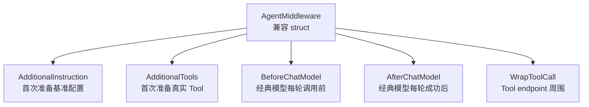
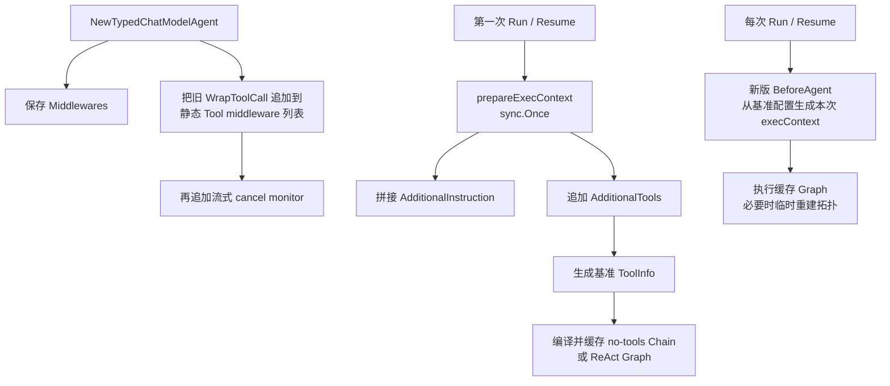
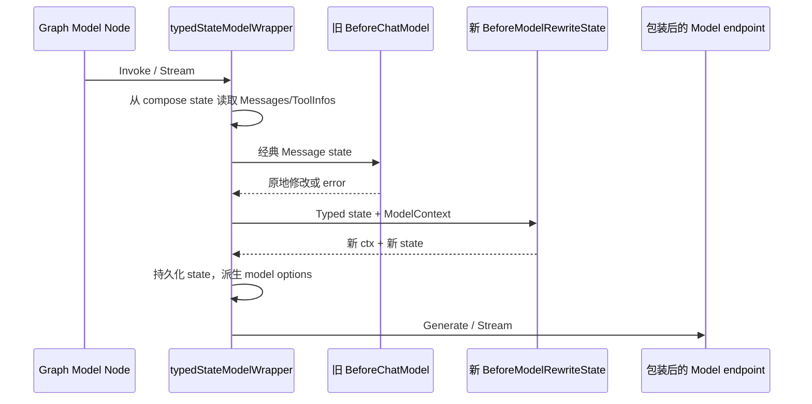
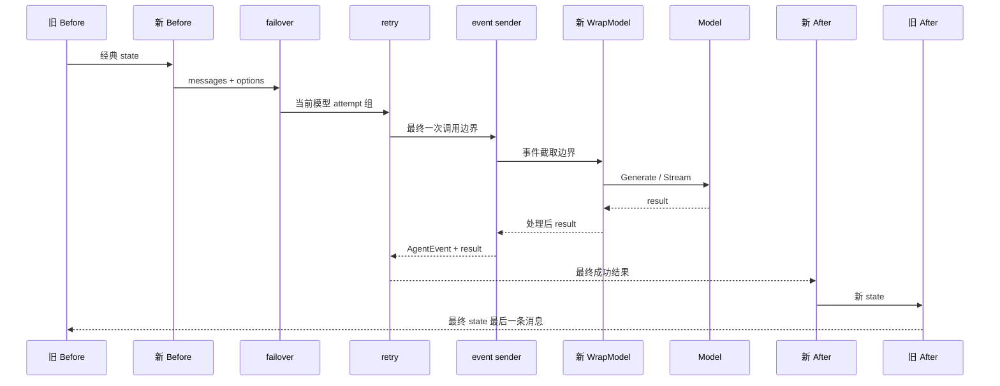
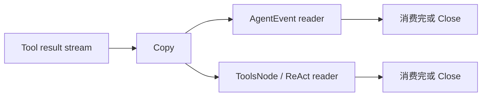

# 兼容版 AgentMiddleware：当前源码中的真实执行方式

::: danger 正在淘汰的旧 API
当前 `main@c5c2dc3` 仍保留 `adk.AgentMiddleware` 与 `TypedChatModelAgentConfig.Middlewares`，但两者已经标记 `Deprecated`，并注明未来删除。新代码应使用 `Handlers []TypedChatModelAgentMiddleware[M]`，见 [Middleware 新旧 API](./middleware-current.md)。

本页不是推荐教程，而是迁移期的源码说明：已有项目为什么还能运行、它怎样与新版 Handler 共同执行、哪些能力在 Agentic 路径上已经不完整。
:::

## 1. 它确实属于 Middleware，但不是新 Middleware interface

旧类型是一个固定字段的 struct：

```go
type AgentMiddleware struct {
    AdditionalInstruction string
    AdditionalTools       []tool.BaseTool
    BeforeChatModel       func(context.Context, *ChatModelAgentState) error
    AfterChatModel        func(context.Context, *ChatModelAgentState) error
    WrapToolCall           compose.ToolMiddleware
}
```

这五个字段虽然会在不同章节和阶段分别出现，但都属于 `AgentMiddleware`：



旧设计的问题不是完全没有能力，而是类型封闭：框架只能识别这五个字段，不能让用户通过新增方法扩展协议；hook 也不能返回新 Context。新版因此改成 interface-based Handler。

## 2. 旧、新和相邻机制先分清

| 机制 | 当前定位 | 执行阶段 | 是否能改变业务行为 |
|---|---|---|---|
| `AgentMiddleware` | Deprecated 兼容层 | 首次基准装配、经典模型每轮、ToolCall | 能 |
| `TypedChatModelAgentMiddleware[M]` | 当前主 API | Agent、Model、Tool 多阶段 | 能，且能传播新 Context/state |
| `compose.ToolMiddleware` | 通用 ToolsNode wrapper | 单次 ToolCall | 能；旧 `WrapToolCall` 的字段类型就是它 |
| `ToolArgumentsHandler` | ToolsNode 参数改写器 | wrapper 之前 | 能改已注册 Tool 的 arguments |
| `callbacks.Handler` | 通用观察切面 | 组件生命周期 | 主要观测，不是业务 mapper |
| event sender wrappers | ADK 内部事件生产层 | Model/Tool 输出返回时 | 生成 `AgentEvent` |

因此把旧 `BeforeChatModel` 单独讲，不表示它脱离了 Middleware；把 `compose.ToolMiddleware` 放在这里讲，也不表示它只属于 ADK。

## 3. 构造、首次运行、每次运行：三个阶段不能混写

当前实现不是“构造器一次性把所有字段折叠完”。真实过程如下：



### 3.1 构造器实际做什么

`NewTypedChatModelAgent` 会：

- 保存 `config.Middlewares`，不立即调用旧 model hooks；
- 把有效的 `WrapToolCall` 收集为 `compose.ToolMiddleware`；
- 将它们追加到 `ToolsConfig.ToolCallMiddlewares` 之后；
- 再追加内部的流式取消监控 middleware；
- 保存 instruction、tools、Handlers、retry/failover 等依赖。

### 3.2 `AdditionalInstruction/Tools` 何时合并

第一次 Run/Resume 触发 `buildRunFunc`，其中的 `prepareExecContext` 才遍历旧 Middlewares：

```go
for _, m := range a.middlewares {
    if m.AdditionalInstruction != "" {
        instruction = concatInstructions(instruction, m.AdditionalInstruction)
    }
    toolsNodeConf.Tools = append(toolsNodeConf.Tools, m.AdditionalTools...)
}
```

它还会在旧 Middleware 之前准备静态 ToolsConfig、transfer/exit 等隐式 Tool。这个基准 `execContext` 和 Graph 由 `sync.Once` 缓存。

### 3.3 为什么新版 BeforeAgent 仍是每次运行

缓存基准配置不等于每次请求都完全冻结。每次 `getRunFunc` 都会在存在 Handlers 时调用 `applyBeforeAgent`，从基准 instruction/tools/ReturnDirectly 复制一份本次配置，再运行新版 `BeforeAgent`。

所以执行次序是：

```text
基础 Config
  + transfer / exit 等框架 Tool
  + 旧 AdditionalInstruction / AdditionalTools
      ↓ 得到缓存的基准 execContext
  + 每次 Run 的新版 BeforeAgent 修改
      ↓ 得到本次 runtime execContext
```

旧静态字段不会每次重新读取业务环境；需要租户级动态装配，应迁移到新版 `BeforeAgent`。

## 4. AdditionalInstruction 的精确语义

旧 instruction 在首次 `prepareExecContext` 时按 Middlewares 注册顺序拼接。它不会立刻变成 Message：每次运行时仍由 `GenModelInput` 决定怎样使用最终 instruction。

```text
Config.Instruction
  + Middleware A.AdditionalInstruction
  + Middleware B.AdditionalInstruction
      ↓ 基准 instruction string
GenModelInput(ctx, instruction, AgentInput)
      ↓
System Message + 用户 Messages（默认实现）
```

如果自定义 `GenModelInput` 忽略 instruction，那么旧 Middleware 也无法强制它进入模型输入。

迁移到新版时，在 `BeforeAgent` 修改 `runCtx.Instruction`；它每次从基准值复制，不要把同一段文字反复追加到 Middleware 自身共享字段。

## 5. AdditionalTools 的精确语义

旧工具在首次准备基准执行配置时追加到真实 Tool 列表。随后：

1. `genToolInfos` 调用 `Tool.Info(ctx)`；
2. ToolInfo 通过 `model.WithTools` 交给模型；
3. Tool 实例进入 ToolsNode；
4. ToolsNode 按工具名建立执行索引。

没有新版 Handlers 时，基准 ToolInfo 通常只在首次构建时生成。存在 Handlers 时，`applyBeforeAgent` 每次运行都会基于本次 Tool 列表再次生成 ToolInfo，并通过运行 option 更新模型和 ToolsNode。

旧 AdditionalTools 本身仍是静态基准。按用户动态增删真实 Tool，应迁移到 `BeforeAgent`；只改变每轮模型可见 schema，应使用 `BeforeModelRewriteState`。

::: warning 工具名必须唯一
重复名称可能让模型看到重复 schema，而执行索引最终只指向其中一个实现。不要依赖覆盖顺序，在应用配置校验阶段直接拒绝重名。
:::

## 6. BeforeChatModel 当前在哪里执行

早期实现常被描述成 ReAct Graph 的 `StatePreHandler`。当前源码已把这条逻辑收进 `typedStateModelWrapper.Generate/Stream`：



执行语义：

- 每次模型调用前执行；一次 ReAct 可执行多次；
- 多个旧 hook 按注册顺序执行；前一个的原地修改对后一个可见；
- 只能修改 `ChatModelAgentState.Messages`，看不到新版 ToolInfos/DeferredToolInfos；
- 只能返回 error，不能返回新 Context 或替换 state 指针；
- error 会阻止本轮真实模型调用。

### 6.1 Agentic 路径的重要缺口

源码只在下面的类型转换成功时调用旧 model hook：

```go
if msgState, ok := any(state).(*ChatModelAgentState); ok {
    // 调用旧 Before/AfterChatModel
}
```

因此 `M = *schema.AgenticMessage` 时，旧 `BeforeChatModel/AfterChatModel` 不执行。AdditionalInstruction、AdditionalTools 和 Tool wrapper 仍可参与通用装配，但依赖经典 `ChatModelAgentState` 的两个 hook 不具备 Typed 能力。

这正是新项目不能继续建立在旧 API 上的原因之一。

## 7. AfterChatModel 当前在哪里执行

完整或流式模型输出成功后，wrapper 会先把结果 materialize 并追加进 state，然后执行：

```text
新 AfterModelRewriteState（注册正序）
  → 旧 AfterChatModel（注册正序，仅经典 Message）
  → 持久化最终 Messages/ToolInfos
  → 返回 state.Messages 的最后一条
```

这带来几个关键结论：

- retry/failover 内部多个 attempt 不会让旧 hook 每个 attempt 都执行；只有外层最终成功输出进入 After 链；
- 旧 hook 可以原地修改 Messages；当前 wrapper 最终返回修改后 state 的最后一条消息；
- 它不是逐 chunk 的流变换器：流式响应先被合并成完整 Message，After 链执行后再以单元素 stream 返回；
- hook 若清空全部 Messages，框架返回 `no messages left in state after model call`；
- hook 返回 error 时，模型已经调用过，但本轮不会正常进入后续 Tool 分支。



## 8. `ChatModelAgentState` 不等于 Runner session

旧 hook 看到的是当前 ChatModelAgent 内部 compose state。Typed state 还包含 `ToolInfos` 和 `DeferredToolInfos`，但旧 hook 的经典参数不能用于 Agentic Message。

Runner/flowAgent 的 `runSession.Events` 是另一层事件账本，用于跨 Agent 重建输入。旧 hook 删除 `state.Messages` 不等于删除 session event。

Message 是指针。若直接修改 `msg.Content`，其他共享同一指针的消费者也可能看到变化。需要隔离时复制 Message 和 slice，再替换 state 中的引用。

## 9. WrapToolCall 现在有四类 endpoint

当前 `compose.ToolMiddleware` 不再只有普通 Invokable/Streamable：

```go
type ToolMiddleware struct {
    Invokable          InvokableToolMiddleware
    Streamable         StreamableToolMiddleware
    EnhancedInvokable  EnhancedInvokableToolMiddleware
    EnhancedStreamable EnhancedStreamableToolMiddleware
}
```

| 字段 | 输入/输出形态 | 典型 Tool |
|---|---|---|
| `Invokable` | JSON string → string | 普通非流式 Tool |
| `Streamable` | JSON string → `StreamReader[string]` | 普通流式 Tool |
| `EnhancedInvokable` | ToolArgument → ToolResult | 结构化/多模态非流式 Tool |
| `EnhancedStreamable` | ToolArgument → `StreamReader[ToolResult]` | 结构化/多模态流式 Tool |

旧 `AgentMiddleware.WrapToolCall` 可以填这四个字段，`collectToolMiddlewaresFromMiddlewares` 当前也会检查四者。但旧 `AgentMiddleware` 自身不提供新版 `ToolContext{Name, CallID}` 风格的方法；需从 `compose.ToolInput` 读取信息。

## 10. Tool 调用链的当前精确顺序

已注册 Tool 的 wrapper 从外到内是：

```text
默认 eventSenderToolWrapper
  → ToolsConfig.ToolCallMiddlewares
    → 旧 AgentMiddleware.WrapToolCall
      → 内部流式 cancel monitor（只对 stream/enhanced stream 有实现）
        → 新 Handler Tool wrappers
          → callback injection（Tool 自己未启用 Callback 时）
            → 真实 Tool endpoint
```

列表先出现者是外层，因此进入顺序如上，返回时完全相反。默认 event sender 位于最外层，通常看到所有用户 wrapper 处理后的最终结果。

如果 Handlers 显式加入 `NewEventSenderToolWrapper()`，框架跳过默认 sender；该 Handler 在新版 wrapper 列表中的位置决定事件能看见哪些内外层修改。

```mermaid
flowchart LR
    Call["模型 ToolCall"] --> Args["ToolArgumentsHandler"]
    Args --> Sender["event sender"]
    Sender --> Config["ToolsConfig middlewares"]
    Config --> Legacy["旧 AgentMiddleware wrapper"]
    Legacy --> Cancel["stream cancel monitor"]
    Cancel --> Current["新版 Handler wrappers"]
    Current --> CB["callback injection"]
    CB --> Tool["真实 Tool"]
    Tool --> Return["反向返回"]
    Return --> Event["生成 Tool AgentEvent"]
```



`ToolArgumentsHandler` 在 wrapper 之前改写已注册 Tool 的 arguments。若它返回 error，后续 wrapper 和 Tool 都不执行。

### 10.1 UnknownToolsHandler 是旁路

未知 Tool 名走单独 fallback task：接收模型原始 name/arguments，不经过已注册 Tool 的 `ToolArgumentsHandler`、middleware、callback injection 和 event sender。因此它不会自动产生普通 Tool AgentEvent。需要统一权限/审计时，应在 UnknownToolsHandler 自己完成，或把能力注册为显式 Tool。

## 11. 流所有权

流式 Tool wrapper 若要旁路观察，应 `Copy(2)`：一份消费，一份继续返回；若要变换，应返回新的 reader。读完原 reader 再原样返回，会让下游只得到 EOF。

event sender 也需要为 Graph 和 AgentEvent 分配不同读者：



每个副本都必须读完或关闭。流式 Callback 又是另一组副本，不要和 event sender 的 reader 所有权混在一起。

## 12. 错误、中断、取消和 retry

### 12.1 Tool error

Tool error 沿 wrapper 返回路径逐层上浮。外层 wrapper 技术上能包装或吞掉 error，但不应吞掉 interrupt、取消和框架控制错误，否则 checkpoint/恢复链会断裂。

### 12.2 模型 retry/failover

`ModelRetryConfig` 和 `ModelFailoverConfig` 都不是旧 AgentMiddleware。它们包围模型 endpoint：

- retry 只重试模型边界，不重新执行已经成功的 Tool；
- failover 可切换模型并记住最近成功模型；
- 旧 Before/After hook 位于 attempt 组之外，不应按它的次数推断底层模型请求次数。

### 12.3 cancel monitor

流式 cancel monitor 位于旧 Tool wrappers 内侧、新 Handler wrappers 外侧。外层旧 wrapper 必须继续传播 `ErrStreamCanceled`；如果它吞掉流内错误，立即取消或超时升级可能无法正确完成。

## 13. 旧 API 完整例子（仅用于读遗留代码）

```go
func NewLegacyTenantGuard() adk.AgentMiddleware {
    return adk.AgentMiddleware{
        AdditionalInstruction: "Only operate on the current tenant's data.",
        BeforeChatModel: func(
            ctx context.Context,
            state *adk.ChatModelAgentState,
        ) error {
            tenant, ok := adk.GetSessionValue(ctx, "tenant_id")
            if !ok || tenant == "" {
                return errors.New("missing tenant_id")
            }
            return nil
        },
        WrapToolCall: compose.ToolMiddleware{
            Invokable: func(next compose.InvokableToolEndpoint) compose.InvokableToolEndpoint {
                return func(ctx context.Context, in *compose.ToolInput) (*compose.ToolOutput, error) {
                    tenant, ok := adk.GetSessionValue(ctx, "tenant_id")
                    if !ok {
                        return nil, errors.New("missing tenant_id")
                    }
                    out, err := next(ctx, in)
                    audit(tenant, in.Name, in.CallID, err)
                    return out, err
                }
            },
        },
    }
}
```

这个例子展示两层防线：model 前缺租户即失败，真实 Tool 副作用前再次鉴权。Prompt 中的 instruction 只是模型行为提示，不能代替 Tool/service 权限。

## 14. 为什么应迁移，而不是继续补旧字段

| 需求 | 旧 AgentMiddleware | 新 Handler |
|---|---|---|
| 动态 instruction/真实 Tool | 只有首次基准静态追加 | `BeforeAgent` 每次运行 |
| 修改模型历史 | 经典 Message 的原地 hook | Typed state，返回新 state/context |
| AgenticMessage | Before/After hook 不执行 | 泛型接口原生支持 |
| 模型 wrapper | 无 | `WrapModel` |
| Enhanced Tool | 可通过底层 compose 字段实现 | 有明确的四种 ADK wrapper 方法 |
| Tool name/CallID | 手动从 ToolInput 读取 | `ToolContext` 显式提供 |
| 成功终态逻辑 | 无 | `AfterAgent` |
| Run 内跨阶段状态 | 无专用接口 | run-local state，可 checkpoint |

迁移映射：

| 旧字段 | 新阶段 |
|---|---|
| `AdditionalInstruction` | `BeforeAgent` 修改 `runCtx.Instruction` |
| `AdditionalTools` | `BeforeAgent` 修改 `runCtx.Tools` |
| `BeforeChatModel` | `BeforeModelRewriteState` |
| `AfterChatModel` | `AfterModelRewriteState` |
| `WrapToolCall.*` | 对应 `Wrap*ToolCall` 方法 |

## 15. 兼容期生产检查清单

- 新功能只注册到 `Handlers`，不再扩大 `Middlewares`；
- 明确旧 Before/After 在 AgenticMessage 路径不会执行；
- 不把旧静态 AdditionalTools 当作请求级动态能力；
- 新旧 hook 同时存在时检查是否重复裁剪、重复 Summary 或重复写存储；
- 为普通/流式/Enhanced Tool 分别覆盖 wrapper；
- wrapper 继续传递 Context，不吞 interrupt/cancel/stream error；
- 修改 Message 指针前复制；
- 权限在 Tool/service 边界硬校验；
- 流的每个副本都消费或关闭；
- 用测试覆盖正常、error、retry、stream、interrupt、cancel 和 resume。

## 16. 源码阅读路线

1. `adk/chatmodel.go`：Deprecated 标记、构造保存、`prepareExecContext`、完整顺序注释；
2. `adk/wrappers.go`：旧 model hooks、新 Handler、event sender、retry/failover 的实际嵌套；
3. `compose/tool_node.go`：四类 Tool endpoint、middleware 反向包装、unknown tool 旁路；
4. `adk/handler.go`：当前 `TypedChatModelAgentMiddleware[M]`；
5. [Middleware 新旧 API](./middleware-current.md)：迁移后的推荐写法；
6. [Callback 与 AgentEvent](./callbacks.md)：观察链与事件生产链的边界。
