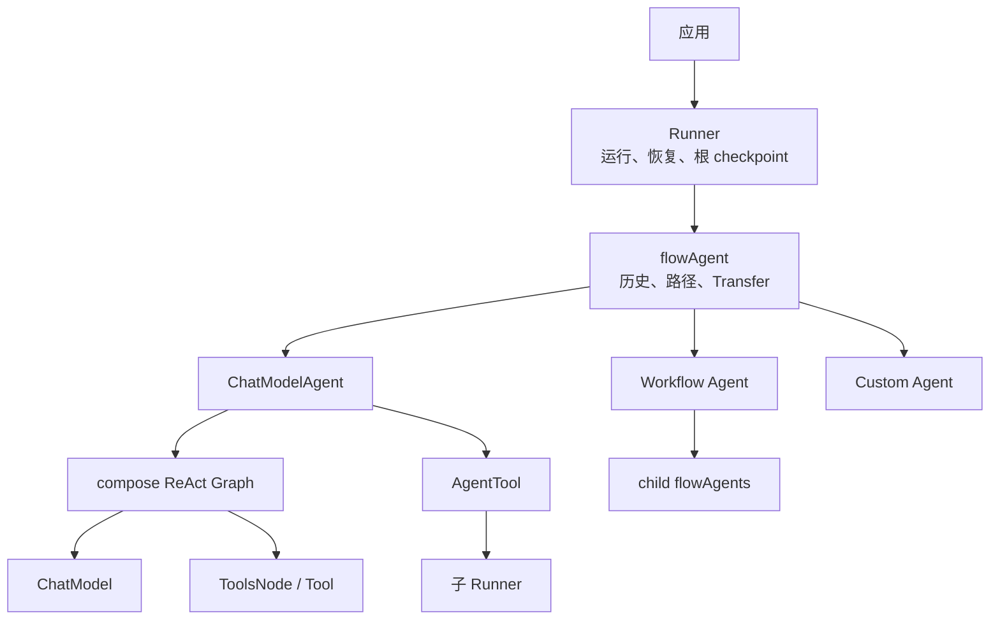

# ADK 总览

ADK（Agent Development Kit）不是一个单独的 ReAct 封装，而是 Eino 在 `compose` 之上建立的完整 Agent 运行层。它解决五类 Graph 本身不表达的问题：持续事件、Agent 层级、会话历史、控制动作，以及跨层中断恢复。

## 模块分层



如果这张总图仍显得抽象，可以先打开 [ADK 图解总览](./visual-guide.md)，它用十张主题图分别拆开对象、时间线、Context、Option、Middleware、Callback、Transfer 和 Resume。想把所有机制放进同一个业务场景，可以继续读[复杂请求的端到端源码追踪](./end-to-end-trace.md)；要专门理解 Sequential、Parallel、Loop 的嵌套运行与两次恢复，则读 [Workflow 完整案例](./workflow-case-study.md)。

```text
应用
  │ Runner.Query / Run / Resume
  ▼
Runner                      检查点持久化、恢复入口
  │
  ▼
flowAgent                   RunPath、历史重写、事件记录、Transfer
  │
  ├─ ChatModelAgent         ReAct 图 + event sender → AgentEvent
  ├─ workflowAgent          Sequential / Parallel / Loop
  ├─ AgentTool              Agent 嵌入工具调用
  └─ custom Agent           用户实现的最小 Agent 接口
        │
        ▼
compose.Graph / Chain       模型、工具、分支、流式执行
```

理解 ADK 时必须区分这些层。`Runner` 不负责 ReAct；`ChatModelAgent` 不负责顶层 checkpoint；`flowAgent` 不执行模型，而是为任意 Agent 补上多 Agent 语义。

## 公开协议

核心接口很小：

```go
type MessageType interface {
    *schema.Message | *schema.AgenticMessage
}

type TypedAgent[M MessageType] interface {
    Name(context.Context) string
    Description(context.Context) string
    Run(context.Context, *TypedAgentInput[M], ...AgentRunOption) *AsyncIterator[*TypedAgentEvent[M]]
}

type Agent = TypedAgent[*schema.Message]

type TypedResumableAgent[M MessageType] interface {
    TypedAgent[M]
    Resume(context.Context, *ResumeInfo, ...AgentRunOption) *AsyncIterator[*TypedAgentEvent[M]]
}
```

`AgentInput` 包含消息与流式开关，`AgentEvent` 同时承载输出、动作、错误和来源路径。返回异步 iterator 而不是单个 Message，是 ADK 支持工具进度、子 Agent 输出和人工中断的基础。

## 一次请求的完整路径

1. `Runner.Run` 创建 root `runContext`，写入 session values；
2. `toFlowAgent` 包装根 Agent；
3. `flowAgent.Run` 追加 Agent 地址与 RunPath，根据根输入和历史事件生成本 Agent 输入；
4. 具体 Agent 在 goroutine 中发送 `AgentEvent`；
5. `flowAgent.run` 给事件补来源，复制流后记录进 session，并处理最后一个控制动作；
6. 如果发生 Transfer，目标 Agent 在同一 session 上继续运行；
7. Runner 观察到 Interrupt 时先保存 checkpoint，再把公开中断事件交给应用。

## 两套“路径”

ADK 同时维护：

- `RunPath []RunStep`：Agent 语义路径，参与历史归属、事件记录与 checkpoint；
- `core.Address`：组件执行地址，包含 agent/tool 等 segment，用于精确定位 interrupt/resume 与 callback 深度。

二者有关但不等价。顺序 workflow 使用 `updateRunPathOnly` 累积历史，却不会错误地把同级 Agent 拼成嵌套组件地址。

## 子系统索引

| 子系统 | 关键类型 | 负责内容 |
| --- | --- | --- |
| 事件 | `AgentEvent`、`MessageVariant` | 输出、动作、路径、错误 |
| 异步通道 | `AsyncIterator`、`AsyncGenerator` | 多事件生产与消费 |
| 应用入口 | `Runner` | 新运行、checkpoint、恢复 |
| 会话 | `runContext`、`runSession` | 根输入、历史事件、共享 KV |
| Agent 包装 | `flowAgent` | 历史重写、转交、归属控制 |
| 推理 Agent | `ChatModelAgent` | 中间件、ReAct、工具事件 |
| 工作流 | `workflowAgent` | 顺序、并行、循环与组合中断 |
| 嵌套 | `agentTool` | Agent 作为 Tool 的动作隔离 |
| 中断恢复 | `InterruptSignal`、`ResumeInfo` | 状态树、checkpoint、目标恢复 |
| 并发运行 | `UnboundedChan`、`laneEvents` | 事件队列、并行历史、所有权 |
| 持续运行 | `TurnLoop`、`WithCancel` | Push、抢占、安全点取消、Stop 和恢复 |
| 扩展切面 | `ChatModelAgentMiddleware`、兼容 `AgentMiddleware`、`callbacks.Handler` | 修改行为与观察运行；旧 Middleware 已 Deprecated |

## 推荐阅读顺序

如果觉得页面较多，不需要按文件名逐个阅读，直接从[ADK 学习路线](./learning-path.md)开始；如果希望边看边运行代码，先看[Demo 阶梯](./demo-ladder.md)。两页把现有章节按“基础概念 → 一次请求 → 消息与状态 → Context 与持久化 → Middleware/Workflow → 源码细节”重新串成一条主线；每个阶段都说明应该先回答什么问题、再进入哪些源码章节。
