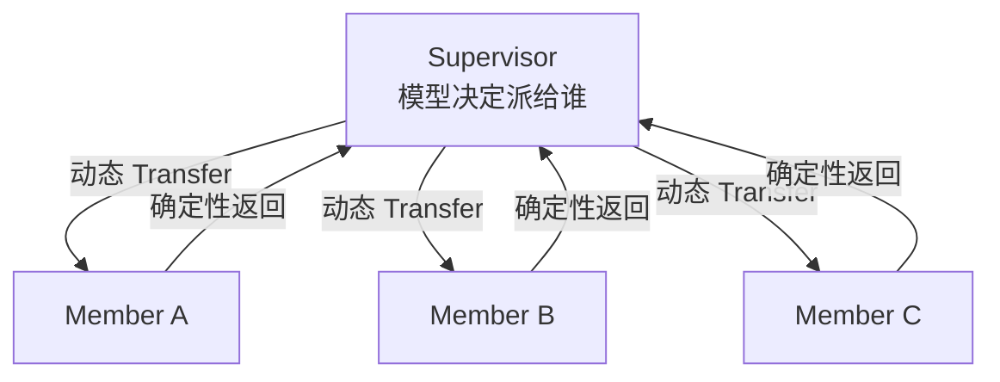
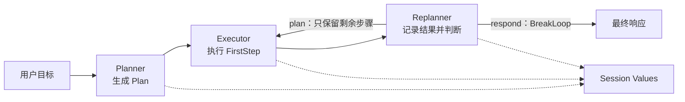
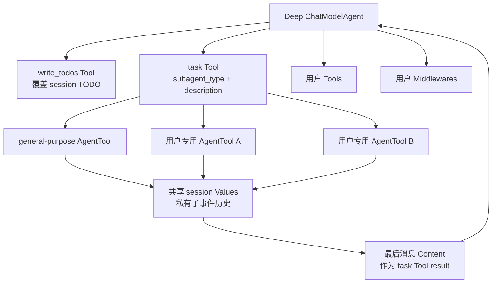

# Prebuilt 深入分析

::: info 最新源码基线
本页已经按 `main@c5c2dc3` 重新校验。Plan-Execute 的 Planner 配置仍真实使用 `ToolCallingChatModel`；Deep 的 `write_todos` 等内置能力已经使用 `TypedChatModelAgentMiddleware` / `Handlers`。两者是不同子模块的当前实现，不能把前者误判为整套 ADK 仍停留在旧 Middleware。
:::

`adk/prebuilt` 不是独立运行时，而是用 Agent、workflow、session 和 AgentTool 拼出的参考架构。目前包含 Supervisor、Plan-Execute-Replan 与 Deep Agent。

## Supervisor

结构如下：

```text
Supervisor
  ├─ member A ──确定性转交──┐
  ├─ member B ──确定性转交──┼→ Supervisor
  └─ member C ──确定性转交──┘
```



中心节点负责每次路由决策；成员之间没有直接边，完成后也不需要再问模型“回不回 supervisor”。

`supervisor.New` 把每个成员包装为 `AgentWithDeterministicTransferTo(member → supervisor)`，再调用 `SetSubAgents`。Supervisor 可以按模型决策转给成员；成员完成后只能回到 supervisor，不能横向调用另一成员。

这种结构实现极少，但依赖 flowAgent 的历史重写、Transfer tool 和确定性转交隔离 session。Supervisor 本身必须能够处理 sub-agent 设置，通常使用 ChatModelAgent。

### 构造过程逐行还原

```text
Config{Supervisor, SubAgents}
  → supervisorName := Supervisor.Name(ctx)
  → 对每个 member:
       AgentWithDeterministicTransferTo(
         Agent = member,
         ToAgentNames = [supervisorName],
       )
  → SetSubAgents(ctx, Supervisor, wrappedMembers)
  → 返回 *flowAgent（ResumableAgent）
```

“成员只能和 supervisor 通信”要准确理解：源码没有给成员配置彼此为 sub-agent；成员正常结束后会程序化追加返回 supervisor 的 Transfer。若成员自身已经是带其他子树的 flowAgent，它自己的内部关系仍存在。

Supervisor 若是 ChatModelAgent，会在 `SetSubAgents` 生命周期钩子之后、第一次 Run 构建 ReAct Graph 时得到：成员列表 instruction、`transfer_to_agent` 工具，以及该工具的 ReturnDirectly 配置。成员名称必须唯一，否则模型路由描述和 `getAgent(name)` 会产生歧义。

### 中断时为什么需要确定性包装

成员执行期间如果中断，包装器将成员 flowAgent 的隔离事件列表保存到 `deterministicTransferState`，然后向上发 CompositeInterrupt。恢复时成员从原事件列表继续；只有真正完成后才追加“返回 supervisor”。所以人工审批不会因为恢复而重复一遍成员已经完成的工具消息，也不会在尚未完成时提前回 supervisor。

### 配置边界

当前构造器假定 `Config`、`Supervisor` 和成员均有效，不做 nil/重名预检。它也不自动设置 `WithDisallowTransferToParent`；拓扑限制主要来自“只把包装成员注册到 supervisor”与确定性返回。生产封装层宜先校验：

- supervisor/member 名称非空且全局唯一；
- 不把 supervisor 自己放进 SubAgents；
- 所需恢复路径上的 Agent 都实现 `ResumableAgent`；
- 第一次 Run 前已完成完整构造。

## Plan-Execute-Replan

最终组合只有两层：

```text
Sequential: plan_execute_replan
  1. Planner
  2. Loop: execute_replan (默认最多 10 轮)
       2.1 Executor
       2.2 Replanner ── BreakLoop → 完成
```



三个 Agent 不是把结构体直接互相作为返回值传递，而是通过固定 session keys 交换 UserInput、Plan、ExecutedStep 和 ExecutedSteps。

### Planner

Planner 可以使用结构化输出模型，或给 ToolCallingChatModel 强制绑定 `plan` tool。内部临时构造 Chain：

```text
AgentInput → 格式化 prompt → ChatModel → 捕获流事件 → JSON → Plan
```

生成的 Root input 和 Plan 分别写入 `UserInputSessionKey`、`PlanSessionKey`。

Planner 配置存在两条互斥的实现路径，优先级是：

```text
ChatModelWithFormattedOutput != nil
  → 直接作为 BaseChatModel
  → 从 message.Content 读取 Plan JSON

否则
  → ToolCallingChatModel.WithTools([PlanToolInfo 或自定义 ToolInfo])
  → 每次调用强制 ToolChoiceForced
  → 从第一条 ToolCall.Function.Arguments 读取 Plan JSON
```

若两个 model 都填写，结构化输出 model 优先；若两个都未填写，当前源码不会返回友好的必填项错误，通常会在 nil model 使用处失败。`NewPlan(ctx)` 每次解析前创建具体 Plan；自定义实现必须返回非 nil、实现 JSON marshal/unmarshal，并能从 `FirstStep` 给出下一步。

Planner 内部每次 Run 都临时构建并 Compile 一条 Chain。无论 Runner 是否 streaming，它都调用 `r.Stream`；区别在于 collect lambda 如何把 model stream 分成“给用户的事件”和“给 parser 的完整消息”：

- streaming：`Copy(2)`，一份转为 Assistant stream 事件，一份 concat 后解析；
- non-streaming：直接 concat，再发一个完整 Assistant 事件；
- tool-call 模式展示的是 arguments JSON content，而不是原始 ToolCall 消息。

写 session 的顺序是先保存原始 `input.Messages`，模型返回并成功反序列化后再保存 Plan。JSON 不合法时会发 Err，Plan key 不会更新。

### Executor

Executor 是 ChatModelAgent。自定义 `GenModelInput` 从 session 读取 UserInput、Plan、ExecutedSteps，只执行 `Plan.FirstStep()`。最终文本通过 `OutputKey` 写入 `ExecutedStepSessionKey`。

这里有两次类型转换：session 的 `any` 先断言为 `Plan`、`[]Message`、`[]ExecutedStep`，再组装成 `ExecutionContext` 交给 `GenInputFn`。缺少前置 key 被视为“不可能状态”并 panic，类型不匹配也会 panic；这套 prebuilt 依赖 Planner → Executor → Replanner 的固定顺序，不应单独拿默认 Executor 在空 session 中直接跑。

默认 input generator 将 Plan marshal 为 JSON，把原始输入、全部已完成步骤和 `FirstStep()` 格式化进 ExecutorPrompt。Executor 自身是一套完整 ReAct ChatModelAgent，因此支持 ToolsConfig、工具/模型 options、中间件行为、retry 和内部中断桥接。`MaxIterations` 原样传给 ChatModelAgent；非正数最终使用 ChatModelAgent 的默认值，而不是外层 Loop 的 10。

`OutputKey` 写入的是 Executor 最终 Assistant Message 的 `Content`。如果最后只有 Action、没有正常模型文本，Replanner 可能读不到期望结果。

### Replanner

Replanner 先把本轮 step/result 追加到 ExecutedSteps，再让模型在两个强制工具中二选一：

- `plan`：产生只包含剩余步骤的新 Plan，覆盖 session；
- `respond`：表示目标完成，并发送 `NewBreakLoopAction`。

BreakLoop 是程序化 Action，不交给 LLM 直接构造。Loop 捕获后设置 Done 和 CurrentIterations，防止嵌套 loop 重复处理。

Replanner 在调用模型**之前**先更新 session：

1. 读取 `ExecutedStepSessionKey`；
2. 取当前 Plan 的 `FirstStep()`；
3. 将 `{Step, Result}` append 到 `ExecutedStepsSessionKey`；
4. 连同根输入与原 Plan 生成新 prompt；
5. 强制模型从 plan/respond 两个 Tool 中选择。

之后只检查第一条 ToolCall：

- 名称等于 respond tool：发送 `BreakLoopAction("replanner")`，不解析 `Response` 结构；
- 名称等于 plan tool：用 `NewPlan` 解析 arguments，并覆盖 `PlanSessionKey`；
- 没有 ToolCall 或调用了其他工具：返回错误。

streaming 时向用户展示第一条 tool call 的 arguments 内容流；non-streaming 时只在确实有 ToolCall 时发送 arguments 作为 AssistantMessage。也就是说默认最终可见内容可能是 `{"response":"..."}` JSON，而不是只取 `response` 字段。若产品 UI 需要纯文本，应在事件消费层解析，或替换 Replanner 实现。

Replanner 不是 ChatModelAgent：它忽略传入的 `AgentInput` 消息和 `AgentRunOption`，所需上下文全从 session 取；底层是一条临时 compose Chain。模型调用仍能触发全局 callbacks，但不会自动继承 Executor 的 ToolsConfig/middleware/retry 设置。

### 扩展点

`Plan` 是接口，要求 FirstStep 和 JSON marshal/unmarshal；Planner/Executor/Replanner 都允许替换 prompt/input generator 和 ToolInfo，因此可以保持 workflow 不变，只换计划结构。

这些扩展点必须成组保持协议一致：

- Planner 的 ToolInfo JSON 与 `NewPlan.UnmarshalJSON` 一致；
- Replanner 的 PlanTool JSON 也与同一个 `NewPlan` 一致；
- RespondTool 的名称必须和自定义 Replanner prompt 中要求的名称一致；
- Executor/Replanner 共用四个固定 session key，业务不要用同名 key 写其他类型；
- 自定义 Plan concrete type若进入 checkpoint，必须注册稳定 gob 名称。

### 外层 workflow 和恢复边界

`planexecute.New` 会把 `MaxIterations <= 0` 归一化成 10，然后构造：

```text
Sequential(name=plan_execute_replan)
  ├─ Planner
  └─ Loop(name=execute_replan, max=N)
       ├─ Executor
       └─ Replanner
```

外层 Sequential/Loop 都是 ResumableAgent。真正可能从内层工具中断并恢复的默认组件主要是 Executor，因为它是 ChatModelAgent；Planner/Replanner 自己没有 Resume 方法。恢复时 workflow state 负责回到对应 iteration/sub-agent，session checkpoint 负责保留 Plan 与 ExecutedSteps，Executor 的 compose bytes 负责回到具体 tool/node。

Loop 的最大轮数是“执行 Executor + Replanner”这一整组的次数。Replanner 发 BreakLoop 后，Loop 吞掉针对自己的 break 控制并结束；若始终不 respond，跑满上限后结束，框架不会自动替你判断 Plan 是否已空。

测试文件 `prebuilt/planexecute/utils_test.go` 里还有一个未导出的 `outputSessionKVsAgent`：它先原样转发底层 Agent 全部事件，结束后再发一条 `CustomizedOutput=GetSessionValues(ctx)` 的事件。它只是测试辅助类型，不在生产构造器 `planexecute.New` 中；不要误以为默认 Plan-Execute 会额外返回整张 KV map。

## Deep Agent

Deep Agent 仍是 ChatModelAgent，但通过 middleware 增加长任务能力：

```text
Deep ChatModelAgent
  ├─ write_todos tool
  ├─ task tool
  │    ├─ general-purpose AgentTool
  │    └─ 用户 SubAgent AgentTool...
  ├─ 用户 tools
  └─ 用户 middlewares
```



task Tool 只是 AgentTool 路由器。它不会把子 Agent 的每一步正式塞回主历史；主模型默认只得到最终 task result。

### write_todos

内置工具用 schema inference 生成，参数是 `{"todos":[{"content":"...","status":"pending|in_progress|completed"}]}`，并配套提示模型持续维护计划。`WithoutWriteTodos` 可关闭。

每次调用用整份 slice 覆盖 `SessionKeyTodos`，不是对旧列表做增量 patch；返回值是序列化后的最新 TODO 列表。TODO 和 `[]TODO` 都注册了 gob 名称，因此能随 session checkpoint 恢复。

`write_todos` 当前实现为 `TypedChatModelAgentMiddleware[M]`：通过 `BeforeAgent` 一起装配工具和配套 prompt。关闭它会同时移除两者，不会留下“提示模型调用一个不存在工具”的半配置。旧版 `Middlewares []AgentMiddleware` 仍可由用户传入，但内置能力已经走 `Handlers` 主链。

### task tool

task tool 接收 `subagent_type` 与 `description`，按名称找到 AgentTool，转换成 `{"request": description}` 后调用。它的 description 动态列出所有 sub-agent 的名称和能力，模型据此选择专家。

默认会创建 `general-purpose` 子 Agent，并复用主模型、instruction、tools 和 middleware；`WithoutGeneralSubAgent` 可关闭。用户 SubAgents 也全部转成 AgentTool，因此遵循工具边界的 action 隔离与中断桥接。

task 并不是另一个 Agent 调度运行时，它只是两层工具适配：

```text
task({subagent_type, description})
  → JSON unmarshal
  → map[subagent_type] 找 Invokable AgentTool
  → description 转成 {"request": description}
  → innerAgentTool.InvokableRun(ctx, params, 同一批 tool.Option...)
  → 返回 inner Agent 最后消息的 Content
```

因为 tool.Option 原样继续传递，AgentTool 的 streaming、内部事件 generator、中断 state 和按 Agent 名定向的 options 仍然生效。task 自己没有额外 checkpoint 格式。

默认 description generator 遍历 `subAgentSlice`，拼出每个 `Name: Description`，再填进 task prompt。自定义 generator 在 `Info(ctx)` 阶段运行；若它失败，ChatModelAgent 构建工具信息也会失败。

当前 task 参数 schema 没把两个字段显式标为 Required，运行实现却要求 `subagent_type` 能在 map 找到；模型漏传时会得到 `subagent type  not found`。自定义模型适配或 ToolInfo 校验层应注意这个差异。

若用户 SubAgent 也叫 `general-purpose`，它会在 map 中覆盖内置 general Agent，但 description slice 仍可能同时列出两个同名项。生产配置应禁止名称冲突。其他重复 SubAgent 名称同理是“后者覆盖调用映射、列表仍重复”。

### Middleware 叠加

内置 middleware 先构造，然后和用户 middleware 一起传给 general sub-agent；主 Deep Agent 最终也获得内置 + task + 用户 middleware。写自定义 middleware 时要意识到它可能同时作用于主 Agent 与 general-purpose Agent。

Middleware 的字段合并、Tool wrapper 顺序见 [Middleware 的完整执行机制](./middleware.md)；Filesystem、Skill、Reduction 和 Deep Agent 自身的 write_todos/task middleware 见[内置 Middleware 源码解析](./builtin-middlewares.md)。

精确顺序是：

```text
builtin = [writeTodos?]

创建 general-purpose Agent:
  Middlewares = builtin + userMiddlewares

创建主 Deep Agent 前:
  builtin += taskMiddleware? 

创建主 Deep Agent:
  Middlewares = builtin + userMiddlewares
```

所以 general-purpose 会拿到 write_todos（若启用）和用户 middleware，但不会拿到 task middleware，避免 general Agent 再无限派生 task；主 Agent 同时拿到 write_todos、task 和用户 middleware。用户提供的专用 SubAgents 不会被 Deep 构造器重建，因此也不会自动继承主 Agent middleware。

用户 `ToolsConfig` 在主 Agent 与 general-purpose 之间是结构体值复制，但其中的 tool/interface、map/slice 底层对象可能仍共享。middleware 后续再追加 AdditionalTools 时会生成各自构建结果；工具本身是否并发安全，仍由工具实现保证。

### Deep Config 的默认化与冻结

| 字段 | 未设置时 |
| --- | --- |
| Instruction | 使用体量较大的内置 `baseAgentInstruction` |
| WithoutWriteTodos | false，即启用 write_todos |
| WithoutGeneralSubAgent | false，即创建 general-purpose |
| TaskToolDescriptionGenerator | 使用默认 agent 列表模板 |
| MaxIteration | 透传给 ChatModelAgent，由后者应用默认值 |
| ModelRetryConfig | nil，不包 retry model |

Deep `New` 会立即构造工具/middleware，但主 ChatModelAgent 的 ReAct runnable 仍在第一次 Run 时通过 `sync.Once` 构建。因此配置对象应在 New 前准备完整，New 后不要修改被共享的 slice/map 并期待可预测热更新。

### Deep 的运行数据到底在哪里

- TODO：父 Runner 的 session Values；
- 专用/general 子任务过程：AgentTool 子 Runner 的私有 Events；
- 子任务最终结果：主 Agent 的 ToolMessage，进入主 session Events；
- `EmitInternalEvents` 开启后的子事件：仅实时发给用户，不进入主 session；
- 文件系统大结果：可能被 Filesystem middleware 改成文件引用，具体见内置 middleware 章节；
- 中断：AgentTool bytes → ChatModelAgent compose bytes → 外层 Runner checkpoint 的嵌套桥接。

这解释了为什么“UI 看到了子 Agent 输出”不等于“主模型历史里有这些输出”：正式上下文只有 task 工具最终返回的字符串。

### Prebuilt 并不替你做的事

- 不校验所有 Agent/tool 名称唯一；
- 不提供持久化 CheckPointStore；
- 不替外部副作用做幂等；
- 不自动压缩长 session 历史，需配置 Reduction 等 middleware；
- Callback 不负责默认的 Model/Tool → AgentEvent 转换；ChatModelAgent 由 event sender wrappers 生成事件；
- 不保证模型一定遵守 TODO、plan/respond 或 task 路由提示，仍需处理错误事件和迭代上限。

## 如何选择

| 模式 | 适合 | 主要代价 |
| --- | --- | --- |
| Supervisor | 动态专家路由、中心统一决策 | 多次回到 supervisor 的模型调用 |
| Plan-Execute | 明确分解、逐步复盘 | session schema 与结构化输出要求 |
| Deep | 开放式长任务、按需委派 | prompt/tool 复杂度和上下文成本 |

<div class="source-path">adk/prebuilt/supervisor<br>adk/prebuilt/planexecute<br>adk/prebuilt/deep</div>
