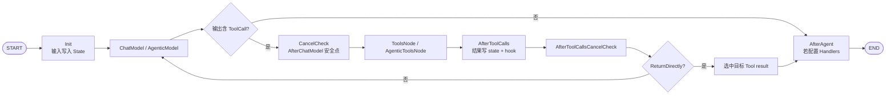

# ReAct 图：两种消息协议的模型—工具循环

当前 ChatModelAgent 对两种消息类型都能构建 ReAct：

- `schema.Message`：`BaseChatModel ↔ compose.ToolsNode`；
- `schema.AgenticMessage`：`AgenticModel ↔ compose.AgenticToolsNode`。

区别主要在消息和 Tool block 的表示，不在“一个有循环、另一个完全没有循环”。

## 1. 当前拓扑



`AfterAgent` 节点只在至少存在一个 Handler 时创建，且只位于正常终态路径；错误、取消、中断不会把它当 finally 执行。

## 2. 外层 Chain 与内层 Graph

有工具时，ChatModelAgent 仍用外层 Chain 做输入适配和整体 checkpoint：

```text
Outer Chain
  1. GenModelInput: Instruction + TypedAgentInput[M] → []M
  2. ReAct Graph: *typedReactInput[M] → M
```

内层 Graph 管模型—工具循环；外层 Chain 管 AgentInput 转换、Graph 名称、serializer、bridge store 与运行 options。

无工具时不创建 ReAct/ToolsNode，只是 GenModelInput → wrapped Model；Middleware model hooks、retry/failover、event sender 和 Callback injection 仍然存在。

## 3. State 有哪些数据

两条路径各有内部 State 类型，概念上都包含：

- `Messages`：本次 ReAct 已确认历史；
- 剩余模型迭代次数；
- ReturnDirectly 目标 call ID；
- Tool event 与 state message 对齐所需的 message ID；
- run-local values；
- 中断/恢复所需状态。

公开给 Middleware 的视图是：

```go
type TypedChatModelAgentState[M MessageType] struct {
    Messages          []M
    ToolInfos         []*schema.ToolInfo
    DeferredToolInfos []*schema.ToolInfo
}
```

Middleware 返回的新 state 会写回内部 State。ToolInfos 是模型可见 schema；真实 Tool endpoint 已在本次 exec context/ToolsNode 中准备，不能只改 ToolInfos 就凭空注册实现。

## 4. Model wrapper 怎样读写 State

Model 节点使用包装后的 Model。对一次调用，从外到内大致为：

```text
旧 BeforeChatModel（兼容）
  → Handlers.BeforeModelRewriteState
    → failover
      → retry
        → default model event sender
          → Handlers.WrapModel
            → callback injection（组件未自行处理时）
              → provider Model
  → Handlers.AfterModelRewriteState
→ 旧 AfterChatModel（兼容）
```

`BeforeModelRewriteState` 在每个 ReAct model round 执行一次，而不是每个 provider retry attempt 执行一次。retry 内部可以多次调用 provider；它看到同一轮 state 经 retry decision 修改后的输入。

## 5. 迭代限制

State 初始剩余次数为 `MaxIterations`，配置小于等于 0 时默认 20。每次进入 Model 节点前：

```text
remaining <= 0 → ErrExceedMaxIterations
otherwise      → remaining-- → 调模型
```

限制的是模型生成次数，不是 Graph step 数。一次模型轮次还可能包括 Branch、CancelCheck、ToolsNode、AfterToolCalls 等多个 step，因此外层 Compose max steps 不能直接替代它。

## 6. Branch 为什么读取流

非流式输出可直接看 ToolCalls；流式输出的 ToolCall 可能在后续 chunk 才出现。ReAct 使用 stream branch 消费自己的 reader 副本：

- 任一 chunk 出现 ToolCall → 走安全点与 ToolsNode；
- 一直 EOF 都没有 ToolCall → 走正常终态；
- stream 中途 error → 错误上抛。

经典路径检查 `chunk.ToolCalls`；Agentic 路径扫描 ContentBlocks 中的 `FunctionToolCall`。

## 7. Tool 前处理

进入 ToolsNode 前，state pre-handler 不信任 branch 传入的临时 chunk，而是读取 `st.Messages` 的最新 assistant message。这保证它拿到经过 Model wrappers、AfterModelRewriteState 并写回 state 的最终版本。

随后扫描 ToolCalls：若某个 Tool 在本次运行的 ReturnDirectly map 中，记录对应 call ID。多个 tool call 同轮出现时，Direct 分支最后只选择被记录的目标结果。

## 8. Tool wrapper 的真实顺序

对流式 Tool，从外到内是：

```text
默认 tool event sender
  → ToolsConfig.ToolCallMiddlewares
    → 旧 AgentMiddleware.WrapToolCall
      → cancel stream monitor
        → Handlers 的 Tool wrappers
          → callback injection
            → Tool implementation
```

普通同步 Tool 没有 stream cancel monitor；其他顺序相同。Handlers 的第一个注册者是最外层，返回阶段按相反顺序展开。

`ToolArgumentsHandler` 发生在这些 wrappers 前，用来改 JSON 参数；它的修改不会回写 assistant message 中原始 ToolCall arguments。

## 9. 工具结果为什么还要 AfterToolCalls 节点

ToolsNode 负责执行和生成结果，`AfterToolCalls` 再完成三件 ReAct 状态工作：

1. 把 event sender 预生成的 message ID 对齐到 state 中的 Tool result；
2. 将所有结果追加到 `State.Messages`；
3. 执行本次运行通过 `WithAfterToolCallsHook` 传入的 hook。

之后才检查 `CancelAfterToolCalls`。所以“工具轮已完成”的安全点意味着结果已经写入 state，可形成一致 checkpoint。

## 10. 两个取消安全点

### 模型后

只有模型确实产生 ToolCall、准备进入 Tool 时才经过 `CancelCheck`。若模型已经给出最终回答，直接正常结束，不把已经完成的答案改成 CancelError。

命中 `CancelAfterChatModel` 时使用 StatefulInterrupt 保存 assistant ToolCall message；恢复后仍知道本来要执行哪些 Tool。

### 工具后

工具结果全部写入 State 后检查 `CancelAfterToolCalls`，命中时产生 Compose Interrupt。恢复后可从下一步继续，而不是猜测哪些工具已经成功。

Immediate cancel 则通过 graph interrupt、model/tool stream monitor 和 Context 协作式终止，完整转换由 `adk/cancel.go` 与 ChatModelAgent 错误边界完成。

## 11. ReturnDirectly

普通 Tool 结果会回到 Model，让模型阅读结果后继续推理。ReturnDirectly Tool 跳过下一轮模型：

```text
ToolsNode results
  → AfterToolCalls
  → safe-point cancel check
  → 找出 call ID 匹配的 result
  → AfterAgent / END
```

事件 sender 仍会发送 Tool event。State 还暂存 ReturnDirectly event，确保输出与 Action 配对且不重复。

## 12. Event 与 State message 的 ID 对齐

默认 Tool event sender 在结果返回时先生成 message ID，并以 `toolName + callID` 记录到 State。AfterToolCalls 追加 Compose 生成的 Tool result message 时弹出同一个 ID。

这样 UI 看到的 AgentEvent 和后续模型 history 指向同一逻辑消息。若使用自定义 event sender 或恢复旧 checkpoint 找不到 ID，框架会生成新 ID。

## 13. 经典 Message 与 AgenticMessage 对照

| 环节 | 经典路径 | Agentic 路径 |
| --- | --- | --- |
| Model node | `AddChatModelNode` | `AddAgenticModelNode` |
| Tools node | `NewToolNode` | `NewAgenticToolsNode` |
| ToolCall | `Message.ToolCalls` | `ContentBlock.FunctionToolCall` |
| Tool result | role=Tool Message | FunctionToolResult ContentBlocks |
| event role | `Role` + `ToolName` | `AgenticRole` + blocks |
| safe points | 模型后、工具后 | 模型后、工具后 |
| interrupt/resume | 支持 | 支持，并有独立测试覆盖 |

当前 `adk/chatmodel.go` 中仍有“agentic single-shot”的过时注释，但实际调用、`newAgenticReact` 和 `agentic_react_test.go` 明确实现多轮 Agentic ReAct。

## 14. Error、Interrupt 与 Cancel 的出口

| 来源 | 结果 |
| --- | --- |
| MaxIterations、Handler、Model、Tool 普通 error | AgentEvent.Err |
| Tool 业务 interrupt | Interrupted Action + checkpoint |
| safe-point/immediate cancel | `CancelError` + interrupt contexts + checkpoint |
| callback observer 自己的问题 | 取决于 handler 实现；Callback 不应改业务结果 |
| AfterAgent error | 整次 Agent 失败，不能当作 finally 日志 |

错误处理会从 bridge store 提取 Compose checkpoint bytes，放入 ADK interrupt 层；Runner 再持久化根 runContext。两层 checkpoint 不可混用。

## 15. 一轮完整例子

```text
1. GenModelInput 构造初始 history
2. Init 写入 State.Messages
3. Model wrapper: state-before → retry/failover → provider → state-after
4. model event sender 发 assistant ToolCall event
5. Branch 识别 ToolCall
6. CancelAfterChatModel 安全点
7. ToolArgumentsHandler → wrappers → Tool
8. tool event sender 发 Tool result event
9. AfterToolCalls 对齐 ID、写 history、执行 hook
10. CancelAfterToolCalls 安全点
11. 非 ReturnDirectly → 回 Model
12. Model 返回最终 answer
13. Branch 走 AfterAgent/END
14. 外层 runnable 完成，Agent event iterator 最终关闭
```

## 16. 源码阅读路线

1. `adk/react.go`：经典 `newReact` 与 `newAgenticReact`；
2. `adk/wrappers.go`：State/Model/Tool/event sender wrappers；
3. `adk/chatmodel.go`：运行期 exec context 与两条 build 分支；
4. `compose/tool_node.go`：经典 Tool endpoint；
5. `compose/agentic_tools_node.go`：Agentic Tool endpoint；
6. `adk/cancel.go`：取消状态机；
7. `adk/agentic_react_test.go`：Agentic 多轮、取消和恢复的可执行证据。
