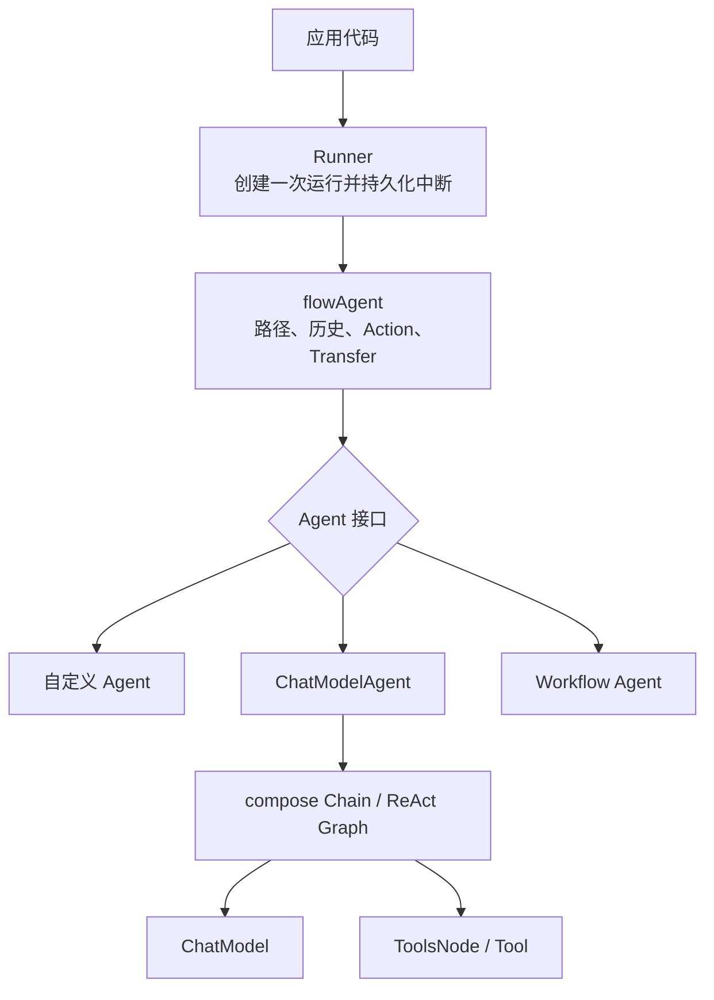

# Agent、Runner、ChatModelAgent 到底有什么区别

这一页直接回答最常见的问题：三者谁创建谁、谁调用谁、各自保存什么状态，以及什么时候应该扩展哪一层。

## 先看结论

> **Agent 是协议，ChatModelAgent 是一种实现，Runner 是执行 Agent 的应用入口。**

当前三者都有 Typed 主定义：`Agent`、`Runner`、`ChatModelAgent` 是 `*schema.Message` 路径的别名；需要 `*schema.AgenticMessage` 时使用对应 `Typed*` 类型。这不是“新旧 API”关系，而是同一协议的两种消息实例化。



图的纵向关系是“谁调用谁”，横向三个 Agent 是“同一个接口的不同实现”。如果只记一张图，就先记这一张。

用 Go 类型关系表达：

```go
var a adk.Agent

a = myCustomAgent       // 可以
a = chatModelAgent      // 可以，ChatModelAgent 实现 Agent
a = sequentialAgent     // 可以，workflow 最终也实现 Agent

a = runner              // 不可以，Runner 不是 Agent
```

## 横向对比

| 维度 | Agent | ChatModelAgent | Runner |
| --- | --- | --- | --- |
| 类型性质 | 泛型 interface；`Agent` 是别名 | 泛型 struct；`ChatModelAgent` 是别名 | 泛型 struct；`Runner` 是别名 |
| 是否必须用 LLM | 否 | 是 | 不关心 |
| 是否知道 Tool | 不要求 | 知道并构建 ToolsNode | 不知道 |
| 是否产生 AgentEvent | 定义这一要求 | 通过 model/tool event sender 与运行边界产生 | 转发、记录并观察事件 |
| 是否管理 RunPath | 自己无需处理 | 自己无需处理 | 间接通过 flowAgent |
| 是否保存 checkpoint | 仅可发中断 | 内部 Graph 存到 bridgeStore | 根 checkpoint 持久化 |
| 是否能 Resume | 只有 ResumableAgent | 能 | 提供应用入口 |
| 是否能作为子 Agent | 可以 | 可以 | 不可以 |
| 是否能包装为 Tool | 可以 | 可以 | 不可以 |
| 典型创建次数 | 按能力对象创建 | 通常长期复用 | 按配置长期复用 |
| 每次请求状态 | 不应放共享字段 | ReAct state 每次运行创建 | runSession 每次 Run 创建 |

## Agent：最小可执行契约

Agent 接口只描述外观：身份 + 执行。框架通过它实现多态，不需要知道内部是规则、LLM、HTTP 还是 workflow。

### Name

Name 不只是展示字段。它参与：

- RunPath；
- AgentRunOption.DesignateAgent；
- 子 Agent 查找与 Transfer；
- AgentTool 的 tool name；
- 调试和事件来源。

同一可达 Agent 树中的 Name 最好唯一，否则 Transfer 和 Option 定位可能出现歧义。

### Description

Description 会告诉父 ChatModelAgent“这个子 Agent 能做什么”，也会成为 AgentTool 的 ToolInfo.Desc。描述过于空泛会直接降低模型路由质量。

### Run

Run 应立即返回 iterator，把耗时工作放在 goroutine。实现必须保证：

- 最终关闭 generator；
- panic 被转换成 error event，或者确保不会逃逸；
- 事件可安全交给调用方修改；
- streaming event 的 reader 独占；
- 收到 context cancel 后停止外部工作。

## ChatModelAgent：Eino 提供的大模型 Agent

ChatModelAgent 在 Agent 接口之上加入了大量约定。

### 它创建了什么

经典 Message 路径在运行时根据有没有 Tool 选择两条路径：

```text
没有任何 Tool：AgentInput → Lambda → ChatModel

存在 Tool：AgentInput → Lambda → ReAct Graph
                               ├─ ChatModel
                               └─ ToolsNode
```

只有真正存在普通工具、Transfer 工具或 Exit 工具时才构建 ReAct。没有工具时使用简单 Chain，避免不必要的循环与分支。

AgenticMessage 路径则是单次 agentic model chain；模型自己处理其 agentic tool 协议，不进入同等的 ADK ReAct Tool loop。

### 它保存什么

ChatModelAgent struct 保存的是可复用配置：模型、instruction、tools、middlewares、子 Agent 关系。每次请求变化的消息历史放在 compose local state，不应写进 struct 字段。

这使一个构建完成的 ChatModelAgent 可以被多个请求复用。前提是传入的模型和工具实现本身并发安全。

### 它不负责什么

- 不创建根 runSession；
- 不把 checkpoint 写入用户的持久化 store；
- 不决定多 Agent workflow 的先后顺序；
- 不替应用消费事件；
- 不保存跨请求对话。

## Runner：应用和 Agent 系统的边界

Runner 由 `RunnerConfig` 创建，持有根 Agent、streaming 开关和可选 CheckPointStore。

### 它创建什么

每次 `Run` 创建：

- AgentInput；
- 新的 root runContext；
- 新的 runSession；
- 根 flowAgent wrapper；
- 必要时用于观察中断的新 iterator/generator。

### 它保存什么

Runner struct 本身不保存某次会话的消息。只有发生中断且提供 checkpoint ID 时，它才把当前 runContext 和 interrupt tree 编码后写入 CheckPointStore。

所以 `runner.Query("第二个问题")` 默认是全新会话，不会接着第一个问题。

### 为什么不直接调用 agent.Run

技术上可以直接调用 Agent.Run，但会绕过 Runner 提供的根上下文和持久化协调。简单自测可以这样做；真实应用更适合从 Runner 进入，尤其是使用 session values、子 Agent、中断恢复时。

## flowAgent：经常被忽略的第四个角色

调用关系不是简单的 `Runner → ChatModelAgent`，而是：

```text
Runner → flowAgent(root wrapper) → ChatModelAgent
```

flowAgent 承担：

- 给 context 添加 `agent:<name>` address；
- 给事件补 AgentName / RunPath；
- 将事件复制进 runSession；
- 把其他 Agent 的历史改写为当前 Agent 可读消息；
- 响应 TransferToAgent；
- Resume 时沿中断地址找到下一层 Agent。

它包装所有 Agent，不限于 ChatModelAgent。自定义 Agent 因而无需重复实现这些多 Agent 基础设施。

## 谁调用谁

### 单 Agent、无工具

```text
Application
  → Runner.Run
  → flowAgent.Run
  → ChatModelAgent.Run
  → compose Chain
  → ChatModel.Generate / Stream
```

### 单 Agent、有工具

```text
Application
  → Runner
  → flowAgent
  → ChatModelAgent
  → outer Chain
  → ReAct Graph
      → ChatModel
      → ToolsNode
          → Tool
      → ChatModel ...
```

### 父 Agent 调用 AgentTool

```text
Parent ChatModelAgent
  → parent ReAct ToolsNode
  → agentTool.InvokableRun
  → child Runner（bridgeStore）
  → child flowAgent
  → child Agent
```

### Workflow

```text
Runner
  → root flowAgent
  → workflowAgent
  → child flowAgent A
  → child flowAgent B
```

## 生命周期对比

| 时刻 | Agent 接口 | ChatModelAgent | Runner |
| --- | --- | --- | --- |
| 应用启动 | 定义能力对象 | 校验配置，但尚未编图 | 保存根 Agent 配置 |
| 第一次 Run | 被 flowAgent 调用 | buildRunFunc、冻结关系 | 建 root session |
| 执行中 | 产生事件 | Graph/Model/Tool 循环 | 转发或观察中断 |
| 正常结束 | iterator 关闭 | generator 关闭 | iterator 到 EOF |
| 中断 | 发 Interrupt Action | 桥接 compose checkpoint | 持久化根 checkpoint |
| Resume | ResumableAgent 恢复 | 还原内部 Graph state | 加载根 runContext 并路由 |
| 下一次新 Run | 新输入 | 复用已编译配置/重建单次 runnable | 创建全新 session |

## 应该扩展哪一层

### 实现 Agent

当流程主要由确定性业务逻辑驱动、需要产生自定义事件，或想包装一个现有服务时，实现 Agent。

### 配置 ChatModelAgent

当核心决策应由 LLM 完成，并需要工具、上下文中间件、Exit 或 Transfer 时，配置 ChatModelAgent。

### 包装/配置 Runner

当需求是 Web API、CLI、事件推送、checkpoint store、多租户 session value 时，在应用层包装 Runner。不要为业务工具修改 Runner。

### 使用 compose

当需求是节点级数据流、类型化输入输出、组件并行或精确分支时，在 Agent 内部使用 compose，而不是把所有逻辑塞进 Runner。

## 常见错误理解

### “Runner 是 Agent 的父类”

错误。Go 中没有这里的继承关系；Runner 只是持有 Agent 接口并执行它。

### “ChatModelAgent 就是 ChatModel”

错误。ChatModel 只推理一次；ChatModelAgent 负责输入生成、工具循环、事件、Action 和恢复桥接。

### “创建了 Agent 就自动有跨轮记忆”

错误。一次 Runner.Run 内有 session 和 ReAct state；新的 Run 默认是新会话。跨请求记忆由应用传入历史或外部存储完成。

### “EnableStreaming=false 就只有一个返回值”

错误。仍然返回 AgentEvent iterator，并可能包含多轮模型和工具事件；区别是消息内容不是 chunk stream。

### “AgentEvent 都会写进历史”

错误。只有 RunPath 精确匹配的非中断事件会被 flowAgent 记录。AgentTool 内部透传事件不会重复进入父历史。
