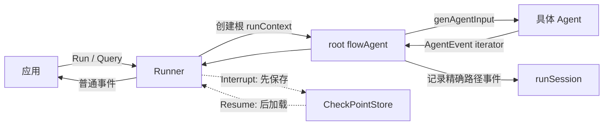

# Runner 与运行上下文

Runner 是应用层入口，但真正的多 Agent 历史组织位于 `flowAgent` 与 `runContext`。当前基础实现是泛型 `TypedRunner[M]`，经典 `Runner` 只是 `TypedRunner[*schema.Message]` 的别名。这一页沿一次请求解释它们如何协作。



Runner 管“一次运行的入口和出口”，flowAgent 管“Agent 之间怎样接力”，runSession 管“这次接力已经发生了什么”。

## Runner 的职责边界

```go
type TypedRunner[M MessageType] struct {
    a               TypedAgent[M]
    enableStreaming bool
    store           CheckPointStore
}

type Runner = TypedRunner[*schema.Message]
```

Runner 只负责：创建根执行上下文、注入 session values、启动 typed/经典 flowAgent，以及在发生 interrupt 或可恢复 cancel 时持久化现场。它不理解具体模型、工具或 workflow 拓扑。

## Run / Query

`Query` 只是把 string 包成 `schema.UserMessage` 后调用 `Run`。`Run` 的关键步骤：

1. 解析通用 `AgentRunOption`；
2. 通过 `toFlowAgent` 包装根 Agent；
3. 建立含 RootInput 和 session 的新 `runContext`；
4. 写入 `WithSessionValues`；
5. 调用 flowAgent.Run；
6. 若既没有 store 也没有 `WithCancel`，可直接返回 iterator；否则用新 iterator 包装，并在 `typedRunnerHandleIterImpl` 中处理中断、取消和 checkpoint。

## runContext 与 runSession

```go
type runContext struct {
    RootInput *AgentInput
    RunPath   []RunStep
    Session   *runSession
}

type runSession struct {
    Events []agentEventWrapper
    Values map[string]any
    LaneEvents *laneEvents
}
```

- RootInput 始终保留用户最初输入；
- RunPath 描述当前 Agent 调用位置；
- Events 是可重建后续 Agent 上下文的事实日志；
- Values 是 workflow / middleware 共享 KV；
- LaneEvents 隔离并行分支尚未提交的事件。

Values 的读写用共享 mutex 保护，`GetSessionValues` 返回 map 副本，避免调用方直接改内部 map。

## flowAgent 为什么存在

任意用户 Agent 都只需实现最小接口。`toFlowAgent` 通过 wrapper 统一补上：

- 子/父 Agent 关系；
- 默认或自定义 HistoryRewriter；
- RunPath 与 address；
- 事件复制和 session 记录；
- TransferToAgent 调度；
- 从中断树选择恢复目标。

如果输入 Agent 已是 flowAgent，会先 deep copy wrapper，避免一次 Runner 调用的选项修改共享结构。

## 历史是如何重建的

`genAgentInput` 不简单地把所有事件原样拼接。它从 RootInput 开始，读取 session events，并：

1. 跳过没有 Message 的事件；
2. 按配置移除 transfer 辅助消息；
3. concat 已记录的流式事件；
4. 把其他 Agent 的 Assistant/Tool 消息改写为当前 Agent 可读的 User 上下文；
5. 交给 `HistoryRewriter` 最终整理。

默认改写类似“`[researcher] said ...`”或“`[researcher] tool returned ...`”，避免把另一个 Agent 的 tool-call 序列直接塞入当前模型，破坏消息协议。

## 事件记录策略

flowAgent 只记录 RunPath 与当前执行路径完全相等的非中断事件。这个精确匹配防止父 Agent 把 AgentTool 内部实时透传的事件重复写进自己的历史。

中断事件也不写入普通历史：其信息由 checkpoint 和 ResumeInfo 管理，不应成为下一轮模型对话内容。

## 并行 lane

Parallel workflow 对每个子 Agent 调用 `forkRunCtx`：

- 已提交 Events 只读共享；
- Values map 与 mutex 共享；
- 每个分支拥有独立 LaneEvents；
- 完成后 `joinRunCtxs` 按纳秒时间戳排序并提交事件。

这避免多个 goroutine 并发 append 同一事件 slice，同时仍让 session KV 在分支间实时共享。由此也产生一个重要边界：并行修改同一个 session key 的最终值仍取决于执行顺序，业务上需要自行避免冲突。

## Option 定位

`AgentRunOption.DesignateAgent(names...)` 控制某个 Option 对哪些 Agent 可见。`filterOptions` 在调用具体 Agent 前过滤；implementation-specific option 通过泛型 `GetImplSpecificOptions[T]` 提取，不同 Agent 可以共享同一个 Option 容器而互不理解彼此字段。

<div class="source-path">入口：adk/runner.go<br>包装与历史：adk/flow.go<br>上下文和并行 lane：adk/runctx.go</div>

## RunnerConfig 每个字段意味着什么

### Agent

这是整棵 Agent 系统的根。可以是 ChatModelAgent、自定义 Agent、workflowAgent 或 prebuilt。Runner 不会验证它具体是哪一种。

### EnableStreaming

Runner 把值写进每次 AgentInput。ChatModelAgent 根据它选择 runnable.Invoke 或 Stream，并决定事件中的 MessageVariant 是完整 Message 还是 MessageStream。

恢复时以 checkpoint 保存的 EnableStreaming 为准，避免一次流式执行恢复后突然改变输出协议。

### CheckPointStore

Store 接口只有 Get/Set bytes。Runner 不规定内存、Redis、数据库还是对象存储，也不负责加密、过期和删除。

注意“配置 store”和“实际保存”是两件事：只有事件发生 interrupt 或可恢复 cancel，而且调用时提供 checkpoint ID，`typedRunnerHandleIterImpl` 才会 Set。

## Query、Run、Resume 的差别

| 方法 | 输入 | 是否新建 session | 用途 |
| --- | --- | --- | --- |
| Query | 一个 string | 是 | 单条用户问题便捷入口 |
| Run | Message slice | 是 | 带历史、多模态或系统消息 |
| Resume | checkpoint ID | 否，加载旧 session | 简单继续所有中断点 |
| ResumeWithParams | ID + target data | 否 | 精确恢复指定中断点 |

Query 内部直接调用 Run，没有额外语义。

## 有无 Store 时的事件路径

### Store 为 nil，且未启用 WithCancel

Runner.Run 直接返回 flowAgent iterator，不增加 Runner 包装 goroutine。Interrupt 仍可能作为 AgentEvent 到达应用，但没有根 checkpoint，之后不能通过这个 Runner.Resume。

### Store 非 nil或启用了 WithCancel

Runner 创建新的 iterator/generator，goroutine 执行 `typedRunnerHandleIterImpl`：普通事件直接转发；内部 interrupt signal 被规范化为公开 contexts，并可保存 checkpoint；`CancelError` 会完成取消状态并在具备 store/checkpoint ID 时保存可恢复现场。

`typedRunnerHandleIterImpl` 还统一 recover panic。它不缓存所有正常事件；事件历史已经在 runSession 内由 flowAgent 记录。

## 为什么 Runner 不把每个事件都持久化

ADK checkpoint 是中断时的执行快照，不是 event sourcing 存储。如果 Runner 每次事件都写 store，会引入：

- 高频持久化开销；
- streaming chunk 序列化；
- 事件与业务副作用的一致性问题；
- store 接口的事务需求。

需要审计/回放时，应用应在消费 iterator 时把事件写入专用事件存储。

## 根 session 的建立

`ctxWithNewRunCtx` 默认创建完全新 session。如果内部 AgentTool 使用 `withSharedParentSession`，它会建立新的 session 外壳，但复用父 Values map 和 mutex；Events 不自动共享，防止内外层历史混在一起。

这个 Option 是内部能力，不是普通应用创建“继续会话”的接口。

## flowAgent 的执行后处理

具体 Agent.Run 返回 iterator 后，flowAgent 启动自己的 goroutine逐事件处理。它关注最后一个与当前 RunPath 精确匹配的 Action：

- Interrupted：停止，不再转交；
- Exit：停止；
- TransferToAgent：当前 iterator 完成后运行目标；
- 无动作：正常关闭。

子 AgentTool 透传的深层 Action 不影响父 flowAgent，因为路径不精确匹配。

## Runner 不负责跨请求会话

Runner 中没有 `sessionID → history` map。即使重复使用同一个 Runner，新的 Run 也会创建新 runSession。

如果 Web 服务需要对话：

```text
HTTP session ID
  → 应用数据库加载 Message history
  → Runner.Run(history + new message)
  → 消费 AgentEvent
  → 应用保存最终消息/业务记录
```

这让 Eino 不绑定特定数据库，也让应用自己负责租户、隐私、摘要和保留策略。

## 两层取消：Context 与 WithCancel

Runner 没有成员方法形式的 `Stop()`，但当前 ADK 不再只有 `context.CancelFunc`。单次运行可用：

```go
cancelOpt, cancel := adk.WithCancel()
events := runner.Run(ctx, messages, cancelOpt)

handle, accepted := cancel(
    adk.WithAgentCancelMode(adk.CancelAfterToolCalls),
)
if accepted {
    _ = handle.Wait()
}
```

- Go Context 负责普遍的超时与协作式取消，所有自定义 Agent、Model、Tool 都必须继续传递 ctx；
- `WithCancel` 增加 Agent 安全点、递归传播、超时升级、`CancelError` 与可恢复 checkpoint；
- 两者都不能强杀忽略 Context 的用户代码；
- 只发送 error event 但不停止后台 goroutine，仍会造成资源泄漏或外部副作用。

完整状态机见 [Cancel 与 TurnLoop](./cancel-turn-loop.md)。

## 生产封装建议

应用通常在 Runner 外再封装一层 service：

```text
AgentService.Run(request)
  1. 建立带超时 context
  2. 加载长期历史
  3. 生成唯一 checkpoint ID
  4. Runner.Run
  5. 消费并推送事件（SSE/WebSocket）
  6. 保存业务消息和指标
  7. 处理 interrupt UI
```

不要把 HTTP、数据库 transaction 或用户鉴权塞进 Runner 本身；这些属于应用边界。

## 继续深入

本章说明了 Runner 拥有哪些上下文数据。如果要继续追踪它们如何经过 flowAgent、Graph、Node 和 Tool，以及中断后如何按地址重建，请读 [Context 的逐层传播](./context-flow.md)。
