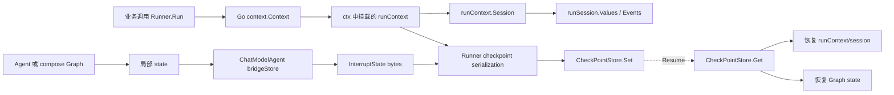
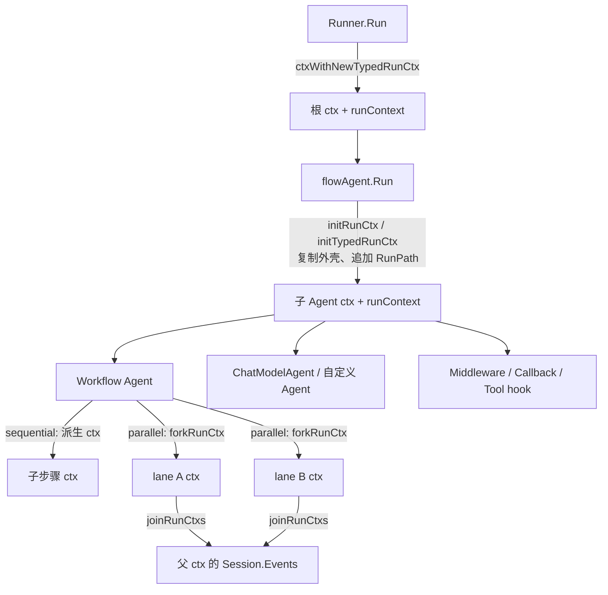
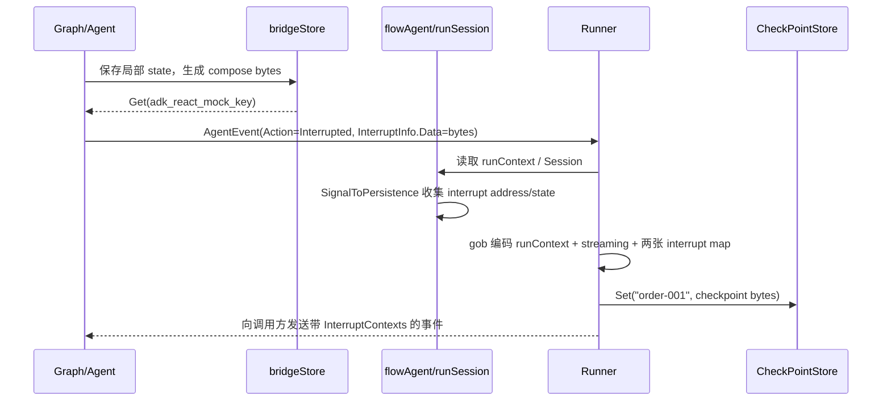
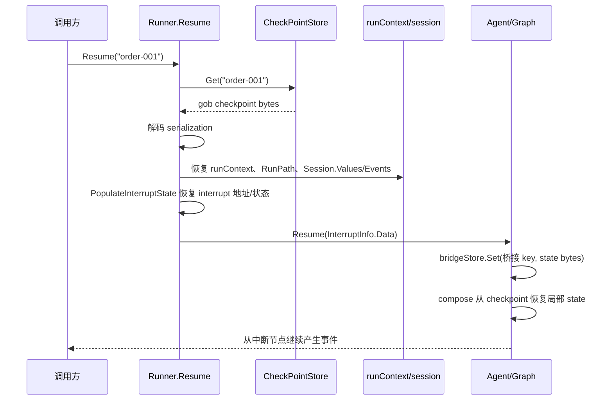

# 一次 Runner 运行的持久化状态：ctx、session、state 的层层读写

> 这一章回答一个很容易混淆的问题：**`ctx`、`session`、`state` 到底哪些会被持久化，在哪一层写入，又在哪一层读回？**

先给结论：它们不是同一个对象，也不是每次执行都会自动落盘。



可以把一次中断运行想成三层抽屉：

1. **`ctx` 是运输箱**：Go 的 `context.Context` 本身不应该序列化；ADK 只把其中的 `runContext` 取出来编码。
2. **`runContext/session` 是 ADK 运行层状态**：记录根输入、Agent 路径、共享 KV 和已经提交的事件。
3. **`state` 是 Agent/Graph 局部状态**：例如 ReAct 的消息、工具调用、剩余轮数。它先由 compose 保存成 bytes，再作为中断信号的一部分向上冒泡。

## 1. “持久化”究竟发生在什么时候

普通成功运行并不会自动把整个会话写入 `CheckPointStore`。Runner 只有在以下条件同时满足时，才会走外层保存流程：

- 调用方配置了 `CheckPointStore`；
- 调用方通过 `WithCheckPointID("订单-001")` 提供了 key；
- Agent 返回了可恢复的 interrupt，或者触发了可恢复的 cancel。

因此下面两种情况完全不同：

| 场景 | `runContext/session` 是否在内存中变化 | 是否写外部 `CheckPointStore` |
| --- | --- | --- |
| 正常 `Run` 直到结束 | 会变化 | 否，除非业务自己另存 |
| 中断但没有 checkpoint ID | 会变化 | 否，只发出中断事件 |
| 中断且有 ID + store | 会变化 | 是，Runner 写一次根快照 |
| `Resume` | 先从 store 读，再继续变化 | 下一次中断时再覆盖/写回 |

## 2. 第一层：`ctx` 里到底放了什么

`ctx` 的类型是标准库的 `context.Context`，它承担取消、deadline、trace、回调等运行时职责；它不是数据库记录，也不能直接 Gob 编码。

ADK 在 `ctx` 中放入自己的 `runContext` 指针。源码中的核心结构可以简化为：

```go
type runContext struct {
    RootInput       *AgentInput // 根调用的输入
    RunPath         []RunStep   // 当前走过的 Agent 地址
    AgenticRootInput any        // Typed Agent 的根输入
    Session         *runSession // 共享运行会话
}
```

所以，“保存 ctx”在 ADK 中的准确含义是：

```text
context.Context（取消、deadline、trace 等）  不保存
        │
        └── ctx 中的 runContext                 保存
              ├── RootInput / AgenticRootInput
              ├── RunPath
              └── Session
```

恢复时，Runner 先从 checkpoint 解码 `runContext`，再通过 `setRunCtx(ctx, runCtx)` 把它重新挂回一个**新的** Go context。也就是说，恢复不会复用旧的 context，也不会复活旧的 goroutine、锁或 channel。

### 2.1 它是“沿调用链传递”，不是“只有 Runner 才有”

可以把 `runContext` 想成贴在 `ctx` 上的一张运行凭证：Runner 首先发证，后续组件拿着同一个 `ctx` 或它的派生版本继续执行。



源码层面有三个关键动作：

1. `Runner` 用 `ctxWithNewTypedRunCtx` 建立根 `runContext`，并把根输入和新的 `runSession` 放进去。
2. `flowAgent.Run` 用 `initRunCtx` / `initTypedRunCtx` 取出已有 `runContext`，做一个浅层复制，追加当前 Agent 的 `RunPath`，再用 `context.WithValue` 放回新的 ctx。
3. Workflow 的并行分支用 `forkRunCtx` 建立不同的 ctx；它们共享已提交的 `Events` 和 `Values`，但各自拥有 `LaneEvents`，结束后通过 `joinRunCtxs` 合并。

因此，通常的调用链是：

```text
Runner ctx
  → flowAgent ctx（RunPath 加一段）
    → workflow/child ctx（继续派生）
      → Agent.Run(ctx)
        → middleware / callback / tool hook 收到同一条 ctx 链
```

这里的“同一条”不是指所有函数都拿到完全相同的指针，而是指它们能沿 `context.Context` 的父子链查到同一个运行会话。`runContext` 外壳可能被复制，`runSession` 通常仍然共享；并行 lane 则会换成带独立 `LaneEvents` 的 session 外壳。

### 2.2 哪些组件可能看不到它

以下情况不能假设 `runContext` 一定存在：

| 情况 | `getRunCtx(ctx)` 结果 | 原因 |
| --- | --- | --- |
| 由 Runner 驱动的普通 Agent | 通常非 nil | Runner 已经创建根 runContext |
| flowAgent 包装的子 Agent | 通常非 nil | flowAgent 继续派生并传递 ctx |
| Runner 内的 Workflow、AgentTool | 通常非 nil | 使用父 ctx、fork ctx 或 shared session |
| 直接手写 `agent.Run(context.Background(), ...)` 的自定义 Agent | 不保证 | 调用方绕过了 Runner/flowAgent 运行层 |
| 组件内部重新使用 `context.Background()` | nil | 父 ctx 被丢弃，运行凭证断链 |
| 显式调用 `ClearRunCtx(ctx)` 后的子系统 | nil | ADK 提供的隔离机制主动清除了它 |

所以 middleware、callback、tool 能不能读到 `runContext`，取决于**它们收到的 ctx 是否来自这条运行链**，而不是取决于组件名字。一个独立的工具函数即使被 Agent 调用，如果它拿到的是 Agent 传下来的 ctx，就可以调用 `GetSessionValue`；如果它自己新建了 Background context，就看不到 session。

### 2.3 复制的是外壳，共享的是会话

这也是初学者最容易误读的地方：

```text
ctx0 ──value: runContext A ──Session S
  │
  └─ flowAgent 派生 ctx1
       value: runContext B（RunPath 更长）──Session S
```

`runContext.deepCopy()` 会复制 `RunPath` 切片和根输入指针，但保留 `Session` 指针。这样每一层可以拥有自己的地址路径，同时仍能把事件和 session KV 写回同一条运行会话。并行 `forkRunCtx` 是特例：它创建新的 session 外壳来承载 lane 事件，但仍共享父级已提交历史和 Values。

## 3. 第二层：`runSession` 保存什么

`runContext.Session` 是一次 Agent 树运行的共享会话。它主要包含：

```go
type runSession struct {
    Values    map[string]any       // AddSessionValue 写入的业务 KV
    Events    []*agentEventWrapper // 已提交的事件历史
    LaneEvents *laneEvents         // 并行 workflow 的临时 lane 事件
    TypedEvents any                 // Typed Agent 的非 schema.Message 事件
}
```

### 3.1 Values：运行期间的共享 KV

`AddSessionValue(ctx, "customer", value)` 并不是给 `context.WithValue` 加一个值；它找到 `ctx` 中的 `runSession`，在锁保护下写入 `Session.Values`。因此子 Agent 可以读到同一个会话值，workflow 的多个步骤也可以共享它。

但要注意：值必须能被当前 checkpoint 序列化器编码。把数据库连接、文件句柄、函数、互斥锁或大型不可序列化对象塞进 `Values`，会导致保存失败或恢复后不可用。

### 3.2 Events：历史投影，不是所有内部状态

Flow 收到 AgentEvent 后，会在事件属于当前 `RunPath`、且不是 interrupt 的情况下，把事件复制到 `runSession.Events`。这个列表用于下一步通过 `RootInput + Events` 重建 `AgentInput`。

两个重要例外：

- **interrupt 事件不写入普通 session history**；它走 interrupt signal/checkpoint 专用通道。
- Agent 内部的中间步骤不一定全部暴露给父 Agent；AgentTool、workflow 和 lane 会根据边界决定哪些事件提交给父 session。

### 3.3 并行 workflow 的 session

`forkRunCtx` 不会让并行分支同时写同一份 slice。每条 lane 得到一个新的 session 外壳，但可以共享已提交的事件和 Values；`joinRunCtxs` 再按时间顺序合并 lane 事件。checkpoint 保存的是 join 后可恢复的会话视图，而不是任意时刻的竞态中间态。

## 4. 第三层：Agent/Graph 的 `state`

这里的 `state` 不是 `runSession.Values` 的别名，而是某个具体 Agent 或 compose Graph 的局部工作内存。

以 `ChatModelAgent` 的 ReAct 图为例，state 通常包含：

```text
Messages              当前模型可见的消息
ToolGenActions        尚未执行/等待执行的工具调用
RemainingIterations   剩余 ReAct 轮数
RetryAttempt          重试次数
ToolMsgIDs            tool call 与 tool result 的关联
ReturnDirectly...     工具要求直接返回时的控制信息
```

这些字段只描述这个 Graph 当前走到哪里，不代表整个 Agent 树的历史。Graph 使用 compose 的 checkpoint store 和 serializer 把 state 编码成 bytes；`ChatModelAgent` 再用固定的桥接 key（`adk_react_mock_key`）从内部 store 取出 bytes，封装为 `ChatModelAgentInterruptInfo`，向外层 Runner 抛出。

因此一条保存链是：

```text
ReAct typedState
  → compose checkpoint bytes
  → ChatModelAgentInterruptInfo.Data
  → InterruptState map[id] = bytes
  → Runner serialization
  → CheckPointStore.Set(checkpointID, gobBytes)
```

## 5. 一次中断运行的完整写入顺序

假设代码如下：

```go
runner := adk.NewRunner(ctx, adk.RunnerConfig{
    EnableStreaming: true,
    CheckPointStore: redisStore,
})

iter := runner.Run(ctx, agent, input,
    adk.WithCheckPointID("order-001"),
)
```

当审批工具触发中断时，写入顺序如下：



外层 checkpoint 的简化结构是：

```go
type serialization struct {
    RunCtx                   *runContext
    Info                     *InterruptInfo
    InfoDataSourceInterruptID string
    EnableStreaming          bool
    InterruptID2Address      map[string]Address
    InterruptID2State        map[string]core.InterruptState
}
```

这里的 `InterruptID2State` 才是承载 Agent 局部 state bytes 的地方；`RunCtx.Session` 承载 ADK 会话层历史。两者一起保存，才能既知道“模型之前看到了什么”，又知道“图停在了哪个节点”。

## 6. Resume 时的反向读取顺序

恢复不是只把一段 bytes 交给 Agent，而是从外到内逐层还原：



恢复后，Runner 会把解码出的 `runContext` 重新挂到新 ctx；`Session.Events` 用于重建 Agent 输入，`Session.Values` 用于恢复共享业务变量，interrupt map 用于定位尚未完成的分支，最后才由叶子 Agent 读取自己的 state bytes。

## 7. 四个名字放在一张表里

| 名称 | 所属层 | 典型内容 | 何时写 | 何时读 | 是否天然持久化 |
| --- | --- | --- | --- | --- | --- |
| `context.Context` | Go 运行时 | cancel、deadline、trace、依赖 | 创建/派生 ctx 时 | 每个组件执行时 | 否 |
| `runContext` | ADK 运行树 | 根输入、RunPath、Session 指针 | 启动、进入子 Agent、fork/join | Runner/flowAgent/恢复时 | 有 checkpoint 才保存其可编码字段 |
| `runSession` | ADK 会话层 | Values、Events、TypedEvents | AddSessionValue、事件提交 | 重建 AgentInput、恢复 | 有 checkpoint 才保存 |
| Graph `state` | Agent/compose 局部层 | Messages、tool calls、重试/节点状态 | Graph checkpoint safe point | Agent.Resume/Graph resume | 由内部 store 先保存，再被外层携带 |
| `InterruptInfo` | 中断协议 | 用户审批数据、叶子 state 来源 | 叶子中断时 | Resume 时交给目标 Agent | 只有被放进 checkpoint 才保存 |

## 8. 最容易犯的几个错误

### 误区一：以为 `ctx` 就是会话

`ctx` 只是携带者。不要把长生命周期的聊天历史直接放进 `context.WithValue`，也不要期待跨进程恢复。需要跨请求保留的内容放在外部 memory/store，或明确放进可序列化的 `runSession.Values` / Agent state。

### 误区二：以为 `session.Events` 包含所有 Graph 状态

它是跨 Agent 的事件历史投影，不包含 ReAct 的剩余轮数、等待中的 tool call 等局部控制状态。后者必须由 Graph state/checkpoint 保存。

### 误区三：只配置 store，不设置 checkpoint ID

没有 `WithCheckPointID`，Runner 没有 key，无法把这次运行与下一次 Resume 对应起来。

### 误区四：把数据库连接放进 Values

checkpoint 恢复的是数据，不是进程资源。恢复后应根据配置重新创建 DB client、HTTP client、锁和 channel；Values 只放可序列化的业务快照或 ID。

## 9. 调试一条运行链的检查清单

遇到“恢复后丢历史”时，按层排查：

1. 是否配置 `CheckPointStore`，并且 `WithCheckPointID` 的值在 Run/Resume 间一致？
2. `runContext` 是否成功创建，`Session.Values` 是否真的通过 `AddSessionValue` 写入？
3. 目标事件是否提交到了当前 `RunPath` 的 `runSession.Events`，还是被 AgentTool/中断边界过滤？
4. 叶子 Agent 是否产生了自己的 compose checkpoint bytes？
5. 外层 checkpoint 中是否同时存在 `RunCtx` 和 `InterruptID2State`？
6. Resume 时是否先恢复外层 interrupt tree，再调用叶子 `Resume`？
7. 恢复后重新创建资源，而不是从旧 ctx 里取出已经失效的指针？

相关章节：

- [Runner 与运行上下文](/adk/runner-context)
- [Context 的逐层传播](/adk/context-flow)
- [中断、检查点与恢复](/adk/interrupt-resume)
- [完整生命周期](/adk/lifecycle)
- [状态、历史与记忆](/adk/state-and-memory)
