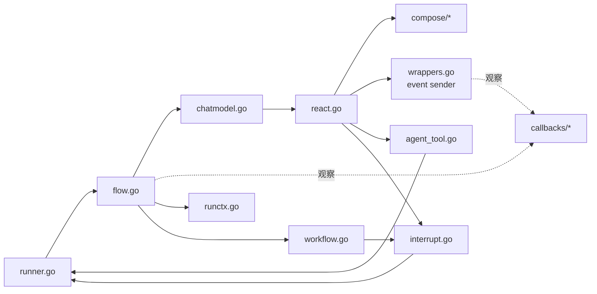

# ADK 源码导读

这一页提供从公开入口向内部追踪的阅读路线，并标明每个文件真正负责的边界。

按箭头读是“调用链”；遇到事件归属回到 runctx/flow，遇到组件生命周期进入 callbacks，遇到暂停恢复进入 interrupt/runner。

## 路线一：Runner.Query 到模型事件

1. `runner.go: Query`：string 包装成 UserMessage；
2. `runner.go: Run`：创建 root runCtx，调用 toFlowAgent；
3. `flow.go: flowAgent.Run`：历史重写、追加 agent address；
4. `chatmodel.go: ChatModelAgent.Run`：首次构建 run func；
5. `react.go: newReact`：建立 Model ↔ ToolNode 图；
6. `wrappers.go: typedEventSenderModelWrapper / typedEventSenderToolWrapper`：把模型和 Tool 输出写成 AgentEvent；
7. `flow.go: flowAgent.run`：记录事件并处理最后 action；
8. `runner.go: typedRunnerHandleIterImpl`：检查是否需要保存 interrupt/cancel checkpoint。

## 路线二：一次 Transfer

1. `chatmodel.go: transferToAgent.InvokableRun` 产生 Action；
2. `react.go: SendToolGenAction` 写入 ReAct state；
3. tool result sender 将 Action 附到 Tool event；
4. `flowAgent.run` 用 exactRunPathMatch 接受控制信号；
5. `getAgent` 在 subAgents / parent 中定位目标；
6. 目标 flowAgent 用共享 session 重建输入。

## 路线三：AgentTool 中断

1. `agent_tool.go: InvokableRun` 创建 bridgeStore 和子 Runner；
2. 子 Agent 产生 Stateful/CompositeInterrupt；
3. 子 Runner 把 checkpoint 写进 bridgeStore；
4. AgentTool 取 bytes，调用 `tool.CompositeInterrupt`；
5. 父 ReAct Graph 中断并把 compose checkpoint 写回自己的 bridgeStore；
6. ChatModelAgent 的运行错误处理把 compose interrupt 转为 ADK CompositeInterrupt 事件；
7. 根 Runner 保存完整 runCtx 与 interrupt maps；
8. Resume 反向逐层还原。

## 文件职责表

| 文件 | 核心职责 | 不负责 |
| --- | --- | --- |
| `interface.go` | Agent/Event/Action 协议 | 调度 |
| `utils.go` | iterator、event copy、流消息提取 | session 持久化 |
| `runner.go` | 根运行入口、checkpoint 时机 | ReAct |
| `runctx.go` | RootInput、events、KV、parallel lane | 模型历史格式 |
| `flow.go` | 历史重写、RunPath、Transfer、恢复路由 | tool 执行 |
| `chatmodel.go` | ChatModelAgent 配置、middleware、运行分流 | 图调度算法 |
| `wrappers.go` | Model/Tool wrapper、Callback 注入、事件发送 | 根 session 持久化 |
| `react.go` | Model/Tool 图与 local state | 根 checkpoint |
| `agent_tool.go` | Agent↔Tool 适配、动作隔离 | 同级 Transfer |
| `workflow.go` | 顺序/并行/循环、组合中断 | LLM 决策 |
| `interrupt.go` | ADK 中断数据与 gob payload | store 实现 |
| `deterministic_transfer.go` | 结束后追加固定转交 | 动态路由 |
| `retry_chatmodel.go` | 模型调用与流错误重试 | tool 重试 |
| `middlewares/reduction` | 模型调用前缩减旧 Tool result | 长期历史持久化 |
| `middlewares/filesystem` | 文件能力和大结果卸载 | 主机权限策略 |
| `middlewares/skill` | Skill 描述与按需正文加载 | Skill 内容审核 |

## 推荐配对测试

| 主题 | 测试文件 |
| --- | --- |
| 流事件复制与拼接 | `adk/utils_test.go`、`chatmodel_test.go` |
| 多 Agent 历史与 Transfer | `adk/flow_test.go` |
| RunContext fork/join | `adk/runctx_test.go` |
| AgentTool action 边界 | `adk/agent_tool_test.go` |
| 顺序/并行/循环恢复 | `adk/workflow_test.go` |
| 确定性转交恢复 | `adk/deterministic_transfer_test.go` |
| 根 checkpoint | `adk/runner_test.go`、`interrupt_test.go` |
| 模型 retry | `adk/chatmodel_retry_test.go` |
| Callback manager、顺序和流复制 | `callbacks/aspect_inject_test.go`、`callbacks/interface_test.go` |
| Callback 组件类型转换 | `utils/callbacks/template_test.go` |
| Reduction 历史缩减 | `adk/middlewares/reduction/reduction_test.go`、`adk/middlewares/reduction/internal/clear_tool_result.go` |
| Filesystem tools、Backend、大结果 | `adk/middlewares/filesystem/*_test.go` |
| Skill 扫描与按需加载 | `adk/middlewares/skill/*_test.go` |

## 阅读时的三个陷阱

1. 不要把 `flow/agent/react` 与 `adk/react.go` 当成同一实现；前者是传统 flow，后者服务 ChatModelAgent 事件层。
2. 不要把 `RunPath` 当作 callback address；它们在顺序 workflow 的更新规则不同。
3. 不要只看 event 最后值；stream copy、session record 和 action gating 都依赖事件归属及所有权。

要反向确认每个生产源码文件对应哪篇文档，使用 [ADK 模块覆盖审计](./coverage-audit.md)。
