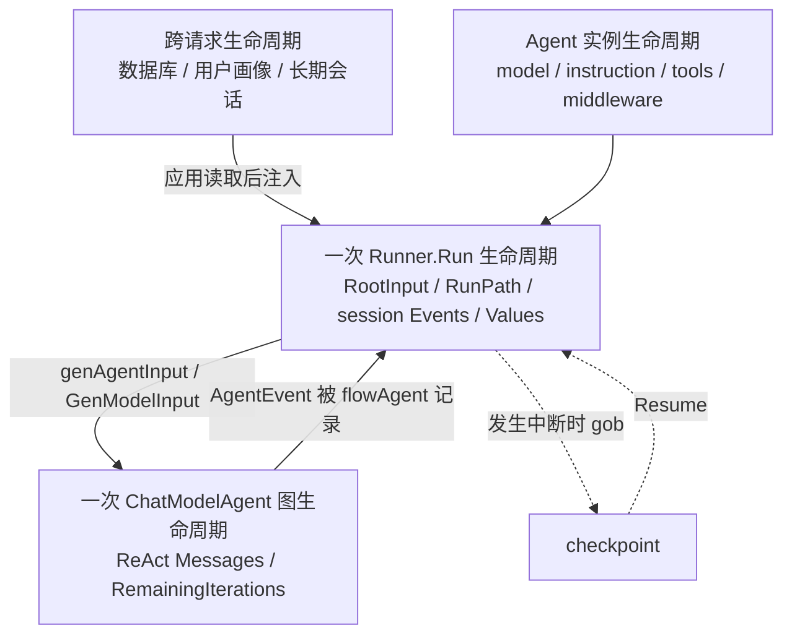
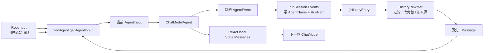
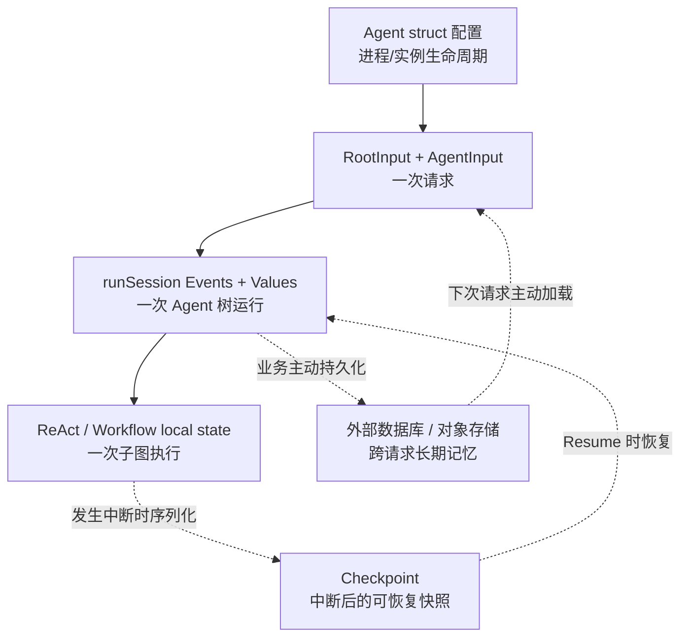

# 状态、历史与记忆到底放在哪里

“Agent 有没有记忆”不是一个简单的是非问题。ADK 中至少有六种不同生命周期的数据，如果放错位置，会出现串请求、无法恢复、并发竞争或上下文越来越大的问题。

本章解释各类状态在源码中实际保存在哪里。如果你更关心“一个生产 Agent 应该怎样组装、长期记忆和 Summary 应该做成 Tool、Middleware 还是独立 Agent”，请配合阅读 [Agent 组装最佳实践](./agent-composition-best-practices.md)。

::: tip 配套 Demo
先运行 [Demo 阶梯](./demo-ladder.md) 的 Demo 1～3，再回来看本章的 `runSession`、`state` 和长期记忆边界。
:::



箭头表示显式转换，没有任何一层会自动成为“永久记忆”。新的 Runner.Run 默认创建新 session；跨请求数据必须由应用重新加载。

## 六类数据全景

| 数据 | 例子 | 生命周期 | 保存位置 |
| --- | --- | --- | --- |
| Agent 配置 | instruction、tools、model | Agent 实例生命周期 | ChatModelAgent 字段 |
| 根输入 | 用户最初的 Messages | 一次 Runner Run/Resume | runContext.RootInput |
| Agent 事件历史 | A 回答、B 工具结果 | 一次 Agent 树运行 | runSession.Events |
| Session KV | user name、Plan、TODO | 一次运行，可随 checkpoint 恢复 | runSession.Values |
| ReAct State | 当前模型 messages、剩余轮次 | 一次 ChatModelAgent 内部图 | compose local state |
| 外部长期记忆 | 历史会话、用户画像 | 跨多次请求 | 应用数据库/存储 |

## 1. Agent 配置

ChatModelAgent struct 保存模型、instruction、ToolsConfig、middlewares 和子 Agent 关系。这些值通常在服务启动时构造并长期复用。

不要把某个用户的消息历史写入 Agent struct：

```go
// 错误方向：多个请求会共享并竞争
type MyAgent struct {
    history []*schema.Message
}
```

正确做法是把单次运行数据放在 AgentInput、runSession 或 local state。

## 2. RootInput

Runner.Run 创建 AgentInput 后，把它保存为 `runContext.RootInput`。子 Agent 的 `Run` 经常收到 `nil` input，因为 flowAgent 会从 RootInput 和 session events 重建适合当前 Agent 的输入。

RootInput 的作用是提供整个 Agent 树共同的原始问题，不代表每个 Agent 都直接看到完全相同的 messages。

## 3. runSession.Events

flowAgent 把当前 Agent 自己产生的非中断事件复制后写入 session。后续 Agent 启动时，`genAgentInput` 将它们转换为 HistoryEntry，再经 HistoryRewriter 生成 messages。

### 为什么记录事件而不是只记录 Message

事件同时保留：

- 是哪个 Agent 产生的；
- 原始 RunPath；
- Assistant 还是 Tool；
- 自定义输出或 Action；
- streaming 消息的缓存状态。

有了来源，历史重写才能把“其他 Agent 的 Assistant 消息”转换成当前 Agent 的背景信息。



<p class="diagram-caption">这是两套消息状态的接力：session Events 负责跨 Agent，ReAct State 负责同一 ChatModelAgent 内的模型—工具循环。</p>

### 哪些事件不记录

- Interrupt event：交给 checkpoint 协议；
- RunPath 不精确匹配当前 Agent 的事件：通常是 AgentTool 内部透传；
- 没有被 flowAgent 包装的直接 Agent.Run 事件。

## 4. Session Values

Session values 是一次 Agent 树中的共享 KV：

```go
adk.AddSessionValue(ctx, "UserName", "小明")
name, ok := adk.GetSessionValue(ctx, "UserName")
all := adk.GetSessionValues(ctx)
```

典型用途：

- instruction FString 变量；
- workflow 节点交换非消息结果；
- Plan-Execute 保存 Plan / ExecutedSteps；
- Deep Agent 保存 TODO；
- 最终结果的 OutputKey。

`GetSessionValues` 返回浅拷贝 map。value 如果是 map、slice 或指针，内部对象仍是共享的。

### 并行注意事项

Values 的 map get/set 有 mutex，但业务 value 内部没有自动加锁。ParallelAgent 两个分支同时执行：

```go
v, _ := adk.GetSessionValue(ctx, "items")
items := v.([]string)
items = append(items, "x") // 并行下不安全
```

应改成每次构造新值再 `AddSessionValue`，或使用业务自己的并发安全结构。多个分支写同一个 key 仍是 last-writer-wins，结果不确定。

## 5. ReAct State

ChatModelAgent 有工具时，内部 `State.Messages` 保存模型与工具循环上下文。它与 runSession.Events 有重叠，但用途不同：

- ReAct State 直接喂给下一轮同一个 ChatModel；
- session Events 用于跨 Agent 历史与恢复整个 Agent 树；
- ReAct State 包含精确 tool-call 配对；
- session 历史可能把其他 Agent 消息改写成 UserMessage。

ReAct State 还保存 RemainingIterations、ReturnDirectly ID 和 ToolGenActions，是 Graph 运行状态的一部分。

## 6. Checkpoint

Checkpoint 不是一种新的业务记忆，而是上述执行现场的序列化快照。

根 Runner checkpoint 保存：

- runContext（RootInput、RunPath、Session）；
- 原 streaming 配置；
- interrupt ID → Address；
- interrupt ID → 各层 State。

ChatModelAgent 的 InterruptState 中又包含内部 compose checkpoint bytes；workflow state 则包含 child index、iteration 或 parallel lane events。

### Checkpoint 不应该承担的职责

- 日常保存每轮聊天记录；
- 用户画像数据库；
- 业务操作审计；
- 永久任务队列；
- 外部副作用的事务日志。

它的目标是“在一个中断点继续”，不是通用持久化。



<p class="diagram-caption">Checkpoint 是执行恢复机制，不等于长期聊天记忆；跨 Query 的记忆必须由应用显式保存并在下一次请求重新加载。</p>

## 跨多次 Query 的长期记忆

同一个 Runner 连续两次 Query：

```go
runner.Query(ctx, "我叫小明")
runner.Query(ctx, "我叫什么？")
```

第二次默认不知道第一次内容，因为每次 Run 都调用 `ctxWithNewRunCtx` 创建新 session。

应用层常见方案：

1. 把每轮最终 Message 保存到数据库；
2. 下次请求查询该用户历史；
3. 做长度控制/摘要；
4. 将历史与新问题一起作为 Runner.Run 的 messages。

```go
history := conversationStore.Load(userID)
messages := append(history, schema.UserMessage(newQuestion))
iter := runner.Run(ctx, messages)
```

ADK 负责这次运行内部的组织，不替应用决定多租户、保留期限和隐私策略。

## HistoryRewriter 与长期记忆的关系

`WithHistoryRewriter` 只重写当前 runSession 已收集的 Agent 历史。例如：

- 删除不相关工具结果；
- 给其他 Agent 消息加来源；
- 只保留最近 N 条；
- 把事件转换成特定模型要求的消息格式。

它不会自动访问外部数据库。要接长期记忆，可以在调用 Runner 前加载，也可以自定义 Agent 在内部检索，但应明确边界。

## OutputKey

ChatModelAgent 配置 OutputKey 后，最终文本写入 session values：

```go
OutputKey: "draft"
```

后续 workflow Agent 可以 `GetSessionValue(ctx, "draft")`。如果最终消息是 stream，ChatModelAgent 会消费 runnable 返回的一份流并 concat content；用户事件持有 event sender 分出的另一份流。流式 Callback 若启用，还会拥有自己必须消费或关闭的观察副本。

OutputKey 只保留 Content 字符串，不保留完整 Message 元数据、ToolCalls 或 chunk 边界。

## Context 与状态传播

所有 runSession/local state/resume 信息都通过派生 context 传播。自定义代码如果错误地换成 `context.Background()`，会失去：

- session values；
- RunPath / Address；
- callbacks；
- interrupt state；
- resume target data。

除非明确要隔离，组件和 Agent 应继续传入收到的 ctx。

## 状态选择决策表

| 需求 | 应该放哪里 |
| --- | --- |
| 所有请求共用只读配置 | Agent struct |
| 一次 Agent 调用输入 | AgentInput |
| 同一次多 Agent 流程共享小量数据 | Session Values |
| 同一 ReAct 循环消息 | ReAct local state |
| 节点内部可恢复进度 | StatefulInterrupt state |
| 中断后恢复整次执行 | CheckPointStore |
| 用户跨天会话 | 外部数据库 |
| 并行大结果 | 外部对象存储/业务存储 |

## 常见故障

### 用户 A 看到了用户 B 的历史

通常是把 request history 写进了长期复用 Agent struct，或模型/工具实现使用了未隔离的全局变量。

### Resume 解码失败

检查自定义状态是否 gob 可编码、接口中的具体类型是否注册、CheckpointSchema 是否被不兼容修改。

### 后续 Agent 看不到前一个结果

检查事件是否经 flowAgent 记录、RunPath 是否被自定义 Agent 错误填充、结果是否只有 CustomizedOutput 而 HistoryRewriter 只处理 Message。

### Parallel 结果偶尔变化

检查多个分支是否写同一个 session key，或共享 value 内部对象是否线程安全。

### 新 Query 没有记忆

这是默认语义。需要应用显式加载并传入历史。

继续阅读：[Agent 组装最佳实践](./agent-composition-best-practices.md)、[Middleware 执行机制](./middleware.md)、[内置 Middleware](./builtin-middlewares.md)、[Workflow Agent](./workflows.md)。
