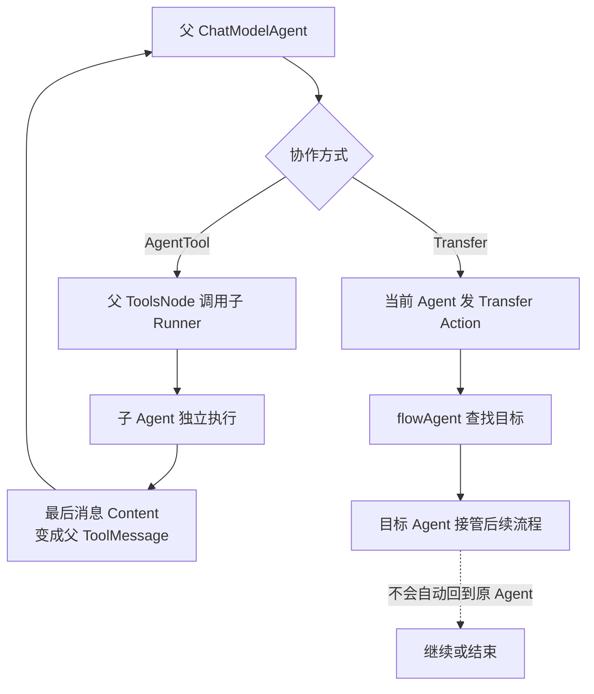
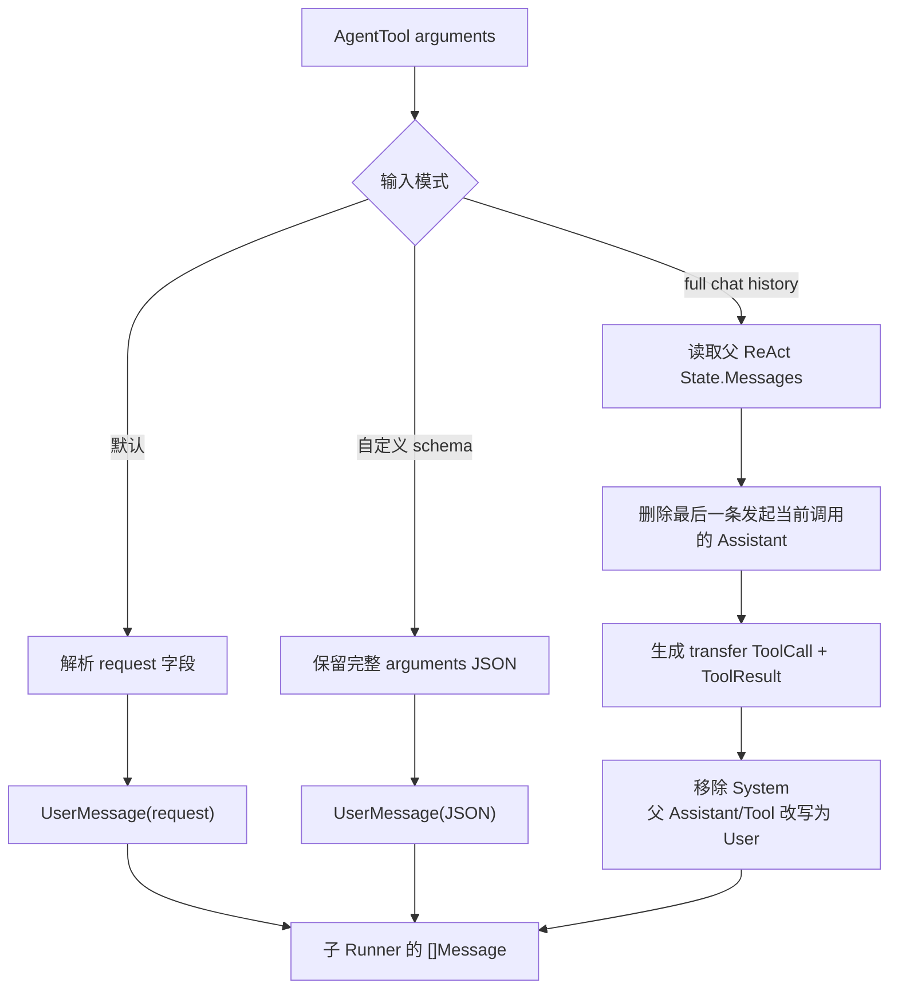
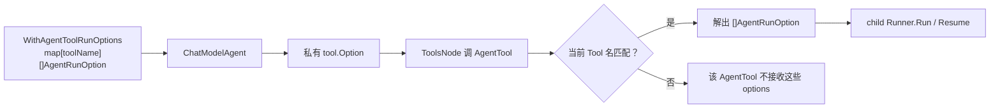

# AgentTool 与转交

ADK 支持两种多 Agent 协作方式：把 Agent 包装成工具（AgentTool），或由 `flowAgent` 处理显式 Transfer。二者的控制权和历史语义完全不同。

如果你还在判断一项能力应该做成普通 Tool、AgentTool、Middleware、Callback 还是固定 Workflow step，先沿执行阶段和可见信息阅读 [从执行阶段理解组件](./component-positioning.md)。



最简单的判断：期望“调用专家后回到这里”就用 AgentTool；期望“从现在起换一个 Agent 继续”就用 Transfer。

## Agent as Tool

`NewAgentTool` 返回 `tool.BaseTool`，其名称和描述直接来自内层 Agent：

```go
researchTool := adk.NewAgentTool(ctx, researcher)
parent, _ := adk.NewChatModelAgent(ctx, &adk.ChatModelAgentConfig{
    Name: "coordinator",
    Description: "coordinates work",
    Model: model,
    ToolsConfig: adk.ToolsConfig{
        ToolsNodeConfig: compose.ToolsNodeConfig{
            Tools: []tool.BaseTool{researchTool},
        },
        EmitInternalEvents: true,
    },
})
```

默认参数 schema 只有 `request string`。`WithAgentInputSchema` 可换成自定义 schema；这时 AgentTool 把完整 JSON arguments 作为 UserMessage content。`WithFullChatHistoryAsInput` 则忽略简单 request，重建父 ReAct 历史作为子 Agent 输入。

## AgentTool 调用流程

```text
父 ToolsNode
  → agentTool.InvokableRun
  → 解析 tool.Option（stream、目标 Agent options、event generator）
  → 创建内存 bridgeStore
  → 子 Runner.Run / Resume
  → 消费子 AgentEvent
  → 最后一条消息 content 作为 tool result
```

bridgeStore 是 compose checkpoint store 的内存桥梁。内层 Agent 中断时，AgentTool 把其 checkpoint bytes 放进 Tool 的 Stateful/CompositeInterrupt；外层恢复后再构造 resume bridge store，让子 Runner 从相同 checkpoint ID 恢复。

### 构造配置怎样变成 ToolInfo

`NewAgentTool(ctx, agent, options...)` 并不执行 Agent，只把构造期配置保存进 `agentTool`：

```text
AgentToolOption
  ├─ WithFullChatHistoryAsInput
  │    └─ fullChatHistoryAsInput = true
  └─ WithAgentInputSchema(schema)
       └─ inputSchema = schema

agentTool.Info(ctx)
  ├─ Name = innerAgent.Name(ctx)
  ├─ Desc = innerAgent.Description(ctx)
  └─ ParamsOneOf
       ├─ 已配置 schema → 原样使用
       └─ 未配置       → { request: string, required: true }
```

这是构造期转换，不要和每次调用的 `AgentRunOption` 混为一谈。模型看到的是 `ToolInfo`；真正调用时，JSON arguments 才会被转成子 Agent 的 `[]Message`。

### 三种输入模式的精确区别

| 配置 | arguments 如何解析 | 子 Agent 收到的输入 |
| --- | --- | --- |
| 默认 | 解析 `{ "request": "..." }` | 一条 `UserMessage(request)` |
| `WithAgentInputSchema` | 不按 schema 字段逐项解包 | 一条 `UserMessage(完整 arguments JSON)` |
| `WithFullChatHistoryAsInput` | 忽略普通 request 解析 | 从父 ReAct State 重建的多条消息 |

“自定义 schema”只改变工具向模型声明的参数形状，并让 AgentTool 把完整 JSON 字符串交给子 Agent；它不会自动把 JSON 映射成多个 Message，也不会做业务级字段校验。实际校验能力取决于模型工具调用与底层 schema 实现。

所谓 full chat history 也不是把父消息数组原封不动复制过去，源码依次做了这些转换：

1. 从 compose 的 ReAct `State.Messages` 读取历史；
2. 删除最后一条 Assistant 消息，因为它正是调用当前 AgentTool 的 tool-call 消息；
3. 用 `GenTransferMessages` 加入一对“转交给子 Agent”的 Assistant ToolCall 和 ToolResult；
4. 丢弃全部 System 消息，子 Agent 使用自己的 instruction；
5. 把父 Agent 的 Assistant 和 Tool 消息改写为 UserMessage，例如 `For context: [parent] said...`；
6. 保留原 User 消息，最终作为子 Agent 的输入。

这一步的目的，是既把上下文交给子 Agent，又避免把父 Agent 的 Assistant/Tool 角色直接冒充成子 Agent 自己说过或调用过的内容。

::: warning 一个源码边界
`getReactChatHistory` 假定当前 ReAct State 至少含有最后一条 tool-call 消息，并直接使用 `len(Messages)-1`。它是给 ChatModelAgent 的 ToolsNode 调用链准备的内部路径，不应脱离该上下文直接复用。
:::



<p class="diagram-caption">自定义 schema 只改变参数声明与 JSON 交付方式；full-history 才会读取父 ReAct 历史，而且会做角色安全改写。</p>

### 运行参数的两次“换壳”

调用 AgentTool 时存在三类 Option，它们的类型不同：

```text
父 Runner 的 AgentRunOption
  └─ ChatModelAgent 读取 chatModelAgentRunOptions
       ├─ WithToolOptions([]tool.Option)
       └─ WithAgentToolRunOptions(map[toolName][]AgentRunOption)
            └─ 转成 agentTool 私有 tool.Option
                 └─ AgentTool 按自己的名字取回 []AgentRunOption
                      └─ 传给子 Runner.Run / Resume
```

此外，ChatModelAgent 还通过私有 `tool.Option` 向 AgentTool 注入：

- 是否启用流式输出；
- 用于向父级发送内部事件的 generator；
- 目标 Agent 专属的运行参数。

因此 `WithAgentToolRunOptions` 的 map key 必须等于 AgentTool 的工具名，也就是内层 `Agent.Name(ctx)`。它不是按 Go 变量名、类型名或 description 匹配。传给其他工具的普通 `WithToolOptions` 不会自动变成子 Agent 的 `AgentRunOption`。



<p class="diagram-caption">这是典型的“两次换壳”：父 AgentRunOption 先变成 Tool 能接收的 option，到 AgentTool 内部再还原为子 Runner 的 AgentRunOption。</p>

### Run 与 Resume 分支

AgentTool 先调用 `tool.GetInterruptState[[]byte](ctx)`，据此选择：

```text
首次执行
  → newBridgeStore()
  → 生成 AgentInput
  → 子 Runner.Run(...,
       WithCheckPointID("adk_react_mock_key"),
       withSharedParentSession())

恢复执行
  → 必须取得 []byte 类型的 tool interrupt state
  → newResumeBridgeStore(bytes)
  → 子 Runner.Resume("adk_react_mock_key",
       withSharedParentSession())
```

固定 checkpoint ID 在这里不会导致不同 AgentTool 互相覆盖，因为每次调用都创建独立的内存 `bridgeStore`。`withSharedParentSession` 共享的是父 session 的 `Values` map 和 mutex；子 Runner 仍维护自己的事件序列，内部事件不会因此自动进入父历史。

如果外层明确选择该 tool 中断地址恢复，compose/tool 层会把之前保存的 `[]byte` state 放回 context；AgentTool 自身不解析这段 bytes，它只是把它重新喂给子 Runner。

### 为什么只取“最后一条事件”作为工具结果

AgentTool 会完整消费子 iterator，同时维护 `lastEvent`：

- 新事件到来时，若上一条事件仍持有未消费的 MessageStream，会主动关闭；
- 任意事件的 `Err` 非空时立刻返回错误；
- 开启内部事件时，发送一份事件给父 generator，保留一份独占流副本供自己继续处理；
- 遍历结束后，只从最后事件的 `MessageOutput` 取完整 Message，并返回其 `Content`；
- 最后事件没有消息输出时，工具结果是空字符串；完全没有事件则报 `no event returned`。

所以自定义子 Agent 应把最终可交付结果放在最后的消息事件中。前面的 reasoning、工具结果或状态事件即使被实时透传，也不会被拼成 AgentTool 的最终字符串。

## 内部事件透传

父 `ToolsConfig.EmitInternalEvents` 开启后，AgentTool 得到父 generator，将子 AgentEvent 实时发送给最终用户，并在 RunPath 前拼接父路径。

这些透传事件不写入父 runSession；否则父历史会同时包含“AgentTool 最终 ToolMessage”和内部每一步消息，既重复又可能破坏模型 tool-call 配对。中断是例外：必须汇总向上传播。

## Action 隔离

AgentTool 是明确的控制边界：

| 内层动作 | 对父 Agent 的影响 |
| --- | --- |
| Exit | 只结束内层 Agent |
| TransferToAgent | 只在内层 Agent 树生效 |
| BreakLoop | 只影响内层 workflow |
| Interrupt | 通过 CompositeInterrupt 传播到父级 |

如果 Exit 或 Transfer 穿透工具边界，一个普通工具调用就能意外终止或改写父 Agent 控制流，所以源码只从最后事件提取文本结果；只有 interrupt 会被转换成 tool interrupt。

## TransferToAgent

Transfer 是同一 Agent 树中的控制权移交：

1. ChatModel 调用 `transfer_to_agent` 工具；
2. 工具发送带 `TransferToAgentAction` 的 Tool event；
3. `flowAgent.run` 只接受与当前 RunPath 精确匹配的 action；
4. 在当前 iterator 结束后查找同级/父级目标；
5. 目标 Agent 用 `nil` input 启动，从共享 runContext 重建历史。

目标查找范围是已配置 subAgents，以及允许时的 parent Agent。找不到目标会生成明确 error event。

### Transfer 能力是在什么时候注入的

`SetSubAgents` 不只是给 `flowAgent` 填一张子 Agent 表。它还会对实现了 `OnSubAgents` 的底层 Agent 调用生命周期钩子。ChatModelAgent 在第一次 `buildRunFunc` 时读取最终父子关系：

```text
可转交目标 = subAgents
if 有 parent 且没有 WithDisallowTransferToParent:
    可转交目标 += parent

if 可转交目标非空:
    instruction += 目标名称与描述
    tools += transfer_to_agent
    ReturnDirectly[transfer_to_agent] = true
```

因此父子关系属于构建配置的一部分。ChatModelAgent 的执行函数由 `sync.Once` 冻结；第一次运行后再改变关系，不会让已经构建的 ReAct Graph 自动重新绑定工具和 instruction。

`WithDisallowTransferToParent` 只禁止子 Agent 回到 parent，不影响当前 Agent 转给自己的 subAgents。Supervisor 正是用它限制成员的动态回跳范围。

### 一次动态 Transfer 的完整事件链

```text
ChatModel 输出 transfer_to_agent tool call
  → transfer tool 解析 agent_name
  → SendToolGenAction(... TransferToAgentAction)
  → ToolsNode 因 ReturnDirectly 提前结束本轮 ReAct
  → flowAgent.run 继续把已有事件交给调用方
  → iterator 结束后检查“当前精确 RunPath”的最后 Action
  → a.getAgent(destName)
  → target.Run(ctx, nil, opts...)
  → target.flowAgent 从共享 runContext 重建 AgentInput
```

这里的 `nil input` 不是“目标 Agent 没有输入”。目标 `flowAgent.Run` 会通过根 `runContext.RootInput + Session.Events` 重新生成输入。默认 `HistoryRewriter` 的规则是：

- 根用户输入保持原角色；
- 当前 Agent 自己产生的消息保持原角色；
- 其他 Agent 的 Assistant/Tool 消息改写成带来源名称的 UserMessage；
- 没有消息的 Action 事件不进入模型历史；
- `WillRetryError` 对应的失败流不进入后续上下文，其他流读取错误会终止历史重建。

Transfer 只采纳与当前 `runCtx.RunPath` **完全相等**的 Action。AgentTool 透传出来的深层事件带更长路径，因而不能意外让父 Agent 转交、退出或中断。

## Transfer 辅助消息

`GenTransferMessages` 构造一对合法的 Assistant ToolCall + Tool result，使后续模型上下文保持协议完整。`WithSkipTransferMessages` 可在历史重建时同时删除这对消息，适合不希望模型看到路由细节的场景。

这对消息共享随机生成的 tool-call ID：第一条是名称为 `transfer_to_agent` 的 Assistant ToolCall，第二条是同 ID、同工具名的 ToolMessage。这样模型历史始终满足“每个工具调用都有对应结果”的协议。

`WithSkipTransferMessages` 是运行期 `AgentRunOption`。历史扫描遇到带 Transfer Action 的 Tool event 时跳过它；如果其输出角色确实是 Tool，还会同时删除前一条配对的 Assistant tool-call。它不是简单过滤所有叫 `transfer_to_agent` 的文本，因此不会误删普通消息中出现的同名字符串。

自定义 `HistoryRewriter` 接收的是框架整理后的 `[]HistoryEntry`，每项包含 `IsUserInput`、来源 Agent 名和 Message。它适合实现更严格的隔离、摘要或角色映射；但要自己维护 Assistant ToolCall 与 ToolMessage 的成对关系。

## 确定性转交

`AgentWithDeterministicTransferTo` 不让模型选择，而是在被包装 Agent 正常结束后依次生成目标 transfer events。若 Agent Exit 或 Interrupt，则不会追加转交。

包装 flowAgent 时使用隔离 session：内部事件在完成时复制回父 session；中断则保存隔离事件列表到 `deterministicTransferState`，恢复后继续，防止重放已完成事件。

### 普通 Agent 与 flowAgent 的包装差异

| 被包装对象 | 处理方式 | 为什么 |
| --- | --- | --- |
| 普通 `Agent` | 原样转发 iterator，结束后追加 Transfer 事件 | 普通 Agent 没有 ADK 共享历史编排 |
| 普通 `ResumableAgent` | Run/Resume 都做同样的尾部追加 | 保留恢复能力 |
| `*flowAgent` | 建立隔离 `runSession`，边复制事件边执行 | 避免其内部 Transfer 先改变外层控制流 |

包装器只在底层对象实现 `ResumableAgent` 时才对外实现 Resume。给一个不可恢复 Agent 套确定性 Transfer，不会凭空获得恢复能力。

flowAgent 的隔离 session 与父 session 共享 `Values` 和 mutex，但 `Events` 独立。每个非中断事件会复制一份写回父 session，原事件继续发送给用户；两份流都设为 automatic close。这样 history 可见，同时每个消费者仍有独占 reader。

如果底层中断，包装器不会把原始中断事件直接发送出去，而是：

1. 取出隔离 session 的事件列表；
2. 保存到已注册 gob 名称的 `deterministicTransferState`；
3. 用原子 Agent 的 signal 作为 child，生成新的 `CompositeInterrupt`；
4. 恢复时从该 state 还原隔离事件，然后调用底层 `flowAgent.Resume`。

这就是“完成过的中间事件不重放、尚未完成的控制流可继续”的来源。

### 多个确定性目标的语义

`ToAgentNames` 会按 slice 顺序为每个名字依次发送一对 Transfer 消息。由于外层 `flowAgent.run` 在同一路径上只保留最后看到的 `lastAction`，真正接管执行的是列表中的**最后一个**目标；前面目标的转交消息仍可能进入事件流和历史，但不会逐个运行。

因此这不是 fan-out API。通常应只配置一个目标。若需要并行运行多个 Agent，应使用 Parallel workflow；若要串行运行，应使用 Sequential workflow。

### 停止与错误边界

- 最后事件是 Interrupt 或 Exit：不追加确定性 Transfer；
- 最后事件只是 `Err`：普通包装路径仍可能追加 Transfer，因为判断只看 Action；调用方仍应优先处理错误事件；
- panic 会转换成 `AgentEvent{Err: ...}` 并关闭 generator；
- `AgentWithDeterministicTransferTo` 本身不校验 nil Agent、空目标或目标是否存在，错误会在调用名称或真正转交时暴露。

Supervisor prebuilt 正是利用这一机制：成员完成后确定性返回 supervisor，成员之间不能直接互转。

## AgentTool 与 Transfer 到底怎么选

| 问题 | AgentTool | Transfer |
| --- | --- | --- |
| 控制权 | 调用结束后回到父模型的 ToolsNode | 当前 Agent 结束后由目标 Agent 接管 |
| 父级得到的正式结果 | 一个 ToolMessage 字符串 | 目标 Agent 的完整事件序列 |
| 历史 | 子事件默认不写父历史；最终 ToolMessage 会写 | 共享根输入和 session 事件并重建 |
| Action | 除 Interrupt 外都隔离 | 当前精确路径的 Action 会驱动流程 |
| 参数 | 有显式工具 JSON schema | 没有额外参数，靠共享历史 |
| 中断 | bytes 经 tool state 桥接 | signal 沿 flow/workflow 层级组合 |
| 典型用途 | “请专家完成一个有返回值的子任务” | “把后续对话控制权交给另一个角色” |

对小白最实用的判断是：如果你期待“像调用函数一样回来一个结果”，用 AgentTool；如果你期待“从现在起由另一个 Agent 继续接待”，用 Transfer。

## 配置与运行排错清单

- AgentTool 的 Name 是否唯一，并和 `WithAgentToolRunOptions` 的 map key 一致；
- 自定义 schema 模式下，子 Agent 是否知道自己拿到的是完整 JSON 字符串；
- full-history 模式是否确实运行在 ChatModelAgent ReAct ToolsNode 内；
- 是否开启 `EmitInternalEvents`，以及 UI 是否错误地把透传事件当作父历史；
- 子 Agent 的最后事件是否含期望的 MessageOutput；
- Transfer 目标是否为直接 subAgent 或允许访问的 parent；
- 是否在 ChatModelAgent 第一次运行前完成 `SetSubAgents`；
- 自定义 HistoryRewriter 是否维护 tool-call/tool-result 配对；
- 确定性转交是否错误地传了多个目标，误以为会依次执行；
- 中断恢复时是否仍使用相同 Agent 树、名称和配置。

<div class="source-path">AgentTool：adk/agent_tool.go<br>动态转交：adk/flow.go、chatmodel.go<br>确定性转交：adk/deterministic_transfer.go</div>
