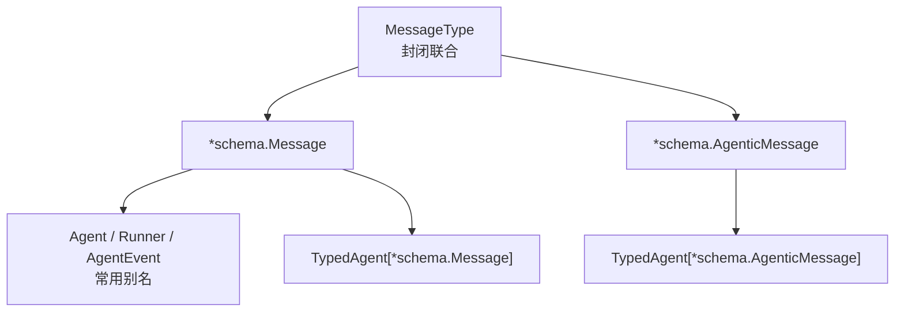
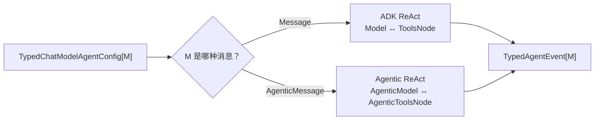

# Typed Agent 与 AgenticMessage：两条消息执行路径

当前 Eino ADK 不再只有一种 Message。Agent、Runner、Event、Middleware 和 ChatModelAgent 已经泛型化，但这个泛型不是“任何类型都可以”：框架只支持两种封闭消息协议。

```go
type MessageType interface {
    *schema.Message | *schema.AgenticMessage
}
```

这一章解释 Typed API 为什么存在、两条路径怎样执行，以及何时仍应使用最常见的非泛型别名。

## 1. 先看结论

| 问题 | `*schema.Message` | `*schema.AgenticMessage` |
| --- | --- | --- |
| 典型模型 | 普通 ChatModel | AgenticModel |
| Agent 类型 | `Agent` / `ChatModelAgent` | `TypedAgent[*schema.AgenticMessage]` |
| Runner | `Runner` | `TypedRunner[*schema.AgenticMessage]` |
| Tool 调用 | ADK ReAct：Model → ToolsNode → Model | ADK Agentic ReAct：AgenticModel → AgenticToolsNode → AgenticModel |
| Tool result 表达 | `schema.Tool` Message | AgenticMessage ContentBlocks |
| Role 元数据 | `MessageVariant.Role`、`ToolName` | `MessageVariant.AgenticRole` |
| Transfer / Workflow | 支持，但官方当前不推荐 transfer/workflow-based 方案 | Typed Agent/AgentTool 支持；传统 transfer 不是推荐方向 |
| retry/failover/cancel | 已接入 | 实现与测试覆盖 ReAct、安全点取消和恢复；retry/failover 使用泛型 wrapper |

如果没有明确使用 agentic provider 的需求，继续使用 `Agent`、`Runner`、`ChatModelAgent` 即可。它们不是旧 API，而是 `*schema.Message` 的便利别名。

## 2. 别名系统怎么读

```go
type Message = *schema.Message
type AgenticMessage = *schema.AgenticMessage

type Agent = TypedAgent[*schema.Message]
type ResumableAgent = TypedResumableAgent[*schema.Message]
type AgentInput = TypedAgentInput[*schema.Message]
type AgentEvent = TypedAgentEvent[*schema.Message]
type MessageVariant = TypedMessageVariant[*schema.Message]
type Runner = TypedRunner[*schema.Message]
type ChatModelAgent = TypedChatModelAgent[*schema.Message]
```

所以两种写法表达的是同一条经典消息路径：

```go
var a adk.Agent

var b adk.TypedAgent[*schema.Message]
```

`a` 与 `b` 的方法集合相同。Typed 前缀的价值是让相同运行框架同时承载 `AgenticMessage`。



<p class="diagram-caption">Typed 是协议泛型化；普通 Agent 别名仍是当前推荐的经典消息入口。</p>

## 3. TypedAgent 的最小契约

```go
type TypedAgent[M MessageType] interface {
    Name(ctx context.Context) string
    Description(ctx context.Context) string

    Run(
        ctx context.Context,
        input *TypedAgentInput[M],
        options ...AgentRunOption,
    ) *AsyncIterator[*TypedAgentEvent[M]]
}
```

和旧认识相同，Agent 仍不要求内部一定有 LLM；变化只在输入/输出消息类型被参数化。

### 3.1 输入

```go
type TypedAgentInput[M MessageType] struct {
    Messages        []M
    EnableStreaming bool
}
```

`EnableStreaming=false` 仍不意味着只返回一个事件。一个经典 ReAct Agent 可能输出多条完整 Model/Tool event；它只表示每条模型或工具消息不以 stream 表达。

### 3.2 输出

```go
type TypedAgentEvent[M MessageType] struct {
    AgentName string
    RunPath   []RunStep
    Output    *TypedAgentOutput[M]
    Action    *AgentAction
    Err       error
}
```

Output、Action、Err 仍需分别检查，不应写成互斥的 `else if`。

## 4. TypedMessageVariant 的差异

```go
type TypedMessageVariant[M MessageType] struct {
    IsStreaming   bool
    Message       M
    MessageStream *schema.StreamReader[M]

    Role        schema.RoleType
    AgenticRole schema.AgenticRoleType
    ToolName    string
}
```

### 4.1 经典 Message

- `Role` 标记 assistant 或 tool；
- `ToolName` 在 Tool event 上提供来源；
- 流式时，即使完整 Message 尚未产生，消费者也能先知道角色和 Tool 名。

### 4.2 AgenticMessage

- 使用 `AgenticRole`；
- `Role` 和 `ToolName` 保持零值；
- Tool 请求/结果存在 ContentBlocks 中，不再依赖经典 ToolMessage 结构。

创建事件的入口也不同：

```go
adk.EventFromMessage(msg, stream, role, toolName)

adk.EventFromAgenticMessage(msg, stream, agenticRole)
```

## 5. TypedRunner 做了什么

```go
type TypedRunnerConfig[M MessageType] struct {
    Agent           TypedAgent[M]
    EnableStreaming bool
    CheckPointStore CheckPointStore
}

runner := adk.NewTypedRunner(adk.TypedRunnerConfig[*schema.AgenticMessage]{
    Agent: agent,
})
```

`TypedRunner.Query` 会按消息类型生成相应 User Message：

- `*schema.Message` → `schema.UserMessage(query)`；
- `*schema.AgenticMessage` → `schema.UserAgenticMessage(query)`。

Run 和 Resume 的入口仍然返回 typed event iterator。

## 6. TypedChatModelAgent 的两条执行分支

```go
type TypedChatModelAgentConfig[M MessageType] struct {
    Model model.BaseModel[M]
    // ...
}
```

`model.BaseModel[M]` 统一要求 `Generate` 和 `Stream`，但具体实现按 M 分成：

```text
M = *schema.Message
  → model.BaseChatModel
  → ADK 绑定 ToolInfo
  → ADK 构建 Model ↔ ToolsNode 的 ReAct Graph

M = *schema.AgenticMessage
  → model.AgenticModel
  → ADK 构建 AgenticModel ↔ AgenticToolsNode 的 ReAct Graph
  → ToolCall / ToolResult 通过 ContentBlocks 表达
```



这不是简单的“消息 struct 换名字”。两条路径都由 ADK 编排 ReAct，但 ToolCall/ToolResult 的编码、ToolsNode 类型、Role 表达和事件转换不同。

## 7. Middleware 怎样泛型化

新版主接口本身就是泛型：

```go
type TypedChatModelAgentMiddleware[M MessageType] interface {
    BeforeModelRewriteState(
        context.Context,
        *TypedChatModelAgentState[M],
        *TypedModelContext[M],
    ) (context.Context, *TypedChatModelAgentState[M], error)

    WrapModel(
        context.Context,
        model.BaseModel[M],
        *TypedModelContext[M],
    ) (model.BaseModel[M], error)

    // 其他 Agent / Tool 阶段省略
}
```

经典别名：

```go
type ChatModelAgentMiddleware =
    TypedChatModelAgentMiddleware[*schema.Message]
```

### 7.1 编写双路径 Middleware

如果算法只依赖抽象 Message slice，可写泛型实现：

```go
type Recorder[M adk.MessageType] struct {
    *adk.TypedBaseChatModelAgentMiddleware[M]
    sink Sink[M]
}
```

但如果算法要读取经典消息的 `ToolCalls`、`Role`、`ToolName`，就不能假装与 AgenticMessage 通用。应使用 type switch 或分别实现。

## 8. Callback 也分两类组件

当前源码提供两个 callback Component：

| Component | 输入/输出 |
| --- | --- |
| `adk.ComponentOfAgent` | `AgentCallbackInput` / `AgentCallbackOutput` |
| `adk.ComponentOfAgenticAgent` | `TypedAgentCallbackInput[*schema.AgenticMessage]` / Typed output |

经典转换：

```go
in := adk.ConvAgentCallbackInput(callbackInput)
out := adk.ConvAgentCallbackOutput(callbackOutput)
```

泛型转换：

```go
in := adk.ConvTypedCallbackInput[*schema.AgenticMessage](callbackInput)
out := adk.ConvTypedCallbackOutput[*schema.AgenticMessage](callbackOutput)
```

每个 callback handler 会得到独立 event iterator，必须异步消费，避免阻塞 Agent 的结束链。

## 9. 两条路径的结构差异

当前实现为两种消息各建一套 ReAct：经典路径使用 `compose.NewToolNode`，Agentic 路径使用 `compose.NewAgenticToolsNode`。两者都有迭代上限、模型/工具安全点取消、AfterToolCalls、AfterAgent、ReturnDirectly、interrupt/checkpoint 与 Typed Event。

Agentic 路径也把泛型 retry/failover 配置传入 model wrapper。主要不对称来自数据协议：

- Tool call/result 位于 ContentBlocks，不是经典 `ToolCalls` 与 role=Tool message；
- event 的经典 `Role/ToolName` 字段保持零值，读取 `AgenticRole` 和 ContentBlocks；
- Middleware 若直接读经典字段，必须用 type switch；
- provider 必须实现 `model.AgenticModel`，Tool 节点也使用 Agentic 转换函数。

::: warning 源码注释与实现不一致
`adk/chatmodel.go` 的类型注释和 `buildReActRunFunc` 附近仍写着 “agentic single-shot / cancel monitoring and retry not supported”，但同一提交的实际调用进入 `buildAgenticReActRunFunc → newAgenticReact`。`adk/agentic_react_test.go` 还覆盖多轮 ToolCalling、CancelAfterChatModel、CancelAfterToolCalls、interrupt/resume 和 TurnLoop。本站以可执行实现和测试为准，并在源码校验报告中记录这条不一致。
:::

## 10. 一个最小 Typed Agent

```go
type EchoAgenticAgent struct{}

func (a *EchoAgenticAgent) Name(context.Context) string {
    return "echo_agentic"
}

func (a *EchoAgenticAgent) Description(context.Context) string {
    return "returns the latest agentic message"
}

func (a *EchoAgenticAgent) Run(
    ctx context.Context,
    input *adk.TypedAgentInput[*schema.AgenticMessage],
    _ ...adk.AgentRunOption,
) *adk.AsyncIterator[*adk.TypedAgentEvent[*schema.AgenticMessage]] {
    iter, gen := adk.NewAsyncIteratorPair[*adk.TypedAgentEvent[*schema.AgenticMessage]]()

    go func() {
        defer gen.Close()
        if input == nil || len(input.Messages) == 0 {
            gen.Send(&adk.TypedAgentEvent[*schema.AgenticMessage]{
                Err: errors.New("empty input"),
            })
            return
        }
        gen.Send(adk.EventFromAgenticMessage(
            input.Messages[len(input.Messages)-1],
            nil,
            schema.AgenticRoleTypeAssistant,
        ))
    }()

    return iter
}
```

真实自定义 Agent 仍需遵守：

- iterator 中的 event 必须可安全修改；
- stream 必须是当前消费者独占的；
- 推荐为 stream 设置 automatic close；
- goroutine 必须在所有退出路径关闭 generator；
- Context cancellation 应传给下游调用。

## 11. 选型建议

### 使用普通别名

满足以下任一条件，优先 `Agent` / `Runner` / `ChatModelAgent`：

- 使用标准 ChatModel provider；
- 依赖大量只理解经典 `schema.Message` 的现有组件；
- 团队希望减少泛型传播。

### 使用 Typed Agentic 路径

适合：

- provider 原生暴露 agentic message/block 协议；
- 需要保留 provider 的结构化 thinking/tool blocks；
- 自定义 Middleware 能正确处理 Agentic ContentBlocks。

### 编写公共库

先问算法是否真的与 Message 结构无关。只有纯运行框架、统计或通用 wrapper 才适合直接泛型化；涉及 ToolCall 配对、Role、MultiContent、Agentic ContentBlocks 时，应显式分支。

## 12. 源码阅读路线

1. `adk/interface.go`：MessageType、TypedAgent、TypedEvent 和所有别名；
2. `schema/agentic_message.go`：AgenticMessage 与 ContentBlocks；
3. `components/model/interface.go`：BaseModel、BaseChatModel、AgenticModel；
4. `adk/runner.go`：TypedRunner 的 Query/Run/Resume；
5. `adk/chatmodel.go`：两种 M 对应的 build 分支；
6. `adk/react.go`：经典与 agentic 图配置；
7. `compose/agentic_tools_node.go`：Agentic Tool 节点协议；
8. `adk/handler.go`：泛型 Middleware；
9. `adk/callback.go`：两类 Agent callback payload。
