# ADK 图解总览

这一页先用十张图建立整体直觉，再把读者带到逐字段、逐函数的源码章节。图中的箭头有三种常见含义：实线通常表示调用或数据流，虚线表示观察/配置关系，回边表示循环。

::: tip 阅读方式
第一次阅读只看每张图和“你应该记住什么”；第二次再进入链接章节核对源码。不要一开始就试图同时记住 AgentEvent、RunPath、Address、Graph State 和 session。
:::

## 图 1：Agent、Runner、ChatModelAgent 的位置

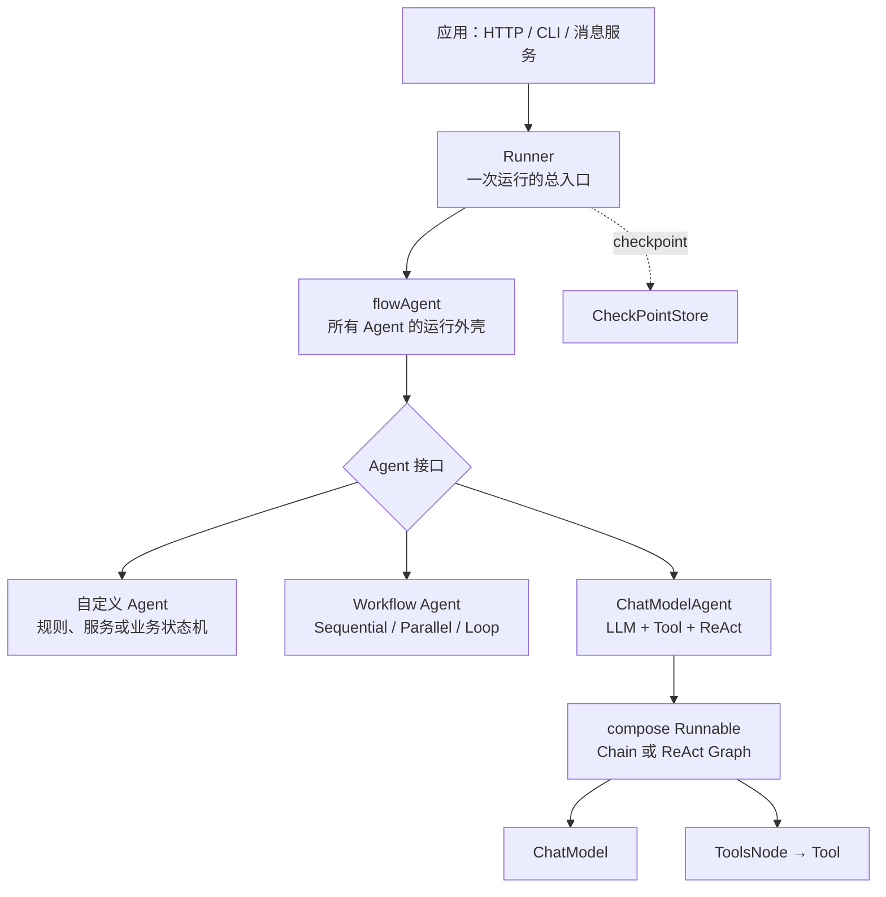

你应该记住：

- Agent 是接口，不等于大模型；
- ChatModelAgent 只是 Agent 的一种实现；
- Runner 不是 Agent，它创建根运行环境并协调持久化；
- flowAgent 是经常被忽略的外壳，负责历史、事件归属、Transfer 和恢复路由；
- ChatModelAgent 内部继续复用 compose，而不是另造一套图运行时。

对应章节：[三类角色](./roles-and-boundaries.md)、[ChatModelAgent](./chat-model-agent.md)。

## 图 2：一次有工具请求的完整时间线

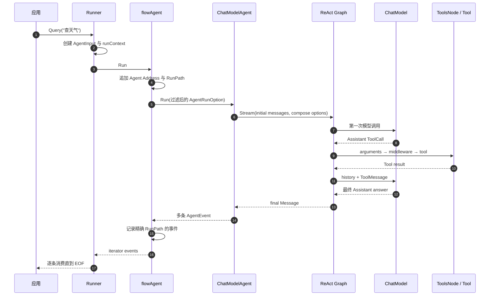

这里同时存在“内部返回值”和“对外事件”：Graph 的最终 Message 用于完成 runnable，默认 model/tool event sender wrappers 在中途产生 AgentEvent。组件 Callback 是观察链，不是当前默认事件发送的唯一来源。

对应章节：[完整生命周期](./lifecycle.md)、[ReAct 图](./react.md)、[事件](./events.md)。

## 图 3：运行中的四套 Context/State

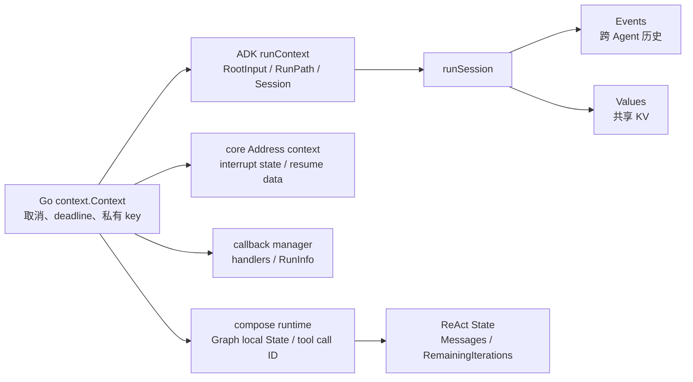

最重要的区别：

| 名称 | 主要解决的问题 | 不应该拿它做什么 |
| --- | --- | --- |
| Go Context | 取消、超时、跨层环境 | 长期业务数据存储 |
| runContext/session | 一次 ADK 会话的根输入、事件和 KV | 直接表示 Graph 节点状态 |
| Address context | 中断地址和恢复数据匹配 | 当作 UI 消息历史 |
| callback manager | 观测 handler 和当前组件信息 | 修改业务输出 |
| ReAct State | 当前 ChatModelAgent 的模型/工具循环 | 跨独立 Runner.Run 永久记忆 |

对应章节：[Context 传播](./context-flow.md)、[状态与记忆](./state-and-memory.md)。

## 图 4：Config 与 Option 为什么会“变来变去”

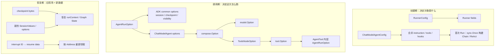

你应该先问“它在哪个生命周期生效”，再问“最终由谁消费”。名字都叫 Option，并不代表类型可以互换。

对应章节：[Config 与 Option 转换](./config-option-flow.md)。

## 图 5：Middleware 与 Callback 的洋葱顺序

```mermaid
flowchart LR
    Request["ToolInput"] --> C1["eventSenderToolWrapper<br/>默认最外层"]
    C1 --> M1["ToolsConfig middleware M1"]
    M1 --> M2["兼容 AgentMiddleware M2"]
    M2 --> Cancel["stream cancel monitor"]
    Cancel --> Current["新版 Handler wrapper"]
    Current --> CB["Tool callback injection"]
    CB --> Tool["真实 Tool"]

    Tool --> CB2["callback end/error"]
    CB2 --> CurrentA["Handler after"]
    CurrentA --> M2A["M2 after"]
    M2A --> M1A["M1 after"]
    M1A --> Event["event sender → Tool AgentEvent"]
```

Callback 自己也有栈式顺序：

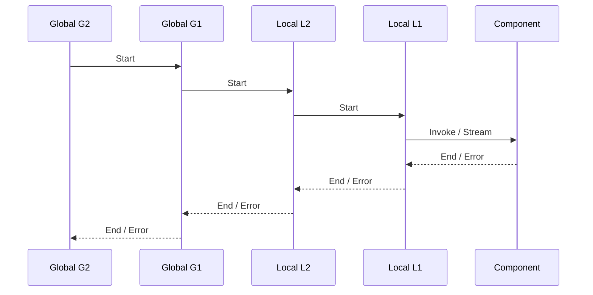

- Middleware 能改变参数、结果和错误，也能不调用 next；
- Callback 主要观测，只返回派生 Context；
- BeforeModelRewriteState/AfterModelRewriteState 是 Graph State handler，不是 provider 每次 retry 的回调；
- ADK 当前用 event sender wrappers 把 Model/Tool 结果翻译成 AgentEvent；Agent Callback 可再观察整条事件流。

对应章节：[Middleware 新旧 API](./middleware-current.md)、[Callback](./callbacks.md)。

## 图 6：ReAct 为什么是一个循环图

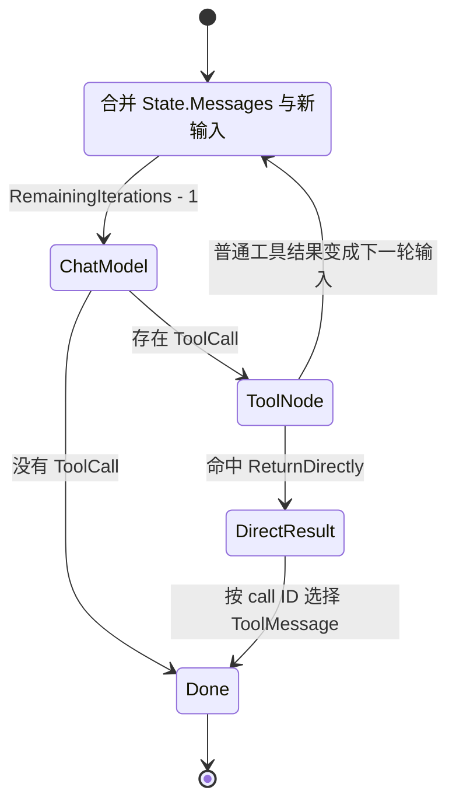

每次循环中的关键状态变化：

```text
模型前：历史 + node input → Before hooks → 调用模型
模型后：追加 Assistant → After hooks → 判断 ToolCall
工具后：生成 ToolMessage → 下一次模型前再并入 Messages
```

对应章节：[ReAct 图实现](./react.md)。

## 图 7：AgentTool、Transfer、Workflow 的选择

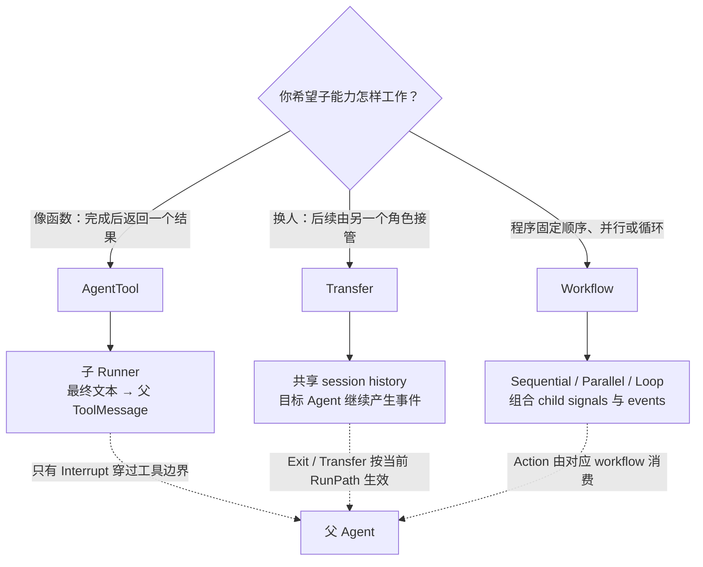

对应章节：[AgentTool 与 Transfer](./tools-transfer.md)、[Workflow Agent](./workflows.md)、[Workflow 完整案例](./workflow-case-study.md)。

## 图 8：AgentTool 中的嵌套 Runner

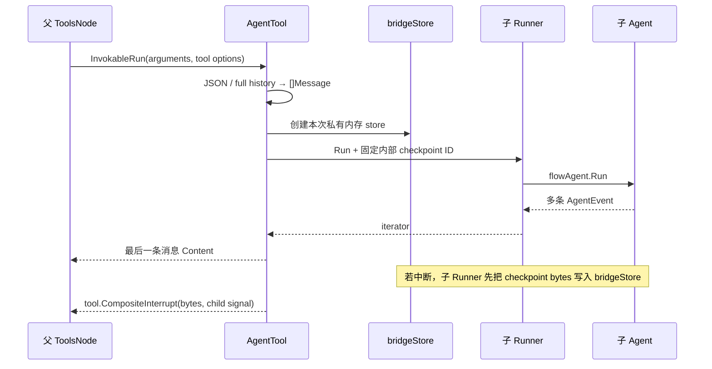

内部事件即使实时透传，也不会写进父 session；父模型正式看到的是 AgentTool 最后返回的一个 ToolMessage。

对应章节：[AgentTool 的输入、运行、事件与恢复](./tools-transfer.md#agenttool-调用流程)、[Runner 生命周期](./runner-context.md)。

## 图 9：中断从树变成 checkpoint，再被恢复

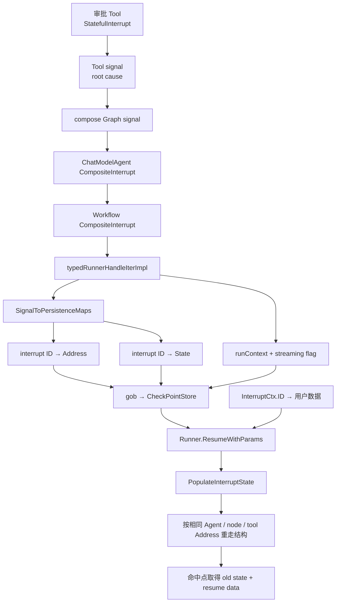

三个 ID 不要混淆：checkpoint ID 定位整份快照，interrupt ID 定位快照里的一个暂停点，Address 描述这个暂停点在运行结构中的位置。

对应章节：[中断、检查点与恢复](./interrupt-resume.md)。

## 图 10：从小白到能改源码的阅读路径

```mermaid
flowchart LR
    A["1. 基础概念"] --> B["2. 三类角色"]
    B --> C["3. 完整生命周期"]
    C --> Case["4. 端到端案例"]
    Case --> D["5. Event 与 State"]
    D --> E["6. Context"]
    E --> F["7. Config / Option"]
    F --> G["8. ReAct"]
    G --> H["9. Middleware / Callback"]
    H --> J["10. Transfer / Workflow"]
    J --> K["11. Interrupt / Resume"]
    K --> Safe["12. 并发与错误"]
    Safe --> L["13. 调试、测试与源码审计"]
```

建议不要跳过 Context 与 Config/Option：Middleware、Callback、AgentTool 和 Resume 的“魔法”，最后都依赖这两条传播链。

## 按问题继续深挖

总图负责建立方向感，下面这张表负责把问题落到具体章节和源码入口。第一次读不需要逐个打开；遇到问题时按现象反查即可。

| 你正在追的问题 | 详细章节 | 建议先看的源码 |
| --- | --- | --- |
| 为什么 Agent、Runner、ChatModelAgent 不能混叫 | [三类角色](./roles-and-boundaries.md) | `adk/interface.go`、`adk/runner.go`、`adk/chatmodel.go` |
| 一次请求究竟经过哪些对象 | [完整生命周期](./lifecycle.md) | `adk/runner.go`、`adk/flow.go` |
| 想看 AgentTool 中断恢复如何完整串起来 | [复杂请求端到端追踪](./end-to-end-trace.md) | `adk/runner.go`、`adk/agent_tool.go`、`adk/interrupt.go` |
| 想自己实现 Agent/ResumableAgent | [自定义 Agent 实战](./custom-agent.md) | `adk/interface.go`、`adk/utils.go`、`adk/flow.go` |
| ctx 为什么越传越多、丢了会怎样 | [Context 逐层传播](./context-flow.md) | `adk/runctx.go`、`internal/core/address.go`、`internal/core/interrupt.go` |
| Config、AgentRunOption、compose.Option 怎么换壳 | [Config 与 Option 转换](./config-option-flow.md) | `adk/call_option.go`、`adk/chatmodel.go`、`compose/graph_call_options.go` |
| 模型—工具为什么会循环 | [ReAct 图实现](./react.md) | `adk/react.go`、`compose/graph.go` |
| 参数改写、权限、结果卸载应该放哪里 | [Middleware](./middleware.md) | `adk/interface.go`、`adk/chatmodel.go`、`compose/tool_node.go` |
| tracing/metrics 为什么有 Start/End 顺序 | [Callback](./callbacks.md) | `callbacks/interface.go`、`callbacks/aspect_inject.go`、`compose/runnable.go` |
| AgentTool、Transfer、Workflow 怎样选 | [AgentTool 与 Transfer](./tools-transfer.md)、[Workflow](./workflows.md) | `adk/agent_tool.go`、`adk/flow.go`、`adk/workflow.go` |
| Sequential/Parallel/Loop 嵌套后怎样中断和恢复 | [Workflow 完整案例](./workflow-case-study.md) | `adk/workflow.go`、`adk/runctx.go`、`adk/interrupt.go` |
| 中断以后为什么能够换进程恢复 | [Interrupt/Resume](./interrupt-resume.md) | `adk/interrupt.go`、`adk/runner.go`、`internal/core/resume.go` |
| 什么是本轮状态，什么是长期记忆 | [状态、历史与记忆](./state-and-memory.md) | `adk/runctx.go`、`adk/react.go` |
| 记忆、Summary、Retriever 应做成什么组件 | [Agent 组装最佳实践](./agent-composition-best-practices.md) | `adk/flow.go`、`adk/chatmodel.go`、`adk/middlewares/reduction` |
| Tool、Middleware、Callback 都能做同一功能时怎么选 | [从执行阶段理解组件](./component-positioning.md) | `components/tool/interface.go`、`adk/chatmodel.go`、`callbacks/interface.go` |
| 并发、取消、流关闭或重复执行有问题 | [并发、取消与错误边界](./concurrency-errors.md) | `internal/channel.go`、`adk/runctx.go`、`adk/retry_chatmodel.go` |
| 不知道在哪一层打断点、跑哪个测试 | [调试与测试手册](./debugging-testing.md) | `adk/*_test.go`、`compose/tool_node_test.go` |
| 想确认有没有漏读 ADK 文件 | [模块覆盖审计](./coverage-audit.md) | `adk/` 下全部生产 Go 文件 |

## 图示符号速查

| 图中元素 | 通常表示 |
| --- | --- |
| 实线箭头 | 调用、返回或主要数据流 |
| 虚线箭头 | 观察、注入、持久化或非主控制关系 |
| 菱形 | 分支判断或选型问题 |
| 回到旧节点的箭头 | ReAct/Loop 的下一轮 |
| sequenceDiagram 实线 | 主动调用 |
| sequenceDiagram 虚线 | 返回值或异步事件 |

图示为了建立心智模型会省略部分错误分支；每个章节中的逐步列表、表格和源码路径才是精确行为定义。
