# Workflow 完整案例：从首次运行到两次恢复

::: warning 适用边界
这是“固定控制流 + 精确恢复”的教学/维护案例，不是当前官方对所有多 Agent 系统的默认推荐。模型自主选择子能力时优先 AgentTool；需要通用深度任务时优先 DeepAgent。
:::

这一章不再分别解释 API，而是沿着一个嵌套 Workflow 的真实运行轨迹，看清：

- Sequential 如何把前一步历史交给后一步；
- Parallel 如何隔离和合并 lane；
- 内层分支中断后，state 怎样一层层包到根；
- Resume 为什么只恢复中断分支；
- Loop 如何运行多轮并用 BreakLoop 结束；
- 后续再次中断时，为什么能生成新的 checkpoint；
- 每个阶段的 RunPath、Address、session events 分别是什么。

阅读前建议先掌握 [Workflow Agent 深入解析](./workflows.md) 和 [中断、检查点与恢复](./interrupt-resume.md)。

## 1. 案例目标

我们要实现一个报告生产流水线：

1. `planner` 制定研究计划；
2. 三个研究 Agent 并行工作；
3. `writer` 与 `reviewer` 最多迭代三轮；
4. `approval` 等待人工审批；
5. `publisher` 发布最终报告。

其中 `repo_researcher` 第一次运行时需要临时仓库访问权限，会中断；恢复后才能完成。`reviewer` 判断质量达标时发出 BreakLoop。`approval` 又会产生第二次中断。

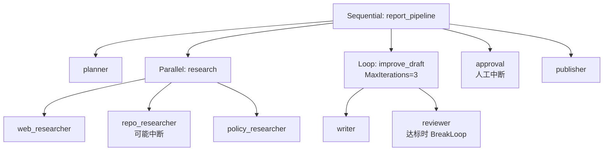

## 2. 构造代码看似简单，运行对象并不简单

组合层代码大致如下。叶子 Agent 的具体实现暂时省略：

```go
research, err := adk.NewParallelAgent(ctx, &adk.ParallelAgentConfig{
    Name:        "research",
    Description: "并行收集网页、仓库和政策资料",
    SubAgents: []adk.Agent{
        webResearcher,
        repoResearcher,
        policyResearcher,
    },
})
if err != nil {
    return nil, err
}

improve, err := adk.NewLoopAgent(ctx, &adk.LoopAgentConfig{
    Name:          "improve_draft",
    Description:   "反复写作与审校",
    SubAgents:     []adk.Agent{writer, reviewer},
    MaxIterations: 3,
})
if err != nil {
    return nil, err
}

pipeline, err := adk.NewSequentialAgent(ctx, &adk.SequentialAgentConfig{
    Name:        "report_pipeline",
    Description: "完整报告流水线",
    SubAgents: []adk.Agent{
        planner,
        research,
        improve,
        approval,
        publisher,
    },
})
```

构造完成后，每一层 Workflow 和每个 child 都已经包装为 flowAgent：

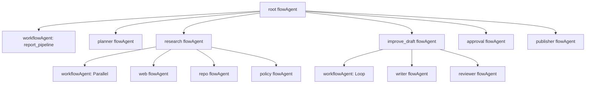

嵌套 Workflow 仍然只是父 Workflow 的一个 child。父 Sequential 不需要知道 child 内部是 ChatModelAgent、Parallel 还是 Loop；它只消费统一的 AgentEvent iterator。

## 3. Runner 启动首次查询

应用创建带 checkpoint store 的 Runner：

```go
runner := adk.NewRunner(ctx, adk.RunnerConfig{
    Agent:           pipeline,
    CheckPointStore: store,
})

iter := runner.Query(
    ctx,
    "分析这个代码库并生成架构报告",
    adk.WithCheckPointID("report-2026-001"),
)
```

初始数据可以画成：

```text
RootInput.Messages = [user: 分析这个代码库并生成架构报告]
Session.Events      = []
Session.Values      = {}
RunPath             = [report_pipeline]
Address             = /agent:report_pipeline
```

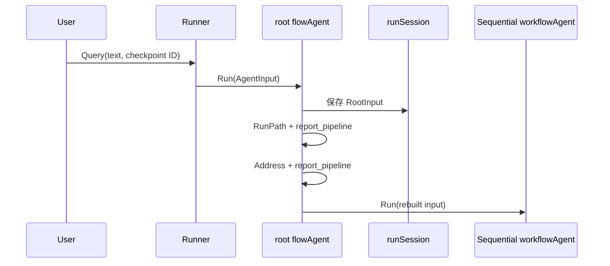

## 4. 第一步：planner 正常完成

根 Sequential 选择 index 0 的 `planner`：

```text
planner.Run(seqCtx, nil)
```

nil 不会让 planner 丢失用户输入。planner 的 flowAgent 用根输入和当前空历史重建：

```text
planner input = [user: 分析这个代码库并生成架构报告]
```

planner 输出计划事件 `P1`：

```text
AgentName = planner
RunPath   = [report_pipeline, planner]
Output    = "先分析 ADK，再分析 compose，最后形成对比"
```

planner flowAgent 在把事件交给 Sequential 之前，将它记录到 session：

```text
Session.Events = [P1]
```

Sequential 随后对自己的 `seqCtx` 调：

```text
updateRunPathOnly(seqCtx, "planner")
```

此时用于后继步骤的执行路径变成：

```text
[report_pipeline, planner]
```

但静态 Address 仍停留在根 Sequential；`research` 将作为 root 的 sibling child 加入 Address，而不是变成 planner 的 child。

## 5. 第二步：进入 Parallel research

根 Sequential 运行 index 1 的 `research`。research 自己也是一个 flowAgent，它先把名称加入路径：

```text
RunPath = [report_pipeline, planner, research]
Address = /report_pipeline/research
```

它重建到的 input 已经包含 planner 历史：

```text
user: 分析这个代码库并生成架构报告
user: For context: [planner] said: 先分析 ADK，再分析 compose，最后形成对比.
```

然后内层 `workflowAgent.runParallel` 为三个 child fork lane。

### 5.1 fork 后的数据视图

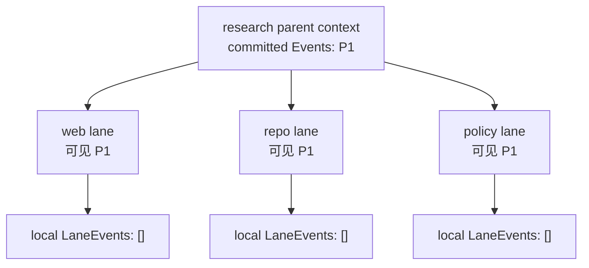

三条 lane 都看到 fork 之前已经提交的 `P1`，但开始运行后只看到自己的新增事件。

### 5.2 三条分支并发执行

假设事件如下：

```text
web lane:
  W1 = "找到官方文档"
  正常完成

repo lane:
  R1 = "已定位核心目录"
  I1 = Interrupt("需要临时仓库权限")

policy lane:
  L1 = "确认许可证和兼容性要求"
  正常完成
```

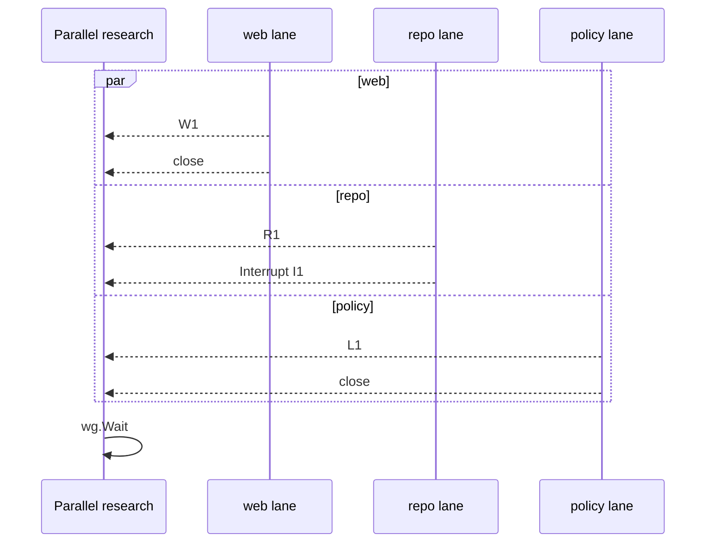

上游消费者在首次运行时会看到 `W1`、`R1`、`L1`，具体到达顺序不保证。但这些 lane events 此时还没有 join 到 research 的父历史。

## 6. 第一次中断：Parallel 保存所有 lane 现场

repo lane 的 internal interrupt 被收集后，Parallel 等另外两条 lane 结束。因为至少有一个中断，它不执行正常 join，而是保存：

```text
parallelWorkflowState.SubAgentEvents = {
  0: [W1],
  1: [R1],
  2: [L1],
}
```

Parallel 还保存兼容数据：

```text
WorkflowInterruptInfo.ParallelInterruptInfo = {
  1: repo child 的 InterruptInfo,
}
```

再把 repo 的 signal 包成 research 层 CompositeInterrupt。

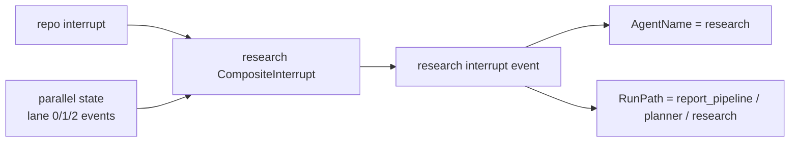

### 6.1 为什么完成分支的事件也要保存

因为 W1 和 L1 虽然已经向 UI 发送，但没有提交到父 session。如果只保存 repo 的 R1：

- 恢复时 web 和 policy 又不能重跑，否则外部调用可能重复；
- 不重跑又会让 W1/L1 从最终历史消失；
- 后续 writer 看不到完整研究结果。

保存所有 lane events 后，恢复可以跳过已完成分支，同时在最终成功时一次性 join 完整历史。

## 7. 中断继续向外包装到根 Sequential

根 Sequential 把 research 的 interrupt event 作为 child 的终端 Action。它保存：

```text
sequentialWorkflowState.InterruptIndex = 1
```

再创建一层 CompositeInterrupt。第一次 checkpoint 的概念结构是：

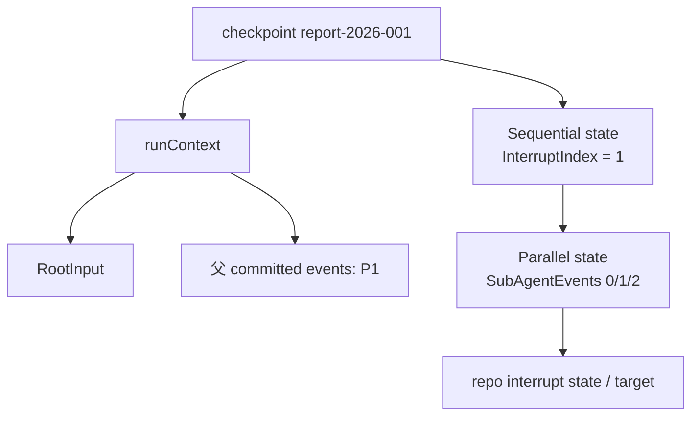

此时最值得注意的是：

```text
父 Session.Events = [P1]
Parallel state     = [W1], [R1], [L1]
```

lane 事件不在父 committed history，却没有丢；它们位于中断 state 中等待恢复。

### 7.1 RunPath 与 Address 在这里各做什么

事件展示路径近似：

```text
P1: [report_pipeline, planner]
W1: [report_pipeline, planner, research, web_researcher]
R1: [report_pipeline, planner, research, repo_researcher]
L1: [report_pipeline, planner, research, policy_researcher]
Interrupt event: [report_pipeline, planner, research]
```

恢复 Address tree 近似：

```text
/report_pipeline
  /research
    /repo_researcher
```

RunPath 说明实际执行历史；Address tree 只保留通往中断点的静态嵌套路线。

## 8. 用户提供权限并执行第一次 Resume

应用从中断事件的 `InterruptContexts` 找到 repo 对应 target ID：

```go
iter, err = runner.ResumeWithParams(
    ctx,
    "report-2026-001",
    &adk.ResumeParams{
        Targets: map[string]any{
            repoInterruptID: "仓库权限已开通",
        },
    },
)
```

恢复调用不是“从整个 Query 再跑一次”，而是沿 interrupt tree 逐层收窄：

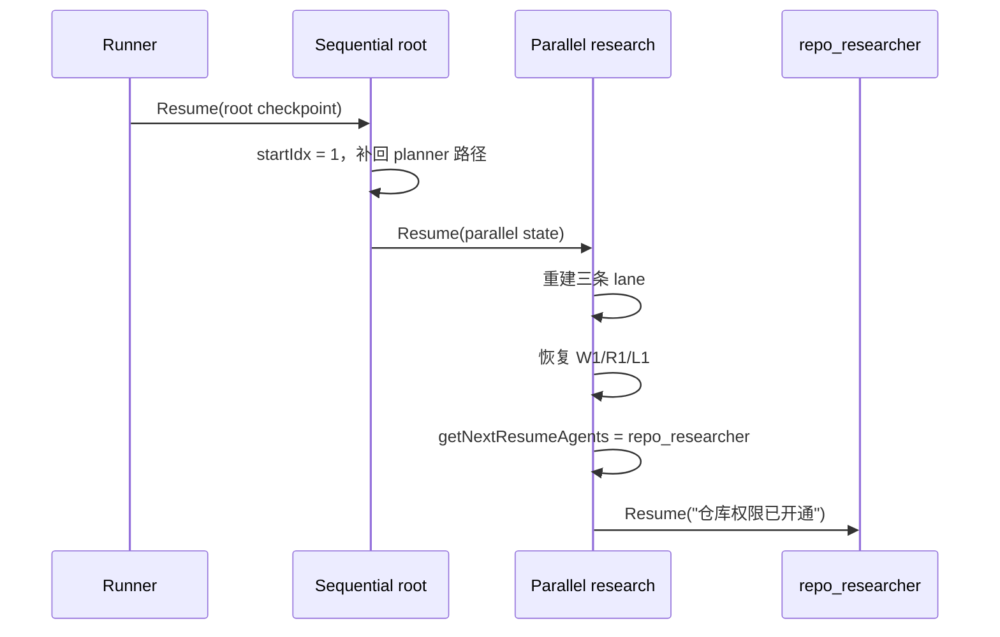

### 8.1 web 和 policy 为什么不会重跑

Parallel 的 `agentNames` 只包含 `repo_researcher`：

```text
web:    parState != nil 且不在恢复集合 → return
repo:   在恢复集合 → Resume
policy: parState != nil 且不在恢复集合 → return
```

这对具有外部副作用的分支非常重要。已发送请求、已扣费或已写数据的完成分支不会仅因 sibling 中断而自动执行第二次。

### 8.2 repo Resume 时能看到什么

repo lane 的 `getEvents()` 返回：

```text
父 committed history: P1
+ 当前恢复 lane: R1
```

它不会看到 sibling lane 的 W1/L1，因为 join 尚未发生。这保证恢复中的 repo 继续自己的局部过程，而不会意外消费另一分支的半成品。

用户恢复数据则通过 `ResumeInfo.ResumeData` 提供：

```text
WasInterrupted = true
IsResumeTarget = true
ResumeData      = "仓库权限已开通"
```

repo 完成并产生 `R2 = "仓库源码分析完成"`。

## 9. Parallel 恢复成功后 join

这次所有恢复分支都没有再次中断，于是 Parallel 执行 `joinRunCtxs`：

```text
lane 0: W1
lane 1: R1, R2
lane 2: L1
```

按包装事件的 `TS` 排序后提交父历史。逻辑上得到：

```text
Session.Events = [P1, W1, R1, L1, R2]
```

实际 W1/R1/L1 的相对顺序由创建时间戳决定，这里只是示意。

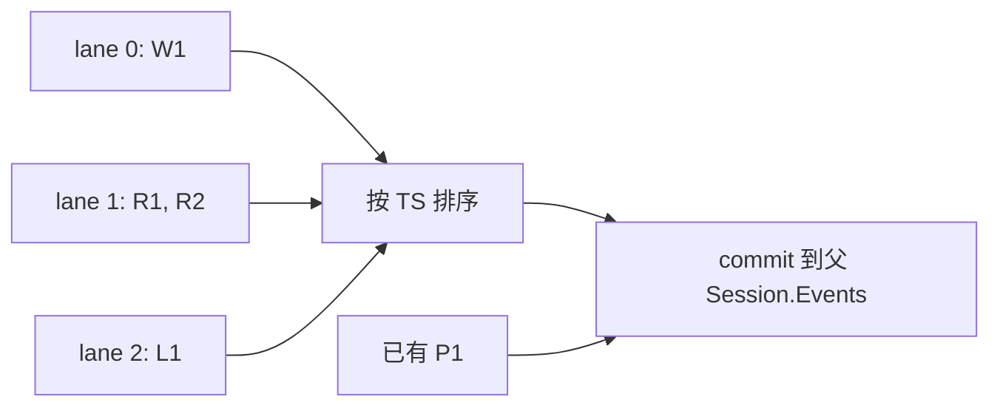

完成后，根 Sequential 把自己的恢复 state 清空，继续运行 index 2 的 `improve_draft`，而不是再次 Resume 后面的新步骤。

## 10. 进入 Loop：writer 如何看到全部研究结果

Loop child 自己的 flowAgent 重建 input 时，父 session 已经包含 planner 和全部研究事件：

```text
RootInput
+ planner P1
+ web W1
+ repo R1/R2
+ policy L1
```

第一轮 writer 的 input 会经过 history rewriter，形成面向 writer 的上下文。它无需知道这些事件最初来自 Parallel，也无需手工读取三个结果字段。

### 10.1 第一轮：审校不通过

```text
iteration 0:
  writer   → D1: 初稿
  reviewer → V1: 结构不够清晰，请修订
```

reviewer 没发 BreakLoop，所以 Loop 开始下一轮。

### 10.2 第二轮：审校通过

第二轮 writer 能看到 D1 与 V1：

```text
iteration 1:
  writer   → D2: 修订稿
  reviewer → V2: 审校通过 + BreakLoop(Done=false)
```

当前 Loop 消费 BreakLoop：

```text
Done              = true
CurrentIterations = 1
```

然后转发该事件并结束，不进入 iteration 2。

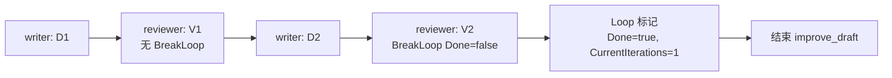

### 10.3 Loop 的 RunPath 怎样累积

执行历史路径可能是：

```text
D1: report_pipeline / planner / research / improve_draft / writer
V1: report_pipeline / planner / research / improve_draft / writer / reviewer
D2: report_pipeline / planner / research / improve_draft / writer / reviewer / writer
V2: report_pipeline / planner / research / improve_draft / writer / reviewer / writer / reviewer
```

这不是静态对象树越来越深，而是 RunPath 在表达“先后执行过哪些 Agent”。Address 仍然把 writer 和 reviewer 视为 Loop 的 sibling child。

## 11. 第三步完成后，approval 产生第二次中断

根 Sequential 接着运行 index 3 的 `approval`。approval 检查到尚无人工决定，发出：

```go
StatefulInterrupt(
    ctx,
    "请审批最终报告",
    &ApprovalState{ReportVersion: 2},
)
```

根 Sequential 保存新的状态：

```text
sequentialWorkflowState.InterruptIndex = 3
```

第二次 checkpoint 与第一次不同：

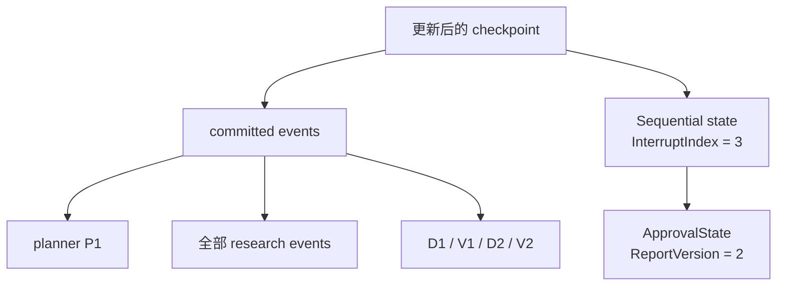

第一次 Parallel 的 state 已经完成使命：lane events 已 join 到 session。当前恢复链只需定位 approval，不再包含 repo 的旧中断点。

## 12. 第二次 Resume 与最终发布

用户批准后：

```go
iter, err = runner.ResumeWithParams(
    ctx,
    "report-2026-001",
    &adk.ResumeParams{
        Targets: map[string]any{
            approvalInterruptID: ApprovalDecision{
                Approved: true,
                Comment:  "可以发布",
            },
        },
    },
)
```

根 Sequential 重建 approval 之前的 RunPath：

```text
planner / research / improve_draft
```

然后：

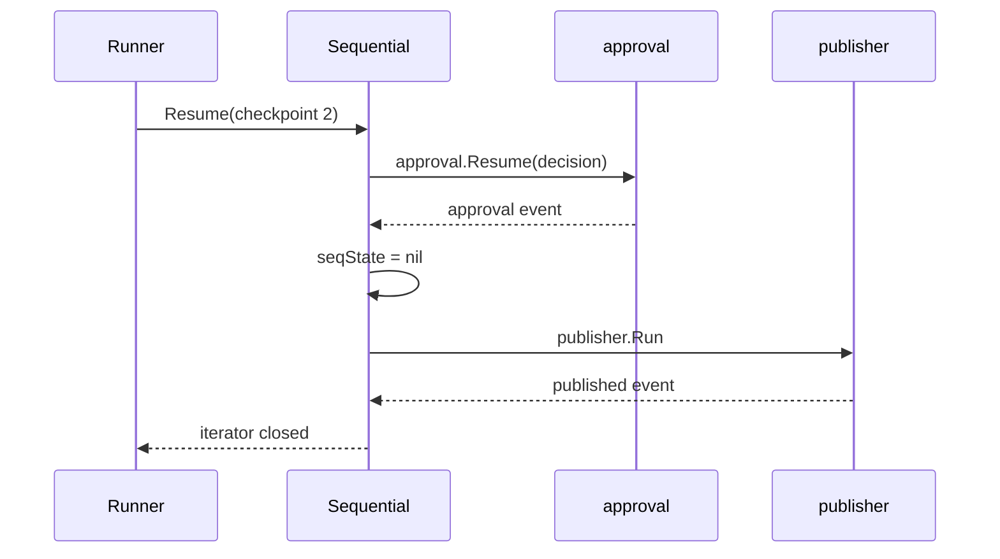

publisher 的 input 包含完整历史：用户请求、规划、并行研究结果、两轮写作审校以及审批结果。整个过程没有重新运行 planner、research 或 improve_draft。

## 13. 完整时间线

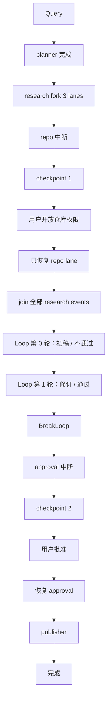

## 14. 事件在 UI 与 session 中的差别

这个案例最容易忽略的一点是：**事件发送给上游**与**事件提交到 session**是两件事。

| 阶段 | UI/调用方已经看到 | 父 Session.Events | 暂存在 state |
| --- | --- | --- | --- |
| planner 后 | P1 | P1 | 无 |
| Parallel 首次中断 | P1、W1、R1、L1、interrupt | P1 | W1/R1/L1 lane events |
| Parallel 恢复并 join 后 | 可能只新增 R2 和后续事件 | P1 + W1/R1/L1/R2 | 无 |
| approval 中断后 | 已看到两轮写作与 approval interrupt | 研究 + 写作审校历史 | approval state |

完成分支在 Parallel Resume 时不会重新向 UI 重发 W1/L1，但它们会从 state 恢复并 join 到 session，供后续 Agent 使用。这是“避免重复副作用”与“保留完整历史”同时成立的关键。

## 15. 如果关键事件换一种类型会怎样

### 15.1 repo 返回普通 Err，而不是 Interrupt

Parallel 会转发 Err，但不会取消 web/policy，也不会自动生成 checkpoint。全部 lane 结束后仍会 join。根 Sequential 随后还可能进入 improve_draft。

如果“无仓库权限”是可由用户补充后继续的条件，应使用 Interrupt；如果是不可恢复失败且必须停止整个流水线，则需要显式错误策略，不能只依赖 Parallel 的普通 Err。

### 15.2 reviewer 返回普通 Err

Loop 会转发 Err，并可能继续后续 child 或下一轮。需要停止时，应让 reviewer 或外层策略产生 Exit / 取消，或自定义 Loop 错误处理。

### 15.3 reviewer 在事件流中间发 BreakLoop，之后又发 Output

该 BreakLoop 不再是终端 Action，会先被转发，但不会结束 Loop。只有 iterator 关闭时仍暂存在 `lastActionEvent` 的 Action 才会被解释为终端控制信号。

### 15.4 web 完成后 repo 中断，Resume 时重新排列 child

如果从 `[web, repo, policy]` 改成 `[repo, web, policy]`，旧 state 的 index 0 仍保存 W1，却会被灌回新的 repo lane，导致历史错配。checkpoint 存续期间必须保持拓扑稳定。

## 16. 让这个案例更适合生产环境

### 16.1 给每条 Parallel lane 独立 session key

推荐：

```text
research.web.result
research.repo.result
research.policy.result
```

不推荐三个 lane 同时写 `research.result`。后者是 last-writer-wins，结果不确定。

### 16.2 外部副作用必须幂等

虽然完成 lane 在正常 Resume 路径不会重跑，但仍应防范：

- checkpoint 保存失败后的应用级重试；
- 进程在副作用成功、事件尚未持久化之间崩溃；
- 人工误用新 checkpoint ID 重新 Query；
- 自定义恢复逻辑重复调用外部服务。

可用业务幂等键：

```text
checkpoint ID + workflow name + child name + operation ID
```

### 16.3 Loop 同时设置上限和业务 break

即使 reviewer 能发 BreakLoop，也保留合理 `MaxIterations`。它是防止模型输出异常、评价标准永远不满足或业务 Agent 漏发 Action 的最后一道保护。

### 16.4 记录 AgentEvent，而不是只记录最终文本

建议日志至少包含：

```text
checkpoint_id
agent_name
run_path
event kind: output/action/error
interrupt target ID
loop iteration（如果业务可得）
lane/来源标识
```

这样才能区分“事件已向 UI 发送但尚未 join”和“事件已经成为后继 Agent 的历史”。

## 17. 调试这个嵌套 Workflow 的检查顺序

### 症状：writer 看不到 planner 或研究结果

依次检查：

1. child event 的 RunPath 是否由 flowAgent 正确设置；
2. event 是否在正确的 lane/session 中记录；
3. Parallel 是否成功 join，还是仍处于 interrupt state；
4. `getMessageFromWrappedEvent` 是否能从事件提取 Message；
5. history rewriter 是否删除或改写了相关事件。

### 症状：Resume 后 web 又执行了一次

检查：

1. 是否真的通过 `Runner.ResumeWithParams` 恢复，而不是重新 `Query`；
2. checkpoint ID 是否相同；
3. interrupt Address 是否能唯一定位 repo；
4. child name 是否修改或重复；
5. Parallel child 顺序是否变化。

### 症状：BreakLoop 没结束循环

检查：

1. BreakLoop 是否为 child iterator 的最后 Action；
2. `Done` 是否在进入当前 Loop 前已经是 true；
3. Action 是否被 AgentTool 边界吞掉；
4. 发信号的 Agent 是否真的位于该 Loop 的直接或嵌套事件路径上；
5. 是否把普通文本“结束循环”误当成程序化 Action。

### 症状：第一次中断恢复后历史重复

检查：

1. 是否手工把 lane events 同时写进父 session 和 `SubAgentEvents`；
2. 自定义 Agent 是否重复发送恢复前的普通事件；
3. 是否绕过内置 `forkRunCtx` / `joinRunCtxs`；
4. 外部存储是否把同一 checkpoint 恢复了多次。

## 18. 把案例压缩成一张“数据所有权图”

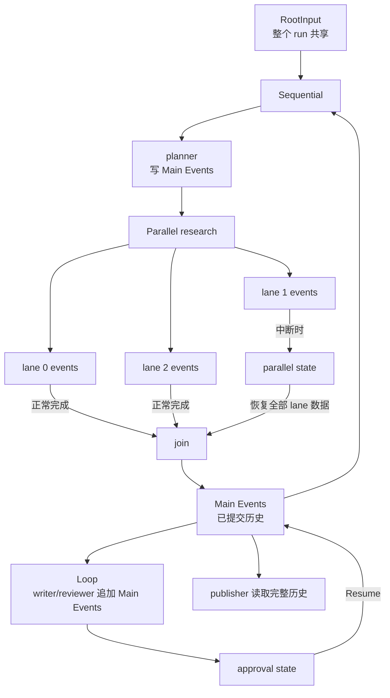

## 19. 从案例反推设计原则

这个实现选择可以归纳为五条：

1. **控制流与业务 Agent 分离**：Workflow 只决定何时运行 child；
2. **历史而非参数连线**：child 通过 RootInput + events 获取前文；
3. **并行写入先隔离后提交**：lane 完成后再 join；
4. **中断是层级结构**：每层只保存自己恢复所需的最小 state；
5. **恢复不是重放整个流程**：已完成 Sequential step 和 Parallel lane 都跳过。

掌握这五点后，再读 `adk/workflow.go` 时，`InterruptIndex`、`SubAgentEvents`、`LoopIterations`、`updateRunPathOnly`、`forkRunCtx` 和 `joinRunCtxs` 就不再是零散工具函数，而是一套完整的一致性方案。

继续阅读：[Workflow Agent 深入解析](./workflows.md)、[Context 的逐层传播](./context-flow.md)、[事件与异步迭代器](./events.md)、[中断、检查点与恢复](./interrupt-resume.md)、[并发、取消与错误边界](./concurrency-errors.md)。

<div class="source-path">案例对应实现：adk/workflow.go、adk/flow.go、adk/runctx.go、adk/interrupt.go、adk/runner.go<br>嵌套行为测试：adk/workflow_test.go 的 TestParallelWorkflowResumeWithEvents 与 TestNestedParallelWorkflow</div>
