# Workflow Agent：从构造、运行到中断恢复

::: warning 当前官方定位
Sequential/Parallel/Loop API 仍完整存在，但当前源码已把 Workflow-based agent collaboration 标为 `NOT RECOMMENDED`：多数动态多 Agent 场景优先使用 ChatModelAgent + AgentTool，通用复杂 Agent 优先参考 DeepAgent。本章仍详细展开，因为确定性流水线、并行 fan-out/join、已有系统维护和 checkpoint 学习仍需要理解其实现。
:::

Workflow Agent 是 ADK 中负责**确定性控制流**的一组 Agent：

- `SequentialAgent`：按顺序执行一组子 Agent；
- `ParallelAgent`：并发执行一组子 Agent；
- `LoopAgent`：反复按顺序执行一组子 Agent。

它们不是另一套独立运行时。它们仍然实现 `Agent` / `ResumableAgent`，仍然接收 `AgentInput`、输出 `AgentEvent`，仍然由 `Runner` 驱动，也仍然使用 `runContext`、session history、Address、checkpoint 和 interrupt tree。特殊之处只在于：**普通 Agent 决定“做什么”，Workflow Agent 决定“下一个 Agent 何时运行”。**

::: tip 配套 Demo
建议先运行 [Demo 阶梯](./demo-ladder.md) 的 Demo 8，再阅读本章的 Sequential、Parallel、Loop 和 fork/join 细节。
:::

> 本章按源码真实执行顺序讲解。重点文件是 `adk/workflow.go`、`adk/flow.go`、`adk/runctx.go`、`adk/interrupt.go` 和 `adk/workflow_test.go`。

## 1. 先建立整体心智模型

假设业务需要“先规划，同时查资料，再反复写作和审校”，可以组合为：

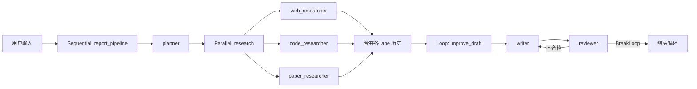

三种 Workflow 解决的是不同问题：

| 类型 | 核心问题 | 子 Agent 如何看到前文 | 典型用途 |
| --- | --- | --- | --- |
| Sequential | 谁先、谁后 | 后一个 child 从 session history 看到前面 child 的事件 | 规划 → 执行 → 总结 |
| Parallel | 哪些任务可以同时做 | 每条 lane 看到共同的已提交历史和本 lane 新历史 | 多源检索、独立评估 |
| Loop | 一组步骤要重复多少次 | 下一步和下一轮都能看到此前已记录事件 | 写作 → 审校 → 修订 |

它们和 LLM 自主转交不是一回事：

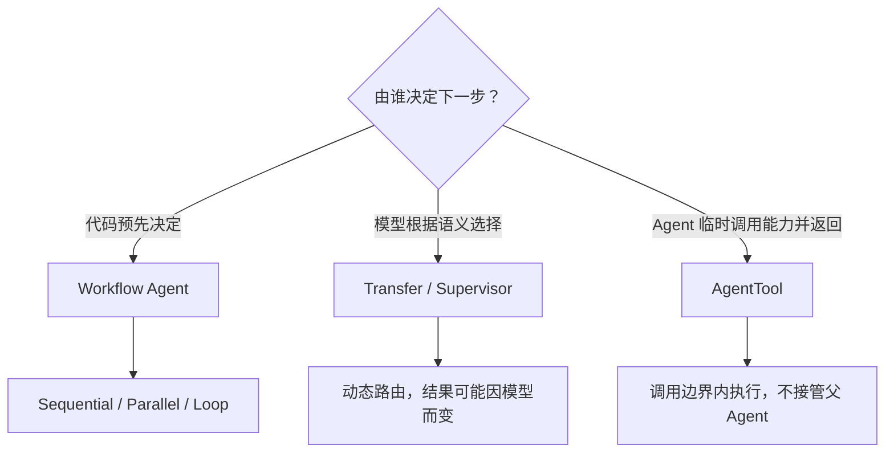

## 2. 对外 API 与最小示例

三个公开构造函数都返回 `ResumableAgent`：

```go
seq, err := adk.NewSequentialAgent(ctx, &adk.SequentialAgentConfig{
    Name:        "report_pipeline",
    Description: "先研究，再写报告",
    SubAgents:   []adk.Agent{planner, researcher, writer},
})

par, err := adk.NewParallelAgent(ctx, &adk.ParallelAgentConfig{
    Name:        "multi_source_research",
    Description: "并行查找不同来源",
    SubAgents:   []adk.Agent{webAgent, codeAgent, paperAgent},
})

loop, err := adk.NewLoopAgent(ctx, &adk.LoopAgentConfig{
    Name:          "draft_improver",
    Description:   "写作和审校循环",
    SubAgents:     []adk.Agent{writer, reviewer},
    MaxIterations: 3,
})
```

公开配置很薄：

```text
SequentialAgentConfig = Name + Description + SubAgents
ParallelAgentConfig   = Name + Description + SubAgents
LoopAgentConfig       = Name + Description + SubAgents + MaxIterations
```

源码中的构造函数直接解引用 `config`，没有统一做 nil 校验；`newWorkflowAgent` 也不会统一校验空名称、nil child 或重名 child。实际项目应在配置装配层校验，而不要等到运行时才暴露问题。

## 3. 三个公开类型，其实共用一个内核

源码没有分别实现三个大结构体，而是通过 `workflowAgent.mode` 分派：

```text
workflowAgentModeSequential
workflowAgentModeLoop
workflowAgentModeParallel
```

`workflowAgent` 保存：

```go
type workflowAgent struct {
    name          string
    description   string
    subAgents     []*flowAgent
    mode          workflowAgentMode
    maxIterations int
}
```

因此它们共享同一套：

- goroutine 与 `AsyncIterator` 输出模型；
- panic → error event 的保护；
- child 的 `flowAgent` 包装；
- `AgentEvent` 与 Action 传播；
- CompositeInterrupt 与 checkpoint 恢复体系。

只有核心调度算法不同：

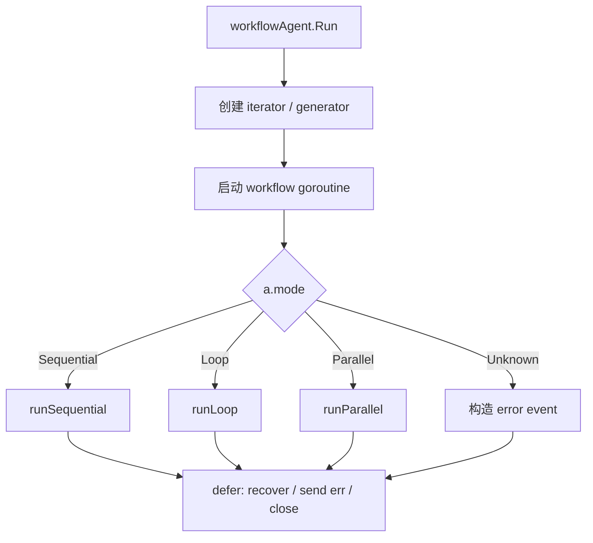

## 4. 构造阶段到底创建了什么

三个公开构造函数最终都调用：

```text
newWorkflowAgent(ctx, name, desc, subAgents, mode, maxIterations)
```

它不是直接返回裸 `workflowAgent`，而是经历四步：

1. 创建内部 `workflowAgent`；
2. 每个 child 通过 `toFlowAgent(..., WithDisallowTransferToParent())` 包装；
3. `setSubAgents` 建立父子关系，并触发 `OnSubAgents` 生命周期钩子；
4. 再把 `workflowAgent` 自己包装成根 `flowAgent`，返回这个外层对象。

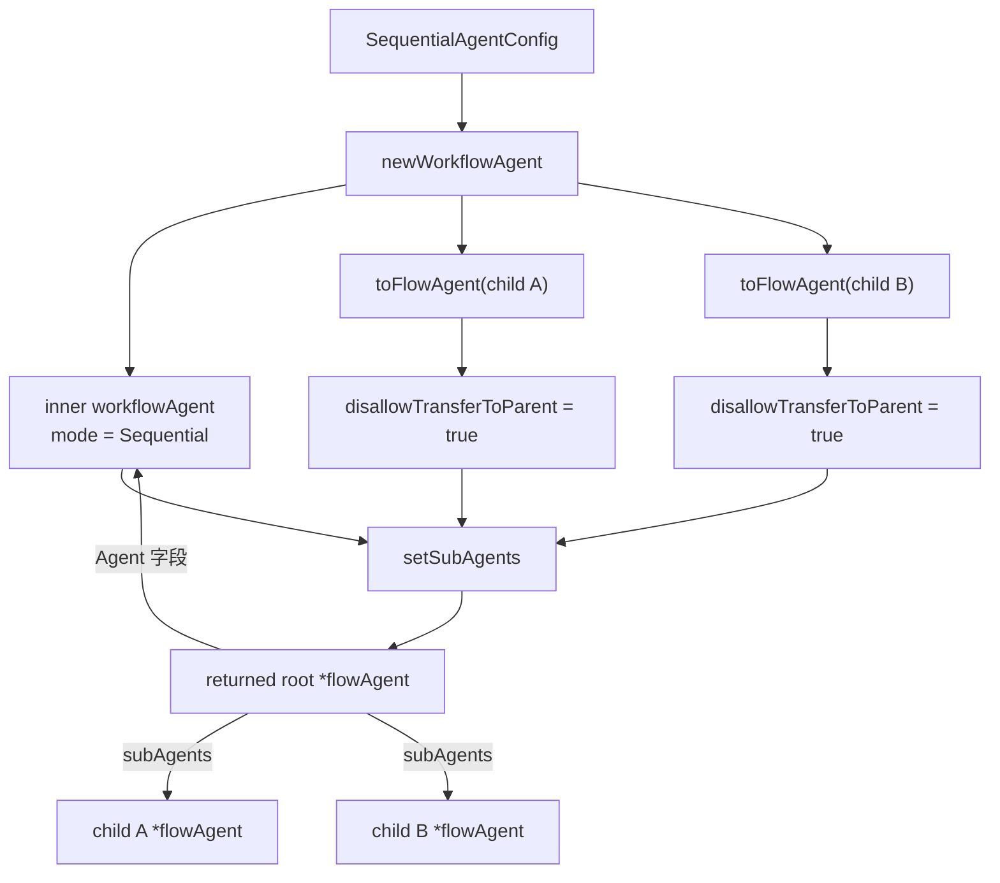

所以运行时的对象关系不是简单的 `workflow → child`，而是：

```text
返回给 Runner 的 *flowAgent
  ├─ Agent: *workflowAgent
  └─ subAgents: []*flowAgent
       ├─ child A wrapper → 原始 Agent A
       ├─ child B wrapper → 原始 Agent B
       └─ child C wrapper → 原始 Agent C
```

### 4.1 为什么每个 child 都必须包一层 flowAgent

因为原始 `Agent` 接口只承诺 `Name`、`Description` 和 `Run`。而 Workflow child 还需要框架帮它完成：

- 将 child 名称加入 `RunPath` 和 Address；
- 从 RootInput + session events 重建本次 `AgentInput`；
- 给事件补 `AgentName` / `RunPath`；
- 把 child 自己的事件记入 session；
- 只让末尾有效 Action 影响控制流；
- 路由 child 内部的 Transfer；
- 在恢复时沿 Address tree 找到真正中断点。

这些都由 `flowAgent` 提供，不应该要求每个业务 Agent 重复实现。

### 4.2 “禁止转交给 Workflow 父节点”到底禁止了什么

`WithDisallowTransferToParent()` 会在 `setSubAgents` 时触发 child 的 `OnDisallowTransferToParent`。`ChatModelAgent` 收到后，不会把 Workflow parent 放进可用 transfer agents，也就不会给模型暴露“转交回 Workflow 容器”的工具选项。

目的很直接：Sequential 的后继、Loop 的下一轮应由 Workflow 决定，而不是由某个 ChatModelAgent 临时把控制权转交给容器。

但要注意边界：这是通过 `OnSubAgents` 能力通知协作 Agent，**不是针对任意自定义 Agent 的硬隔离沙箱**。如果自定义 Agent 手工构造 `TransferToAgent` Action，框架层仍会按一般 transfer 逻辑处理。自定义 Agent 应遵守 Workflow 的控制流约定。

## 5. 为什么外层 flowAgent 对 Workflow 有特殊分支

普通 Agent 的调用链是：

```text
flowAgent.Run
  → 原始 Agent.Run
  → flowAgent.run 消费事件
  → 补 RunPath、记录 session、解释末尾 Action
```

Workflow 的调用链不同：

```text
flowAgent.Run
  → 识别 a.Agent 是 *workflowAgent
  → 直接返回 workflowAgent.Run 的 iterator
```

源码里的特殊判断是：

```go
if wf, ok := a.Agent.(*workflowAgent); ok {
    return wf.Run(ctx, input, opts...)
}
```

原因是 child 已经各自经过 `flowAgent.run`，事件已经在正确的 child 路径上完成标记和记录。如果容器外层再执行一次通用 `flowAgent.run`，就可能把 child 事件错误地当成 Workflow 自己的事件重复处理。

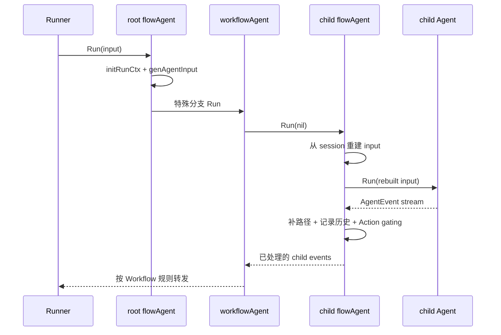

## 6. 输入看似传 nil，child 为什么仍然有上下文

`workflowAgent.Run(ctx, _ *AgentInput, ...)` 明确忽略第二个参数；调用 child 时又写成 `subAgent.Run(seqCtx, nil, opts...)`。这很容易让初学者误以为 child 收不到用户问题。

真正的数据链路是：

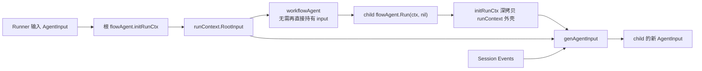

详细过程如下：

1. 根 `flowAgent.Run` 调 `initRunCtx`；
2. 若这是根调用且 input 非 nil，input 保存到 `runContext.RootInput`；
3. Workflow 把带 runContext 的 `ctx` 传给 child；
4. child `flowAgent.Run(ctx, nil)` 再调 `initRunCtx`；
5. 因为 ctx 已有 runContext，`deepCopy` 会保留原 RootInput 与 Session；
6. `genAgentInput` 复制 RootInput，再追加 session 中已有事件；
7. history rewriter 把其他 Agent 的输出改写为面向当前 child 的上下文消息。

例如 A 输出“找到 3 个文件”，B 收到的历史不是共享一个 Go 参数，而是近似：

```text
原始 user message
For context: [A] said: 找到 3 个文件.
```

这就是 ADK Workflow 的数据传递模型：**不是显式字段连线，而是 RootInput + 事件历史 + session KV。**

## 7. 三种容易混淆的“路径”

理解 Workflow 恢复前，必须区分：

| 概念 | 用途 | Sequential 中是否累积前序 sibling |
| --- | --- | --- |
| `RunPath` | 事件归属、history 与调试展示 | 是 |
| Address | 中断树中定位静态嵌套层级 | 否，sibling 仍是 sibling |
| child index | Workflow checkpoint 的紧凑调度坐标 | 是，用数字定位 |

假设 Sequential 为 A → B：

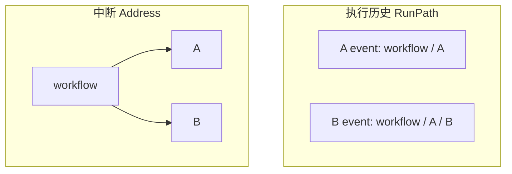

B 的 RunPath 包含 A，是为了表达“B 在 A 完成后运行”；但 B 的 Address 不能变成 A 的 child，否则恢复系统会误认为 B 静态嵌套在 A 里面。

因此 Sequential / Loop 使用 `updateRunPathOnly`：只增加执行历史，不修改 Address。

## 8. Action 为什么要等 child iterator 结束再判断

Sequential 和 Loop 都使用一个 `lastActionEvent` 缓冲槽：

```text
收到普通事件       → 立即转发
收到 Action 事件 A → 暂存 A
又收到事件 B       → 先转发 A，再处理 B
iterator 结束      → 如果仍有暂存 Action，它才是“终端 Action”
```

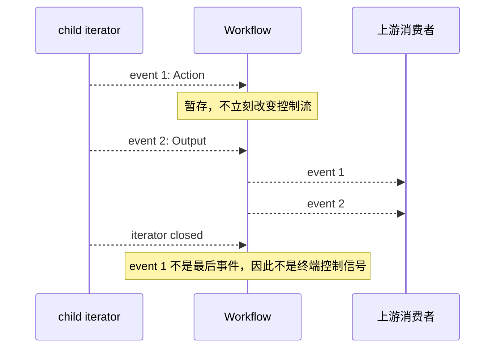

为什么这样设计？因为事件流中间出现 Action，并不一定代表 child 真正结束。例如某个底层能力可能先产生带 Action 的事件，随后还会产生工具结果或最终输出。Workflow 只把 child 最后留下的 Action 解释为“退出、打断或 break”。

这与 `flowAgent.run` 的末尾 Action gating 是同一设计方向：控制流应由当前 Agent 执行的最终有效 Action 决定。

---

## 9. SequentialAgent：逐步算法

Sequential 的核心目标是：**完整消费当前 child，再启动下一个 child。**

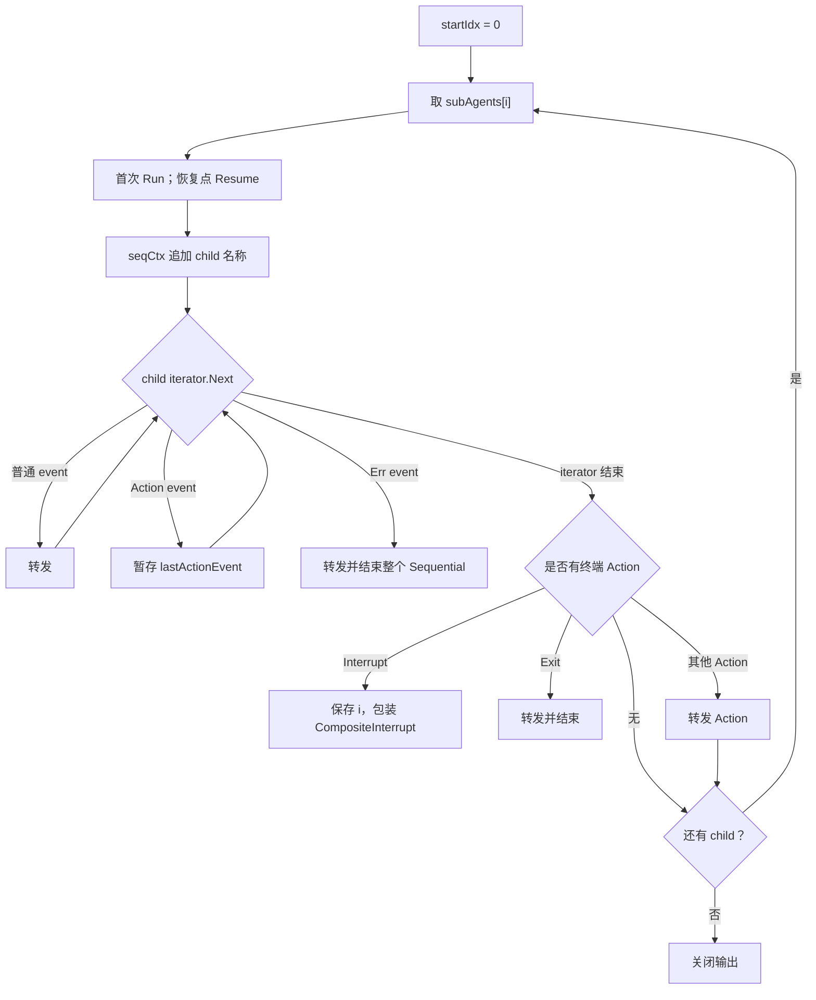

### 9.1 一个两步序列如何共享历史

假设 A 产生事件 `A1`，B 产生 `B1`：

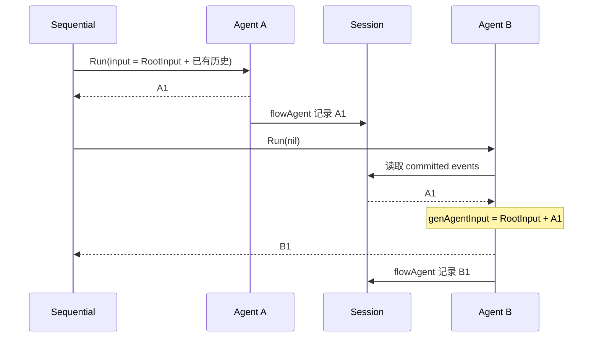

所以 Sequential 不需要把 A 的输出手工塞进 B 的字段。B 通过统一历史重建看到 A 的输出。

### 9.2 Sequential 遇到不同事件会怎样

| child 的终态 | Sequential 行为 | 下一个 child |
| --- | --- | --- |
| 正常关闭，无 Action | 继续 | 运行 |
| 普通 Output | 立即转发 | 当前 child 结束后运行 |
| `Err != nil` | 转发错误并立即 return | 不运行 |
| 最后 Action 为 `Exit` | 转发并立即 return | 不运行 |
| 最后 Action 为 Interrupt | 包装 workflow state 并 return | 等恢复 |
| 最后 Action 为 BreakLoop | 本层不是 Loop，只转发 | 运行 |
| 最后 Action 为其他 Action | 转发 | 运行 |

这里有一个明确的源码特例：Sequential 在消费 child iterator 时直接检查 `event.Err != nil`，所以它对普通错误是 fail-stop。

检查 `event.Err` 发生在“发送此前暂存的 Action”之前。因此极端情况下，如果 child 先发一个 Action、随后又发 Err，Sequential 会直接转发 Err 并结束，那个尚未发送的 Action 不会再向上游转发。这也是为什么自定义 Agent 最好只在真正结束时发送控制 Action，不要在 Action 后继续发送错误或普通输出。

### 9.3 Sequential 的恢复状态为何只保存一个 index

状态结构非常小：

```go
type sequentialWorkflowState struct {
    InterruptIndex int
}
```

因为其他信息已有各自归属：

- 已完成输出：在 checkpoint 的 runSession events 中；
- 根输入：在 `runContext.RootInput`；
- child 的内部状态：在 child interrupt signal 中；
- 用户恢复数据：在 ResumeParams 对应的 interrupt target 中；
- Workflow 只需记住“停在第几个 child”。

### 9.4 Sequential Resume 的精确步骤

假设 A 已完成，B 中断，C 尚未运行：

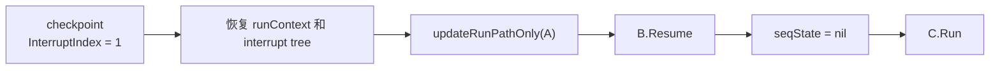

源码顺序是：

1. `startIdx = seqState.InterruptIndex`；
2. 把 `startIdx` 之前的 child name 补回 `seqCtx.RunPath`；
3. 在第一个待执行 child 上调用 `Resume`；
4. 把 `seqState` 置 nil，确保 Resume 只调用一次；
5. 该 child 完成后，其余 child 走普通 `Run`。

注意：这里不会重新运行 A。A 的事件已经随 checkpoint 恢复到 session，B 恢复时仍能读到。

### 9.5 Sequential 的 checkpoint 兼容风险

恢复状态用 index，不是稳定 ID。checkpoint 存活期间如果把 `[A, B, C]` 改成 `[X, A, B, C]`，旧的 `InterruptIndex = 1` 就会错误地指向 A。即使顺序不变，修改 Agent name 也可能破坏 Address tree 的恢复匹配。

因此 checkpoint 尚可能恢复时，不要：

- 在 child 列表前方插入或删除 Agent；
- 调整 child 顺序；
- 修改 Workflow 或 child 的名称；
- 让同一层出现重名 child。

---

## 10. LoopAgent：不是“重复一个 Agent”，而是重复一整个序列

Loop 的一轮是完整执行 `SubAgents[0..n-1]`。例如 `[writer, reviewer]`、`MaxIterations = 3` 的顺序是：

```text
第 0 轮：writer → reviewer
第 1 轮：writer → reviewer
第 2 轮：writer → reviewer
```

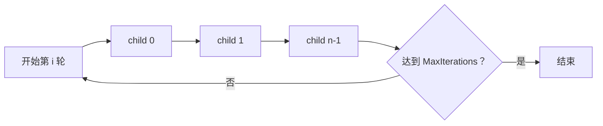

### 10.1 MaxIterations 的真实边界

循环条件直接写成：

```go
for i := startIter; i < a.maxIterations || a.maxIterations == 0; i++ {
```

因此：

| 值 | 语义 |
| --- | --- |
| `> 0` | 最多执行指定轮数 |
| `== 0` | 无限循环，直到 BreakLoop、Exit、Interrupt，或能响应 context 的 child / 外层机制终止运行 |
| `< 0` | 条件一开始即不成立，一轮也不执行 |

`MaxIterations == 0` 不是“不执行”，而是“没有轮数上限”。生产代码必须保证存在可靠终止路径。`runLoop` 自己没有在两轮之间显式检查 `ctx.Done()`；取消能否及时结束取决于 child 或更外层执行机制是否响应 context。若 child 立即返回且完全忽略已取消的 ctx，无限 Loop 仍可能继续空转。

### 10.2 Loop 的 Action 处理顺序

每个 child 结束时，Loop 按以下优先级解释终端 Action：

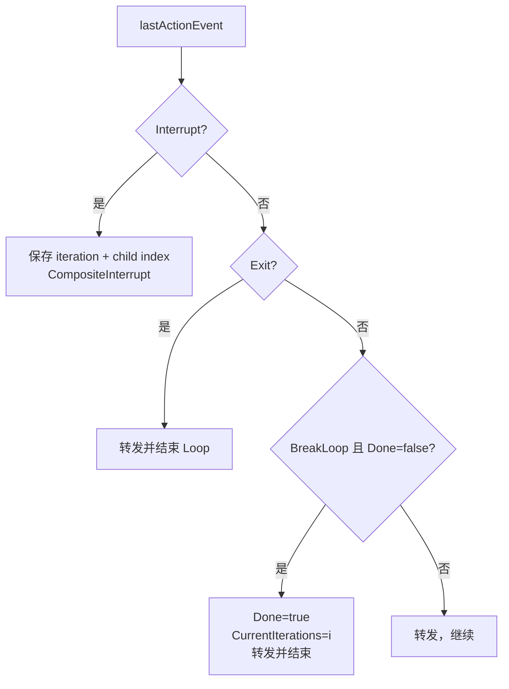

### 10.3 BreakLoop 是程序信号，不是给 LLM 随意调用的工具

`NewBreakLoopAction(agentName)` 创建：

```go
&AgentAction{
    BreakLoop: &BreakLoopAction{
        From: agentName,
    },
}
```

当前 Loop 消费时会原地补两个字段：

```text
Done = true
CurrentIterations = 当前内部轮数 i
```

`CurrentIterations` 从 0 开始。第 1 轮 break 时值是 0；如果 UI 要显示自然语言“第 1 轮”，应自行加一。

### 10.4 为什么 Done 能防止 break 穿透嵌套 Loop

假设内层和外层都是 Loop：

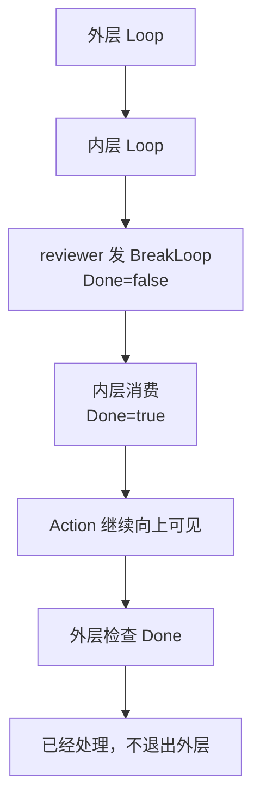

`doBreakLoopIfNeeded` 只消费 `BreakLoop != nil && !Done` 的 Action。因此一次 break 只结束离它最近、尚未处理该信号的 Loop。

### 10.5 Loop 对 Err 的行为与 Sequential 不同

这是一个很容易从直觉推错、也值得在业务层显式处理的细节：`runLoop` 消费 child event 时没有 `event.Err != nil` 的立即 return 分支。

因此源码当前行为是：

1. error event 像普通非 Action event 一样转发；
2. 当前 child iterator 结束后，Loop 仍可能继续下一个 child；
3. 当前轮结束后，仍可能进入下一轮。

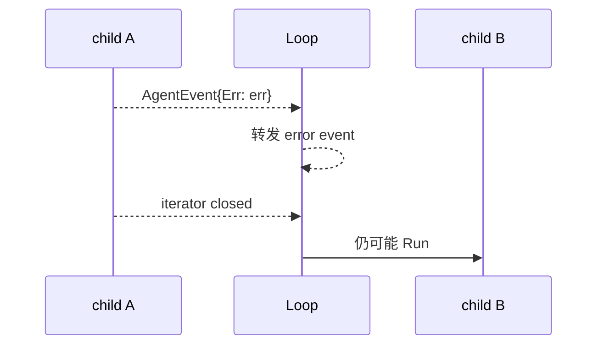

如果业务需要“任意错误立即停止重试循环”，可采用：

- child 把不可恢复失败转换为 `Exit`；
- 在 Loop 外包装自定义控制 Agent；
- 取消 context；
- 或修改/扩展 Workflow 策略并为此增加测试。

### 10.6 Loop 的恢复坐标

Loop 需要二维坐标：

```go
type loopWorkflowState struct {
    LoopIterations int
    SubAgentIndex  int
}
```

例如第 2 轮（内部 index 1）的 reviewer 中断：

```text
LoopIterations = 1
SubAgentIndex  = 1
```

恢复前需要重建 RunPath：

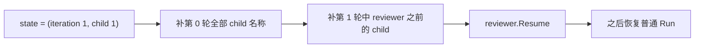

对应 `[writer, reviewer]`，重建路径先追加：

```text
writer / reviewer / writer
```

然后对 reviewer 调 Resume。恢复完成后 `startIdx` 会重置为 0，下一轮重新从 writer 开始。

---

## 11. ParallelAgent：并行的不只是 goroutine，还有独立事件 lane

如果仅仅给每个 child 开 goroutine，却让所有 child 同时 append 同一个历史切片，会产生竞态，也会让某条分支在执行中看到另一条尚未完成分支的半成品历史。

ADK 的解决方式是 `forkRunCtx` / `joinRunCtxs`：

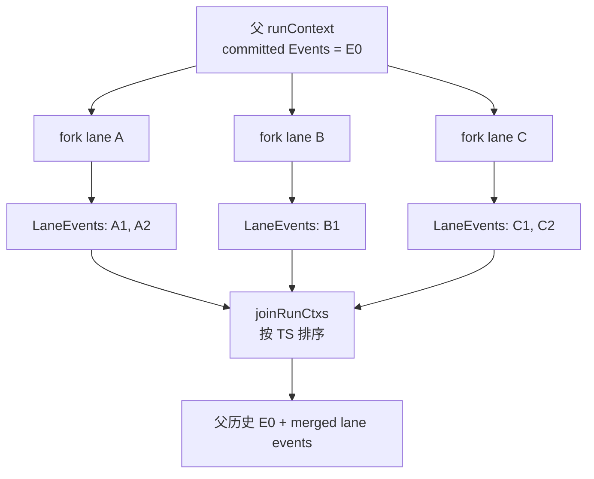

### 11.1 fork 时哪些共享，哪些隔离

`forkRunCtx` 为每个 child 创建新的 `runSession` 外壳，但字段的所有权不同：

| 数据 | fork 后行为 | 原因 |
| --- | --- | --- |
| `RootInput` | 共享同一指针 | 所有分支起点相同 |
| `RunPath` | 复制 slice | 每个 child 独立追加路径 |
| committed `Events` | 共享已有 slice 视图 | 所有分支都应看到 fork 前历史 |
| `Values` map | 共享 | 分支可用 session KV 协作 |
| `valuesMtx` | 共享 | 保护共享 map 的 get/set |
| `LaneEvents` | 每条 lane 独立 | 分支执行中不互相污染事件历史 |

lane 内调用 `getEvents()` 时，能看到：

```text
父级已提交 Events
+ 祖先 lane events
+ 当前 lane events
```

看不到 sibling lane 的执行中事件。

### 11.2 Parallel 的完整运行时序

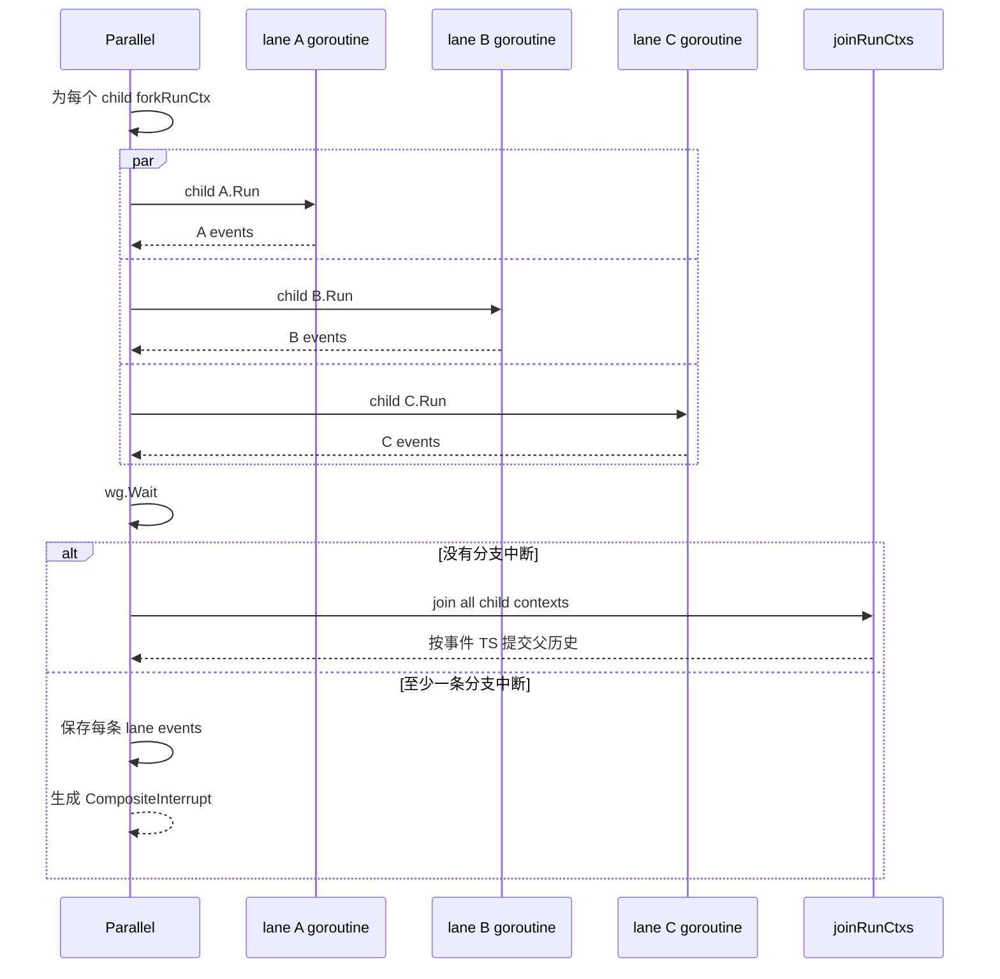

每条 child goroutine 做的事情很少：

1. 决定本分支是 `Run`、`Resume` 还是跳过；
2. 消费 child iterator；
3. 遇到 internal interrupt 时，在 mutex 下收集 signal 与旧兼容数据，然后停止该 lane；
4. 其他事件直接发往父 generator；
5. defer 捕获 lane panic 并 `wg.Done()`。

### 11.3 两种“顺序”不要混为一谈

Parallel 存在两种顺序：

- **上游观察到的发送顺序**：多个 goroutine 竞争向 generator 发送，由调度决定；
- **最终写入 session 的历史顺序**：`joinRunCtxs` 收集 leaf lane events，并按事件包装时的纳秒时间戳 `TS` 排序。

二者通常接近，但不应把它们当成严格一致的业务排序。时间戳相同或并发调度变化时，也不应依赖 lane 输出的稳定先后。

如果结果必须确定，增加一个 Sequential 后继汇总 Agent，让它按来源名称、优先级或业务 key 显式排序。

### 11.4 session Values 的并发安全边界

`AddSessionValue` / `GetSessionValue` 对共享 map 使用同一个 `valuesMtx`，所以 map 的单次 get/set 安全。但下面两件事仍不自动安全：

```go
// 1. 读-改-写不是一个原子事务
v, _ := adk.GetSessionValue(ctx, "count")
adk.AddSessionValue(ctx, "count", v.(int)+1)

// 2. map 中 value 指向的对象内部没有被 valuesMtx 保护
shared, _ := adk.GetSessionValue(ctx, "items")
shared.([]string)[0] = "changed"
```

多个 lane 写同一 key 时，最终结果是最后一次获得锁并写入的值，业务上仍然是非确定的。推荐每条 lane 写独立 key，最后由汇总 Agent 合并。

## 12. Parallel Interrupt：为什么不能立刻 join

普通完成时可以把 lane 事件提交到父历史。但分支中断时，如果先 join，再恢复时又把同一分支重放，历史可能重复；如果什么都不保存，已完成分支和中断前输出又会丢失。

因此 Parallel 中断时保存：

```go
type parallelWorkflowState struct {
    SubAgentEvents map[int][]*agentEventWrapper
}
```

同时把各中断 child 的 signal 合成一个 CompositeInterrupt。

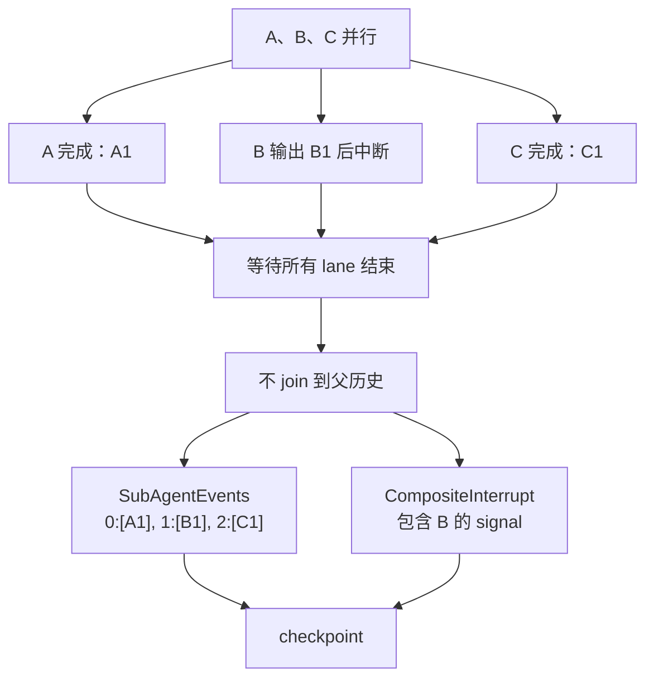

### 12.1 恢复时为何只重跑中断分支

`getNextResumeAgents` 从恢复 context 中的 Address tree 取出当前层下一批恢复点。恢复步骤是：

1. 为所有 child 重新 fork context；
2. 按 index 把 `SubAgentEvents` 填回对应 lane；
3. 从 interrupt Address tree 得到仍需恢复的 child name 集合；
4. 集合中的 child 调 `Resume`；
5. 不在集合中的 child 说明上次已经完成，直接 return，不重跑；
6. 全部分支完成且没有新中断后，把旧 lane events + 恢复产生的新 events 一起 join。

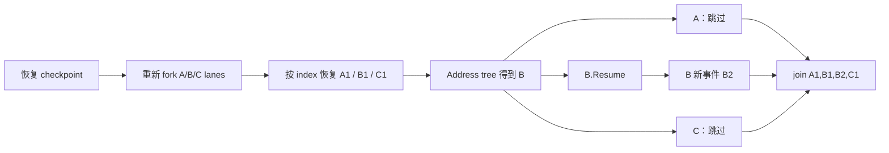

这解释了 `TestParallelWorkflowResumeWithEvents` 验证的两个关键性质：

- 中断分支 Resume 时只能看到共同历史和自己的旧 lane 事件，不能看到 sibling 的 lane 事件；
- 已完成分支在 Resume 时不会再次运行。

### 12.2 Parallel state 为什么同时依赖 index 和 name

两个维度各有用途：

- index：`SubAgentEvents[index]` 找回正确 lane；
- name / Address：判断哪条分支位于中断路径上。

所以旧 checkpoint 恢复前，既不能重排 child，也不应改名，更不能在同一层用重复名称。

### 12.3 Parallel 不是 fail-fast

Parallel 对事件的处理规则是：

| 分支事件 | 当前 lane | sibling lane | 最终 Workflow |
| --- | --- | --- | --- |
| 普通 Output | 转发并继续 | 继续 | 等全部结束后 join |
| `Err != nil` | 转发；通常等 iterator 自己结束 | 不取消 | 仍等待全部 goroutine |
| `Exit` | 作为 child event 转发 | 不取消 | 不代表退出整个 Parallel |
| `BreakLoop` | 转发 | 不取消 | Parallel 不消费 |
| internal Interrupt | 收集后停止此 lane | 继续到各自结束/中断 | 汇总成 CompositeInterrupt |
| panic | lane defer 转成 error event | 不取消 | `wg.Wait` 后继续收尾 |

因此“一个分支失败立即取消全部分支”不是当前内置语义。需要 fail-fast 时，应设计共享可取消 context、业务协调器或自定义 Parallel 策略，并认真处理已发生的外部副作用。

---

## 13. Run 与 Resume 是两套入口，但共用同一输出纪律

### 13.1 Run

`workflowAgent.Run` 创建 iterator/generator，启动一个 goroutine，再按 mode 调度。外层 defer 保证：

- 内部函数返回 error → 发一个 `AgentEvent{Err: err}`；
- panic → `safe.NewPanicErr`，携带堆栈并发 error event；
- 无论成功失败都关闭 generator。

### 13.2 Resume

`workflowAgent.Resume` 不优先根据 `a.mode` 分派，而是根据 checkpoint 恢复出的 state 动态类型分派：

```mermaid
flowchart TD
    Resume["workflowAgent.Resume"] --> State{"InterruptState 动态类型"}
    State -->|"*sequentialWorkflowState"| Seq["runSequential"]
    State -->|"*parallelWorkflowState"| Par["runParallel"]
    State -->|"*loopWorkflowState"| Loop["runLoop"]
    State -->|"nil"| Panic["panic，再被 defer 转 error event"]
    State -->|"其他类型"| Err["unsupported state type error event"]
```

这意味着“怎么恢复”由持久化状态本身说明，而不是只相信当前配置的 mode。三个 state 类型都在 `init()` 中向 schema 注册稳定名称，供 checkpoint 序列化：

```text
eino_adk_sequential_workflow_state
eino_adk_parallel_workflow_state
eino_adk_loop_workflow_state
```

### 13.3 新旧两层中断数据为什么同时存在

Workflow 构造 CompositeInterrupt 时保存两套信息：

- 新机制：internal interrupt tree + 强类型 Workflow state；
- 兼容机制：`WorkflowInterruptInfo` 放进 `InterruptInfo.Data`。

`WorkflowInterruptInfo` 包含旧字段：

```text
OrigInput
SequentialInterruptIndex
SequentialInterruptInfo
LoopIterations
ParallelInterruptInfo[index]
```

Workflow 内部恢复 child 时仍会从 `resumeInfo.Data.(*WorkflowInterruptInfo)` 取兼容层 child InterruptInfo，而恢复路由和 state 则由新的 interrupt context 机制提供。阅读源码时不要把两者当成两次独立 checkpoint；它们是迁移期共存的表示。

## 14. 嵌套 Workflow 如何包装中断

设根 Sequential 中包含一个 Parallel，Parallel 的 B 分支中断：

```mermaid
flowchart TB
    Root["Sequential root"] --> A["planner 已完成"]
    Root --> P["Parallel research"]
    P --> PA["branch A 已完成"]
    P --> PB["branch B 中断"]
    P --> PC["branch C 已完成"]
    PB --> I1["child interrupt signal"]
    PA --> PS["parallelWorkflowState<br/>保存所有 lane events"]
    PB --> PS
    PC --> PS
    I1 --> PI["Parallel CompositeInterrupt"]
    PS --> PI
    PI --> SS["sequentialWorkflowState<br/>InterruptIndex = research"]
    SS --> SI["Sequential CompositeInterrupt"]
```

恢复时方向相反：

```mermaid
sequenceDiagram
    participant R as Runner.Resume
    participant S as Sequential
    participant P as Parallel
    participant B as branch B
    R->>S: 恢复根 state
    S->>P: Parallel.Resume
    P->>P: 恢复所有旧 lane events
    P->>B: 只对 B 调 Resume
    B-->>P: 完成
    P->>P: join lanes
    P-->>S: Parallel 完成
    S->>S: 继续下一个 child
```

测试 `TestNestedParallelWorkflow` 进一步证明：Parallel 之前的 predecessor event 对每条内层 lane 都可见；恢复后内层分支仍能看到 predecessor + 自己的旧 lane event；整个 Parallel 成功 join 后，Sequential 的 successor 能看到所有分支历史。

## 15. Action、错误、取消与 panic 总表

下表按源码当前行为整理，而不是按“通常应该怎样”推测：

| 情况 | Sequential | Loop | Parallel |
| --- | --- | --- | --- |
| 普通 Output | 转发；child 完成后继续 | 转发；继续 child/轮次 | 并发转发；完成后 join |
| 普通 `Err` event | **立即停止整个序列** | **转发但不自动停止循环** | **转发但不取消 sibling** |
| 终端 `Exit` | 停止整个序列 | 停止整个循环 | 不取消 sibling；只是分支事件 |
| 终端 Interrupt | 保存 child index | 保存 iteration + child index | 保存全部 lane events，汇总所有中断 |
| `BreakLoop(Done=false)` | 不消费 | 当前 Loop 消费并结束 | 不消费 |
| `BreakLoop(Done=true)` | 转发 | 不再消费，可向外传播 | 转发 |
| child 同步 panic | 外层 Workflow recover，整体结束 | 外层 Workflow recover，整体结束 | lane recover，其他 lane 继续 |
| context 取消 | 取决于 child 是否响应 ctx | 同左；无限循环尤其要响应 | 不会由 Workflow 主动取消 sibling |

> `AgentEvent.Err` 是事件，不等同于 Go 函数直接 `return err`。Workflow 三种算法对这个事件的策略确实不同，调用方要按源码语义设计。

## 16. AgentRunOption 如何穿过 Workflow

Workflow 调 child 时把原始 `opts...` 继续传下去。真正进入某个原始 child Agent 前，child 的 `flowAgent.Run` 会调用：

```text
filterOptions(childName, opts)
```

因此用 `DesignateAgent` 指定的实现专用 option，只会交给名字匹配的 Agent：

```go
workflow.Run(
    ctx,
    input,
    optionForA.DesignateAgent("agent_a"),
    optionForB.DesignateAgent("agent_b"),
)
```

```mermaid
flowchart LR
    Opts["opts: A专用 + B专用 + 全局"] --> WF["Workflow 原样向下传"]
    WF --> FA["flowAgent A<br/>filterOptions(A)"]
    WF --> FB["flowAgent B<br/>filterOptions(B)"]
    FA --> A["A专用 + 全局"]
    FB --> B["B专用 + 全局"]
```

`TestFilterOptions` 同时覆盖了 Sequential 与 Parallel，确保 Workflow 不会提前把其他 child 的 option 丢掉，也不会把 A 专用 option 交给 B 的底层实现。

## 17. 空子 Agent、名称与配置的真实行为

| 配置情况 | 源码结果 |
| --- | --- |
| Sequential `SubAgents` 为空 | for 循环不进入，正常结束 |
| Parallel `SubAgents` 为空 | 立即返回 nil |
| Loop `SubAgents` 为空 | 立即返回 nil，即使 MaxIterations=0 也不会空转 |
| `config == nil` | 公开构造函数解引用时 panic |
| child 为 nil | 包装/取 Name 时可能 panic |
| child 名称重复 | 构造期没有统一拒绝，但恢复与路由会产生歧义 |
| Workflow 名称为空 | 构造层不统一拒绝，路径与调试质量会变差 |

建议在应用配置加载阶段建立统一校验：

```text
✓ config 非 nil
✓ Workflow name 非空且全局可辨认
✓ 同一父节点下 child name 唯一
✓ child 非 nil
✓ Loop MaxIterations 符合业务预期
✓ 无限 Loop 有 BreakLoop / Exit / cancel 保障
✓ checkpoint 存续期间拓扑和名称稳定
```

## 18. Workflow Agent 与 compose Workflow 的区别

两者名称相似，但抽象层级不同：

| 维度 | `compose.Workflow` | ADK Workflow Agent |
| --- | --- | --- |
| 组合单位 | Lambda / ChatModel / Tool 等组件 | Agent |
| 数据传递 | 字段映射、类型化输入输出 | RootInput、AgentEvent 历史、session KV |
| 控制结构 | DAG / graph 节点与边 | Sequential / Parallel / Loop |
| 输出 | Runnable 的类型 `O` | `AsyncIterator[*AgentEvent]` |
| 观测粒度 | 组件 callback | AgentEvent + RunPath |
| 中断定位 | graph task/channel state | Agent Address tree + Workflow state |
| 适用场景 | 确定的数据处理图 | 多 Agent 协作流程 |

可以在一个 Agent 内用 compose Graph 实现推理，也可以再把多个这样的 Agent 放进 ADK Workflow。它们不是互斥关系。

## 19. 如何选择 Sequential、Parallel、Loop

```mermaid
flowchart TD
    Start{"多个 Agent 之间有确定关系吗？"}
    Start -->|"否，模型动态选"| Transfer["Transfer / Supervisor"]
    Start -->|"是"| Depends{"后一步依赖前一步输出吗？"}
    Depends -->|"是"| Repeat{"整组步骤需要重复吗？"}
    Repeat -->|"否"| Seq["Sequential"]
    Repeat -->|"是"| Loop["Loop"]
    Depends -->|"否"| Independent{"分支可并发且副作用可控吗？"}
    Independent -->|"是"| Par["Parallel"]
    Independent -->|"否"| Seq2["Sequential"]
```

实务建议：

- 先用 Sequential 保证行为可解释，再只并行化确认独立的步骤；
- Parallel 后增加显式汇总 Agent，不让下游依赖并发到达顺序；
- Loop 用清晰的最大轮数兜底，即便已有 BreakLoop；
- 有外部写操作的 Parallel 要考虑部分成功、重复恢复和幂等；
- 需要人工审批时，让真正需要审批的 child 发 StatefulInterrupt，不要把“等待用户”写成忙等 Loop。

## 20. 源码阅读路线与测试证据

按下面顺序阅读最容易建立完整链路：

1. `adk/workflow.go`：三种调度算法、state、构造函数；
2. `adk/flow.go`：child 包装、input 重建、事件记录、Action gating；
3. `adk/runctx.go`：RootInput、Events、LaneEvents、fork/join；
4. `adk/interrupt.go`：CompositeInterrupt、ResumeInfo、Address；
5. `adk/runner.go`：checkpoint 保存与 Resume 入口；
6. `adk/workflow_test.go`：基础、退出、循环、并行恢复、嵌套恢复；
7. `adk/interrupt_test.go`：更复杂的 Workflow interrupt tree；
8. `adk/agent_tool_test.go`：Workflow 与 AgentTool 嵌套时的路径和 session。

关键测试与它们证明的行为：

| 测试 | 证明什么 |
| --- | --- |
| `TestSequentialAgent` | child 严格按顺序输出 |
| `TestSequentialAgentWithExit` | Exit 阻止后续 child |
| `TestParallelAgent` | 每条并行分支都产生事件 |
| `TestLoopAgent` | `MaxIterations` 控制轮数 |
| `TestLoopAgentWithBreakLoop` | BreakLoop 被标记 Done，轮数从 0 开始 |
| `TestWorkflowAgentPanicRecovery` | panic 被转换为 error event |
| `TestParallelWorkflowResumeWithEvents` | lane 历史隔离、选择性恢复、完成分支不重跑 |
| `TestNestedParallelWorkflow` | predecessor 历史、嵌套中断、恢复后 successor 连续执行 |
| `TestWorkflowAgentUnsupportedMode` | 未知 mode 产生 error event |
| `TestFilterOptions` | 指定 Agent 的 option 能穿过 Workflow 正确过滤 |

## 21. 初学者最容易踩的坑

### 21.1 把 Parallel 当成“并行后自动汇总答案”

Parallel 只负责并发执行和合并事件历史，不会生成一个语义上的综合结论。要增加专门的汇总 Agent。

### 21.2 认为 child 的 nil input 就是什么也看不到

nil 只是没有重新传一个顶层参数；child input 会由 flowAgent 从 RootInput 和 session history 重建。

### 21.3 把 RunPath 当成静态父子树

RunPath 包含执行历史；Address 才负责静态恢复路径。Sequential 中后继 child 的 RunPath 会包含前序 sibling，但 Address 不会。

### 21.4 认为所有错误都会自动终止 Workflow

三种模式不同：Sequential 停，Loop 继续，Parallel 等其他分支。业务必须明确错误策略。

### 21.5 无限 Loop 只依赖模型“自觉结束”

模型可能永远不给出预期信号。即使设计 BreakLoop，也建议提供最大轮数、deadline 或上层取消。

### 21.6 checkpoint 期间修改拓扑

Workflow state 按 index 保存，恢复 Address 又依赖名称。改顺序或名称都可能让旧 checkpoint 无法正确恢复。

### 21.7 多个 Parallel lane 原地修改同一个对象

session map 的锁只保护 map 操作，不保护 value 内部。共享 slice/map/pointer 仍需业务锁或不可变数据结构。

## 22. 一句话总结每种实现

```text
Sequential = 一个共享 session 上，依次运行 child，并用一个 index 恢复。
Loop       = Sequential 外再套 iteration，并用 (iteration, child index) 恢复。
Parallel   = 为 child fork 独立 event lane，结束后 join；中断时保存所有 lane，只恢复中断分支。
```

下一章用一个“规划 → 并行研究 → 循环修订 → 人工审批”的完整嵌套案例，把首次运行、事件历史、中断树、checkpoint 和恢复逐帧串起来：[Workflow 完整案例](./workflow-case-study.md)。

<div class="source-path">核心控制流：adk/workflow.go<br>child 包装与历史重建：adk/flow.go<br>并行 lane：adk/runctx.go<br>中断树：adk/interrupt.go<br>行为证据：adk/workflow_test.go</div>
