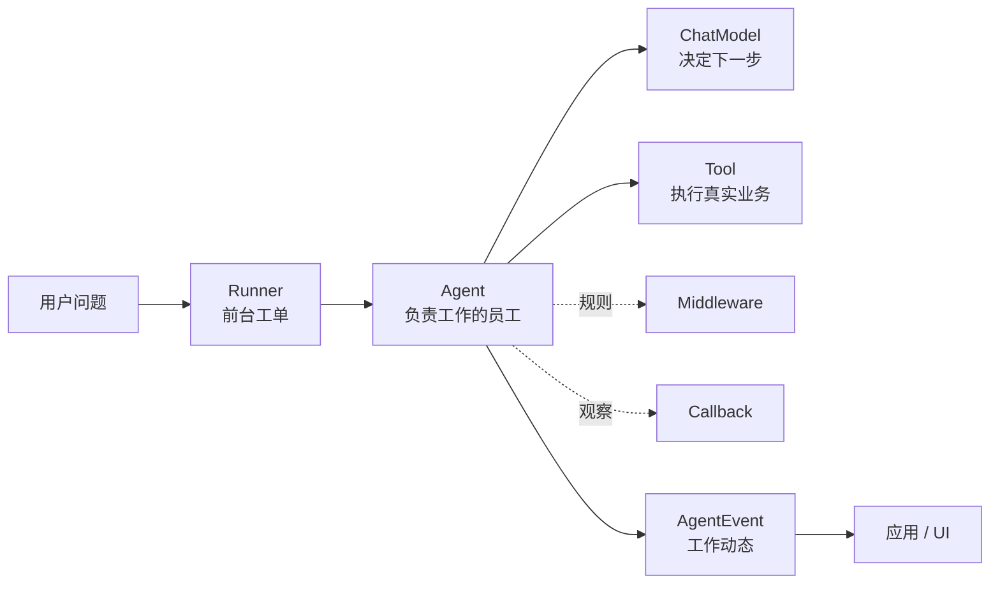
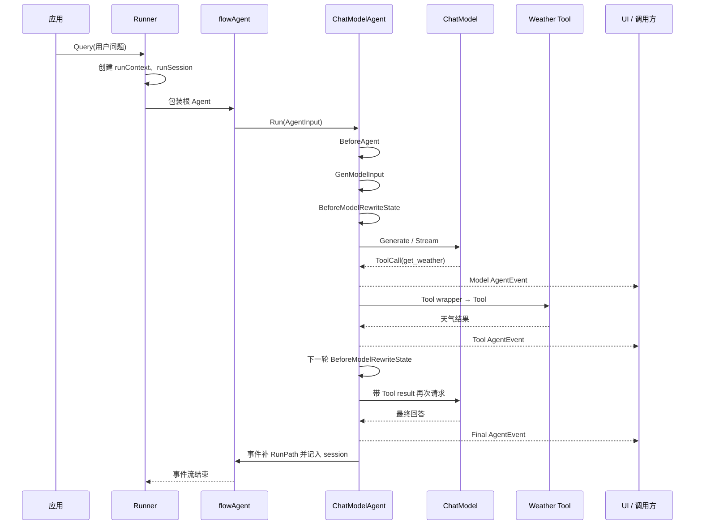
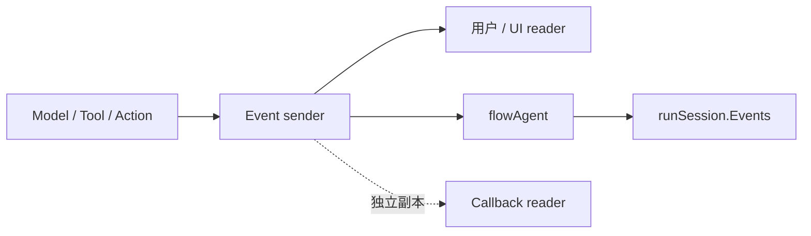
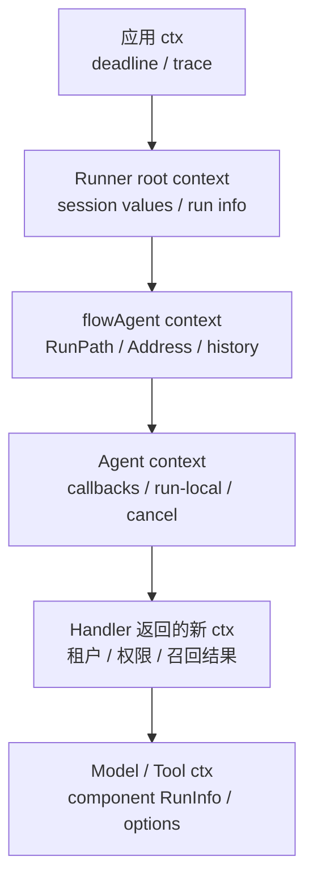

# 从一句话到一次 Agent 运行

这一页专门给第一次接触 ADK 的读者。我们不先背接口，而是跟着一句真实请求走一遍：

> 用户问：“上海明天会下雨吗？如果会，提醒我带伞。”

目标不是只看见“模型回答了天气”，而是看清楚这句话怎样经过 Runner、Agent、Middleware、Model、Tool、Callback，最后变成 UI 能消费的 `AgentEvent`。

## 1. 先建立一个最简单的心智模型

把 Agent 系统想成一家客服公司：

| 现实角色 | ADK 对象 | 小白理解 |
| --- | --- | --- |
| 前台接待 | Runner | 接收请求、开工单、把结果交给应用 |
| 负责这类问题的员工 | Agent | 能持续做事并报告进度 |
| 会思考的员工 | ChatModelAgent | 让模型决定下一步做什么 |
| 工作人员的流程 | compose Graph / Chain | 规定“先问模型，再做 Tool，再问模型” |
| 公司业务系统 | Tool | 真正查询订单、天气或写数据库 |
| 主管观察员 | Callback | 记录开始、耗时、错误和指标 |
| 工作规章 | Middleware | 在固定阶段检查、改写或包装执行 |
| 工作动态 | AgentEvent | 把模型输出、Tool 结果、中断、错误告诉外界 |
| 工单草稿 | State / runSession | 保存本次工作中已经发生的内容 |

最容易犯的错误，是把“会写数据库的代码”都叫 Memory，或者把“能执行代码的代码”都叫 Tool。组件的名字不能决定定位，执行阶段和返回契约才决定定位。



## 2. 我们要搭建的最小例子

业务上有一个天气查询 Tool。模型不能直接访问天气服务，它只能提出一个结构化请求；Tool 才真正调用天气 API。

```go
weatherTool := newWeatherTool()

agent, err := adk.NewChatModelAgent(ctx, &adk.ChatModelAgentConfig{
    Name:        "weather_assistant",
    Description: "查询天气并给出出行建议",
    Instruction: "你是一个谨慎、简洁的天气助手。",
    Model:       chatModel,
    ToolsConfig: adk.ToolsConfig{
        ToolsNodeConfig: compose.ToolsNodeConfig{
            Tools: []tool.BaseTool{weatherTool},
        },
    },
    Handlers: []adk.ChatModelAgentMiddleware{
        policyMiddleware,
        historyMiddleware,
    },
})
if err != nil {
    return err
}

runner := adk.NewRunner(ctx, adk.RunnerConfig{
    Agent:           agent,
    EnableStreaming: true,
    CheckPointStore: checkpointStore,
})
```

这段代码只完成“长期配置”：模型是谁、Tool 是什么、有哪些 Handler。它还没有回答任何用户问题，也没有创建本次请求的消息历史。

## 3. 一次 Query 的完整电影

应用真正调用 Runner：

```go
iter := runner.Query(ctx, "上海明天会下雨吗？如果会，提醒我带伞。",
    adk.WithSessionValues(map[string]any{
        "User": "小明",
    }),
    adk.WithCallbacks(traceHandler),
)
```

从这里开始，框架大致按下面的顺序运行：



注意：模型可能只调用一次，但 Agent 事件通常不止一条。**Agent 是事件生产者，不是只返回一个字符串的函数。**

## 4. 把这段电影拆成 12 个镜头

### 镜头 1：Runner 接到问题

`runner.Query` 是应用层入口。Runner 不会自己调用模型，它只负责准备一次运行：

- 把字符串包装成 `AgentInput`；
- 创建本次运行独有的 root `runContext`；
- 创建本次运行的 `runSession`；
- 写入 SessionValues，例如当前用户、租户、语言；
- 将根 Agent 包成 `flowAgent`；
- 返回一个可持续读取的事件 iterator。

可以把它想成前台给这次问题开了一张新工单。除非应用自己加载旧历史，否则这张工单默认不会自动知道昨天的对话。

### 镜头 2：flowAgent 给 Agent 套上运行外壳

真正的调用关系不是：

```text
Runner → ChatModelAgent
```

而是：

```text
Runner → flowAgent → ChatModelAgent
```

`flowAgent` 不负责思考，也不负责执行天气 Tool。它负责给 Agent 补上 ADK 运行语义：

- 给 Context 增加当前 Agent 的 Address；
- 给事件补 `AgentName` 和 `RunPath`；
- 将事件复制给 UI 和 session 两类消费者；
- 处理 Transfer；
- 在 Resume 时根据 checkpoint 找回正确的子 Agent。

因此，自定义 Agent 也能自动获得这些能力，不需要自己复制一遍 Runner 逻辑。

### 镜头 3：Agent Callback 先得到观察入口

如果配置了：

```go
adk.WithCallbacks(traceHandler)
```

Callback 可以观察 Agent 的开始、结束和事件流。它不是另一条执行主线，也不会替换 Agent 的输入输出。

一个非常容易踩的坑：Agent 的 `OnEnd` 可能会提前收到一个“未来事件 iterator”。因为事件还没有全部转发完，Callback 必须启动异步消费者后立刻返回：

```go
func (h *traceHandler) OnEnd(
    ctx context.Context,
    info *adk.AgentCallbackInput,
    output *adk.AgentCallbackOutput,
) context.Context {
    go func(events *adk.AsyncIterator[*adk.AgentEvent]) {
        for {
            event, ok, err := events.Next()
            if err != nil || !ok {
                return
            }
            recordAudit(event)
        }
    }(output.Events)

    return ctx
}
```

如果在 `OnEnd` 里同步等待 `Next()`，生产者可能正在等 Callback 返回，消费者又在等生产者发消息，结果就是死锁。

### 镜头 4：BeforeAgent 准备本次运行规则

新版 Middleware 的 `BeforeAgent` 每次 Run/Resume 执行一次。它看到的是本次运行级配置，而不是每一轮完整消息：

```text
ChatModelAgentContext
  ├─ Instruction
  ├─ Tools（真实可执行 Tool）
  ├─ ReturnDirectly
  └─ ToolSearchTool
```

例如租户 A 可以使用查询天气，租户 B 还可以使用写入日历：

```go
func (m *tenantPolicy) BeforeAgent(
    ctx context.Context,
    runCtx *adk.ChatModelAgentContext,
) (context.Context, *adk.ChatModelAgentContext, error) {
    next := *runCtx
    next.Tools = append([]tool.BaseTool(nil), runCtx.Tools...)

    if tenantFromContext(ctx) == "calendar" {
        next.Tools = append(next.Tools, m.calendarTool)
    }
    return ctx, &next, nil
}
```

它适合“这次运行使用哪些真实能力”。它不适合每轮检查 token，因为它不会随着 ReAct round 重复执行。

### 镜头 5：GenModelInput 把入口输入变成 Messages

`AgentInput` 不是模型直接接收的参数。默认 `GenModelInput` 会把它转换成模型消息：

```text
Instruction + SessionValues
  ↓
System: 你是一个谨慎的天气助手。当前用户是小明。

AgentInput.Messages
  ↓
User: 上海明天会下雨吗？如果会，提醒我带伞。
```

这里的 `Instruction` 是 Agent 配置和运行级规则，`Messages` 是用户输入与对话历史。两者合并后才是模型看到的第一版输入。

`GenModelInput` 通常每个 Agent Run 准备一次；不要把“每一轮都要压缩历史”的逻辑放在这里，应放到新版 Middleware 的 `BeforeModelRewriteState`。

### 镜头 6：BeforeModelRewriteState 改写模型前的真实 State

模型每次调用前，框架会把内部状态暴露成：

```go
type ChatModelAgentState struct {
    Messages          []*schema.Message
    ToolInfos         []*schema.ToolInfo
    DeferredToolInfos []*schema.ToolInfo
}
```

这就是第一个真正适合做上下文治理的位置。它能看到：

- 之前的 User、Assistant、Tool messages；
- 上一轮 Tool 的结果；
- 本轮会暴露给模型的 Tool schema；
- 可选的 run-local 值。

返回的新 State 会被写回 Agent 内部状态，影响当前模型调用和后续轮次。适合：

- summarization；
- reduction；
- 召回长期记忆并插入参考事实；
- 修复悬空 ToolCall；
- 动态筛选模型可见 Tool；
- 每轮注入 Agents.md。

不适合把真正的退款、发邮件、删数据等副作用藏在这里，因为它发生在模型前，且不是一个模型明确选择的业务 Tool。

### 镜头 7：Model 只能提出 ToolCall

模型看到 Tool schema 后，可能返回：

```json
{
  "name": "get_weather",
  "arguments": "{\"city\":\"上海\",\"date\":\"明天\"}"
}
```

这不是天气结果，只是模型的结构化意图。此时发生三件事：

1. Model event sender 将模型消息转换为 `AgentEvent`，UI 可以看到“模型准备查询天气”；
2. ReAct Graph 的另一份流副本判断这是 ToolCall；
3. Graph 进入 ToolsNode，而不是直接结束 Agent。

Callback 可以同时观察模型调用，但它不是 Model event sender，也不会因为观察到了 ToolCall 就自动执行 Tool。

### 镜头 8：Tool wrapper 先于 Tool 本体

Tool 真正执行前，可能依次经过：

```text
ToolArgumentsHandler
  → event sender
  → ToolsConfig.ToolCallMiddlewares
  → 旧 AgentMiddleware.WrapToolCall
  → 新 Middleware 的四种 Tool wrapper
  → callback injection
  → Tool.InvokableRun / StreamableRun
```

不同层拿到的信息不完全一样：

| 位置 | 能看到 | 适合做什么 |
| --- | --- | --- |
| `ToolArgumentsHandler` | Tool 名称和 JSON 参数 | 参数别名、默认值、兼容旧字段 |
| Tool wrapper | 名称、CallID、参数、结果、错误 | 权限、限流、幂等、脱敏、审计、结果卸载 |
| Tool 本体 | 解析后的业务参数和业务 Context | 查询、写库、发消息等真实副作用 |
| Tool Callback | Tool 输入输出和 RunInfo | 观察、指标、追踪 |

安全边界应该放在 Tool wrapper 或 Tool service，而不是只写一句 system prompt：“不要调用危险 Tool”。模型可能犯错，服务端权限检查不能依赖模型自觉。

### 镜头 9：Tool 结果写回 State

天气 Tool 返回：

```text
明天上海：小雨，18～22℃，降雨概率 80%。
```

框架会把它包装成 Tool message，并和原来的 ToolCall 通过 `call_id` 对齐：

```text
User:      上海明天会下雨吗？
Assistant: tool_call(get_weather, call_id=42)
Tool:      tool_result(call_id=42, 小雨，降雨概率 80%)
```

如果缺少对应的 Tool result，很多模型 provider 会拒绝下一次请求；这正是 `patchtoolcalls` 存在的原因。Tool result 写入当前 ReAct State 后，Graph 再回到 Model 节点。

### 镜头 10：第二轮 Model 得到“证据”

第二轮模型输入不只是用户原话，而是：

```text
System:    你是一个谨慎的天气助手。
User:      上海明天会下雨吗？如果会，提醒我带伞。
Assistant: 我需要查询天气。
Tool:      明天上海小雨，降雨概率 80%。
```

模型现在拥有 Tool 返回的事实，才可以生成最终答案：“会下雨，建议带伞。”

这说明 Agent 的 ReAct 循环本质上是：

```text
模型做决定 → Tool 获取事实 → 事实写回 State → 模型继续决定
```

### 镜头 11：最终回答和 AfterAgent

如果模型最终返回普通文本、没有 ToolCall，Graph 到达成功终态：

- 默认 event sender 发送最终 assistant `AgentEvent`；
- `AfterModelRewriteState` 先处理模型后的 state；
- `AfterAgent` 在成功终态执行一次；
- iterator 最终关闭，调用方读到 `ok=false`。

`AfterAgent` 适合从最终 state 提取候选记忆、写一次成功指标、提交本次摘要。但它不保证覆盖 error、cancel、interrupt。全路径审计应放 Callback 或 Runner 边界。

### 镜头 12：flowAgent 把事件交回 Runner

一个事件可能同时有多个去处：



这不是重复发送同一个指针，而是不同消费者拥有自己的读取副本。UI 消费慢，不应该让 session 记录和 Callback 观察完全共用一个会被读空的 stream。

## 5. 四条并行的数据流

一次 Agent 运行不是一条直线，而是四条同时推进的流。把它们混在一起，就会误以为“Context 里有全部消息”或“Callback 可以改 State”。

### 5.1 控制流：决定下一步运行谁

```text
Runner → flowAgent → ChatModelAgent
                    ├─ Model
                    ├─ ToolsNode
                    ├─ AgentTool → child Agent
                    └─ Exit / Transfer / Interrupt
```

控制流回答：“现在执行哪个节点、是否进入 Tool、是否转交、是否暂停？”

### 5.2 消息流：决定模型看到什么

```text
AgentInput
  → GenModelInput
  → State.Messages
  → BeforeModelRewriteState
  → Model.Generate / Stream
```

消息流回答：“模型此刻看到哪些 System、User、Assistant、Tool 消息？”

### 5.3 事件流：决定外界看到什么

```text
Model / Tool / Action / Error
  → AgentEvent
  → flowAgent 补路径
  → Runner iterator
  → 应用 / UI / Callback
```

事件流回答：“用户什么时候看到模型输出、Tool 进度、中断或错误？”

### 5.4 状态流：决定恢复和下一轮依赖什么

```text
compose state
  → ChatModelAgentState
  → tool result / handler rewrite
  → 下一轮 state
  → interrupt checkpoint（需要时）
```

状态流回答：“下一轮和 Resume 时还能拿到什么？”

四条流的常见误区：

| 误区 | 实际情况 |
| --- | --- |
| Context 里应该放全部历史 | Context 主要传播身份、trace、deadline、run-local 句柄；消息在 State/session |
| Callback 能修改模型最终答案 | Callback 的返回值主要是 Context；要改行为用 Middleware |
| AgentEvent 就是 State | Event 是对外动态；State 是内部下一轮事实来源 |
| Runner 保存所有长期对话 | Runner 只负责本次运行和必要 checkpoint；跨 Query Memory 要由应用存储 |

## 6. Context 到底怎样一层层变化

Context 不是一个“全局变量袋子”，而是一条随着调用向下传播的链。每一层都可能返回一个新 Context，后面的层拿到新值。



可以把它理解成“快递袋逐层贴标签”：

- Runner 贴本次工单编号；
- flowAgent 贴当前 Agent 路径；
- Callback manager 贴组件信息；
- Middleware 可能贴权限、召回结果或自己的 run-local key；
- Model/Tool 收到最终版本。

Context value 的写入者和读取者必须约定 key 和类型。它适合传递，不适合替代数据库：Context 通常不负责查询、版本控制、跨请求保存。

## 7. Config、Option、Context、State 的区别

四个名字都像“配置/状态”，但生命周期不同：

| 东西 | 谁创建 | 什么时候改变 | 放什么 | 能否自然跨 Query |
| --- | --- | --- | --- | --- |
| `ChatModelAgentConfig` | 应用启动 | 通常不变 | Model、Instruction、Tools、Handlers | Agent 复用，但不是会话历史 |
| `RunnerConfig` | 应用启动 | 通常不变 | 根 Agent、streaming、checkpoint store | Runner 复用，但不是用户消息 |
| `AgentRunOption` | 每次 Run | 本次调用有效 | SessionValues、Callbacks、Cancel、checkpoint ID | 否 |
| `context.Context` | 调用链 | 逐层派生 | deadline、身份、trace、run-local | 通常不序列化 |
| `ChatModelAgentState` | 每次 Agent Run | 每轮模型/Tool 修改 | Messages、ToolInfos | checkpoint 可恢复 |
| `runSession` | 每次根 Run | 事件产生时追加 | AgentEvent 历史、session values | 只有应用明确持久化才跨 Query |
| Memory Store | 应用 | 业务写入时 | 用户事实、偏好、文档、摘要 | 是 |

一个判断口诀：

```text
启动时固定的 → Config
本次调用带来的 → Option
调用链传递的 → Context
下一轮模型要继续看的 → State
跨请求还要记得的 → 外部 Store
```

## 8. 为什么 Middleware、Callback、Tool 不能互相替代

### 需求 A：记录每次模型耗时

选择 Model Callback。它能拿到开始、结束、错误和 RunInfo，侵入小；不需要改变输入输出。

### 需求 B：模型输入太长时生成摘要

选择 summarization Middleware 的 `BeforeModelRewriteState`。它能看到完整 Messages，并返回改写后的 State，让下一轮继续使用压缩结果。

### 需求 C：危险 Tool 必须经过用户权限检查

选择新版 Tool wrapper 或 Tool service。它发生在副作用边界，能拿到 Tool 名称、CallID、参数，并能在真正执行前拒绝。

### 需求 D：所有成功结果提取成长期记忆

选择 `AfterAgent` + 外部 Memory Store，或专用 Memory Agent。它能在成功终态看到完整结果；写库、去重、版本和权限仍由应用负责。

### 需求 E：失败、取消、中断也要记录审计

选择 Agent Callback 或 Runner 边界。`AfterAgent` 只覆盖成功终态，不能作为全路径审计保证。

### 需求 F：用户发来新消息，要抢占正在运行的任务

选择 TurnLoop。它处理 item buffer、preempt、stop、resume；这不是普通 Tool，也不是 Callback。

## 9. 一张“小白决策卡”

遇到需求时，不要先问“我能不能在某个 Middleware 里写这段代码”，先按顺序回答：

```text
问题 1：它发生在哪个时刻？
  整次 Run / 每轮模型前 / 模型周围 / Tool 周围 / 成功终态 / 所有事件？

问题 2：它必须看到什么？
  真实 Tool / 完整 Messages / ToolCall 参数 / 最终 State / 全部 AgentEvent？

问题 3：它需要改变什么？
  只记录 / 改 Context / 改 State / 改模型输出 / 阻止副作用 / 控制下一节点？

问题 4：状态需要活多久？
  一次调用 / 一次 Run / checkpoint / 跨请求？

问题 5：失败要影响多大范围？
  记录即可 / 阻止一次 Tool / 终止模型轮次 / 终止整次 Agent？
```

然后选择最窄的组件：

```text
只观察        → Callback
改模型前 State → 新版 Middleware
包模型调用     → 新版 WrapModel
包 Tool 副作用  → Tool wrapper
执行业务动作    → Tool
成功后写一次    → AfterAgent + 外部 Store
整次运行恢复    → Runner / CheckPointStore
固定多 Agent 流程 → Workflow Agent
持续输入抢占    → TurnLoop
```

## 10. 小白调试时先看哪一层

当页面没有答案时，可以按下面顺序定位，而不是直接盯着模型 prompt：

1. **Runner 有没有产生 iterator？** 没有可能是 Agent 配置或入口错误。
2. **有没有 `AgentEvent.Err`？** 有就先看错误路径，不要只看最后一条空消息。
3. **Model event 有没有产生 ToolCall？** 没有可能是模型没理解 schema 或 Tool 没暴露。
4. **Tool event 有没有产生？** 没有可能被参数处理、权限 wrapper 或 cancel 拦截。
5. **Tool result 的 CallID 是否和 ToolCall 对齐？** 不对齐会导致 provider 拒绝下一轮。
6. **BeforeModelRewriteState 后的 Messages 是什么？** 这里能发现摘要、历史修复、Agents.md 注入的问题。
7. **Callback 是否同步消费 OnEnd iterator？** 同步读取可能造成死锁。
8. **是否把跨 Query 数据误放在 run-local 或 Context？** 这些不会自动成为长期 Memory。

## 11. 学完这一页后怎么继续读源码

按下面顺序读，每一步都带着同一个天气例子：

1. [Agent / Runner / ChatModelAgent](./roles-and-boundaries.md)：确认对象边界；
2. [完整生命周期](./lifecycle.md)：对照 12 个镜头找到源码函数；
3. [Context 的逐层传播](./context-flow.md)：追踪 Context 怎样被包装和返回；
4. [Config 与 Option 转换](./config-option-flow.md)：看启动配置怎样变成本次运行参数；
5. [ChatModelAgent](./chat-model-agent.md)：进入 ReAct 和 model wrapper；
6. [Callback 与 AgentEvent](./callbacks.md)：理解观察链和事件流为什么是两条线；
7. [组件定位](./component-positioning.md)：用阶段、信息、控制能力选择扩展点；
8. [内置 Middleware](./builtin-middlewares.md)：把摘要、reduction、Agents.md、filesystem 放回正确阶段。

如果读到某个函数仍然觉得抽象，先问一句：“它此刻是在改消息、改 Context、包 Model、包 Tool，还是只观察事件？”通常就能把它放回这张地图。
